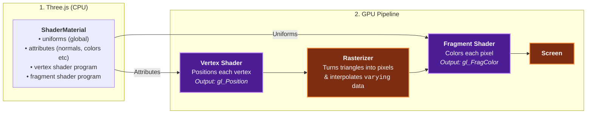
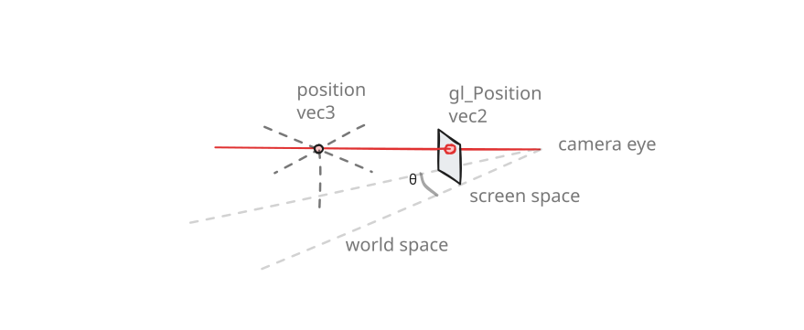
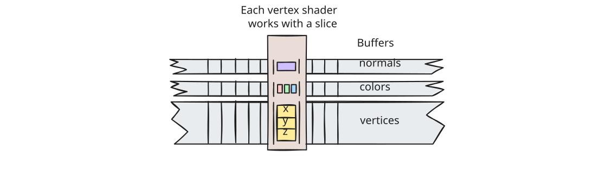
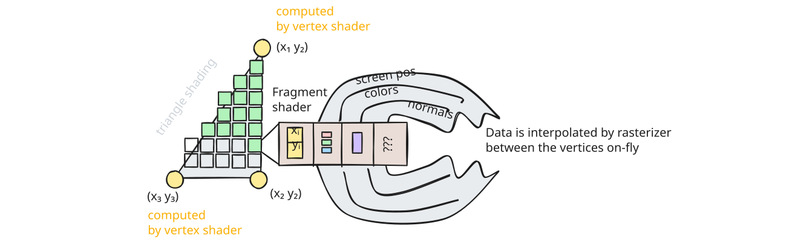

{/* add this script to the body  */}
{/* https://cdn.jsdelivr.net/gh/WLJSTeam/web-components@latest/src/common/app.js */}
<wljs-store kernel="./attachments/kernel-4917119444556254384.txt" json="./attachments/67c6ccae-e4d1-4f0b-8bd9-319aa39f3ed9.txt"></wljs-store>


<DownloadFile
    title="Download"
    description="This notebook"
    href="./notebook-67c.wln"
/>


## Shaders, again

> A short reminder from the previous post on how shaders are routed into the graphics pipeline




A __vertex shader__ runs for each vertex of the mesh. Its essential job is to produce a position in clip space; the graphics pipeline then turns that into a position on the screen. Before projection, we are free to move the vertex and that is where our waves will come from. First, a quick look at the camera geometry:

<div className="invertColor">



</div>

We won't derive the full projection matrix here; [Song Ho Ahn's explanation](https://www.songho.ca/opengl/gl_projectionmatrix.html) is a good reference. Let's fix our conventions first: the camera is at the origin, looking along the negative z-axis. The coordinates below are in **camera space**. We use a horizontal field of view $\theta_F$, an aspect ratio $a = \text{width}/\text{height}$, and a positive near-plane distance $n$.

Similar triangles give the normalized screen coordinates:

$$
x_s = \frac{x}{-z\tan(\theta_F/2)}, \qquad y_s = \frac{a y}{-z\tan(\theta_F/2)}.
$$

For the simplified projection used here, with the far plane at infinity, the normalized depth is

$$
z_{\mathrm{ndc}} = 1 + \frac{2n}{z}.
$$

The near plane maps to −1, and distant points approach +1. Depth testing uses this extra coordinate to resolve visibility. Later we will color code $z_{\mathrm{ndc}}$. 

Before putting these expressions into a matrix, let's quickly recall why matrices are useful here. And why the heck 3x3 matrices are not enough...

### Why 4x4, why vec4?!

Rotations and reflections are linear transformations, and a sequence of them can be combined into one matrix:

$$
M_{\mathrm{mirror}} M_{\mathrm{rot-y}} M_{\mathrm{rot-x}}\mathbf{v}
= M_{\mathrm{combined}}\mathbf{v}.
$$

We can compute the combined matrix once and apply it to thousands of vertices. The following WL check illustrates the associativity of matrix multiplication:

<WLJSWrapper><wljs-editor display="codemirror" type="Input" editable="true"  >{`M1 = RotationMatrix[\\[Theta]1, {a1,b1,c1}];
	M2 = RotationMatrix[\\[Theta]2, {a2,b2,c2}];
	
	v  = (*GB[*){{x}(*||*),(*||*){y}(*||*),(*||*){z}}(*||*)(*1:eJxTTMoPSmNkYGAo5gUSYZmp5S6pyflFiSX5RcFsQBHfxJKizAoAs04KOA==*)(*]GB*);
	
	M2.(M1.v) == (M2.M1).v // ComplexExpand // Simplify `}</wljs-editor></WLJSWrapper>

<WLJSWrapper><wljs-editor display="codemirror" type="Output"  >{`True`}</wljs-editor></WLJSWrapper>

We would like to include translations in the same calculation. A translation is affine rather than linear in three coordinates, so we introduce **homogeneous coordinates**: a point becomes `{x, y, z, 1}`. The extra coordinate lets a 4×4 matrix add a translation. It is a *bookkeeping device*, not a rotation into a fourth spatial dimension:

<WLJSWrapper><wljs-editor display="codemirror" type="Input" editable="true"  >{`(*GB[*){{1(*|*),(*|*)0(*|*),(*|*)0(*|*),(*|*)tx}(*||*),(*||*){0(*|*),(*|*)1(*|*),(*|*)0(*|*),(*|*)ty}(*||*),(*||*){0(*|*),(*|*)0(*|*),(*|*)1(*|*),(*|*)tz}(*||*),(*||*){0(*|*),(*|*)0(*|*),(*|*)0(*|*),(*|*)1}}(*||*)(*1:eJxTTMoPSmNkYGAo5gUSYZmp5S6pyflFiSX5RcFsQBHfxJKizAoAs04KOA==*)(*]GB*) . (*GB[*){{x}(*||*),(*||*){y}(*||*),(*||*){z}(*||*),(*||*){1}}(*||*)(*1:eJxTTMoPSmNkYGAo5gUSYZmp5S6pyflFiSX5RcFsQBHfxJKizAoAs04KOA==*)(*]GB*) // MatrixForm`}</wljs-editor></WLJSWrapper>

<WLJSWrapper><wljs-editor display="codemirror" type="Output"  >{`(*GB[*){{tx+x}(*||*),(*||*){ty+y}(*||*),(*||*){tz+z}(*||*),(*||*){1}}(*||*)(*1:eJxTTMoPSmNkYGAo5gUSYZmp5S6pyflFiSX5RcFsQBHfxJKizAoAs04KOA==*)(*]GB*)`}</wljs-editor></WLJSWrapper>

This is why `vec4` and 4×4 matrices appear throughout graphics code. A direction uses a fourth component of 0, so translating a point does not translate its direction vector.

Now we can write our simplified perspective projection as a matrix `P`. The matrix produces **clip coordinates**; the division that creates perspective comes afterward:

<WLJSWrapper><wljs-editor display="codemirror" type="Input" editable="true"  >{`P[a_, \\[Theta]_, n_] := (*GB[*){{Cot[(*FB[*)((\\[Theta])(*,*)/(*,*)(2))(*]FB*)](*|*),(*|*)0(*|*),(*|*)0(*|*),(*|*)0}(*||*),(*||*){0(*|*),(*|*)a Cot[(*FB[*)((\\[Theta])(*,*)/(*,*)(2))(*]FB*)](*|*),(*|*)0(*|*),(*|*)0}(*||*),(*||*){0(*|*),(*|*)0(*|*),(*|*)-1(*|*),(*|*)-2 n}(*||*),(*||*){0(*|*),(*|*)0(*|*),(*|*)-1(*|*),(*|*)0}}(*||*)(*1:eJxTTMoPSmNkYGAo5gUSYZmp5S6pyflFiSX5RcFsQBHfxJKizAoAs04KOA==*)(*]GB*);`}</wljs-editor></WLJSWrapper>

Let's multiply it out symbolically:

<WLJSWrapper><wljs-editor display="codemirror" type="Input" editable="true"  >{`P[a,\\[Theta],n]. (*GB[*){{x}(*||*),(*||*){y}(*||*),(*||*){z}(*||*),(*||*){1}}(*||*)(*1:eJxTTMoPSmNkYGAo5gUSYZmp5S6pyflFiSX5RcFsQBHfxJKizAoAs04KOA==*)(*]GB*) // Flatten`}</wljs-editor></WLJSWrapper>

<WLJSWrapper><wljs-editor display="codemirror" type="Output"  >{`{x Cot[(*FB[*)((\\[Theta])(*,*)/(*,*)(2))(*]FB*)],a y Cot[(*FB[*)((\\[Theta])(*,*)/(*,*)(2))(*]FB*)],-2 n-z,-z}`}</wljs-editor></WLJSWrapper>

The fourth component is `-z`. Dividing the first **three** components by it gives normalized device coordinates, including depth. In a vertex shader we leave that division to the hardwired graphics pipeline, after clipping:

```glsl
void main() {
  gl_Position = projectionMatrix * modelViewMatrix * vec4(position, 1.0);
}
```

Read this from right to left. `position` starts in the mesh's object space. `modelViewMatrix` takes it into camera space, and `projectionMatrix` takes it into clip space. The renderer supplies these matrices and updates them as the object or camera moves. Its actual projection can be perspective or orthographic; `P` above illustrates the perspective case.

Let's recreate the projection in WL. Change the field of view to see the apparent size change; change `n` to move the near plane and change the depth mapping. The point-cloud illustration colors depth of each point

<WLJSWrapper><wljs-editor display="codemirror" type="Input" editable="true" fade="true" >{`exPoints = ExampleData[{"Geometry3D","UtahTeapot"}, "VertexData"];
	exPoints = With[{m = Mean[exPoints]}, (# - m - {0,0,1.0})&/@ exPoints];
	
	ClearAll[project];
	project[params__][vec3List_List] := With[{vec4 = P[params].Transpose[{Join[#, {1.}]}] // Flatten},
	  {vec4[[1;;2]]/vec4[[4]], (vec4[[3]]/vec4[[4]] + 1)/2}
	]& /@ vec3List
	
	depthColor[z_List] := List@@(Blend[{Red, Orange, Yellow, White}, #]) &/@ z;
	
	Manipulate[Grid[{
	  {"World",Graphics3D[{
	    PointSize[0.01], Blue, Point[exPoints],
	    Black, Sphere[{0,0,0}, 0.05],
	    Line[{{0,0,0}, {0,Tan[\\[Theta]/2],-1.0}}],
	    Line[{{0,0,0}, {0,-Tan[\\[Theta]/2],-1.0}}],
	    Red, Opacity[0.5], 
	    Cuboid[n {Tan[\\[Theta]/2],Tan[\\[Theta]/2],-1.001}, n {-Tan[\\[Theta]/2],-Tan[\\[Theta]/2],-1.0}]
	  }, PlotRange->Full, ImageSize->300,
	  "OrthographicCameraZoom"->1.9]},
	  {"Screen", Graphics[With[{res = exPoints // project[1.0, \\[Theta], n] // Transpose}, {
	    PointSize[0.01], GraphicsComplex[res[[1]],
	      Point[Range[Length[exPoints]]],
	      VertexColors -> depthColor[res[[2]]]
	    ]
	  }], PlotRange->1, Axes->True, ImageSize->300, FrameTicks->{{},{}}, Frame->True, "Controls"->False]}
	}//Transpose, Alignment->{Center, Center}]//Deploy, {\\[Theta], 0.5, 2.0, 0.5}, {n, 0.1,0.5,0.1}, ContinuousAction->True]`}</wljs-editor></WLJSWrapper>

<WLJSWrapper><wljs-editor display="codemirror" type="Output"  >{`(*VB[*)(FrontEndRef["F8534a5d3-bb49-4cca-b6f6-67944847e3cf"])(*,*)(*"1:eJxTTMoPSmNkYGAoZgESHvk5KRCeEJBwK8rPK3HNS3GtSE0uLUlMykkNVgUJW5gamySaphjrJiWZWOqaJCcn6iaZpZnpmplbmphYmJinGienAQCakBX9"*)(*]VB*)`}</wljs-editor></WLJSWrapper>

### Mesh modulation

Now we know where and who to intervene - change the object-space position before multiplying by the matrices. The rest of the camera pipeline can stay as it is.

Start with a constant offset along each vertex's unit normal:

$$
\mathbf{p}' = \mathbf{p} + A\mathbf{n}.
$$

On a plane, this translates the whole surface. On a sphere, it changes the radius. On a curved plot, each point moves in a different direction. For the saddle $z=xy$, an upward unit normal is like $(-y,-x,1)/\sqrt{1+x^2+y^2}$.

Let's mess with it in WL first. The blue surface below is the original saddle; the orange surface is its normal offset. Notice that this is not simply adding a constant to z

<WLJSWrapper><wljs-editor display="codemirror" type="Input" editable="true"  >{`Module[{base, normal, offset},
	  base = {u, v, u v};
	  normal = {-v, -u, 1}/Sqrt[1 + u^2 + v^2];
	  offset = base + 0.35 normal;
	  ParametricPlot3D[Evaluate[{base, offset}], {u, -1, 1}, {v, -1, 1},
	    PlotStyle -> {Blue, Orange}, Mesh -> None,
	    BoxRatios -> Automatic, ImageSize -> 420]
	]`}</wljs-editor></WLJSWrapper>

<WLJSWrapper><wljs-editor display="codemirror" type="Output"  >{`(*VB[*)(FrontEndRef["F0a8ebb33-b151-4e41-bd4a-e7e584f15083"])(*,*)(*"1:eJxTTMoPSmNkYGAoZgESHvk5KRCeEJBwK8rPK3HNS3GtSE0uLUlMykkNVgUJGyRapCYlGRvrJhmaGuqapJoY6ialmCTqppqnmlqYpBmaGlgYAwCfkhXd"*)(*]VB*)`}</wljs-editor></WLJSWrapper>

The GLSL version does the same vector addition for each existing vertex. In the definition below, the JavaScript wrapper loads 3D shared library and creates a `ShaderMaterial`. The strings inside `vertexShader` and `fragmentShader` as susual are GLSL programs executed on the GPU. These special constant vectors `position`, `normal`, and the camera matrices are supplied by the framework (Three.js) and a unique for each thread running on parallel. Note, that all running threads can't talk to each other and they only see their small chunk of memory exposed to a given vertex, normal, color and other custom buffer attributes - linear parallel arrays in GPU memory

<div className="invertColor">



</div>

In the contrast the fragment shader won't receive such slice, but it can get the interpolated per-pixel data generated by vertex shader (if needed).

<Callout type="help">

See the [ShaderMaterial documentation](https://threejs.org/docs/pages/ShaderMaterial.html) for that interface.

</Callout>

We only have to write the new position and the output color. 

<WLJSWrapper><wljs-editor display="codemirror" type="Input" editable="true" encoded="true"  >{`.js%0Alet%20THREE%3B%0A%0Acore.MeshMod1%20%3D%20async%20%28args%2C%20env%29%20%3D%3E%20%7B%0A%20%20if%20%28%21THREE%29%20%7B%0A%20%20%20%20await%20interpretate.shared.THREE.load%28%29%0A%20%20%20%20THREE%20%3D%20interpretate.shared.THREE.THREE%3B%0A%20%20%7D%0A%0A%20%20return%20function%28%29%20%7B%0A%20%20%20%20return%20new%20THREE.ShaderMaterial%28%7B%0A%20%20%20%20%20%20%20%20name%3A%20%27MeshMod1%27%2C%0A%20%20%20%20%20%20%20%20uniforms%3A%20%7B%7D%2C%0A%20%20%20%20%20%20%20%20vertexShader%3A%20%60%0A%20%20%20%20%20%20%20%20%20%20void%20main%28%29%20%7B%0A%20%20%20%20%20%20%20%20%20%20%20%20vec3%20n%20%3D%20normalize%28normal%29%3B%0A%20%20%20%20%20%20%20%20%20%20%20%20float%20a%20%3D%200.5%3B%0A%20%20%20%20%20%20%20%20%20%20%20%20gl_Position%20%3D%20projectionMatrix%20%2A%20modelViewMatrix%20%2A%20vec4%28position%20%2B%20a%20%2A%20n%2C%201.0%29%3B%0A%20%20%20%20%20%20%20%20%20%20%7D%0A%20%20%20%20%20%20%20%20%60%2C%20%20%20%20%20%20%0A%20%20%20%20%20%20%20%20fragmentShader%3A%20%60%0A%20%20%20%20%20%20%20%20%20%20void%20main%28%29%20%7B%0A%20%20%20%20%20%20%20%20%20%20%20%20gl_FragColor%20%3D%20vec4%281.0%2C%200.77%2C%200.34%2C%201.0%29%3B%0A%20%20%20%20%20%20%20%20%20%20%7D%0A%20%20%20%20%20%20%20%20%60%2C%0A%20%20%20%20%20%20%20%20lights%3A%20false%2C%0A%20%20%20%20%20%20%20%20toneMapped%3A%20false%0A%20%20%20%20%20%20%7D%29%3B%20%20%20%20%0A%20%20%7D%0A%7D`}</wljs-editor></WLJSWrapper>

<WLJSWrapper><wljs-editor display="js" type="Output" encoded="true" class="wljs-hide-undefined" >{`let%20THREE%3B%0A%0Acore.MeshMod1%20%3D%20async%20%28args%2C%20env%29%20%3D%3E%20%7B%0A%20%20if%20%28%21THREE%29%20%7B%0A%20%20%20%20await%20interpretate.shared.THREE.load%28%29%0A%20%20%20%20THREE%20%3D%20interpretate.shared.THREE.THREE%3B%0A%20%20%7D%0A%0A%20%20return%20function%28%29%20%7B%0A%20%20%20%20return%20new%20THREE.ShaderMaterial%28%7B%0A%20%20%20%20%20%20%20%20name%3A%20%27MeshMod1%27%2C%0A%20%20%20%20%20%20%20%20uniforms%3A%20%7B%7D%2C%0A%20%20%20%20%20%20%20%20vertexShader%3A%20%60%0A%20%20%20%20%20%20%20%20%20%20void%20main%28%29%20%7B%0A%20%20%20%20%20%20%20%20%20%20%20%20vec3%20n%20%3D%20normalize%28normal%29%3B%0A%20%20%20%20%20%20%20%20%20%20%20%20float%20a%20%3D%200.5%3B%0A%20%20%20%20%20%20%20%20%20%20%20%20gl_Position%20%3D%20projectionMatrix%20%2A%20modelViewMatrix%20%2A%20vec4%28position%20%2B%20a%20%2A%20n%2C%201.0%29%3B%0A%20%20%20%20%20%20%20%20%20%20%7D%0A%20%20%20%20%20%20%20%20%60%2C%20%20%20%20%20%20%0A%20%20%20%20%20%20%20%20fragmentShader%3A%20%60%0A%20%20%20%20%20%20%20%20%20%20void%20main%28%29%20%7B%0A%20%20%20%20%20%20%20%20%20%20%20%20gl_FragColor%20%3D%20vec4%281.0%2C%200.77%2C%200.34%2C%201.0%29%3B%0A%20%20%20%20%20%20%20%20%20%20%7D%0A%20%20%20%20%20%20%20%20%60%2C%0A%20%20%20%20%20%20%20%20lights%3A%20false%2C%0A%20%20%20%20%20%20%20%20toneMapped%3A%20false%0A%20%20%20%20%20%20%7D%29%3B%20%20%20%20%0A%20%20%7D%0A%7D`}</wljs-editor></WLJSWrapper>

The definition registers a frontend symbol `MeshMod1` that returns a material factory. `MaterialShading` uses that factory when constructing the rendered mesh. Each later example follows exactly the same pattern.

Here it is on the saddle generated by `Plot3D`:

<WLJSWrapper><wljs-editor display="codemirror" type="Input" editable="true"  >{`Plot3D[x y, {x,-1,1}, {y,-1,1}, PlotStyle->MaterialShading[MeshMod1[]]]
	`}</wljs-editor></WLJSWrapper>

<WLJSWrapper><wljs-editor display="codemirror" type="Output"  >{`(*VB[*)(FrontEndRef["Faab23bee-3a72-45d5-b4a3-2d81e388d8ac"])(*,*)(*"1:eJxTTMoPSmNkYGAoZgESHvk5KRCeEJBwK8rPK3HNS3GtSE0uLUlMykkNVgUJJyYmGRknpabqGieaG+mamKaY6iaZJBrrGqVYGKYaW1ikWCQmAwCn+BZv"*)(*]VB*)`}</wljs-editor></WLJSWrapper>

### From an offset to a wave

Let's replace the constant offset with a scalar field evaluated at the original position:

$$
h(\mathbf{p})=A\sin(k\,\mathbf{p}\cdot\mathbf{d}), \qquad
\mathbf{p}'=\mathbf{p}+h(\mathbf{p})\mathbf{n}.
$$

The dot product picks out a coordinate along $\mathbf{d}$ - wavefront propagation direction; points with the same value lie on the same wavefront. In the code below, $\mathbf{d}=(1,1,0)$ is deliberately left unnormalized to match our simple example: the phase is $k(x+y)$. Its wavelength along that direction is $2\pi/(k\sqrt{2})$. With a unit direction, it would be $2\pi/k$.

On a flat xy-plane the normal is just `{0,0,1}`, so we can inspect exactly this displacement with an ordinary WL plot. Try changing the amplitude and frequency before reading the follow-up GLSL version:

<WLJSWrapper><wljs-editor display="codemirror" type="Input" editable="true"  >{`Manipulate[
	  Plot3D[amp Sin[frequency (x + y)], {x, -1, 1}, {y, -1, 1},
	    PlotRange -> {-0.6, 0.6}, PlotPoints -> 45, MaxRecursion -> 0,
	    Mesh -> None, ImageSize -> 420],
	  {{amp, 0.3, "Amplitude"}, 0, 0.5, 0.05},
	  {{frequency, 3., "Frequency"}, 1, 8, 0.5},
	  ContinuousAction -> True
	]`}</wljs-editor></WLJSWrapper>

In the shader version, GPU will displace its existing vertices, not WL. That distinction matters: a vertex shader cannot add vertices where the mesh is too coarse for example. This is a job for geometry or mesh shaders, which are not available in WebGL unfortunately.

<WLJSWrapper><wljs-editor display="codemirror" type="Input" editable="true" encoded="true"  >{`.js%0Alet%20THREE%3B%0A%0Acore.MeshMod2%20%3D%20async%20%28args%2C%20env%29%20%3D%3E%20%7B%0A%20%20if%20%28%21THREE%29%20%7B%0A%20%20%20%20await%20interpretate.shared.THREE.load%28%29%0A%20%20%20%20THREE%20%3D%20interpretate.shared.THREE.THREE%3B%0A%20%20%7D%0A%0A%20%20return%20function%28%29%20%7B%0A%20%20%20%20return%20new%20THREE.ShaderMaterial%28%7B%0A%20%20%20%20%20%20%20%20name%3A%20%27MeshMod2%27%2C%0A%20%20%20%20%20%20%20%20uniforms%3A%20%7B%7D%2C%0A%20%20%20%20%20%20%20%20vertexShader%3A%20%60%0A%20%20%20%20%20%20%20%20%20%20void%20main%28%29%20%7B%0A%20%20%20%20%20%20%20%20%20%20%20%20vec3%20dir%20%3D%20vec3%281.0%2C1.0%2C0.0%29%3B%0A%20%20%20%20%20%20%20%20%20%20%20%20float%20a%20%3D%200.5%3B%0A%20%20%20%20%20%20%20%20%20%20%20%20float%20alpha%20%3D%203.0%3B%0A%20%20%20%20%20%20%20%20%20%20%20%20vec3%20m%20%3D%20a%20%2A%20sin%28alpha%20%2A%20dot%28position%2C%20dir%29%29%20%2A%20normalize%28normal%29%3B%0A%20%20%20%20%20%20%20%20%20%20%20%20gl_Position%20%3D%20projectionMatrix%20%2A%20modelViewMatrix%20%2A%20vec4%28position%20%2B%20m%2C%201.0%29%3B%0A%20%20%20%20%20%20%20%20%20%20%7D%0A%20%20%20%20%20%20%20%20%60%2C%20%20%20%20%20%20%0A%20%20%20%20%20%20%20%20fragmentShader%3A%20%60%0A%20%20%20%20%20%20%20%20%20%20void%20main%28%29%20%7B%0A%20%20%20%20%20%20%20%20%20%20%20%20gl_FragColor%20%3D%20vec4%281.0%2C%200.77%2C%200.34%2C%201.0%29%3B%0A%20%20%20%20%20%20%20%20%20%20%7D%0A%20%20%20%20%20%20%20%20%60%2C%0A%20%20%20%20%20%20%20%20lights%3A%20false%2C%0A%20%20%20%20%20%20%20%20toneMapped%3A%20false%0A%20%20%20%20%20%20%7D%29%3B%20%20%20%20%0A%20%20%7D%0A%7D`}</wljs-editor></WLJSWrapper>

<WLJSWrapper><wljs-editor display="js" type="Output" encoded="true" class="wljs-hide-undefined" >{`let%20THREE%3B%0A%0Acore.MeshMod2%20%3D%20async%20%28args%2C%20env%29%20%3D%3E%20%7B%0A%20%20if%20%28%21THREE%29%20%7B%0A%20%20%20%20await%20interpretate.shared.THREE.load%28%29%0A%20%20%20%20THREE%20%3D%20interpretate.shared.THREE.THREE%3B%0A%20%20%7D%0A%0A%20%20return%20function%28%29%20%7B%0A%20%20%20%20return%20new%20THREE.ShaderMaterial%28%7B%0A%20%20%20%20%20%20%20%20name%3A%20%27MeshMod2%27%2C%0A%20%20%20%20%20%20%20%20uniforms%3A%20%7B%7D%2C%0A%20%20%20%20%20%20%20%20vertexShader%3A%20%60%0A%20%20%20%20%20%20%20%20%20%20void%20main%28%29%20%7B%0A%20%20%20%20%20%20%20%20%20%20%20%20vec3%20dir%20%3D%20vec3%281.0%2C1.0%2C0.0%29%3B%0A%20%20%20%20%20%20%20%20%20%20%20%20float%20a%20%3D%200.5%3B%0A%20%20%20%20%20%20%20%20%20%20%20%20float%20alpha%20%3D%203.0%3B%0A%20%20%20%20%20%20%20%20%20%20%20%20vec3%20m%20%3D%20a%20%2A%20sin%28alpha%20%2A%20dot%28position%2C%20dir%29%29%20%2A%20normalize%28normal%29%3B%0A%20%20%20%20%20%20%20%20%20%20%20%20gl_Position%20%3D%20projectionMatrix%20%2A%20modelViewMatrix%20%2A%20vec4%28position%20%2B%20m%2C%201.0%29%3B%0A%20%20%20%20%20%20%20%20%20%20%7D%0A%20%20%20%20%20%20%20%20%60%2C%20%20%20%20%20%20%0A%20%20%20%20%20%20%20%20fragmentShader%3A%20%60%0A%20%20%20%20%20%20%20%20%20%20void%20main%28%29%20%7B%0A%20%20%20%20%20%20%20%20%20%20%20%20gl_FragColor%20%3D%20vec4%281.0%2C%200.77%2C%200.34%2C%201.0%29%3B%0A%20%20%20%20%20%20%20%20%20%20%7D%0A%20%20%20%20%20%20%20%20%60%2C%0A%20%20%20%20%20%20%20%20lights%3A%20false%2C%0A%20%20%20%20%20%20%20%20toneMapped%3A%20false%0A%20%20%20%20%20%20%7D%29%3B%20%20%20%20%0A%20%20%7D%0A%7D`}</wljs-editor></WLJSWrapper>

<WLJSWrapper><wljs-editor display="codemirror" type="Input" editable="true"  >{`Plot3D[x y, {x,-1,1}, {y,-1,1}, PlotStyle->MaterialShading[MeshMod2[]]]`}</wljs-editor></WLJSWrapper>

<WLJSWrapper><wljs-editor display="codemirror" type="Output"  >{`(*VB[*)(FrontEndRef["Fe8de6bfa-1ca0-4770-bdb9-57f1ccc00e87"])(*,*)(*"1:eJxTTMoPSmNkYGAoZgESHvk5KRCeEJBwK8rPK3HNS3GtSE0uLUlMykkNVgUJp1qkpJolpSXqGiYnGuiamJsb6CalJFnqmpqnGSYnJxsYpFqYAwCutBan"*)(*]VB*)`}</wljs-editor></WLJSWrapper>

#### A wave needs more vertices!

Triangles remain flat between their vertices. A dense fragment pattern cannot repair a coarse silhouette. This cross-section compares the same sine wave sampled at 8 and 64 intervals

<WLJSWrapper><wljs-editor display="codemirror" type="Input" editable="true"  >{`Grid[{Table[
	  With[{samples = Table[{q, 0.3 Sin[8 q]}, {q, -1., 1., 2./count}]},
	    Show[
	      Plot[0.3 Sin[8 x], {x, -1, 1}, PlotStyle -> Blue],
	      ListLinePlot[samples, PlotStyle -> Orange],
	      Graphics[{Orange, PointSize[0.012], Point[samples]}],
	      PlotRange -> {{-1, 1}, {-0.4, 0.4}},
	      PlotLabel -> ToString[count] <> " intervals"]
	  ], {count, {8, 64}}]}]`}</wljs-editor></WLJSWrapper>

<WLJSWrapper><wljs-editor display="codemirror" type="Output"  >{`(*GB[*){{(*VB[*)(FrontEndRef["F2b068a55-9812-458d-ba30-660b4e68a975"])(*,*)(*"1:eJxTTMoPSmNkYGAoZgESHvk5KRCeEJBwK8rPK3HNS3GtSE0uLUlMykkNVgUJGyUZmFkkmprqWloYGumamFqk6CYlGhvompkZJJmkAqUszU0Bi5EVMQ=="*)(*]VB*)(*|*),(*|*)(*VB[*)(FrontEndRef["F7512d05b-ca2a-4e69-baca-2bea84dab281"])(*,*)(*"1:eJxTTMoPSmNkYGAoZgESHvk5KRCeEJBwK8rPK3HNS3GtSE0uLUlMykkNVgUJm5saGqUYmCbpJicaJeqapJpZ6iYlJifqGiWlJlqYpCQmGVkYAgCh6BaS"*)(*]VB*)}}(*||*)(*1:eJxTTMoPSmNkYGAo5gUSYZmp5S6pyflFiSX5RcEsQBH3oswUAJ89CUc=*)(*]GB*)`}</wljs-editor></WLJSWrapper>

Just keep it in mind for later

### Give the waves some light

The geometry is in place, but its constant color hides much of its shape. To shade it, the fragment shader needs a surface normal. A `varying` carries a value from the vertex shader to the fragment shader; the rasterizer interpolates that value across each triangle __on-fly__ by *metal* rasterizer

<div className="invertColor">



</div>

We transform the normal with `normalMatrix`, the inverse transpose of the upper-left 3×3 part of the model-view matrix. This keeps normals perpendicular to the surface under nonuniform scaling. We normalize again in the fragment shader because interpolating unit vectors does not generally preserve their length :0

The next material adds three simple terms to the fragment shader:

- Diffuse color: `max(dot(n, lightDir), 0.0)` makes surfaces facing the light brighter - Lambert's cosine law.
- A specular highlight: the normal's alignment with the light/view half-vector produces a small bright glint.
- A Fresnel-like rim or something: `pow(1.0 - max(dot(n, viewDir), 0.0), 3.0)` highlights grazing angles.

All these directions are in camera space. The fixed `viewDir = vec3(0,0,1)` fits the default orthographic view; the light is also fixed relative to the camera. 

<Callout type="note">

There is one caveat: `MeshMod3` still uses the **original** normals. The silhouette is wavy, but the highlights do not yet follow the new slopes. We'll make that mismatch visible in WL, then fix it in the final material.

</Callout>

<WLJSWrapper><wljs-editor display="codemirror" type="Input" editable="true" encoded="true"  >{`.js%0Alet%20THREE%3B%0A%0Acore.MeshMod3%20%3D%20async%20%28args%2C%20env%29%20%3D%3E%20%7B%0A%20%20if%20%28%21THREE%29%20%7B%0A%20%20%20%20await%20interpretate.shared.THREE.load%28%29%0A%20%20%20%20THREE%20%3D%20interpretate.shared.THREE.THREE%3B%0A%20%20%7D%0A%0A%20%20return%20function%28%29%20%7B%0A%20%20%20%20return%20new%20THREE.ShaderMaterial%28%7B%0A%20%20%20%20%20%20%20%20name%3A%20%27MeshMod3%27%2C%0A%20%20%20%20%20%20%20%20uniforms%3A%20%7B%7D%2C%0A%20%20%20%20%20%20%20%20vertexShader%3A%20%60%0A%20%20%20%20%20%20%20%20%20%20varying%20vec3%20vNormals%3B%20%2F%2F%20Interpolated%20camera-space%20normal.%0A%20%20%20%20%20%20%20%20%20%20void%20main%28%29%20%7B%0A%20%20%20%20%20%20%20%20%20%20%20%20vec3%20dir%20%3D%20vec3%281.0%2C1.0%2C0.0%29%3B%0A%20%20%20%20%20%20%20%20%20%20%20%20float%20a%20%3D%200.5%3B%0A%20%20%20%20%20%20%20%20%20%20%20%20float%20alpha%20%3D%203.0%3B%0A%20%20%20%20%20%20%20%20%20%20%20%20vec3%20m%20%3D%20a%20%2A%20sin%28alpha%20%2A%20dot%28position%2C%20dir%29%29%20%2A%20normalize%28normal%29%3B%0A%20%20%20%20%20%20%20%20%20%20%20%20%2F%2F%20Intermediate%20version%3A%20lighting%20still%20uses%20the%20undeformed%20normal.%0A%20%20%20%20%20%20%20%20%20%20%20%20vNormals%20%3D%20normalize%28normalMatrix%20%2A%20normal%29%3B%0A%20%20%20%20%20%20%20%20%20%20%20%20gl_Position%20%3D%20projectionMatrix%20%2A%20modelViewMatrix%20%2A%20vec4%28position%20%2B%20m%2C%201.0%29%3B%0A%20%20%20%20%20%20%20%20%20%20%7D%0A%20%20%20%20%20%20%20%20%60%2C%20%20%20%20%20%20%0A%20%20%20%20%20%20%20%20fragmentShader%3A%20%60%0A%20%20%20%20%20%20%20%20%20%20varying%20vec3%20vNormals%3B%0A%20%20%20%20%20%20%20%20%20%20%0A%20%20%20%20%20%20%20%20%20%20void%20main%28%29%20%7B%0A%20%20%20%20%20%20%20%20%20%20%20%20vec3%20n%20%3D%20normalize%28vNormals%29%3B%0A%20%20%20%20%20%20%20%20%20%20%20%20vec3%20lightDir%20%3D%20normalize%28vec3%281.0%2C%200.8%2C%201.0%29%29%3B%0A%20%20%20%20%20%20%20%20%20%20%20%20vec3%20viewDir%20%3D%20vec3%280.0%2C%200.0%2C%201.0%29%3B%0A%0A%20%20%20%20%20%20%20%20%20%20%20%20vec3%20deepWater%20%3D%20vec3%280.2%2C%200.22%2C%200.45%29%3B%0A%20%20%20%20%20%20%20%20%20%20%20%20vec3%20shallowWater%20%3D%20vec3%280.10%2C%200.65%2C%200.80%29%3B%0A%20%20%20%20%20%20%20%20%20%20%20%20float%20diffuse%20%3D%20clamp%28dot%28n%2C%20lightDir%29%2C%200.0%2C%201.0%29%3B%0A%20%20%20%20%20%20%20%20%20%20%20%20vec3%20waterColor%20%3D%20mix%28deepWater%2C%20shallowWater%2C%20diffuse%29%3B%0A%20%20%20%20%20%20%20%20%0A%20%20%20%20%20%20%20%20%20%20%20%20vec3%20halfVector%20%3D%20normalize%28lightDir%20%2B%20viewDir%29%3B%0A%20%20%20%20%20%20%20%20%20%20%20%20float%20spec%20%3D%20pow%28max%28dot%28n%2C%20halfVector%29%2C%200.0%29%2C%2064.0%29%3B%0A%20%20%20%20%20%20%20%20%20%20%20%20vec3%20specular%20%3D%20vec3%281.0%29%20%2A%20spec%20%2A%200.85%3B%0A%20%20%20%20%20%20%20%20%0A%20%20%20%20%20%20%20%20%20%20%20%20float%20fresnel%20%3D%20pow%281.0%20-%20max%28dot%28n%2C%20viewDir%29%2C%200.0%29%2C%203.0%29%3B%0A%20%20%20%20%20%20%20%20%20%20%20%20vec3%20skyColor%20%3D%20vec3%280.70%2C%200.88%2C%200.98%29%3B%0A%20%20%20%20%20%20%20%20%0A%20%20%20%20%20%20%20%20%20%20%20%20%2F%2F%20Combine%20water%20color%2C%20sky%20reflection%2C%20and%20sun%20glint%0A%20%20%20%20%20%20%20%20%20%20%20%20vec3%20finalColor%20%3D%20mix%28waterColor%2C%20skyColor%2C%20fresnel%20%2A%200.55%29%20%2B%20specular%3B%0A%20%20%20%20%20%20%20%20%20%20%20%20gl_FragColor%20%3D%20vec4%28finalColor%2C%201.0%29%3B%20%0A%20%20%20%20%20%20%20%20%20%20%7D%0A%20%20%20%20%20%20%20%20%60%2C%0A%20%20%20%20%20%20%20%20lights%3A%20false%2C%0A%20%20%20%20%20%20%20%20toneMapped%3A%20false%0A%20%20%20%20%20%20%7D%29%3B%20%20%20%20%0A%20%20%7D%0A%7D`}</wljs-editor></WLJSWrapper>

<WLJSWrapper><wljs-editor display="js" type="Output" encoded="true" class="wljs-hide-undefined" >{`let%20THREE%3B%0A%0Acore.MeshMod3%20%3D%20async%20%28args%2C%20env%29%20%3D%3E%20%7B%0A%20%20if%20%28%21THREE%29%20%7B%0A%20%20%20%20await%20interpretate.shared.THREE.load%28%29%0A%20%20%20%20THREE%20%3D%20interpretate.shared.THREE.THREE%3B%0A%20%20%7D%0A%0A%20%20return%20function%28%29%20%7B%0A%20%20%20%20return%20new%20THREE.ShaderMaterial%28%7B%0A%20%20%20%20%20%20%20%20name%3A%20%27MeshMod3%27%2C%0A%20%20%20%20%20%20%20%20uniforms%3A%20%7B%7D%2C%0A%20%20%20%20%20%20%20%20vertexShader%3A%20%60%0A%20%20%20%20%20%20%20%20%20%20varying%20vec3%20vNormals%3B%20%2F%2F%20Interpolated%20camera-space%20normal.%0A%20%20%20%20%20%20%20%20%20%20void%20main%28%29%20%7B%0A%20%20%20%20%20%20%20%20%20%20%20%20vec3%20dir%20%3D%20vec3%281.0%2C1.0%2C0.0%29%3B%0A%20%20%20%20%20%20%20%20%20%20%20%20float%20a%20%3D%200.5%3B%0A%20%20%20%20%20%20%20%20%20%20%20%20float%20alpha%20%3D%203.0%3B%0A%20%20%20%20%20%20%20%20%20%20%20%20vec3%20m%20%3D%20a%20%2A%20sin%28alpha%20%2A%20dot%28position%2C%20dir%29%29%20%2A%20normalize%28normal%29%3B%0A%20%20%20%20%20%20%20%20%20%20%20%20%2F%2F%20Intermediate%20version%3A%20lighting%20still%20uses%20the%20undeformed%20normal.%0A%20%20%20%20%20%20%20%20%20%20%20%20vNormals%20%3D%20normalize%28normalMatrix%20%2A%20normal%29%3B%0A%20%20%20%20%20%20%20%20%20%20%20%20gl_Position%20%3D%20projectionMatrix%20%2A%20modelViewMatrix%20%2A%20vec4%28position%20%2B%20m%2C%201.0%29%3B%0A%20%20%20%20%20%20%20%20%20%20%7D%0A%20%20%20%20%20%20%20%20%60%2C%20%20%20%20%20%20%0A%20%20%20%20%20%20%20%20fragmentShader%3A%20%60%0A%20%20%20%20%20%20%20%20%20%20varying%20vec3%20vNormals%3B%0A%20%20%20%20%20%20%20%20%20%20%0A%20%20%20%20%20%20%20%20%20%20void%20main%28%29%20%7B%0A%20%20%20%20%20%20%20%20%20%20%20%20vec3%20n%20%3D%20normalize%28vNormals%29%3B%0A%20%20%20%20%20%20%20%20%20%20%20%20vec3%20lightDir%20%3D%20normalize%28vec3%281.0%2C%200.8%2C%201.0%29%29%3B%0A%20%20%20%20%20%20%20%20%20%20%20%20vec3%20viewDir%20%3D%20vec3%280.0%2C%200.0%2C%201.0%29%3B%0A%0A%20%20%20%20%20%20%20%20%20%20%20%20vec3%20deepWater%20%3D%20vec3%280.2%2C%200.22%2C%200.45%29%3B%0A%20%20%20%20%20%20%20%20%20%20%20%20vec3%20shallowWater%20%3D%20vec3%280.10%2C%200.65%2C%200.80%29%3B%0A%20%20%20%20%20%20%20%20%20%20%20%20float%20diffuse%20%3D%20clamp%28dot%28n%2C%20lightDir%29%2C%200.0%2C%201.0%29%3B%0A%20%20%20%20%20%20%20%20%20%20%20%20vec3%20waterColor%20%3D%20mix%28deepWater%2C%20shallowWater%2C%20diffuse%29%3B%0A%20%20%20%20%20%20%20%20%0A%20%20%20%20%20%20%20%20%20%20%20%20vec3%20halfVector%20%3D%20normalize%28lightDir%20%2B%20viewDir%29%3B%0A%20%20%20%20%20%20%20%20%20%20%20%20float%20spec%20%3D%20pow%28max%28dot%28n%2C%20halfVector%29%2C%200.0%29%2C%2064.0%29%3B%0A%20%20%20%20%20%20%20%20%20%20%20%20vec3%20specular%20%3D%20vec3%281.0%29%20%2A%20spec%20%2A%200.85%3B%0A%20%20%20%20%20%20%20%20%0A%20%20%20%20%20%20%20%20%20%20%20%20float%20fresnel%20%3D%20pow%281.0%20-%20max%28dot%28n%2C%20viewDir%29%2C%200.0%29%2C%203.0%29%3B%0A%20%20%20%20%20%20%20%20%20%20%20%20vec3%20skyColor%20%3D%20vec3%280.70%2C%200.88%2C%200.98%29%3B%0A%20%20%20%20%20%20%20%20%0A%20%20%20%20%20%20%20%20%20%20%20%20%2F%2F%20Combine%20water%20color%2C%20sky%20reflection%2C%20and%20sun%20glint%0A%20%20%20%20%20%20%20%20%20%20%20%20vec3%20finalColor%20%3D%20mix%28waterColor%2C%20skyColor%2C%20fresnel%20%2A%200.55%29%20%2B%20specular%3B%0A%20%20%20%20%20%20%20%20%20%20%20%20gl_FragColor%20%3D%20vec4%28finalColor%2C%201.0%29%3B%20%0A%20%20%20%20%20%20%20%20%20%20%7D%0A%20%20%20%20%20%20%20%20%60%2C%0A%20%20%20%20%20%20%20%20lights%3A%20false%2C%0A%20%20%20%20%20%20%20%20toneMapped%3A%20false%0A%20%20%20%20%20%20%7D%29%3B%20%20%20%20%0A%20%20%7D%0A%7D`}</wljs-editor></WLJSWrapper>

<WLJSWrapper><wljs-editor display="codemirror" type="Input" editable="true"  >{`Plot3D[x y, {x,-1,1}, {y,-1,1}, PlotStyle->MaterialShading[MeshMod3[]]]`}</wljs-editor></WLJSWrapper>

<WLJSWrapper><wljs-editor display="codemirror" type="Output"  >{`(*VB[*)(FrontEndRef["F83cd440c-2145-4039-9cab-bc95d729cf62"])(*,*)(*"1:eJxTTMoPSmNkYGAoZgESHvk5KRCeEJBwK8rPK3HNS3GtSE0uLUlMykkNVgUJWxgnp5iYGCTrGhmamOqaGBhb6lomJybpJiVbmqaYG1kmp5kZAQCSzRW8"*)(*]VB*)`}</wljs-editor></WLJSWrapper>

#### Fixing normals

For a flat base displaced to `z = h(x,y)`, the tangent vectors are `{1,0,D[h,x]}` and `{0,1,D[h,y]}`. Their cross product is `{-D[h,x],-D[h,y],1}`; normalize it to obtain the new normal.

In a 2D cross-section, the same construction gives `Normalize[{-h'(x),1}]`. The orange arrows below follow that normal, while the gray arrows keep pointing upward. Lighting with the gray arrows would make this entire wave behave as if it were flat. Notice how the corrected normals tilt on the slopes and return to vertical at crests and troughs:

<WLJSWrapper><wljs-editor display="codemirror" type="Input" editable="true"  >{`Module[{height, slope},
	  height[q_] := 0.3 Sin[3 q];
	  slope[q_] := 0.9 Cos[3 q];
	  Plot[height[x], {x, -2, 2},
	    PlotRange -> {{-2.3, 2.3}, {-0.5, 0.8}},
	    PlotStyle -> Blue, AspectRatio -> Automatic,
	    Epilog -> Table[
	      With[{p = {q, height[q]}},
	        {Gray, Arrow[{p, p + {0, 0.3}}],
	         Orange, Arrow[{p, p + 0.3 Normalize[{-slope[q], 1}]}]}
	      ], {q, -1.8, 1.8, 0.3}]
	  ]
	]`}</wljs-editor></WLJSWrapper>

<WLJSWrapper><wljs-editor display="codemirror" type="Output"  >{`(*VB[*)(FrontEndRef["F1cbe8a7a-b278-49c3-b5cd-ddb3e1490b11"])(*,*)(*"1:eJxTTMoPSmNkYGAoZgESHvk5KRCeEJBwK8rPK3HNS3GtSE0uLUlMykkNVgUJGyYnpVokmifqJhmZW+iaWCYb6yaZJqfopqQkGacamlgaJBkaAgCpeBZu"*)(*]VB*)`}</wljs-editor></WLJSWrapper>

### Uniforms: give the wave a clock

A uniform is a value supplied by the CPU that stays constant across all vertices or fragments in one draw call:

1. Large vertex, normals, colors and etc data __stays still on GPU__
2. We only send a few bytes to GPU for every render call

An attribute such as `position` varies per vertex; a varying is interpolated across a triangle; a uniform such as time is shared by the whole draw call.

To animate our wave, add a time-dependent phase:

$$
h(\mathbf{p},t)=A\sin(k\,\mathbf{p}\cdot\mathbf{d}+\omega t).
$$

With this plus sign, crests travel in the negative $\mathbf{d}$ direction. Changing the phase moves the pattern; it does not change its amplitude. The WL slider below is a manual clock for the same two harmonics used in `MeshMod4`:

<WLJSWrapper><wljs-editor display="codemirror" type="Input" editable="true"  >{`Animate[
	  Plot[0.1 (Sin[2 time + 5 x] + Sin[4 time + 10 x]), {x, -2, 2},
	    PlotRange -> {-0.25, 0.25}, PlotStyle -> Blue,
	    AxesLabel -> {"x", "height"}, ImageSize -> 480],
	  {{time, 0., "Time (seconds)"}, 0, Pi, 0.05}
	]`}</wljs-editor></WLJSWrapper>

This is the `y = 0` cross-section of the shader's wave field. Both harmonics move together because the second doubles both spatial frequency and temporal frequency. In the next cell, a browser clock replaces our slider

<WLJSWrapper><wljs-editor display="codemirror" type="Input" editable="true" encoded="true"  >{`.js%0Alet%20THREE%3B%0A%0Acore.MeshMod4%20%3D%20async%20%28args%2C%20env%29%20%3D%3E%20%7B%0A%20%20if%20%28%21THREE%29%20%7B%0A%20%20%20%20await%20interpretate.shared.THREE.load%28%29%0A%20%20%20%20THREE%20%3D%20interpretate.shared.THREE.THREE%3B%0A%20%20%7D%0A%0A%20%20return%20function%28%29%20%7B%0A%20%20%20%20const%20material%20%3D%20new%20THREE.ShaderMaterial%28%7B%0A%20%20%20%20%20%20%20%20name%3A%20%27MeshMod4%27%2C%0A%20%20%20%20%20%20%20%20uniforms%3A%20%7B%0A%20%20%20%20%20%20%20%20%20%20time%3A%20%7B%20value%3A%200.0%20%7D%0A%20%20%20%20%20%20%20%20%7D%2C%0A%20%20%20%20%20%20%20%20vertexShader%3A%20%60%0A%20%20%20%20%20%20%20%20%20%20varying%20vec3%20vNormals%3B%20%0A%20%20%20%20%20%20%20%20%20%20uniform%20float%20time%3B%20%2F%2F%20Seconds%20since%20this%20material%20was%20created.%0A%20%20%20%20%20%20%20%20%20%20%0A%20%20%20%20%20%20%20%20%20%20void%20main%28%29%20%7B%0A%20%20%20%20%20%20%20%20%20%20%20%20vec3%20dir%20%3D%20vec3%281.0%2C1.0%2C0.0%29%3B%0A%20%20%20%20%20%20%20%20%20%20%20%20float%20speed%20%3D%202.0%3B%0A%20%20%20%20%20%20%20%20%20%20%20%20float%20a%20%3D%200.1%3B%0A%20%20%20%20%20%20%20%20%20%20%20%20float%20alpha%20%3D%205.0%3B%0A%20%20%20%20%20%20%20%20%20%20%20%20%2F%2F%20Two%20harmonics%20share%20the%20same%20travelling%20phase.%0A%20%20%20%20%20%20%20%20%20%20%20%20vec3%20m%20%3D%20a%20%2A%20%28sin%28time%2Aspeed%20%2B%20alpha%20%2A%20dot%28position%2C%20dir%29%29%20%2B%20sin%282.0%2Atime%2Aspeed%20%2B%202.0%2Aalpha%20%2A%20dot%28position%2C%20dir%29%29%29%20%20%2A%20normalize%28normal%29%3B%0A%20%20%20%20%20%20%20%20%20%20%20%20%2F%2F%20Intermediate%20version%3A%20lighting%20still%20uses%20the%20undeformed%20normal.%0A%20%20%20%20%20%20%20%20%20%20%20%20vNormals%20%3D%20normalize%28normalMatrix%20%2A%20normal%29%3B%0A%20%20%20%20%20%20%20%20%20%20%20%20gl_Position%20%3D%20projectionMatrix%20%2A%20modelViewMatrix%20%2A%20vec4%28position%20%2B%20m%2C%201.0%29%3B%0A%20%20%20%20%20%20%20%20%20%20%7D%0A%20%20%20%20%20%20%20%20%60%2C%20%20%20%20%20%20%0A%20%20%20%20%20%20%20%20fragmentShader%3A%20%60%0A%20%20%20%20%20%20%20%20%20%20varying%20vec3%20vNormals%3B%0A%20%20%20%20%20%20%20%20%20%20%0A%20%20%20%20%20%20%20%20%20%20void%20main%28%29%20%7B%0A%20%20%20%20%20%20%20%20%20%20%20%20vec3%20n%20%3D%20normalize%28vNormals%29%3B%0A%20%20%20%20%20%20%20%20%20%20%20%20vec3%20lightDir%20%3D%20normalize%28vec3%281.0%2C%200.8%2C%201.0%29%29%3B%0A%20%20%20%20%20%20%20%20%20%20%20%20vec3%20viewDir%20%3D%20vec3%280.0%2C%200.0%2C%201.0%29%3B%0A%0A%20%20%20%20%20%20%20%20%20%20%20%20vec3%20deepWater%20%3D%20vec3%280.2%2C%200.22%2C%200.45%29%3B%0A%20%20%20%20%20%20%20%20%20%20%20%20vec3%20shallowWater%20%3D%20vec3%280.10%2C%200.65%2C%200.80%29%3B%0A%20%20%20%20%20%20%20%20%20%20%20%20float%20diffuse%20%3D%20clamp%28dot%28n%2C%20lightDir%29%2C%200.0%2C%201.0%29%3B%0A%20%20%20%20%20%20%20%20%20%20%20%20vec3%20waterColor%20%3D%20mix%28deepWater%2C%20shallowWater%2C%20diffuse%29%3B%0A%0A%20%20%20%20%20%20%20%20%20%20%20%20vec3%20halfVector%20%3D%20normalize%28lightDir%20%2B%20viewDir%29%3B%0A%20%20%20%20%20%20%20%20%20%20%20%20float%20spec%20%3D%20pow%28max%28dot%28n%2C%20halfVector%29%2C%200.0%29%2C%2064.0%29%3B%0A%20%20%20%20%20%20%20%20%20%20%20%20vec3%20specular%20%3D%20vec3%281.0%29%20%2A%20spec%20%2A%200.85%3B%0A%0A%20%20%20%20%20%20%20%20%20%20%20%20float%20fresnel%20%3D%20pow%281.0%20-%20max%28dot%28n%2C%20viewDir%29%2C%200.0%29%2C%203.0%29%3B%0A%20%20%20%20%20%20%20%20%20%20%20%20vec3%20skyColor%20%3D%20vec3%280.70%2C%200.88%2C%200.98%29%3B%0A%0A%20%20%20%20%20%20%20%20%20%20%20%20%2F%2F%20Combine%20water%20color%2C%20sky%20reflection%2C%20and%20sun%20glint%0A%20%20%20%20%20%20%20%20%20%20%20%20vec3%20finalColor%20%3D%20mix%28waterColor%2C%20skyColor%2C%20fresnel%20%2A%200.55%29%20%2B%20specular%3B%0A%20%20%20%20%20%20%20%20%20%20%20%20gl_FragColor%20%3D%20vec4%28finalColor%2C%201.0%29%3B%20%0A%20%20%20%20%20%20%20%20%20%20%7D%0A%20%20%20%20%20%20%20%20%60%2C%0A%20%20%20%20%20%20%20%20lights%3A%20false%2C%0A%20%20%20%20%20%20%20%20toneMapped%3A%20false%0A%20%20%20%20%20%20%7D%29%3B%20%0A%20%20%0A%20%20%20%20const%20start%20%3D%20performance.now%28%29%3B%0A%20%20%20%20material.onBeforeRender%20%3D%20%28%29%20%3D%3E%20%7B%0A%20%20%20%20%20%20material.uniforms.time.value%20%3D%20%28performance.now%28%29%20-%20start%29%20%2F%201000%3B%0A%20%20%20%20%7D%3B%0A%0A%20%20%20%20return%20material%3B%0A%20%20%7D%0A%7D`}</wljs-editor></WLJSWrapper>

<WLJSWrapper><wljs-editor display="js" type="Output" encoded="true" class="wljs-hide-undefined" >{`let%20THREE%3B%0A%0Acore.MeshMod4%20%3D%20async%20%28args%2C%20env%29%20%3D%3E%20%7B%0A%20%20if%20%28%21THREE%29%20%7B%0A%20%20%20%20await%20interpretate.shared.THREE.load%28%29%0A%20%20%20%20THREE%20%3D%20interpretate.shared.THREE.THREE%3B%0A%20%20%7D%0A%0A%20%20return%20function%28%29%20%7B%0A%20%20%20%20const%20material%20%3D%20new%20THREE.ShaderMaterial%28%7B%0A%20%20%20%20%20%20%20%20name%3A%20%27MeshMod4%27%2C%0A%20%20%20%20%20%20%20%20uniforms%3A%20%7B%0A%20%20%20%20%20%20%20%20%20%20time%3A%20%7B%20value%3A%200.0%20%7D%0A%20%20%20%20%20%20%20%20%7D%2C%0A%20%20%20%20%20%20%20%20vertexShader%3A%20%60%0A%20%20%20%20%20%20%20%20%20%20varying%20vec3%20vNormals%3B%20%0A%20%20%20%20%20%20%20%20%20%20uniform%20float%20time%3B%20%2F%2F%20Seconds%20since%20this%20material%20was%20created.%0A%20%20%20%20%20%20%20%20%20%20%0A%20%20%20%20%20%20%20%20%20%20void%20main%28%29%20%7B%0A%20%20%20%20%20%20%20%20%20%20%20%20vec3%20dir%20%3D%20vec3%281.0%2C1.0%2C0.0%29%3B%0A%20%20%20%20%20%20%20%20%20%20%20%20float%20speed%20%3D%202.0%3B%0A%20%20%20%20%20%20%20%20%20%20%20%20float%20a%20%3D%200.1%3B%0A%20%20%20%20%20%20%20%20%20%20%20%20float%20alpha%20%3D%205.0%3B%0A%20%20%20%20%20%20%20%20%20%20%20%20%2F%2F%20Two%20harmonics%20share%20the%20same%20travelling%20phase.%0A%20%20%20%20%20%20%20%20%20%20%20%20vec3%20m%20%3D%20a%20%2A%20%28sin%28time%2Aspeed%20%2B%20alpha%20%2A%20dot%28position%2C%20dir%29%29%20%2B%20sin%282.0%2Atime%2Aspeed%20%2B%202.0%2Aalpha%20%2A%20dot%28position%2C%20dir%29%29%29%20%20%2A%20normalize%28normal%29%3B%0A%20%20%20%20%20%20%20%20%20%20%20%20%2F%2F%20Intermediate%20version%3A%20lighting%20still%20uses%20the%20undeformed%20normal.%0A%20%20%20%20%20%20%20%20%20%20%20%20vNormals%20%3D%20normalize%28normalMatrix%20%2A%20normal%29%3B%0A%20%20%20%20%20%20%20%20%20%20%20%20gl_Position%20%3D%20projectionMatrix%20%2A%20modelViewMatrix%20%2A%20vec4%28position%20%2B%20m%2C%201.0%29%3B%0A%20%20%20%20%20%20%20%20%20%20%7D%0A%20%20%20%20%20%20%20%20%60%2C%20%20%20%20%20%20%0A%20%20%20%20%20%20%20%20fragmentShader%3A%20%60%0A%20%20%20%20%20%20%20%20%20%20varying%20vec3%20vNormals%3B%0A%20%20%20%20%20%20%20%20%20%20%0A%20%20%20%20%20%20%20%20%20%20void%20main%28%29%20%7B%0A%20%20%20%20%20%20%20%20%20%20%20%20vec3%20n%20%3D%20normalize%28vNormals%29%3B%0A%20%20%20%20%20%20%20%20%20%20%20%20vec3%20lightDir%20%3D%20normalize%28vec3%281.0%2C%200.8%2C%201.0%29%29%3B%0A%20%20%20%20%20%20%20%20%20%20%20%20vec3%20viewDir%20%3D%20vec3%280.0%2C%200.0%2C%201.0%29%3B%0A%0A%20%20%20%20%20%20%20%20%20%20%20%20vec3%20deepWater%20%3D%20vec3%280.2%2C%200.22%2C%200.45%29%3B%0A%20%20%20%20%20%20%20%20%20%20%20%20vec3%20shallowWater%20%3D%20vec3%280.10%2C%200.65%2C%200.80%29%3B%0A%20%20%20%20%20%20%20%20%20%20%20%20float%20diffuse%20%3D%20clamp%28dot%28n%2C%20lightDir%29%2C%200.0%2C%201.0%29%3B%0A%20%20%20%20%20%20%20%20%20%20%20%20vec3%20waterColor%20%3D%20mix%28deepWater%2C%20shallowWater%2C%20diffuse%29%3B%0A%0A%20%20%20%20%20%20%20%20%20%20%20%20vec3%20halfVector%20%3D%20normalize%28lightDir%20%2B%20viewDir%29%3B%0A%20%20%20%20%20%20%20%20%20%20%20%20float%20spec%20%3D%20pow%28max%28dot%28n%2C%20halfVector%29%2C%200.0%29%2C%2064.0%29%3B%0A%20%20%20%20%20%20%20%20%20%20%20%20vec3%20specular%20%3D%20vec3%281.0%29%20%2A%20spec%20%2A%200.85%3B%0A%0A%20%20%20%20%20%20%20%20%20%20%20%20float%20fresnel%20%3D%20pow%281.0%20-%20max%28dot%28n%2C%20viewDir%29%2C%200.0%29%2C%203.0%29%3B%0A%20%20%20%20%20%20%20%20%20%20%20%20vec3%20skyColor%20%3D%20vec3%280.70%2C%200.88%2C%200.98%29%3B%0A%0A%20%20%20%20%20%20%20%20%20%20%20%20%2F%2F%20Combine%20water%20color%2C%20sky%20reflection%2C%20and%20sun%20glint%0A%20%20%20%20%20%20%20%20%20%20%20%20vec3%20finalColor%20%3D%20mix%28waterColor%2C%20skyColor%2C%20fresnel%20%2A%200.55%29%20%2B%20specular%3B%0A%20%20%20%20%20%20%20%20%20%20%20%20gl_FragColor%20%3D%20vec4%28finalColor%2C%201.0%29%3B%20%0A%20%20%20%20%20%20%20%20%20%20%7D%0A%20%20%20%20%20%20%20%20%60%2C%0A%20%20%20%20%20%20%20%20lights%3A%20false%2C%0A%20%20%20%20%20%20%20%20toneMapped%3A%20false%0A%20%20%20%20%20%20%7D%29%3B%20%0A%20%20%0A%20%20%20%20const%20start%20%3D%20performance.now%28%29%3B%0A%20%20%20%20material.onBeforeRender%20%3D%20%28%29%20%3D%3E%20%7B%0A%20%20%20%20%20%20material.uniforms.time.value%20%3D%20%28performance.now%28%29%20-%20start%29%20%2F%201000%3B%0A%20%20%20%20%7D%3B%0A%0A%20%20%20%20return%20material%3B%0A%20%20%7D%0A%7D`}</wljs-editor></WLJSWrapper>

<WLJSWrapper><wljs-editor display="codemirror" type="Input" editable="true"  >{`Plot3D[x y, {x,-1,1}, {y,-1,1}, PlotStyle->MaterialShading[MeshMod4[]]]`}</wljs-editor></WLJSWrapper>

<WLJSWrapper><wljs-editor display="codemirror" type="Output"  >{`(*VB[*)(FrontEndRef["Fdc0254fa-10e9-43a6-a902-a300e83a4cfb"])(*,*)(*"1:eJxTTMoPSmNkYGAoZgESHvk5KRCeEJBwK8rPK3HNS3GtSE0uLUlMykkNVgUJpyQbGJmapCXqGhqkWuqaGCea6SZaGhjpJhobGKRaGCeaJKclAQCZrxYA"*)(*]VB*)`}</wljs-editor></WLJSWrapper>

The JavaScript object `uniforms.time.value` supplies the GLSL declaration `uniform float time`. The `onBeforeRender` callback updates that value in seconds just before rendering. *The geometry stays on the GPU; we don't regenerate the WL plot on every frame*

The callback only runs when a frame is drawn. WLJS lets an idle scene sleep to save resources, so changing the clock alone does not keep it rendering. `SpinShow` provides camera motion and keeps visible frames coming:

<WLJSWrapper><wljs-editor display="codemirror" type="Input" editable="true" encoded="true"  >{`Graphics3D%60SpinShow%5BPlot3D%5Bx%20y%2C%20%7Bx%2C-1%2C1%7D%2C%20%7By%2C-1%2C1%7D%2C%20PlotStyle-%3EMaterialShading%5BMeshMod4%5B%5D%5D%5D%2C%20%7B0.5%2C%200.1%7D%5D`}</wljs-editor></WLJSWrapper>

<WLJSWrapper><wljs-editor display="codemirror" type="Output"  >{`(*VB[*)(FrontEndRef["Fedf52505-c082-4128-a711-3adb066bc54b"])(*,*)(*"1:eJxTTMoPSmNkYGAoZgESHvk5KRCeEJBwK8rPK3HNS3GtSE0uLUlMykkNVgUJp6akmRqZGpjqJhtYGOmaGBpZ6CaaGxrqGiemJBmYmSUlm5okAQCUKRWm"*)(*]VB*)`}</wljs-editor></WLJSWrapper>

### Ocean waves: put all pieces together

Our final material adds four waves with different directions, wavelengths, amplitudes, speeds and fixes normals! The displacement is still the same operation: `position + normal * h * uAmplitude`.

**Let's start with repairing the normals** We sample the wave field at the vertex and at three nearby points to estimate the gradient of the displacement height. Its normal component does not describe a slope along the surface, so we remove it:

$$
\mathbf{g}_T=\mathbf{g}-\mathbf{n}(\mathbf{n}\cdot\mathbf{g}), \qquad
\mathbf{n}_{\mathrm{wave}}\approx
\frac{\mathbf{n}-\mathbf{g}_T}{\lVert\mathbf{n}-\mathbf{g}_T\rVert}.
$$

For a planar base surface this gives the height-field normal, apart from finite-difference error if you wish. On a curved mesh it is a local approximation, small displacements relative to the surface's curvature will work best as expected.


#### Vertex shader
To nicely shade our waves, we generated the following `varying` attributes in addition in __our vertex shader__:

| Varying |  |
| --- | --- |
| `vNormalV` | The corrected normal, in camera space, for lighting |
| `vViewPos` | The displaced camera-space position, for the perspective view direction |
| `vObjPos` | The original object-space position, for procedural foam |
| `vHeight` | A normalized wave height, for color and crest selection |
| `vSlope` | The magnitude of the tangential gradient, to favor steep regions |

Then all of them are passed to fragment shader and interpolated linearly between 3 vertices automatically. 

#### Fragment shader

Troughs blend toward dark blue, crests toward cyan. The variable `depthMix` is a height-based color blend. A crest mask combines height and slope, and two scales of moving 3D value noise break that mask into patches. The noise interpolates pseudorandom values at the eight corners of a grid cell; so we do not use any texture image.

<WLJSWrapper><wljs-editor display="codemirror" type="Input" editable="true" encoded="true" fade="true" >{`.js%0Alet%20THREE%3B%0Acore.WaterMaterial%20%3D%20async%20%28args%2C%20env%29%20%3D%3E%20%7B%0A%20%20if%20%28%21THREE%29%20%7B%0A%20%20%20%20await%20interpretate.shared.THREE.load%28%29%0A%20%20%20%20THREE%20%3D%20interpretate.shared.THREE.THREE%3B%0A%20%20%7D%0A%0A%20%20%2F%2F%20Optional%20WL%20arguments%3A%20amplitude%2C%20frequency%2C%20speed.%0A%20%20const%20values%20%3D%20await%20Promise.all%28args.map%28arg%20%3D%3E%20interpretate%28arg%2C%20env%29%29%29%3B%0A%20%20const%20%5Bamplitude%20%3D%200.25%2C%20frequency%20%3D%204.0%2C%20speed%20%3D%201.0%5D%20%3D%20values%3B%0A%20%20if%20%28%21%5Bamplitude%2C%20frequency%2C%20speed%5D.every%28Number.isFinite%29%20%7C%7C%20frequency%20%3C%3D%200%29%20%7B%0A%20%20%20%20throw%20new%20Error%28%22WaterMaterial%20expects%20numeric%20amplitude%2Fspeed%20and%20positive%20frequency.%22%29%3B%0A%20%20%7D%0A%0A%20%20return%20function%28%29%20%7B%0A%20%20%20%20const%20material%20%3D%20new%20THREE.ShaderMaterial%28%7B%0A%20%20%20%20%20%20name%3A%20%27WaterMaterial%27%2C%0A%20%20%20%20%20%20uniforms%3A%20%7B%0A%20%20%20%20%20%20%20%20uTime%3A%20%20%20%20%20%20%20%20%20%20%7B%20value%3A%200.0%20%7D%2C%0A%20%20%20%20%20%20%20%20uAmplitude%3A%20%20%20%20%20%7B%20value%3A%20amplitude%20%7D%2C%20%20%20%0A%20%20%20%20%20%20%20%20uFrequency%3A%20%20%20%20%20%7B%20value%3A%20frequency%20%7D%2C%20%20%20%0A%20%20%20%20%20%20%20%20uSpeed%3A%20%20%20%20%20%20%20%20%20%7B%20value%3A%20speed%20%7D%2C%0A%20%20%20%20%20%20%20%20uDeepColor%3A%20%20%20%20%20%7B%20value%3A%20new%20THREE.Color%280x0a3d6b%29%20%7D%2C%0A%20%20%20%20%20%20%20%20uShallowColor%3A%20%20%7B%20value%3A%20new%20THREE.Color%280x2fa4d9%29%20%7D%2C%0A%20%20%20%20%20%20%20%20uFoamColor%3A%20%20%20%20%20%7B%20value%3A%20new%20THREE.Color%280xffffff%29%20%7D%2C%0A%20%20%20%20%20%20%20%20uFoamThreshold%3A%20%7B%20value%3A%200.55%20%7D%2C%20%20%20%0A%20%20%20%20%20%20%20%20uOpacity%3A%20%20%20%20%20%20%20%7B%20value%3A%200.92%20%7D%0A%20%20%20%20%20%20%7D%2C%0A%20%20%20%20%20%20vertexShader%3A%20%60%0A%20%20%20%20%20%20%20%20uniform%20float%20uTime%2C%20uAmplitude%2C%20uFrequency%2C%20uSpeed%3B%0A%20%20%20%20%20%20%20%20varying%20vec3%20vNormalV%3B%0A%20%20%20%20%20%20%20%20varying%20vec3%20vViewPos%3B%0A%20%20%20%20%20%20%20%20varying%20vec3%20vObjPos%3B%0A%20%20%20%20%20%20%20%20varying%20float%20vHeight%3B%20%20%20%2F%2F%20normalized%20wave%20height%2C%20about%20-1..1%0A%20%20%20%20%20%20%20%20varying%20float%20vSlope%3B%0A%0A%20%20%20%20%20%20%20%20%2F%2F%20Sum%20of%20directional%20waves%20defined%20in%203D%20%28object%20space%29%2C%0A%20%20%20%20%20%20%20%20%2F%2F%20Sample%20the%20same%20field%20on%20flat%20or%20curved%20meshes.%0A%20%20%20%20%20%20%20%20float%20waves%28vec3%20p%29%20%7B%0A%20%20%20%20%20%20%20%20%20%20float%20t%20%3D%20uTime%20%2A%20uSpeed%3B%0A%20%20%20%20%20%20%20%20%20%20float%20h%20%3D%200.0%3B%0A%20%20%20%20%20%20%20%20%20%20h%20%2B%3D%200.50%20%2A%20sin%28dot%28p%2C%20normalize%28vec3%28%201.0%2C%200.3%2C%200.6%29%29%29%20%2A%20uFrequency%20%20%20%20%20%20%20%20%2B%20t%20%2A%201.1%29%3B%0A%20%20%20%20%20%20%20%20%20%20h%20%2B%3D%200.30%20%2A%20sin%28dot%28p%2C%20normalize%28vec3%28-0.7%2C%200.8%2C%200.2%29%29%29%20%2A%20uFrequency%20%2A%201.7%20%20%2B%20t%20%2A%201.7%29%3B%0A%20%20%20%20%20%20%20%20%20%20h%20%2B%3D%200.15%20%2A%20sin%28dot%28p%2C%20normalize%28vec3%28%200.2%2C-0.5%2C%201.0%29%29%29%20%2A%20uFrequency%20%2A%202.9%20%20%2B%20t%20%2A%202.3%29%3B%0A%20%20%20%20%20%20%20%20%20%20h%20%2B%3D%200.08%20%2A%20sin%28dot%28p%2C%20normalize%28vec3%28%200.9%2C%200.9%2C-0.4%29%29%29%20%2A%20uFrequency%20%2A%204.7%20%20%2B%20t%20%2A%203.1%29%3B%0A%20%20%20%20%20%20%20%20%20%20return%20h%3B%20%2F%2F%20max%20amplitude%20sum%20%3D%201.03%0A%20%20%20%20%20%20%20%20%7D%0A%0A%20%20%20%20%20%20%20%20void%20main%28%29%20%7B%0A%20%20%20%20%20%20%20%20%20%20vec3%20n%20%3D%20normalize%28normal%29%3B%0A%20%20%20%20%20%20%20%20%20%20float%20h%20%3D%20waves%28position%29%3B%0A%0A%20%20%20%20%20%20%20%20%20%20%2F%2F%201.%20Estimate%20the%20object-space%20gradient%20of%20displacement%20height.%0A%20%20%20%20%20%20%20%20%20%20float%20e%20%3D%200.01%20%2F%20uFrequency%3B%0A%20%20%20%20%20%20%20%20%20%20vec3%20g%20%3D%20vec3%28%0A%20%20%20%20%20%20%20%20%20%20%20%20waves%28position%20%2B%20vec3%28e%2C%200.0%2C%200.0%29%29%20-%20h%2C%0A%20%20%20%20%20%20%20%20%20%20%20%20waves%28position%20%2B%20vec3%280.0%2C%20e%2C%200.0%29%29%20-%20h%2C%0A%20%20%20%20%20%20%20%20%20%20%20%20waves%28position%20%2B%20vec3%280.0%2C%200.0%2C%20e%29%29%20-%20h%0A%20%20%20%20%20%20%20%20%20%20%29%20%2F%20e%20%2A%20uAmplitude%3B%0A%0A%20%20%20%20%20%20%20%20%20%20%2F%2F%202.%20Project%20onto%20the%20tangent%20plane%3B%20approximate%20the%20new%20normal.%0A%20%20%20%20%20%20%20%20%20%20vec3%20tang%20%3D%20g%20-%20n%20%2A%20dot%28g%2C%20n%29%3B%0A%20%20%20%20%20%20%20%20%20%20vec3%20nWave%20%3D%20normalize%28n%20-%20tang%29%3B%0A%0A%20%20%20%20%20%20%20%20%20%20%2F%2F%203.%20Displace%2C%20then%20apply%20the%20usual%20camera%2Fprojection%20transforms.%0A%20%20%20%20%20%20%20%20%20%20vec3%20displaced%20%3D%20position%20%2B%20n%20%2A%20h%20%2A%20uAmplitude%3B%0A%0A%20%20%20%20%20%20%20%20%20%20vec4%20mv%20%3D%20modelViewMatrix%20%2A%20vec4%28displaced%2C%201.0%29%3B%0A%20%20%20%20%20%20%20%20%20%20vViewPos%20%3D%20mv.xyz%3B%0A%20%20%20%20%20%20%20%20%20%20vNormalV%20%3D%20normalize%28normalMatrix%20%2A%20nWave%29%3B%0A%20%20%20%20%20%20%20%20%20%20vObjPos%20%3D%20position%3B%0A%20%20%20%20%20%20%20%20%20%20vHeight%20%3D%20h%20%2F%201.03%3B%0A%20%20%20%20%20%20%20%20%20%20vSlope%20%3D%20length%28tang%29%3B%0A%0A%20%20%20%20%20%20%20%20%20%20gl_Position%20%3D%20projectionMatrix%20%2A%20mv%3B%0A%20%20%20%20%20%20%20%20%7D%0A%20%20%20%20%20%20%60%2C%0A%20%20%20%20%20%20fragmentShader%3A%20%60%0A%20%20%20%20%20%20%20%20uniform%20float%20uTime%2C%20uSpeed%2C%20uFoamThreshold%2C%20uOpacity%3B%0A%20%20%20%20%20%20%20%20uniform%20vec3%20uDeepColor%2C%20uShallowColor%2C%20uFoamColor%3B%0A%20%20%20%20%20%20%20%20varying%20vec3%20vNormalV%3B%0A%20%20%20%20%20%20%20%20varying%20vec3%20vViewPos%3B%0A%20%20%20%20%20%20%20%20varying%20vec3%20vObjPos%3B%0A%20%20%20%20%20%20%20%20varying%20float%20vHeight%3B%0A%20%20%20%20%20%20%20%20varying%20float%20vSlope%3B%0A%0A%20%20%20%20%20%20%20%20float%20hash%28vec3%20p%29%20%7B%0A%20%20%20%20%20%20%20%20%20%20p%20%3D%20fract%28p%20%2A%200.3183099%20%2B%200.1%29%3B%0A%20%20%20%20%20%20%20%20%20%20p%20%2A%3D%2017.0%3B%0A%20%20%20%20%20%20%20%20%20%20return%20fract%28p.x%20%2A%20p.y%20%2A%20p.z%20%2A%20%28p.x%20%2B%20p.y%20%2B%20p.z%29%29%3B%0A%20%20%20%20%20%20%20%20%7D%0A%20%20%20%20%20%20%20%20float%20noise%28vec3%20x%29%20%7B%0A%20%20%20%20%20%20%20%20%20%20vec3%20i%20%3D%20floor%28x%29%2C%20f%20%3D%20fract%28x%29%3B%0A%20%20%20%20%20%20%20%20%20%20f%20%3D%20f%20%2A%20f%20%2A%20%283.0%20-%202.0%20%2A%20f%29%3B%0A%20%20%20%20%20%20%20%20%20%20return%20mix%28%0A%20%20%20%20%20%20%20%20%20%20%20%20mix%28mix%28hash%28i%29%2C%20hash%28i%20%2B%20vec3%281%2C0%2C0%29%29%2C%20f.x%29%2C%0A%20%20%20%20%20%20%20%20%20%20%20%20%20%20%20%20mix%28hash%28i%20%2B%20vec3%280%2C1%2C0%29%29%2C%20hash%28i%20%2B%20vec3%281%2C1%2C0%29%29%2C%20f.x%29%2C%20f.y%29%2C%0A%20%20%20%20%20%20%20%20%20%20%20%20mix%28mix%28hash%28i%20%2B%20vec3%280%2C0%2C1%29%29%2C%20hash%28i%20%2B%20vec3%281%2C0%2C1%29%29%2C%20f.x%29%2C%0A%20%20%20%20%20%20%20%20%20%20%20%20%20%20%20%20mix%28hash%28i%20%2B%20vec3%280%2C1%2C1%29%29%2C%20hash%28i%20%2B%20vec3%281%2C1%2C1%29%29%2C%20f.x%29%2C%20f.y%29%2C%0A%20%20%20%20%20%20%20%20%20%20%20%20f.z%29%3B%0A%20%20%20%20%20%20%20%20%7D%0A%0A%20%20%20%20%20%20%20%20void%20main%28%29%20%7B%0A%20%20%20%20%20%20%20%20%20%20vec3%20n%20%3D%20normalize%28vNormalV%29%3B%0A%20%20%20%20%20%20%20%20%20%20if%20%28%21gl_FrontFacing%29%20n%20%3D%20-n%3B%0A%20%20%20%20%20%20%20%20%20%20%2F%2F%20Three.js%20supplies%20isOrthographic%20with%20the%20camera%20uniforms.%0A%20%20%20%20%20%20%20%20%20%20vec3%20v%20%3D%20isOrthographic%20%3F%20vec3%280.0%2C%200.0%2C%201.0%29%20%3A%20normalize%28-vViewPos%29%3B%0A%20%20%20%20%20%20%20%20%20%20vec3%20l%20%3D%20normalize%28vec3%281.0%29%29%3B%0A%0A%20%20%20%20%20%20%20%20%20%20%2F%2F%20base%20water%20color%3A%20deeper%20in%20troughs%2C%20lighter%20on%20crests%0A%20%20%20%20%20%20%20%20%20%20float%20depthMix%20%3D%20smoothstep%28-1.0%2C%201.0%2C%20vHeight%29%3B%0A%20%20%20%20%20%20%20%20%20%20vec3%20col%20%3D%20mix%28uDeepColor%2C%20uShallowColor%2C%20depthMix%29%3B%0A%0A%20%20%20%20%20%20%20%20%20%20%2F%2F%20Camera-space%20diffuse%2C%20specular%2C%20and%20Fresnel-like%20lighting.%0A%20%20%20%20%20%20%20%20%20%20float%20diff%20%3D%20clamp%28dot%28n%2C%20l%29%2C%200.0%2C%201.0%29%20%2A%200.6%20%2B%200.4%3B%0A%20%20%20%20%20%20%20%20%20%20float%20spec%20%3D%20pow%28max%28dot%28n%2C%20normalize%28l%20%2B%20v%29%29%2C%200.0%29%2C%2090.0%29%3B%0A%20%20%20%20%20%20%20%20%20%20float%20fres%20%3D%20pow%281.0%20-%20max%28dot%28n%2C%20v%29%2C%200.0%29%2C%203.0%29%3B%0A%20%20%20%20%20%20%20%20%20%20col%20%3D%20col%20%2A%20diff%20%2B%20uShallowColor%20%2A%20fres%20%2A%200.5%20%2B%20vec3%28spec%29%20%2A%201.2%3B%0A%0A%20%20%20%20%20%20%20%20%20%20%2F%2F%20foam%3A%20on%20crests%0A%20%20%20%20%20%20%20%20%20%20%0A%20%20%20%20%20%20%20%20%20%20float%20crest%20%3D%20smoothstep%28uFoamThreshold%2C%201.0%2C%20vHeight%20%2B%20vSlope%20%2A%200.6%29%3B%0A%20%20%20%20%20%20%20%20%20%20float%20nz%20%3D%20noise%28vObjPos%20%2A%2025.0%20%2B%20vec3%280.0%2C%20uTime%20%2A%20uSpeed%20%2A%200.6%2C%20uTime%20%2A%20uSpeed%20%2A%200.3%29%29%20%2A%200.65%0A%20%20%20%20%20%20%20%20%20%20%20%20%20%20%20%20%20%20%20%2B%20noise%28vObjPos%20%2A%2060.0%20-%20vec3%28uTime%20%2A%20uSpeed%20%2A%200.4%29%29%20%2A%200.35%3B%0A%20%20%20%20%20%20%20%20%20%20float%20foam%20%3D%20smoothstep%280.35%2C%200.75%2C%20nz%20%2A%20crest%20%2A%201.6%20%2B%20crest%20%2A%200.25%29%3B%0A%20%20%20%20%20%20%20%20%20%20col%20%3D%20mix%28col%2C%20uFoamColor%2C%20clamp%28foam%2C%200.0%2C%201.0%29%29%3B%0A%0A%20%20%20%20%20%20%20%20%20%20gl_FragColor%20%3D%20vec4%28col%2C%20uOpacity%29%3B%0A%20%20%20%20%20%20%20%20%7D%0A%20%20%20%20%20%20%60%2C%0A%20%20%20%20%20%20lights%3A%20false%2C%0A%20%20%20%20%20%20toneMapped%3A%20false%2C%0A%20%20%20%20%20%20transparent%3A%20true%2C%0A%20%20%20%20%20%20side%3A%20THREE.DoubleSide%0A%20%20%20%20%7D%29%3B%0A%0A%20%20%20%20const%20start%20%3D%20performance.now%28%29%3B%0A%20%20%20%20material.onBeforeRender%20%3D%20%28%29%20%3D%3E%20%7B%0A%20%20%20%20%20%20material.uniforms.uTime.value%20%3D%20%28performance.now%28%29%20-%20start%29%20%2F%201000%3B%0A%20%20%20%20%7D%3B%0A%0A%20%20%20%20return%20material%3B%0A%20%20%7D%0A%7D`}</wljs-editor></WLJSWrapper>

<WLJSWrapper><wljs-editor display="js" type="Output" encoded="true" class="wljs-hide-undefined" >{`let%20THREE%3B%0Acore.WaterMaterial%20%3D%20async%20%28args%2C%20env%29%20%3D%3E%20%7B%0A%20%20if%20%28%21THREE%29%20%7B%0A%20%20%20%20await%20interpretate.shared.THREE.load%28%29%0A%20%20%20%20THREE%20%3D%20interpretate.shared.THREE.THREE%3B%0A%20%20%7D%0A%0A%20%20%2F%2F%20Optional%20WL%20arguments%3A%20amplitude%2C%20frequency%2C%20speed.%0A%20%20const%20values%20%3D%20await%20Promise.all%28args.map%28arg%20%3D%3E%20interpretate%28arg%2C%20env%29%29%29%3B%0A%20%20const%20%5Bamplitude%20%3D%200.25%2C%20frequency%20%3D%204.0%2C%20speed%20%3D%201.0%5D%20%3D%20values%3B%0A%20%20if%20%28%21%5Bamplitude%2C%20frequency%2C%20speed%5D.every%28Number.isFinite%29%20%7C%7C%20frequency%20%3C%3D%200%29%20%7B%0A%20%20%20%20throw%20new%20Error%28%22WaterMaterial%20expects%20numeric%20amplitude%2Fspeed%20and%20positive%20frequency.%22%29%3B%0A%20%20%7D%0A%0A%20%20return%20function%28%29%20%7B%0A%20%20%20%20const%20material%20%3D%20new%20THREE.ShaderMaterial%28%7B%0A%20%20%20%20%20%20name%3A%20%27WaterMaterial%27%2C%0A%20%20%20%20%20%20uniforms%3A%20%7B%0A%20%20%20%20%20%20%20%20uTime%3A%20%20%20%20%20%20%20%20%20%20%7B%20value%3A%200.0%20%7D%2C%0A%20%20%20%20%20%20%20%20uAmplitude%3A%20%20%20%20%20%7B%20value%3A%20amplitude%20%7D%2C%20%20%20%0A%20%20%20%20%20%20%20%20uFrequency%3A%20%20%20%20%20%7B%20value%3A%20frequency%20%7D%2C%20%20%20%0A%20%20%20%20%20%20%20%20uSpeed%3A%20%20%20%20%20%20%20%20%20%7B%20value%3A%20speed%20%7D%2C%0A%20%20%20%20%20%20%20%20uDeepColor%3A%20%20%20%20%20%7B%20value%3A%20new%20THREE.Color%280x0a3d6b%29%20%7D%2C%0A%20%20%20%20%20%20%20%20uShallowColor%3A%20%20%7B%20value%3A%20new%20THREE.Color%280x2fa4d9%29%20%7D%2C%0A%20%20%20%20%20%20%20%20uFoamColor%3A%20%20%20%20%20%7B%20value%3A%20new%20THREE.Color%280xffffff%29%20%7D%2C%0A%20%20%20%20%20%20%20%20uFoamThreshold%3A%20%7B%20value%3A%200.55%20%7D%2C%20%20%20%0A%20%20%20%20%20%20%20%20uOpacity%3A%20%20%20%20%20%20%20%7B%20value%3A%200.92%20%7D%0A%20%20%20%20%20%20%7D%2C%0A%20%20%20%20%20%20vertexShader%3A%20%60%0A%20%20%20%20%20%20%20%20uniform%20float%20uTime%2C%20uAmplitude%2C%20uFrequency%2C%20uSpeed%3B%0A%20%20%20%20%20%20%20%20varying%20vec3%20vNormalV%3B%0A%20%20%20%20%20%20%20%20varying%20vec3%20vViewPos%3B%0A%20%20%20%20%20%20%20%20varying%20vec3%20vObjPos%3B%0A%20%20%20%20%20%20%20%20varying%20float%20vHeight%3B%20%20%20%2F%2F%20normalized%20wave%20height%2C%20about%20-1..1%0A%20%20%20%20%20%20%20%20varying%20float%20vSlope%3B%0A%0A%20%20%20%20%20%20%20%20%2F%2F%20Sum%20of%20directional%20waves%20defined%20in%203D%20%28object%20space%29%2C%0A%20%20%20%20%20%20%20%20%2F%2F%20Sample%20the%20same%20field%20on%20flat%20or%20curved%20meshes.%0A%20%20%20%20%20%20%20%20float%20waves%28vec3%20p%29%20%7B%0A%20%20%20%20%20%20%20%20%20%20float%20t%20%3D%20uTime%20%2A%20uSpeed%3B%0A%20%20%20%20%20%20%20%20%20%20float%20h%20%3D%200.0%3B%0A%20%20%20%20%20%20%20%20%20%20h%20%2B%3D%200.50%20%2A%20sin%28dot%28p%2C%20normalize%28vec3%28%201.0%2C%200.3%2C%200.6%29%29%29%20%2A%20uFrequency%20%20%20%20%20%20%20%20%2B%20t%20%2A%201.1%29%3B%0A%20%20%20%20%20%20%20%20%20%20h%20%2B%3D%200.30%20%2A%20sin%28dot%28p%2C%20normalize%28vec3%28-0.7%2C%200.8%2C%200.2%29%29%29%20%2A%20uFrequency%20%2A%201.7%20%20%2B%20t%20%2A%201.7%29%3B%0A%20%20%20%20%20%20%20%20%20%20h%20%2B%3D%200.15%20%2A%20sin%28dot%28p%2C%20normalize%28vec3%28%200.2%2C-0.5%2C%201.0%29%29%29%20%2A%20uFrequency%20%2A%202.9%20%20%2B%20t%20%2A%202.3%29%3B%0A%20%20%20%20%20%20%20%20%20%20h%20%2B%3D%200.08%20%2A%20sin%28dot%28p%2C%20normalize%28vec3%28%200.9%2C%200.9%2C-0.4%29%29%29%20%2A%20uFrequency%20%2A%204.7%20%20%2B%20t%20%2A%203.1%29%3B%0A%20%20%20%20%20%20%20%20%20%20return%20h%3B%20%2F%2F%20max%20amplitude%20sum%20%3D%201.03%0A%20%20%20%20%20%20%20%20%7D%0A%0A%20%20%20%20%20%20%20%20void%20main%28%29%20%7B%0A%20%20%20%20%20%20%20%20%20%20vec3%20n%20%3D%20normalize%28normal%29%3B%0A%20%20%20%20%20%20%20%20%20%20float%20h%20%3D%20waves%28position%29%3B%0A%0A%20%20%20%20%20%20%20%20%20%20%2F%2F%201.%20Estimate%20the%20object-space%20gradient%20of%20displacement%20height.%0A%20%20%20%20%20%20%20%20%20%20float%20e%20%3D%200.01%20%2F%20uFrequency%3B%0A%20%20%20%20%20%20%20%20%20%20vec3%20g%20%3D%20vec3%28%0A%20%20%20%20%20%20%20%20%20%20%20%20waves%28position%20%2B%20vec3%28e%2C%200.0%2C%200.0%29%29%20-%20h%2C%0A%20%20%20%20%20%20%20%20%20%20%20%20waves%28position%20%2B%20vec3%280.0%2C%20e%2C%200.0%29%29%20-%20h%2C%0A%20%20%20%20%20%20%20%20%20%20%20%20waves%28position%20%2B%20vec3%280.0%2C%200.0%2C%20e%29%29%20-%20h%0A%20%20%20%20%20%20%20%20%20%20%29%20%2F%20e%20%2A%20uAmplitude%3B%0A%0A%20%20%20%20%20%20%20%20%20%20%2F%2F%202.%20Project%20onto%20the%20tangent%20plane%3B%20approximate%20the%20new%20normal.%0A%20%20%20%20%20%20%20%20%20%20vec3%20tang%20%3D%20g%20-%20n%20%2A%20dot%28g%2C%20n%29%3B%0A%20%20%20%20%20%20%20%20%20%20vec3%20nWave%20%3D%20normalize%28n%20-%20tang%29%3B%0A%0A%20%20%20%20%20%20%20%20%20%20%2F%2F%203.%20Displace%2C%20then%20apply%20the%20usual%20camera%2Fprojection%20transforms.%0A%20%20%20%20%20%20%20%20%20%20vec3%20displaced%20%3D%20position%20%2B%20n%20%2A%20h%20%2A%20uAmplitude%3B%0A%0A%20%20%20%20%20%20%20%20%20%20vec4%20mv%20%3D%20modelViewMatrix%20%2A%20vec4%28displaced%2C%201.0%29%3B%0A%20%20%20%20%20%20%20%20%20%20vViewPos%20%3D%20mv.xyz%3B%0A%20%20%20%20%20%20%20%20%20%20vNormalV%20%3D%20normalize%28normalMatrix%20%2A%20nWave%29%3B%0A%20%20%20%20%20%20%20%20%20%20vObjPos%20%3D%20position%3B%0A%20%20%20%20%20%20%20%20%20%20vHeight%20%3D%20h%20%2F%201.03%3B%0A%20%20%20%20%20%20%20%20%20%20vSlope%20%3D%20length%28tang%29%3B%0A%0A%20%20%20%20%20%20%20%20%20%20gl_Position%20%3D%20projectionMatrix%20%2A%20mv%3B%0A%20%20%20%20%20%20%20%20%7D%0A%20%20%20%20%20%20%60%2C%0A%20%20%20%20%20%20fragmentShader%3A%20%60%0A%20%20%20%20%20%20%20%20uniform%20float%20uTime%2C%20uSpeed%2C%20uFoamThreshold%2C%20uOpacity%3B%0A%20%20%20%20%20%20%20%20uniform%20vec3%20uDeepColor%2C%20uShallowColor%2C%20uFoamColor%3B%0A%20%20%20%20%20%20%20%20varying%20vec3%20vNormalV%3B%0A%20%20%20%20%20%20%20%20varying%20vec3%20vViewPos%3B%0A%20%20%20%20%20%20%20%20varying%20vec3%20vObjPos%3B%0A%20%20%20%20%20%20%20%20varying%20float%20vHeight%3B%0A%20%20%20%20%20%20%20%20varying%20float%20vSlope%3B%0A%0A%20%20%20%20%20%20%20%20float%20hash%28vec3%20p%29%20%7B%0A%20%20%20%20%20%20%20%20%20%20p%20%3D%20fract%28p%20%2A%200.3183099%20%2B%200.1%29%3B%0A%20%20%20%20%20%20%20%20%20%20p%20%2A%3D%2017.0%3B%0A%20%20%20%20%20%20%20%20%20%20return%20fract%28p.x%20%2A%20p.y%20%2A%20p.z%20%2A%20%28p.x%20%2B%20p.y%20%2B%20p.z%29%29%3B%0A%20%20%20%20%20%20%20%20%7D%0A%20%20%20%20%20%20%20%20float%20noise%28vec3%20x%29%20%7B%0A%20%20%20%20%20%20%20%20%20%20vec3%20i%20%3D%20floor%28x%29%2C%20f%20%3D%20fract%28x%29%3B%0A%20%20%20%20%20%20%20%20%20%20f%20%3D%20f%20%2A%20f%20%2A%20%283.0%20-%202.0%20%2A%20f%29%3B%0A%20%20%20%20%20%20%20%20%20%20return%20mix%28%0A%20%20%20%20%20%20%20%20%20%20%20%20mix%28mix%28hash%28i%29%2C%20hash%28i%20%2B%20vec3%281%2C0%2C0%29%29%2C%20f.x%29%2C%0A%20%20%20%20%20%20%20%20%20%20%20%20%20%20%20%20mix%28hash%28i%20%2B%20vec3%280%2C1%2C0%29%29%2C%20hash%28i%20%2B%20vec3%281%2C1%2C0%29%29%2C%20f.x%29%2C%20f.y%29%2C%0A%20%20%20%20%20%20%20%20%20%20%20%20mix%28mix%28hash%28i%20%2B%20vec3%280%2C0%2C1%29%29%2C%20hash%28i%20%2B%20vec3%281%2C0%2C1%29%29%2C%20f.x%29%2C%0A%20%20%20%20%20%20%20%20%20%20%20%20%20%20%20%20mix%28hash%28i%20%2B%20vec3%280%2C1%2C1%29%29%2C%20hash%28i%20%2B%20vec3%281%2C1%2C1%29%29%2C%20f.x%29%2C%20f.y%29%2C%0A%20%20%20%20%20%20%20%20%20%20%20%20f.z%29%3B%0A%20%20%20%20%20%20%20%20%7D%0A%0A%20%20%20%20%20%20%20%20void%20main%28%29%20%7B%0A%20%20%20%20%20%20%20%20%20%20vec3%20n%20%3D%20normalize%28vNormalV%29%3B%0A%20%20%20%20%20%20%20%20%20%20if%20%28%21gl_FrontFacing%29%20n%20%3D%20-n%3B%0A%20%20%20%20%20%20%20%20%20%20%2F%2F%20Three.js%20supplies%20isOrthographic%20with%20the%20camera%20uniforms.%0A%20%20%20%20%20%20%20%20%20%20vec3%20v%20%3D%20isOrthographic%20%3F%20vec3%280.0%2C%200.0%2C%201.0%29%20%3A%20normalize%28-vViewPos%29%3B%0A%20%20%20%20%20%20%20%20%20%20vec3%20l%20%3D%20normalize%28vec3%281.0%29%29%3B%0A%0A%20%20%20%20%20%20%20%20%20%20%2F%2F%20base%20water%20color%3A%20deeper%20in%20troughs%2C%20lighter%20on%20crests%0A%20%20%20%20%20%20%20%20%20%20float%20depthMix%20%3D%20smoothstep%28-1.0%2C%201.0%2C%20vHeight%29%3B%0A%20%20%20%20%20%20%20%20%20%20vec3%20col%20%3D%20mix%28uDeepColor%2C%20uShallowColor%2C%20depthMix%29%3B%0A%0A%20%20%20%20%20%20%20%20%20%20%2F%2F%20Camera-space%20diffuse%2C%20specular%2C%20and%20Fresnel-like%20lighting.%0A%20%20%20%20%20%20%20%20%20%20float%20diff%20%3D%20clamp%28dot%28n%2C%20l%29%2C%200.0%2C%201.0%29%20%2A%200.6%20%2B%200.4%3B%0A%20%20%20%20%20%20%20%20%20%20float%20spec%20%3D%20pow%28max%28dot%28n%2C%20normalize%28l%20%2B%20v%29%29%2C%200.0%29%2C%2090.0%29%3B%0A%20%20%20%20%20%20%20%20%20%20float%20fres%20%3D%20pow%281.0%20-%20max%28dot%28n%2C%20v%29%2C%200.0%29%2C%203.0%29%3B%0A%20%20%20%20%20%20%20%20%20%20col%20%3D%20col%20%2A%20diff%20%2B%20uShallowColor%20%2A%20fres%20%2A%200.5%20%2B%20vec3%28spec%29%20%2A%201.2%3B%0A%0A%20%20%20%20%20%20%20%20%20%20%2F%2F%20foam%3A%20on%20crests%0A%20%20%20%20%20%20%20%20%20%20%0A%20%20%20%20%20%20%20%20%20%20float%20crest%20%3D%20smoothstep%28uFoamThreshold%2C%201.0%2C%20vHeight%20%2B%20vSlope%20%2A%200.6%29%3B%0A%20%20%20%20%20%20%20%20%20%20float%20nz%20%3D%20noise%28vObjPos%20%2A%2025.0%20%2B%20vec3%280.0%2C%20uTime%20%2A%20uSpeed%20%2A%200.6%2C%20uTime%20%2A%20uSpeed%20%2A%200.3%29%29%20%2A%200.65%0A%20%20%20%20%20%20%20%20%20%20%20%20%20%20%20%20%20%20%20%2B%20noise%28vObjPos%20%2A%2060.0%20-%20vec3%28uTime%20%2A%20uSpeed%20%2A%200.4%29%29%20%2A%200.35%3B%0A%20%20%20%20%20%20%20%20%20%20float%20foam%20%3D%20smoothstep%280.35%2C%200.75%2C%20nz%20%2A%20crest%20%2A%201.6%20%2B%20crest%20%2A%200.25%29%3B%0A%20%20%20%20%20%20%20%20%20%20col%20%3D%20mix%28col%2C%20uFoamColor%2C%20clamp%28foam%2C%200.0%2C%201.0%29%29%3B%0A%0A%20%20%20%20%20%20%20%20%20%20gl_FragColor%20%3D%20vec4%28col%2C%20uOpacity%29%3B%0A%20%20%20%20%20%20%20%20%7D%0A%20%20%20%20%20%20%60%2C%0A%20%20%20%20%20%20lights%3A%20false%2C%0A%20%20%20%20%20%20toneMapped%3A%20false%2C%0A%20%20%20%20%20%20transparent%3A%20true%2C%0A%20%20%20%20%20%20side%3A%20THREE.DoubleSide%0A%20%20%20%20%7D%29%3B%0A%0A%20%20%20%20const%20start%20%3D%20performance.now%28%29%3B%0A%20%20%20%20material.onBeforeRender%20%3D%20%28%29%20%3D%3E%20%7B%0A%20%20%20%20%20%20material.uniforms.uTime.value%20%3D%20%28performance.now%28%29%20-%20start%29%20%2F%201000%3B%0A%20%20%20%20%7D%3B%0A%0A%20%20%20%20return%20material%3B%0A%20%20%7D%0A%7D`}</wljs-editor></WLJSWrapper>

<WLJSWrapper><wljs-editor display="codemirror" type="Input" editable="true" encoded="true"  >{`Graphics3D%60SpinShow%5BPlot3D%5Bx%20y%2C%20%7Bx%2C-1%2C1%7D%2C%20%7By%2C-1%2C1%7D%2C%20PlotStyle-%3EMaterialShading%5BWaterMaterial%5B%5D%5D%5D%2C%20%7B0.5%2C%200.1%7D%5D`}</wljs-editor></WLJSWrapper>

<WLJSWrapper><wljs-editor display="codemirror" type="Output"  >{`(*VB[*)(FrontEndRef["F5f841ddf-08c6-4fbd-b092-33965de2412c"])(*,*)(*"1:eJxTTMoPSmNkYGAoZgESHvk5KRCeEJBwK8rPK3HNS3GtSE0uLUlMykkNVgUJm6ZZmBimpKTpGlgkm+mapCWl6CYZWBrpGhtbmpmmpBqZGBolAwCfwxXt"*)(*]VB*)`}</wljs-editor></WLJSWrapper>

Now we have moving waves, highlights that follow their slopes, and patches of foam. The result is a procedural water effect. 

Because the wave field is defined in 3D object space and displacement follows the local normal, we can reuse it on a sphere for instance

<WLJSWrapper><wljs-editor display="codemirror" type="Input" editable="true"  >{`Graphics3D[{
	  MaterialShading[WaterMaterial[]],
	  Sphere[{0,0,0}, 2.0]
	}]`}</wljs-editor></WLJSWrapper>

<WLJSWrapper><wljs-editor display="codemirror" type="Output"  >{`(*VB[*)(Graphics3D[{MaterialShading[WaterMaterial[]], Sphere[{0, 0, 0}, 2.]}])(*,*)(*"1:eJxTTMoPSmNkYGAoZgESHvk5KRAeF5BwL0osyMhMLjZ2SWOCqfDJLC6BqOAHEr6JJalFmYk5wRmJKZl56WkMIAleIBEOkoDJQnSzAYnggozUotQ0ZmTTMkGaEEQRAwQ4AAAZPh9Q"*)(*]VB*)`}</wljs-editor></WLJSWrapper>

or on a torus

<WLJSWrapper><wljs-editor display="codemirror" type="Input" editable="true"  >{`RevolutionPlot3D[{2 + Cos[t], Sin[t]}, {t, 0, 2 Pi}, PlotStyle->MaterialShading[WaterMaterial[]]]`}</wljs-editor></WLJSWrapper>

<WLJSWrapper><wljs-editor display="codemirror" type="Output"  >{`(*VB[*)(FrontEndRef["F507875ed-bd35-46b8-9ebb-7810da1e00ae"])(*,*)(*"1:eJxTTMoPSmNkYGAoZgESHvk5KRCeEJBwK8rPK3HNS3GtSE0uLUlMykkNVgUJmxqYW5ibpqboJqUYm+qamCVZ6FqmJiXpmlsYGqQkGqYaGCSmAgCYbhYY"*)(*]VB*)`}</wljs-editor></WLJSWrapper>

*drag it with your mouse to see an effect*

### Try it by yourself!

We can now change the character of the waves without editing GLSL. Here is a gently moving patch on a flat base. `WaterMaterial[0.08, 3.0, 0.6]` stands for amplitude `0.08`, base frequency `3`, and speed `0.6`. We increase `PlotPoints -> 65` so that we have enough vertices to play with

<WLJSWrapper><wljs-editor display="codemirror" type="Input" editable="true" encoded="true"  >{`Graphics3D%60SpinShow%5B%0A%20%20Plot3D%5B0%2C%20%7Bx%2C%20-2%2C%202%7D%2C%20%7By%2C%20-2%2C%202%7D%2C%0A%20%20%20%20PlotPoints%20-%3E%2065%2C%20MaxRecursion%20-%3E%200%2C%20Mesh%20-%3E%20None%2C%0A%20%20%20%20PlotStyle%20-%3E%20MaterialShading%5BWaterMaterial%5B0.08%2C%203.0%2C%200.6%5D%5D%2C%0A%20%20%20%20PlotRange%20-%3E%20%7B%7B-2%2C%202%7D%2C%20%7B-2%2C%202%7D%2C%20%7B-0.4%2C%200.4%7D%7D%2C%0A%20%20%20%20BoxRatios%20-%3E%20Automatic%2C%20ImageSize%20-%3E%20480%5D%2C%0A%20%20%7B0.5%2C%200.1%7D%0A%5D`}</wljs-editor></WLJSWrapper>

<WLJSWrapper><wljs-editor display="codemirror" type="Output"  >{`(*VB[*)(FrontEndRef["F508a5649-0d86-4f6d-8dbd-1ef8d8c46e7f"])(*,*)(*"1:eJxTTMoPSmNkYGAoZgESHvk5KRCeEJBwK8rPK3HNS3GtSE0uLUlMykkNVgUJmxpYJJqamVjqGqRYmOmapJml6FqkJKXoGqamWaRYJJuYpZqnAQCVphY3"*)(*]VB*)`}</wljs-editor></WLJSWrapper>

