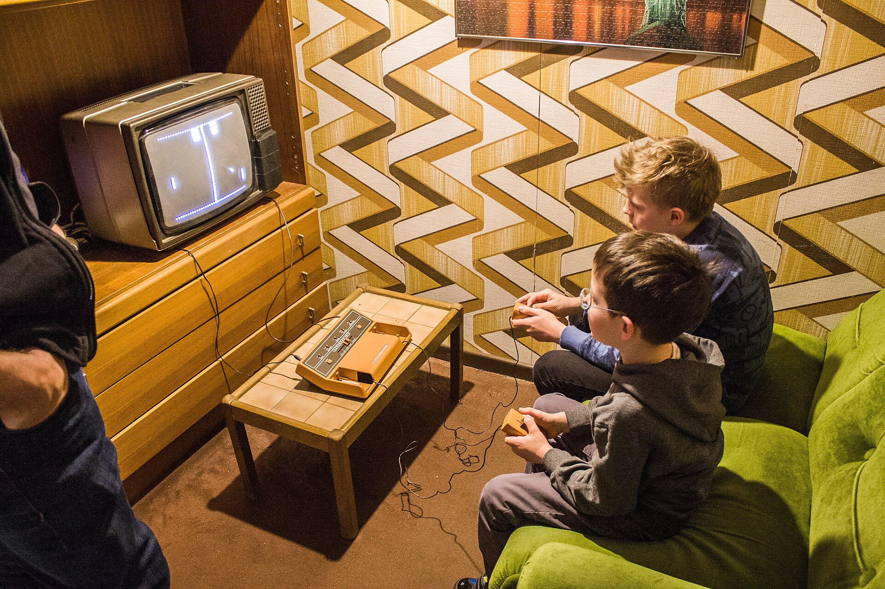
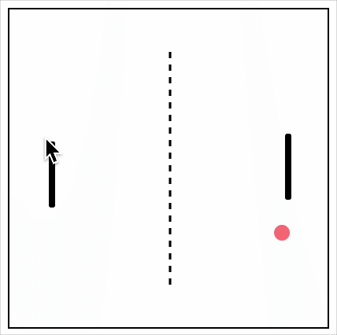
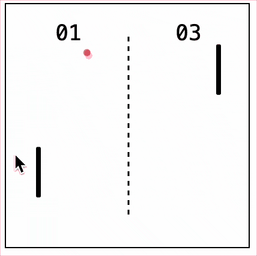

{/* add this script to the body  */}
{/* https://cdn.jsdelivr.net/gh/WLJSTeam/web-components@latest/src/common/app.js */}
<wljs-store json="./attachments/ade8938d-9af6-4f88-9a8c-49eb05db89cd.txt"></wljs-store>

> Original live stream is available [on the YouTube](https://youtu.be/Fw2qRq-ojW8) and here. @JerryI is very sorry for his live coding sloppiness 😑. Timecodes are included

<iframe
  src="https://www.youtube-nocookie.com/embed/Fw2qRq-ojW8"
  title="YouTube video player"
  style={{
    width: "100%",
    aspectRatio: "16 / 9",
    border: 0,
  }}
  allowFullScreen
/>

Interestingly, Pong is not the oldest game of all time. As early as 1958, people were already playing [Tennis for Two](https://en.wikipedia.org/wiki/Tennis_for_Two) at Brookhaven National Laboratory on an oscilloscope. If we exclude analog cathode-ray-tube displays, however, the first game may date back even further, to the 1936 [Seeburg Ray-O-Lite](https://www.pinrepair.com/arcade/rayolit.htm).

However, Pong is probably the holy grail of retro gaming, video game history, and minimalist yet effective game design.

*First-generation Pong console in a retro 1970s installation at the Computerspielemuseum Berlin, pictured in 2017*

<wljs-html encoded="true">{`%3Cbr%20%2F%3E`}</wljs-html>

<DownloadFile
    title="Download"
    description="Get this notebook"
    href="./attachments/notebook-ade.wln"
/>

---

## Essential math

The equations of motion for a ball are
$$
\begin{align*}
\frac{\partial \mathbf{x}}{\partial t} = \mathbf{v}, \quad
\frac{\partial \mathbf{v}}{\partial t} = \mathbf{a}
\end{align*}
$$

They can be solved numerically using [Verlet integration](https://en.wikipedia.org/wiki/Verlet_integration):

$$
\displaystyle \mathbf {x} _{n+1}=2\mathbf {x} _{n}-\mathbf {x} _{n-1}+\mathbf {A} (\mathbf {x} _{n})\,\Delta t^{2}.

$$

__Timecode: 1:01:27__

<WLJSWrapper><wljs-editor display="codemirror" type="Input" editable="true"  >{`ball = Table[{0.,0.}, {2}];
	integrate[ball_, a_:{0.,0.}, \\[Delta]t_:0.01] := {
	  (*TB[*)Indexed[(*|*)ball(*|*), {(*|*)2(*|*)}](*|*)(*1:eJxTTMoPSmMAgmIuIOGZl5JakZrilF8BAECTBhI=*)(*]TB*), 2 (*TB[*)Indexed[(*|*)ball(*|*), {(*|*)2(*|*)}](*|*)(*1:eJxTTMoPSmMAgmIuIOGZl5JakZrilF8BAECTBhI=*)(*]TB*) - (*TB[*)Indexed[(*|*)ball(*|*), {(*|*)1(*|*)}](*|*)(*1:eJxTTMoPSmMAgmIuIOGZl5JakZrilF8BAECTBhI=*)(*]TB*) + (*SpB[*)Power[\\[Delta]t(*|*),(*|*)2](*]SpB*) a
	}`}</wljs-editor></WLJSWrapper>

The boundary conditions for a box are simple:
- When the `ball` hits the left or right wall, reflect the $v_x$ component.
- When the `ball` hits the top or bottom wall, reflect the $v_y$ component.

<wljs-html encoded="true">{`%3Cdiv%20class%3D%22text-center%20w-full%22%3E%3Csvg%20version%3D%221.1%22%20xmlns%3D%22http%3A%2F%2Fwww.w3.org%2F2000%2Fsvg%22%20viewBox%3D%220%200%20800.4515160264536%20300.6585492433408%22%3E%0A%20%20%3C%21--%20svg-source%3Aexcalidraw%20--%3E%0A%20%20%0A%20%20%3Cdefs%3E%0A%20%20%20%20%3Cstyle%20class%3D%22style-fonts%22%3E%0A%20%20%20%20%20%20%40font-face%20%7B%0A%20%20%20%20%20%20%20%20font-family%3A%20%22Virgil%22%3B%0A%20%20%20%20%20%20%20%20src%3A%20url%28%22https%3A%2F%2Funpkg.com%2F%40excalidraw%2Fexcalidraw%40undefined%2Fdist%2Fexcalidraw-assets%2FVirgil.woff2%22%29%3B%0A%20%20%20%20%20%20%7D%0A%20%20%20%20%20%20%40font-face%20%7B%0A%20%20%20%20%20%20%20%20font-family%3A%20%22Cascadia%22%3B%0A%20%20%20%20%20%20%20%20src%3A%20url%28%22https%3A%2F%2Funpkg.com%2F%40excalidraw%2Fexcalidraw%40undefined%2Fdist%2Fexcalidraw-assets%2FCascadia.woff2%22%29%3B%0A%20%20%20%20%20%20%7D%0A%20%20%20%20%20%20%40font-face%20%7B%0A%20%20%20%20%20%20%20%20font-family%3A%20%22Assistant%22%3B%0A%20%20%20%20%20%20%20%20src%3A%20url%28%22https%3A%2F%2Funpkg.com%2F%40excalidraw%2Fexcalidraw%40undefined%2Fdist%2Fexcalidraw-assets%2FAssistant-Regular.woff2%22%29%3B%0A%20%20%20%20%20%20%7D%0A%20%20%20%20%3C%2Fstyle%3E%0A%20%20%20%20%0A%20%20%3C%2Fdefs%3E%0A%20%20%3Cg%20stroke-linecap%3D%22round%22%3E%3Cg%20transform%3D%22translate%28377.9989298548579%20233.79885635637606%29%20rotate%280%20-2.842170943040401e-14%20-88.23571396441955%29%22%3E%3Cpath%20d%3D%22M0%200%20C0%20-29.41%2C%200%20-147.06%2C%200%20-176.47%20M0%200%20C0%20-29.41%2C%200%20-147.06%2C%200%20-176.47%22%20stroke%3D%22%23e03131%22%20stroke-width%3D%222%22%20fill%3D%22none%22%3E%3C%2Fpath%3E%3C%2Fg%3E%3Cg%20transform%3D%22translate%28377.9989298548579%20233.79885635637606%29%20rotate%280%20-2.842170943040401e-14%20-88.23571396441955%29%22%3E%3Cpath%20d%3D%22M0%20-176.47%20L6.34%20-162.88%20L-6.34%20-162.88%20L0%20-176.47%22%20stroke%3D%22none%22%20stroke-width%3D%220%22%20fill%3D%22%23e03131%22%20fill-rule%3D%22evenodd%22%3E%3C%2Fpath%3E%3Cpath%20d%3D%22M0%20-176.47%20C2.43%20-171.27%2C%204.85%20-166.06%2C%206.34%20-162.88%20M0%20-176.47%20C2.12%20-171.93%2C%204.24%20-167.39%2C%206.34%20-162.88%20M6.34%20-162.88%20C2.93%20-162.88%2C%20-0.48%20-162.88%2C%20-6.34%20-162.88%20M6.34%20-162.88%20C3.28%20-162.88%2C%200.23%20-162.88%2C%20-6.34%20-162.88%20M-6.34%20-162.88%20C-4.39%20-167.06%2C%20-2.44%20-171.25%2C%200%20-176.47%20M-6.34%20-162.88%20C-4.95%20-165.86%2C%20-3.56%20-168.83%2C%200%20-176.47%20M0%20-176.47%20C0%20-176.47%2C%200%20-176.47%2C%200%20-176.47%20M0%20-176.47%20C0%20-176.47%2C%200%20-176.47%2C%200%20-176.47%22%20stroke%3D%22%23e03131%22%20stroke-width%3D%222%22%20fill%3D%22none%22%3E%3C%2Fpath%3E%3C%2Fg%3E%3C%2Fg%3E%3Cmask%3E%3C%2Fmask%3E%3Cg%20stroke-linecap%3D%22round%22%3E%3Cg%20transform%3D%22translate%28227.7439969546134%20242.31570967753697%29%20rotate%280%20154.396484375%200%29%22%3E%3Cpath%20d%3D%22M0%200%20C51.47%200%2C%20257.33%200%2C%20308.79%200%20M0%200%20C51.47%200%2C%20257.33%200%2C%20308.79%200%22%20stroke%3D%22%231e1e1e%22%20stroke-width%3D%222%22%20fill%3D%22none%22%3E%3C%2Fpath%3E%3C%2Fg%3E%3C%2Fg%3E%3Cmask%3E%3C%2Fmask%3E%3Cg%20stroke-linecap%3D%22round%22%3E%3Cg%20transform%3D%22translate%28465.91977820461346%20145.96805342753697%29%20rotate%280%20-46.10546875000003%2046.10546875%29%22%3E%3Cpath%20d%3D%22M0%200%20C-15.37%2015.37%2C%20-76.84%2076.84%2C%20-92.21%2092.21%20M0%200%20C-15.37%2015.37%2C%20-76.84%2076.84%2C%20-92.21%2092.21%22%20stroke%3D%22%231971c2%22%20stroke-width%3D%222%22%20fill%3D%22none%22%3E%3C%2Fpath%3E%3C%2Fg%3E%3Cg%20transform%3D%22translate%28465.91977820461346%20145.96805342753697%29%20rotate%280%20-46.10546875000003%2046.10546875%29%22%3E%3Cpath%20d%3D%22M-92.21%2092.21%20L-87.08%2078.12%20L-78.12%2087.08%20L-92.21%2092.21%22%20stroke%3D%22none%22%20stroke-width%3D%220%22%20fill%3D%22%231971c2%22%20fill-rule%3D%22evenodd%22%3E%3C%2Fpath%3E%3Cpath%20d%3D%22M-92.21%2092.21%20C-90.31%2086.98%2C%20-88.4%2081.75%2C%20-87.08%2078.12%20M-92.21%2092.21%20C-90.87%2088.53%2C%20-89.53%2084.84%2C%20-87.08%2078.12%20M-87.08%2078.12%20C-85.1%2080.1%2C%20-83.12%2082.08%2C%20-78.12%2087.08%20M-87.08%2078.12%20C-83.53%2081.67%2C%20-79.98%2085.21%2C%20-78.12%2087.08%20M-78.12%2087.08%20C-83.45%2089.02%2C%20-88.78%2090.96%2C%20-92.21%2092.21%20M-78.12%2087.08%20C-83.36%2088.99%2C%20-88.6%2090.9%2C%20-92.21%2092.21%20M-92.21%2092.21%20C-92.21%2092.21%2C%20-92.21%2092.21%2C%20-92.21%2092.21%20M-92.21%2092.21%20C-92.21%2092.21%2C%20-92.21%2092.21%2C%20-92.21%2092.21%22%20stroke%3D%22%231971c2%22%20stroke-width%3D%222%22%20fill%3D%22none%22%3E%3C%2Fpath%3E%3C%2Fg%3E%3C%2Fg%3E%3Cmask%3E%3C%2Fmask%3E%3Cg%20stroke-linecap%3D%22round%22%3E%3Cg%20transform%3D%22translate%28374.7877059234046%20234.35579498363933%29%20rotate%280%20-45.214307943723384%20-45.21430794372337%29%22%3E%3Cpath%20d%3D%22M0%200%20C-15.07%20-15.07%2C%20-75.36%20-75.36%2C%20-90.43%20-90.43%20M0%200%20C-15.07%20-15.07%2C%20-75.36%20-75.36%2C%20-90.43%20-90.43%22%20stroke%3D%22%231971c2%22%20stroke-width%3D%222%22%20fill%3D%22none%22%3E%3C%2Fpath%3E%3C%2Fg%3E%3Cg%20transform%3D%22translate%28374.7877059234046%20234.35579498363933%29%20rotate%280%20-45.214307943723384%20-45.21430794372337%29%22%3E%3Cpath%20d%3D%22M-90.43%20-90.43%20L-76.33%20-85.3%20L-85.3%20-76.33%20L-90.43%20-90.43%22%20stroke%3D%22none%22%20stroke-width%3D%220%22%20fill%3D%22%231971c2%22%20fill-rule%3D%22evenodd%22%3E%3C%2Fpath%3E%3Cpath%20d%3D%22M-90.43%20-90.43%20C-85.73%20-88.72%2C%20-81.04%20-87.01%2C%20-76.33%20-85.3%20M-90.43%20-90.43%20C-85.17%20-88.51%2C%20-79.91%20-86.6%2C%20-76.33%20-85.3%20M-76.33%20-85.3%20C-78.47%20-83.16%2C%20-80.6%20-81.03%2C%20-85.3%20-76.33%20M-76.33%20-85.3%20C-78.88%20-82.75%2C%20-81.42%20-80.21%2C%20-85.3%20-76.33%20M-85.3%20-76.33%20C-87.05%20-81.14%2C%20-88.8%20-85.95%2C%20-90.43%20-90.43%20M-85.3%20-76.33%20C-87.29%20-81.81%2C%20-89.29%20-87.29%2C%20-90.43%20-90.43%20M-90.43%20-90.43%20C-90.43%20-90.43%2C%20-90.43%20-90.43%2C%20-90.43%20-90.43%20M-90.43%20-90.43%20C-90.43%20-90.43%2C%20-90.43%20-90.43%2C%20-90.43%20-90.43%22%20stroke%3D%22%231971c2%22%20stroke-width%3D%222%22%20fill%3D%22none%22%3E%3C%2Fpath%3E%3C%2Fg%3E%3C%2Fg%3E%3Cmask%3E%3C%2Fmask%3E%3Cg%20stroke-linecap%3D%22round%22%3E%3Cg%20transform%3D%22translate%28289.1619657046134%20145.57742842753697%29%20rotate%280%20123.681640625%200%29%22%3E%3Cpath%20d%3D%22M0%200%20C41.23%200%2C%20206.14%200%2C%20247.36%200%22%20stroke%3D%22%231971c2%22%20stroke-width%3D%222.5%22%20fill%3D%22none%22%20stroke-dasharray%3D%228%2010%22%3E%3C%2Fpath%3E%3C%2Fg%3E%3C%2Fg%3E%3Cmask%3E%3C%2Fmask%3E%3Cg%20stroke-linecap%3D%22round%22%3E%3Cg%20transform%3D%22translate%28377.4394270497254%20235.4719472320872%29%20rotate%280%2079.310488077444%200%29%22%3E%3Cpath%20d%3D%22M0%200%20C26.44%200%2C%20132.18%200%2C%20158.62%200%22%20stroke%3D%22%231971c2%22%20stroke-width%3D%222.5%22%20fill%3D%22none%22%20stroke-dasharray%3D%228%2010%22%3E%3C%2Fpath%3E%3C%2Fg%3E%3C%2Fg%3E%3Cmask%3E%3C%2Fmask%3E%3Cg%20transform%3D%22translate%28530.5721219546134%2043.70242842753697%29%20rotate%280%205%2011.5%29%22%3E%3Ctext%20x%3D%220%22%20y%3D%220%22%20font-family%3D%22Helvetica%2C%20Segoe%20UI%20Emoji%22%20font-size%3D%2220px%22%20fill%3D%22%231e1e1e%22%20text-anchor%3D%22start%22%20style%3D%22white-space%3A%20pre%3B%22%20direction%3D%22ltr%22%20dominant-baseline%3D%22text-before-edge%22%3Ey%3C%2Ftext%3E%3C%2Fg%3E%3Cg%20transform%3D%22translate%28203.1516583926017%20226.99149092753697%29%20rotate%280%205%2011.5%29%22%3E%3Ctext%20x%3D%220%22%20y%3D%220%22%20font-family%3D%22Helvetica%2C%20Segoe%20UI%20Emoji%22%20font-size%3D%2220px%22%20fill%3D%22%231e1e1e%22%20text-anchor%3D%22start%22%20style%3D%22white-space%3A%20pre%3B%22%20direction%3D%22ltr%22%20dominant-baseline%3D%22text-before-edge%22%3Ex%3C%2Ftext%3E%3C%2Fg%3E%3Cg%20transform%3D%22translate%28441.5525907046134%20180.92899092753697%29%20rotate%280%205%2011.5%29%22%3E%3Ctext%20x%3D%220%22%20y%3D%220%22%20font-family%3D%22Helvetica%2C%20Segoe%20UI%20Emoji%22%20font-size%3D%2220px%22%20fill%3D%22%231971c2%22%20text-anchor%3D%22start%22%20style%3D%22white-space%3A%20pre%3B%22%20direction%3D%22ltr%22%20dominant-baseline%3D%22text-before-edge%22%3Ev%3C%2Ftext%3E%3C%2Fg%3E%3Cg%20transform%3D%22translate%28254.73665747707435%20185.28055342753697%29%20rotate%280%2029.453125%2023%29%22%3E%3Ctext%20x%3D%220%22%20y%3D%220%22%20font-family%3D%22Helvetica%2C%20Segoe%20UI%20Emoji%22%20font-size%3D%2220px%22%20fill%3D%22%231971c2%22%20text-anchor%3D%22start%22%20style%3D%22white-space%3A%20pre%3B%22%20direction%3D%22ltr%22%20dominant-baseline%3D%22text-before-edge%22%3Ev%20after%3C%2Ftext%3E%3Ctext%20x%3D%220%22%20y%3D%2223%22%20font-family%3D%22Helvetica%2C%20Segoe%20UI%20Emoji%22%20font-size%3D%2220px%22%20fill%3D%22%231971c2%22%20text-anchor%3D%22start%22%20style%3D%22white-space%3A%20pre%3B%22%20direction%3D%22ltr%22%20dominant-baseline%3D%22text-before-edge%22%3Eimpact%3C%2Ftext%3E%3C%2Fg%3E%3Cg%20transform%3D%22translate%28389.47884497707435%2078.17508467753697%29%20rotate%280%2010.5615234375%2011.5%29%22%3E%3Ctext%20x%3D%220%22%20y%3D%220%22%20font-family%3D%22Helvetica%2C%20Segoe%20UI%20Emoji%22%20font-size%3D%2220px%22%20fill%3D%22%23e03131%22%20text-anchor%3D%22start%22%20style%3D%22white-space%3A%20pre%3B%22%20direction%3D%22ltr%22%20dominant-baseline%3D%22text-before-edge%22%3E2v%3C%2Ftext%3E%3C%2Fg%3E%3Cg%20transform%3D%22translate%28410.37447485988685%2087.10867842753697%29%20rotate%280%204%209.200000000000003%29%22%3E%3Ctext%20x%3D%220%22%20y%3D%220%22%20font-family%3D%22Helvetica%2C%20Segoe%20UI%20Emoji%22%20font-size%3D%2216px%22%20fill%3D%22%23e03131%22%20text-anchor%3D%22start%22%20style%3D%22white-space%3A%20pre%3B%22%20direction%3D%22ltr%22%20dominant-baseline%3D%22text-before-edge%22%3Ey%3C%2Ftext%3E%3C%2Fg%3E%3Cg%20stroke-linecap%3D%22round%22%3E%3Cg%20transform%3D%22translate%28536.2303250796134%2077.66727217753697%29%20rotate%280%200%2092.62109375%29%22%3E%3Cpath%20d%3D%22M0%200%20C0%2030.87%2C%200%20154.37%2C%200%20185.24%20M0%200%20C0%2030.87%2C%200%20154.37%2C%200%20185.24%22%20stroke%3D%22%231e1e1e%22%20stroke-width%3D%222%22%20fill%3D%22none%22%3E%3C%2Fpath%3E%3C%2Fg%3E%3C%2Fg%3E%3Cmask%3E%3C%2Fmask%3E%3Cg%20stroke-linecap%3D%22round%22%20transform%3D%22translate%2810%2010%29%20rotate%280%20390.2257580132268%20140.3292746216704%29%22%3E%3Cpath%20d%3D%22M32%200%20C230.2%200%2C%20428.4%200%2C%20748.45%200%20M32%200%20C268.76%200%2C%20505.53%200%2C%20748.45%200%20M748.45%200%20C769.78%200%2C%20780.45%2010.67%2C%20780.45%2032%20M748.45%200%20C769.78%200%2C%20780.45%2010.67%2C%20780.45%2032%20M780.45%2032%20C780.45%2085.99%2C%20780.45%20139.97%2C%20780.45%20248.66%20M780.45%2032%20C780.45%20113.57%2C%20780.45%20195.13%2C%20780.45%20248.66%20M780.45%20248.66%20C780.45%20269.99%2C%20769.78%20280.66%2C%20748.45%20280.66%20M780.45%20248.66%20C780.45%20269.99%2C%20769.78%20280.66%2C%20748.45%20280.66%20M748.45%20280.66%20C482.85%20280.66%2C%20217.26%20280.66%2C%2032%20280.66%20M748.45%20280.66%20C476.26%20280.66%2C%20204.07%20280.66%2C%2032%20280.66%20M32%20280.66%20C10.67%20280.66%2C%200%20269.99%2C%200%20248.66%20M32%20280.66%20C10.67%20280.66%2C%200%20269.99%2C%200%20248.66%20M0%20248.66%20C0%20188.68%2C%200%20128.71%2C%200%2032%20M0%20248.66%20C0%20197.42%2C%200%20146.18%2C%200%2032%20M0%2032%20C0%2010.67%2C%2010.67%200%2C%2032%200%20M0%2032%20C0%2010.67%2C%2010.67%200%2C%2032%200%22%20stroke%3D%22transparent%22%20stroke-width%3D%222%22%20fill%3D%22none%22%3E%3C%2Fpath%3E%3C%2Fg%3E%3C%2Fsvg%3E%3C%2Fdiv%3E`}</wljs-html>

With the Verlet method, velocity is implicit and is derived as $(x_{n}-x_{n-1}) / \delta t$; therefore, flipping the velocity vector is equivalent to exchanging $x_{n}\leftrightarrow x_{n-1}$.

__Timecode: 1:06:59__
Test scene

<WLJSWrapper><wljs-editor display="codemirror" type="Input" editable="true"  >{`Graphics[{
	  Black, Disk[ball[[2]] // Offload, Offset[{10,10}]]
	}, AspectRatio->1, ImageSize->200, PlotRange->1]//Framed `}</wljs-editor></WLJSWrapper>

<WLJSWrapper><wljs-editor display="codemirror" type="Output" encoded="true"  >{`%28%2AVB%5B%2A%29%28CoffeeLiqueur%60Extensions%60Video%60Internal%60imgSymbol%24457660%29%28%2A%2C%2A%29%28%2A%221%3AeJxTTMoPSmNkYGAoZgESHvk5KRCeEJBwK8rPK3HNS3GtSE0uLUlMykkNVgUJJ5sbmxuZpJjrpqYmmemaGCQa6VokmRvqGhtZJJmYp6RYmpolAgCX1BXB%22%2A%29%28%2A%5DVB%2A%29`}</wljs-editor></WLJSWrapper>

Run the animation with boundary conditions.

<WLJSWrapper><wljs-editor display="codemirror" type="Input" editable="true"  >{`ball = 0.0 ball;
	ball[[2]] = {-0.01,-0.02};
	
	Do[
	  If[Abs[ball[[2,1]]] >= 1, 
	    ball[[{1,2}, 1]] = ball[[{2,1}, 1]];
	  ];
	
	  If[Abs[ball[[2,2]]] >= 1, 
	    ball[[{1,2}, 2]] = ball[[{2,1}, 2]];
	  ];  
	  
	  ball = integrate[ball, {0.,0.}, 0.1];
	  Pause[1/60.0];
	, {300}];`}</wljs-editor></WLJSWrapper>

## Animation loop & paddles
__Timecode: 1:27:19__
`Do`, `For`, and other loops with `Pause` block the kernel. Event-driven animation is preferable for continuous animations, game loops, etc.

__Timecode: 1:28:12__
For user input, we use `EventHandler` with the `"mousemove"` event to assign the mouse's y-coordinate to the paddle position.

<WLJSWrapper><wljs-editor display="codemirror" type="Input" editable="true"  >{`paddles = {{-0.75,0.}, {0.75,0.}};
	$paddles = 2{0.02, 0.21};
	
	handler[_] := With[{},
	  If[Abs[ball[[2,1]]] >= 1, 
	    ball[[{1,2}, 1]] = ball[[{2,1}, 1]];
	  ];
	
	  If[Abs[ball[[2,2]]] >= 1, 
	    ball[[{1,2}, 2]] = ball[[{2,1}, 2]];
	  ];  
	  
	  ball = integrate[ball, {0.,0.}, 0.1];
	  paddles = paddles;
	];
	
	EventHandler[Graphics[{
	  Pink, Disk[ball[[2]] // Offload, Offset[{5,5}]],
	  Black, 
	  Translate[Rectangle[
	    -$paddles/2,$paddles/2, RoundingRadius->0.02
	  ], paddles[[1]]//Offload],
	  Translate[Rectangle[
	    -$paddles/2,$paddles/2, RoundingRadius->0.02
	  ], paddles[[2]]//Offload],
	  Dashed, Line[{{0.0, -0.75}, {0.0,0.75}}],
	  
	  EventHandler[
	    AnimationFrameListener[ball//Offload],
	    handler
	  ]
	}, AspectRatio->1, ImageSize->200, PlotRange->1], {
	  "mousemove" -> Function[xy,
	    paddles[[1,2]] = xy[[2]];
	  ]
	}]//Framed `}</wljs-editor></WLJSWrapper>

Here, `AnimationFrameListener` fires `handler` only __once before the window's paint cycle__ and is clamped by the window's refresh rate. For the next event, it must be *retriggered* by a change to the `ball` symbol. This ensures that the next paint event will not fire until `handler` has finished executing and useful data has arrived at the frontend.
To stop the animation — that is, to break the cycle — run:

<WLJSWrapper><wljs-editor display="codemirror" type="Input" editable="true"  >{`handler[_] := Null;`}</wljs-editor></WLJSWrapper>

## Sound effects, scoring, and paddle collisions
Let's go!

__Timecode: 2:02:40__
Any sound can be represented as a collection of sine and cosine waves.

<WLJSWrapper><wljs-editor display="codemirror" type="Input" editable="true"  >{`Play[Sin[15000.0 x ]Exp[-30.0 x], {x,0,Pi/32}] `}</wljs-editor></WLJSWrapper>

<WLJSWrapper><wljs-editor display="codemirror" type="Output"  >{`(*VB[*)(FrontEndRef["F2a567631-f7b0-476e-b172-7f9c0a39f5b0"])(*,*)(*"1:eJxTTMoPSmNkYGAoZgESHvk5KRCeEJBwK8rPK3HNS3GtSE0uLUlMykkNVgUJGyWampmbGRvqppknGeiamJul6iYZmhvpmqdZJhskGlummSYZAACPTRWN"*)(*]VB*)`}</wljs-editor></WLJSWrapper>

This is what it looks like in the time and frequency domains:

<WLJSWrapper><wljs-editor display="codemirror" type="Input" editable="true"  >{`{
	  AudioPlot[%, PlotRange->{0, 0.01}],
	  Periodogram[%, PlotRange->Full, Frame->True]
	} // Column // Deploy `}</wljs-editor></WLJSWrapper>

<WLJSWrapper><wljs-editor display="codemirror" type="Output"  >{`(*GB[*){{(*VB[*)(FrontEndRef["Fe687ab49-d886-4ad0-9eaf-496526ffa5c7"])(*,*)(*"1:eJxTTMoPSmNkYGAoZgESHvk5KRCeEJBwK8rPK3HNS3GtSE0uLUlMykkNVgUJp5pZmCcmmVjqplhYmOmaJKYY6FqmJqbpmliamRqZpaUlmiabAwCfHxY4"*)(*]VB*)}(*||*),(*||*){(*VB[*)(FrontEndRef["Fe2534287-28c4-4f43-92ad-811828c38100"])(*,*)(*"1:eJxTTMoPSmNkYGAoZgESHvk5KRCeEJBwK8rPK3HNS3GtSE0uLUlMykkNVgUJpxqZGpsYWZjrGlkkm+iapJkY61oaJaboWhgaWgCFjC0MDQwAiGsUyw=="*)(*]VB*)}}(*||*)(*1:eJxTTMoPSmNmYGAo5gUSYZmp5S6pyflFiSX5RcEsQBH3osyUNCaQPIgXVJqTWiwAFXbKr3DMyUzPy03NK0ljhCnxySwuQdUQzA5kOOfnlObmFaOpQ+FBGKlpaNqLuYCM4NSc1OSSxCQglxXIdUvMKU4FAOS6Kv4=*)(*]GB*)`}</wljs-editor></WLJSWrapper>

Retroify it by adding higher harmonics, distorting the perfect sine wave into a quasi-rectangular waveform.

<WLJSWrapper><wljs-editor display="codemirror" type="Input" editable="true"  >{`SFXPaddle = Play[Sum[Sin[15000.0 x n ], {n,1,4,2}]Exp[-30.0 x], {x,0,Pi/32}]`}</wljs-editor></WLJSWrapper>

<WLJSWrapper><wljs-editor display="codemirror" type="Output"  >{`(*VB[*)(FrontEndRef["Fb43842bd-108f-4536-b5dc-dc219655031c"])(*,*)(*"1:eJxTTMoPSmNkYGAoZgESHvk5KRCeEJBwK8rPK3HNS3GtSE0uLUlMykkNVgUJJ5kYW5gYJaXoGhpYpOmamBqb6SaZpiTrpiQbGVqamZoaGBsmAwCUoRWA"*)(*]VB*)`}</wljs-editor></WLJSWrapper>

<WLJSWrapper><wljs-editor display="codemirror" type="Input" editable="true"  >{`{
	  AudioPlot[%, PlotRange->{0, 0.01}],
	  Periodogram[%, PlotRange->Full, Frame->True]
	} // Column // Deploy `}</wljs-editor></WLJSWrapper>

<WLJSWrapper><wljs-editor display="codemirror" type="Output"  >{`(*GB[*){{(*VB[*)(FrontEndRef["Ff4164d19-9ba4-4e2e-9191-1b8f17cded33"])(*,*)(*"1:eJxTTMoPSmNkYGAoZgESHvk5KRCeEJBwK8rPK3HNS3GtSE0uLUlMykkNVgUJp5kYmpmkGFrqWiYlmuiapBql6loaWhrqGiZZpBmaJ6ekphgbAwCXIxXw"*)(*]VB*)}(*||*),(*||*){(*VB[*)(FrontEndRef["F3bae19f4-9b8e-422a-ae18-87549ea966b4"])(*,*)(*"1:eJxTTMoPSmNkYGAoZgESHvk5KRCeEJBwK8rPK3HNS3GtSE0uLUlMykkNVgUJGyclphpappnoWiZZpOqaGBkl6gIFLHQtzE1NLFMTLc3MkkwAoQEV+w=="*)(*]VB*)}}(*||*)(*1:eJxTTMoPSmNmYGAo5gUSYZmp5S6pyflFiSX5RcEsQBH3osyUNCaQPIgXVJqTWiwAFXbKr3DMyUzPy03NK0ljhCnxySwuQdUQzA5kOOfnlObmFaOpQ+FBGKlpaNqLuYCM4NSc1OSSxCQglxXIdUvMKU4FAOS6Kv4=*)(*]GB*)`}</wljs-editor></WLJSWrapper>

Higher harmonics exceed the audio sampling rate, causing them to fold back to lower frequencies and effectively become subharmonics. This is also known as aliasing; an optical example is the [wagon-wheel effect](https://en.wikipedia.org/wiki/Wagon-wheel_effect), which you have probably seen in real life:

When the ball hits the left or right wall, make some noise (turn the volume down a bit).

<WLJSWrapper><wljs-editor display="codemirror" type="Input" editable="true"  >{`SFXLost = AudioAmplify[Play[RandomReal[{-1,1}] Exp[- 10 x], {x,0,Pi/8}], 0.2]`}</wljs-editor></WLJSWrapper>

<WLJSWrapper><wljs-editor display="codemirror" type="Output"  >{`(*VB[*)(Audio[FrontEndRef["Fecdecb74-3dd9-44a9-ac73-4f7836e3c289"], "SignedInteger16", SampleRate->8000])(*,*)(*"1:eJxTTMoPSmNkYGAoZgESHvk5KRCeEJBwK8rPK3HNS3GtSE0uLUlMykkNVgUJGyWZGJiaJBrqGhgZGuiamJtZ6lqamZromlkkJ1qYGZskmyUnAQCBcxT3"*)(*]VB*)`}</wljs-editor></WLJSWrapper>

<WLJSWrapper><wljs-editor display="codemirror" type="Input" editable="true"  >{`{
	  AudioPlot[%, PlotRange->{0, 0.01}],
	  Periodogram[%, PlotRange->Full, Frame->True]
	} // Column // Deploy `}</wljs-editor></WLJSWrapper>

<WLJSWrapper><wljs-editor display="codemirror" type="Output"  >{`(*GB[*){{(*VB[*)(FrontEndRef["Fe53da39b-7dca-438a-a739-a5b57cbf13e7"])(*,*)(*"1:eJxTTMoPSmNkYGAoZgESHvk5KRCeEJBwK8rPK3HNS3GtSE0uLUlMykkNVgUJp5oapyQaWybpmqckJ+qaGFsk6iaaG1vqJpommZonJ6UZGqeaAwCm2xZ8"*)(*]VB*)}(*||*),(*||*){(*VB[*)(FrontEndRef["F4d7d125f-f1eb-44d6-ada6-50d05b2760c0"])(*,*)(*"1:eJxTTMoPSmNkYGAoZgESHvk5KRCeEJBwK8rPK3HNS3GtSE0uLUlMykkNVgUJm6SYpxgamabpphmmJumamKSY6SamJJrpmhqkGJgmGZmbGSQbAACiBBYJ"*)(*]VB*)}}(*||*)(*1:eJxTTMoPSmNmYGAo5gUSYZmp5S6pyflFiSX5RcEsQBH3osyUNCaQPIgXVJqTWiwAFXbKr3DMyUzPy03NK0ljhCnxySwuQdUQzA5kOOfnlObmFaOpQ+FBGKlpaNqLuYCM4NSc1OSSxCQglxXIdUvMKU4FAOS6Kv4=*)(*]GB*)`}</wljs-editor></WLJSWrapper>

To play a sound (`Sound` or `Audio` object) programmatically, simply call `EmitSound` on it.

<WLJSWrapper><wljs-editor display="codemirror" type="Input" editable="true"  >{`Button["Boom", (*VB[*)(Audio[FrontEndRef["Fe861a778-250d-4b8f-a460-9e736a58f45a"], "SignedInteger16", SampleRate->8000])(*,*)(*"1:eJxTTMoPSmNkYGAoZgESHvk5KRCeEJBwK8rPK3HNS3GtSE0uLUlMykkNVgUJm5oaJZuZpxnqJhmZmOmamBgY6VoaGhvpJpuZJZmYm5ulWpqZAgCHVRTW"*)(*]VB*) // EmitSound]`}</wljs-editor></WLJSWrapper>

### Paddle Collisions
We can significantly simplify the problem by considering only the left and right sides of each paddle. Thus, it effectively becomes a wall-collision problem.

<wljs-html encoded="true">{`%3Cdiv%20class%3D%22text-center%20w-full%22%3E%3Csvg%20version%3D%221.1%22%20xmlns%3D%22http%3A%2F%2Fwww.w3.org%2F2000%2Fsvg%22%20viewBox%3D%220%200%20755.176778218705%20312.7759924999067%22%3E%0A%20%20%3C%21--%20svg-source%3Aexcalidraw%20--%3E%0A%20%20%0A%20%20%3Cdefs%3E%0A%20%20%20%20%3Cstyle%20class%3D%22style-fonts%22%3E%0A%20%20%20%20%20%20%40font-face%20%7B%0A%20%20%20%20%20%20%20%20font-family%3A%20%22Virgil%22%3B%0A%20%20%20%20%20%20%20%20src%3A%20url%28%22https%3A%2F%2Funpkg.com%2F%40excalidraw%2Fexcalidraw%40undefined%2Fdist%2Fexcalidraw-assets%2FVirgil.woff2%22%29%3B%0A%20%20%20%20%20%20%7D%0A%20%20%20%20%20%20%40font-face%20%7B%0A%20%20%20%20%20%20%20%20font-family%3A%20%22Cascadia%22%3B%0A%20%20%20%20%20%20%20%20src%3A%20url%28%22https%3A%2F%2Funpkg.com%2F%40excalidraw%2Fexcalidraw%40undefined%2Fdist%2Fexcalidraw-assets%2FCascadia.woff2%22%29%3B%0A%20%20%20%20%20%20%7D%0A%20%20%20%20%20%20%40font-face%20%7B%0A%20%20%20%20%20%20%20%20font-family%3A%20%22Assistant%22%3B%0A%20%20%20%20%20%20%20%20src%3A%20url%28%22https%3A%2F%2Funpkg.com%2F%40excalidraw%2Fexcalidraw%40undefined%2Fdist%2Fexcalidraw-assets%2FAssistant-Regular.woff2%22%29%3B%0A%20%20%20%20%20%20%7D%0A%20%20%20%20%3C%2Fstyle%3E%0A%20%20%20%20%0A%20%20%3C%2Fdefs%3E%0A%20%20%3Cg%20stroke-linecap%3D%22round%22%3E%3Cg%20transform%3D%22translate%28406.71113006498655%2039.621474499352246%29%20rotate%280%200%20121.1875%29%22%3E%3Cpath%20d%3D%22M0%200%20C0%2063.77%2C%200%20127.55%2C%200%20242.38%20M0%200%20C0%2095%2C%200%20189.99%2C%200%20242.38%22%20stroke%3D%22%23ced4da%22%20stroke-width%3D%222%22%20fill%3D%22none%22%3E%3C%2Fpath%3E%3C%2Fg%3E%3C%2Fg%3E%3Cmask%3E%3C%2Fmask%3E%3Cg%20stroke-linecap%3D%22round%22%20transform%3D%22translate%28327.1857394399866%2065.85975574935225%29%20rotate%280%2030.875%20103.1953125%29%22%3E%3Cpath%20d%3D%22M0%200%20L61.75%200%20L61.75%20206.39%20L0%20206.39%22%20stroke%3D%22none%22%20stroke-width%3D%220%22%20fill%3D%22%23e9ecef%22%3E%3C%2Fpath%3E%3Cpath%20d%3D%22M0%200%20C18.66%200%2C%2037.31%200%2C%2061.75%200%20M0%200%20C20.02%200%2C%2040.03%200%2C%2061.75%200%20M61.75%200%20C61.75%2046.44%2C%2061.75%2092.89%2C%2061.75%20206.39%20M61.75%200%20C61.75%2072.81%2C%2061.75%20145.62%2C%2061.75%20206.39%20M61.75%20206.39%20C40.14%20206.39%2C%2018.52%20206.39%2C%200%20206.39%20M61.75%20206.39%20C41.91%20206.39%2C%2022.06%20206.39%2C%200%20206.39%20M0%20206.39%20C0%20147.06%2C%200%2087.74%2C%200%200%20M0%20206.39%20C0%20155.87%2C%200%20105.35%2C%200%200%22%20stroke%3D%22%23ced4da%22%20stroke-width%3D%222%22%20fill%3D%22none%22%3E%3C%2Fpath%3E%3C%2Fg%3E%3Cg%20stroke-linecap%3D%22round%22%3E%3Cg%20transform%3D%22translate%28510.7365206899866%2085.55506824935225%29%20rotate%280%20-109.54296874999997%200%29%22%3E%3Cpath%20d%3D%22M0%200%20C-81.76%200%2C%20-163.52%200%2C%20-219.09%200%20M0%200%20C-44.36%200%2C%20-88.72%200%2C%20-219.09%200%22%20stroke%3D%22%23ced4da%22%20stroke-width%3D%222%22%20fill%3D%22none%22%3E%3C%2Fpath%3E%3C%2Fg%3E%3C%2Fg%3E%3Cmask%3E%3C%2Fmask%3E%3Cg%20stroke-linecap%3D%22round%22%3E%3Cg%20transform%3D%22translate%28436.3117160024866%20188.13319324935225%29%20rotate%280%200%20-72.81640625%29%22%3E%3Cpath%20d%3D%22M0%200%20C0%20-42.67%2C%200%20-85.33%2C%200%20-145.63%20M0%200%20C0%20-40.87%2C%200%20-81.74%2C%200%20-145.63%22%20stroke%3D%22%23ced4da%22%20stroke-width%3D%222%22%20fill%3D%22none%22%3E%3C%2Fpath%3E%3C%2Fg%3E%3C%2Fg%3E%3Cmask%3E%3C%2Fmask%3E%3Cg%20stroke-linecap%3D%22round%22%3E%3Cg%20transform%3D%22translate%28296.1994113149866%2053.465224499352246%29%20rotate%280%20102.5361328125%200%29%22%3E%3Cpath%20d%3D%22M0%200%20C46.39%200%2C%2092.78%200%2C%20205.07%200%20M0%200%20C61.96%200%2C%20123.92%200%2C%20205.07%200%22%20stroke%3D%22%23ced4da%22%20stroke-width%3D%222%22%20fill%3D%22none%22%3E%3C%2Fpath%3E%3C%2Fg%3E%3C%2Fg%3E%3Cmask%3E%3C%2Fmask%3E%3Cg%20stroke-linecap%3D%22round%22%3E%3Cg%20transform%3D%22translate%28208.8693331899866%2065.53944324935225%29%20rotate%280%20150.091796875%200%29%22%3E%3Cpath%20d%3D%22M0%200%20C117.91%200%2C%20235.81%200%2C%20300.18%200%20M0%200%20C95.19%200%2C%20190.38%200%2C%20300.18%200%22%20stroke%3D%22%23ced4da%22%20stroke-width%3D%222%22%20fill%3D%22none%22%3E%3C%2Fpath%3E%3C%2Fg%3E%3C%2Fg%3E%3Cmask%3E%3C%2Fmask%3E%3Cg%20stroke-linecap%3D%22round%22%3E%3Cg%20transform%3D%22translate%28357.9376925649866%2041.629286999352246%29%20rotate%280%20-1.4210854715202004e-14%20122.09375000000003%29%22%3E%3Cpath%20d%3D%22M0%200%20C0%2070.48%2C%200%20140.96%2C%200%20244.19%20M0%200%20C0%2085.81%2C%200%20171.62%2C%200%20244.19%22%20stroke%3D%22%23ced4da%22%20stroke-width%3D%222%22%20fill%3D%22none%22%3E%3C%2Fpath%3E%3C%2Fg%3E%3C%2Fg%3E%3Cmask%3E%3C%2Fmask%3E%3Cg%20stroke-linecap%3D%22round%22%20transform%3D%22translate%28354.1251925649866%2064.00624012435225%29%20rotate%280%202.771484375%202.771484375%29%22%3E%3Cpath%20d%3D%22M5.54%202.77%20C5.54%202.93%2C%205.53%203.09%2C%205.5%203.25%20C5.47%203.41%2C%205.43%203.57%2C%205.38%203.72%20C5.32%203.87%2C%205.25%204.02%2C%205.17%204.16%20C5.09%204.3%2C%205%204.43%2C%204.89%204.55%20C4.79%204.68%2C%204.68%204.79%2C%204.55%204.89%20C4.43%205%2C%204.3%205.09%2C%204.16%205.17%20C4.02%205.25%2C%203.87%205.32%2C%203.72%205.38%20C3.57%205.43%2C%203.41%205.47%2C%203.25%205.5%20C3.09%205.53%2C%202.93%205.54%2C%202.77%205.54%20C2.61%205.54%2C%202.45%205.53%2C%202.29%205.5%20C2.13%205.47%2C%201.97%205.43%2C%201.82%205.38%20C1.67%205.32%2C%201.52%205.25%2C%201.39%205.17%20C1.25%205.09%2C%201.11%205%2C%200.99%204.89%20C0.87%204.79%2C%200.75%204.68%2C%200.65%204.55%20C0.55%204.43%2C%200.45%204.3%2C%200.37%204.16%20C0.29%204.02%2C%200.22%203.87%2C%200.17%203.72%20C0.11%203.57%2C%200.07%203.41%2C%200.04%203.25%20C0.01%203.09%2C%200%202.93%2C%200%202.77%20C0%202.61%2C%200.01%202.45%2C%200.04%202.29%20C0.07%202.13%2C%200.11%201.97%2C%200.17%201.82%20C0.22%201.67%2C%200.29%201.52%2C%200.37%201.39%20C0.45%201.25%2C%200.55%201.11%2C%200.65%200.99%20C0.75%200.87%2C%200.87%200.75%2C%200.99%200.65%20C1.11%200.55%2C%201.25%200.45%2C%201.39%200.37%20C1.52%200.29%2C%201.67%200.22%2C%201.82%200.17%20C1.97%200.11%2C%202.13%200.07%2C%202.29%200.04%20C2.45%200.01%2C%202.61%200%2C%202.77%200%20C2.93%200%2C%203.09%200.01%2C%203.25%200.04%20C3.41%200.07%2C%203.57%200.11%2C%203.72%200.17%20C3.87%200.22%2C%204.02%200.29%2C%204.16%200.37%20C4.3%200.45%2C%204.43%200.55%2C%204.55%200.65%20C4.68%200.75%2C%204.79%200.87%2C%204.89%200.99%20C5%201.11%2C%205.09%201.25%2C%205.17%201.39%20C5.25%201.52%2C%205.32%201.67%2C%205.38%201.82%20C5.43%201.97%2C%205.47%202.13%2C%205.5%202.29%20C5.53%202.45%2C%205.54%202.69%2C%205.54%202.77%20C5.55%202.85%2C%205.55%202.69%2C%205.54%202.77%22%20stroke%3D%22none%22%20stroke-width%3D%220%22%20fill%3D%22%231e1e1e%22%3E%3C%2Fpath%3E%3Cpath%20d%3D%22M5.54%202.77%20C5.54%202.93%2C%205.53%203.09%2C%205.5%203.25%20C5.47%203.41%2C%205.43%203.57%2C%205.38%203.72%20C5.32%203.87%2C%205.25%204.02%2C%205.17%204.16%20C5.09%204.3%2C%205%204.43%2C%204.89%204.55%20C4.79%204.68%2C%204.68%204.79%2C%204.55%204.89%20C4.43%205%2C%204.3%205.09%2C%204.16%205.17%20C4.02%205.25%2C%203.87%205.32%2C%203.72%205.38%20C3.57%205.43%2C%203.41%205.47%2C%203.25%205.5%20C3.09%205.53%2C%202.93%205.54%2C%202.77%205.54%20C2.61%205.54%2C%202.45%205.53%2C%202.29%205.5%20C2.13%205.47%2C%201.97%205.43%2C%201.82%205.38%20C1.67%205.32%2C%201.52%205.25%2C%201.39%205.17%20C1.25%205.09%2C%201.11%205%2C%200.99%204.89%20C0.87%204.79%2C%200.75%204.68%2C%200.65%204.55%20C0.55%204.43%2C%200.45%204.3%2C%200.37%204.16%20C0.29%204.02%2C%200.22%203.87%2C%200.17%203.72%20C0.11%203.57%2C%200.07%203.41%2C%200.04%203.25%20C0.01%203.09%2C%200%202.93%2C%200%202.77%20C0%202.61%2C%200.01%202.45%2C%200.04%202.29%20C0.07%202.13%2C%200.11%201.97%2C%200.17%201.82%20C0.22%201.67%2C%200.29%201.52%2C%200.37%201.39%20C0.45%201.25%2C%200.55%201.11%2C%200.65%200.99%20C0.75%200.87%2C%200.87%200.75%2C%200.99%200.65%20C1.11%200.55%2C%201.25%200.45%2C%201.39%200.37%20C1.52%200.29%2C%201.67%200.22%2C%201.82%200.17%20C1.97%200.11%2C%202.13%200.07%2C%202.29%200.04%20C2.45%200.01%2C%202.61%200%2C%202.77%200%20C2.93%200%2C%203.09%200.01%2C%203.25%200.04%20C3.41%200.07%2C%203.57%200.11%2C%203.72%200.17%20C3.87%200.22%2C%204.02%200.29%2C%204.16%200.37%20C4.3%200.45%2C%204.43%200.55%2C%204.55%200.65%20C4.68%200.75%2C%204.79%200.87%2C%204.89%200.99%20C5%201.11%2C%205.09%201.25%2C%205.17%201.39%20C5.25%201.52%2C%205.32%201.67%2C%205.38%201.82%20C5.43%201.97%2C%205.47%202.13%2C%205.5%202.29%20C5.53%202.45%2C%205.54%202.69%2C%205.54%202.77%20C5.55%202.85%2C%205.55%202.69%2C%205.54%202.77%22%20stroke%3D%22%231e1e1e%22%20stroke-width%3D%222%22%20fill%3D%22none%22%3E%3C%2Fpath%3E%3C%2Fg%3E%3Cg%20stroke-opacity%3D%220.8%22%20fill-opacity%3D%220.8%22%20transform%3D%22translate%28393.9982394399866%20171.31678699935225%29%20rotate%280%2023.8916015625%2011.5%29%22%3E%3Ctext%20x%3D%220%22%20y%3D%220%22%20font-family%3D%22Helvetica%2C%20Segoe%20UI%20Emoji%22%20font-size%3D%2220px%22%20fill%3D%22%231e1e1e%22%20text-anchor%3D%22start%22%20style%3D%22white-space%3A%20pre%3B%22%20direction%3D%22ltr%22%20dominant-baseline%3D%22text-before-edge%22%3Ex-dist%3C%2Ftext%3E%3C%2Fg%3E%3Cg%20stroke-opacity%3D%220.8%22%20fill-opacity%3D%220.8%22%20transform%3D%22translate%28247.4386691274866%2061.828505749352246%29%20rotate%280%2023.8916015625%2011.5%29%22%3E%3Ctext%20x%3D%220%22%20y%3D%220%22%20font-family%3D%22Helvetica%2C%20Segoe%20UI%20Emoji%22%20font-size%3D%2220px%22%20fill%3D%22%231e1e1e%22%20text-anchor%3D%22start%22%20style%3D%22white-space%3A%20pre%3B%22%20direction%3D%22ltr%22%20dominant-baseline%3D%22text-before-edge%22%3Ey-dist%3C%2Ftext%3E%3C%2Fg%3E%3Cg%20stroke-linecap%3D%22round%22%20transform%3D%22translate%28404.8244113149866%2081.70155262435225%29%20rotate%280%202.771484375%202.771484375%29%22%3E%3Cpath%20d%3D%22M5.54%202.77%20C5.54%202.93%2C%205.53%203.09%2C%205.5%203.25%20C5.47%203.41%2C%205.43%203.57%2C%205.38%203.72%20C5.32%203.87%2C%205.25%204.02%2C%205.17%204.16%20C5.09%204.3%2C%205%204.43%2C%204.89%204.55%20C4.79%204.68%2C%204.68%204.79%2C%204.55%204.89%20C4.43%205%2C%204.3%205.09%2C%204.16%205.17%20C4.02%205.25%2C%203.87%205.32%2C%203.72%205.38%20C3.57%205.43%2C%203.41%205.47%2C%203.25%205.5%20C3.09%205.53%2C%202.93%205.54%2C%202.77%205.54%20C2.61%205.54%2C%202.45%205.53%2C%202.29%205.5%20C2.13%205.47%2C%201.97%205.43%2C%201.82%205.38%20C1.67%205.32%2C%201.52%205.25%2C%201.39%205.17%20C1.25%205.09%2C%201.11%205%2C%200.99%204.89%20C0.87%204.79%2C%200.75%204.68%2C%200.65%204.55%20C0.55%204.43%2C%200.45%204.3%2C%200.37%204.16%20C0.29%204.02%2C%200.22%203.87%2C%200.17%203.72%20C0.11%203.57%2C%200.07%203.41%2C%200.04%203.25%20C0.01%203.09%2C%200%202.93%2C%200%202.77%20C0%202.61%2C%200.01%202.45%2C%200.04%202.29%20C0.07%202.13%2C%200.11%201.97%2C%200.17%201.82%20C0.22%201.67%2C%200.29%201.52%2C%200.37%201.39%20C0.45%201.25%2C%200.55%201.11%2C%200.65%200.99%20C0.75%200.87%2C%200.87%200.75%2C%200.99%200.65%20C1.11%200.55%2C%201.25%200.45%2C%201.39%200.37%20C1.52%200.29%2C%201.67%200.22%2C%201.82%200.17%20C1.97%200.11%2C%202.13%200.07%2C%202.29%200.04%20C2.45%200.01%2C%202.61%200%2C%202.77%200%20C2.93%200%2C%203.09%200.01%2C%203.25%200.04%20C3.41%200.07%2C%203.57%200.11%2C%203.72%200.17%20C3.87%200.22%2C%204.02%200.29%2C%204.16%200.37%20C4.3%200.45%2C%204.43%200.55%2C%204.55%200.65%20C4.68%200.75%2C%204.79%200.87%2C%204.89%200.99%20C5%201.11%2C%205.09%201.25%2C%205.17%201.39%20C5.25%201.52%2C%205.32%201.67%2C%205.38%201.82%20C5.43%201.97%2C%205.47%202.13%2C%205.5%202.29%20C5.53%202.45%2C%205.54%202.69%2C%205.54%202.77%20C5.55%202.85%2C%205.55%202.69%2C%205.54%202.77%22%20stroke%3D%22none%22%20stroke-width%3D%220%22%20fill%3D%22%23e03131%22%3E%3C%2Fpath%3E%3Cpath%20d%3D%22M5.54%202.77%20C5.54%202.93%2C%205.53%203.09%2C%205.5%203.25%20C5.47%203.41%2C%205.43%203.57%2C%205.38%203.72%20C5.32%203.87%2C%205.25%204.02%2C%205.17%204.16%20C5.09%204.3%2C%205%204.43%2C%204.89%204.55%20C4.79%204.68%2C%204.68%204.79%2C%204.55%204.89%20C4.43%205%2C%204.3%205.09%2C%204.16%205.17%20C4.02%205.25%2C%203.87%205.32%2C%203.72%205.38%20C3.57%205.43%2C%203.41%205.47%2C%203.25%205.5%20C3.09%205.53%2C%202.93%205.54%2C%202.77%205.54%20C2.61%205.54%2C%202.45%205.53%2C%202.29%205.5%20C2.13%205.47%2C%201.97%205.43%2C%201.82%205.38%20C1.67%205.32%2C%201.52%205.25%2C%201.39%205.17%20C1.25%205.09%2C%201.11%205%2C%200.99%204.89%20C0.87%204.79%2C%200.75%204.68%2C%200.65%204.55%20C0.55%204.43%2C%200.45%204.3%2C%200.37%204.16%20C0.29%204.02%2C%200.22%203.87%2C%200.17%203.72%20C0.11%203.57%2C%200.07%203.41%2C%200.04%203.25%20C0.01%203.09%2C%200%202.93%2C%200%202.77%20C0%202.61%2C%200.01%202.45%2C%200.04%202.29%20C0.07%202.13%2C%200.11%201.97%2C%200.17%201.82%20C0.22%201.67%2C%200.29%201.52%2C%200.37%201.39%20C0.45%201.25%2C%200.55%201.11%2C%200.65%200.99%20C0.75%200.87%2C%200.87%200.75%2C%200.99%200.65%20C1.11%200.55%2C%201.25%200.45%2C%201.39%200.37%20C1.52%200.29%2C%201.67%200.22%2C%201.82%200.17%20C1.97%200.11%2C%202.13%200.07%2C%202.29%200.04%20C2.45%200.01%2C%202.61%200%2C%202.77%200%20C2.93%200%2C%203.09%200.01%2C%203.25%200.04%20C3.41%200.07%2C%203.57%200.11%2C%203.72%200.17%20C3.87%200.22%2C%204.02%200.29%2C%204.16%200.37%20C4.3%200.45%2C%204.43%200.55%2C%204.55%200.65%20C4.68%200.75%2C%204.79%200.87%2C%204.89%200.99%20C5%201.11%2C%205.09%201.25%2C%205.17%201.39%20C5.25%201.52%2C%205.32%201.67%2C%205.38%201.82%20C5.43%201.97%2C%205.47%202.13%2C%205.5%202.29%20C5.53%202.45%2C%205.54%202.69%2C%205.54%202.77%20C5.55%202.85%2C%205.55%202.69%2C%205.54%202.77%22%20stroke%3D%22%23e03131%22%20stroke-width%3D%222%22%20fill%3D%22none%22%3E%3C%2Fpath%3E%3C%2Fg%3E%3Cg%20stroke-linecap%3D%22round%22%20transform%3D%22translate%28434.9220675649866%2052.166396374352246%29%20rotate%280%202.771484375%202.771484375%29%22%3E%3Cpath%20d%3D%22M5.54%202.77%20C5.54%202.93%2C%205.53%203.09%2C%205.5%203.25%20C5.47%203.41%2C%205.43%203.57%2C%205.38%203.72%20C5.32%203.87%2C%205.25%204.02%2C%205.17%204.16%20C5.09%204.3%2C%205%204.43%2C%204.89%204.55%20C4.79%204.68%2C%204.68%204.79%2C%204.55%204.89%20C4.43%205%2C%204.3%205.09%2C%204.16%205.17%20C4.02%205.25%2C%203.87%205.32%2C%203.72%205.38%20C3.57%205.43%2C%203.41%205.47%2C%203.25%205.5%20C3.09%205.53%2C%202.93%205.54%2C%202.77%205.54%20C2.61%205.54%2C%202.45%205.53%2C%202.29%205.5%20C2.13%205.47%2C%201.97%205.43%2C%201.82%205.38%20C1.67%205.32%2C%201.52%205.25%2C%201.39%205.17%20C1.25%205.09%2C%201.11%205%2C%200.99%204.89%20C0.87%204.79%2C%200.75%204.68%2C%200.65%204.55%20C0.55%204.43%2C%200.45%204.3%2C%200.37%204.16%20C0.29%204.02%2C%200.22%203.87%2C%200.17%203.72%20C0.11%203.57%2C%200.07%203.41%2C%200.04%203.25%20C0.01%203.09%2C%200%202.93%2C%200%202.77%20C0%202.61%2C%200.01%202.45%2C%200.04%202.29%20C0.07%202.13%2C%200.11%201.97%2C%200.17%201.82%20C0.22%201.67%2C%200.29%201.52%2C%200.37%201.39%20C0.45%201.25%2C%200.55%201.11%2C%200.65%200.99%20C0.75%200.87%2C%200.87%200.75%2C%200.99%200.65%20C1.11%200.55%2C%201.25%200.45%2C%201.39%200.37%20C1.52%200.29%2C%201.67%200.22%2C%201.82%200.17%20C1.97%200.11%2C%202.13%200.07%2C%202.29%200.04%20C2.45%200.01%2C%202.61%200%2C%202.77%200%20C2.93%200%2C%203.09%200.01%2C%203.25%200.04%20C3.41%200.07%2C%203.57%200.11%2C%203.72%200.17%20C3.87%200.22%2C%204.02%200.29%2C%204.16%200.37%20C4.3%200.45%2C%204.43%200.55%2C%204.55%200.65%20C4.68%200.75%2C%204.79%200.87%2C%204.89%200.99%20C5%201.11%2C%205.09%201.25%2C%205.17%201.39%20C5.25%201.52%2C%205.32%201.67%2C%205.38%201.82%20C5.43%201.97%2C%205.47%202.13%2C%205.5%202.29%20C5.53%202.45%2C%205.54%202.69%2C%205.54%202.77%20C5.55%202.85%2C%205.55%202.69%2C%205.54%202.77%22%20stroke%3D%22none%22%20stroke-width%3D%220%22%20fill%3D%22%23e03131%22%3E%3C%2Fpath%3E%3Cpath%20d%3D%22M5.54%202.77%20C5.54%202.93%2C%205.53%203.09%2C%205.5%203.25%20C5.47%203.41%2C%205.43%203.57%2C%205.38%203.72%20C5.32%203.87%2C%205.25%204.02%2C%205.17%204.16%20C5.09%204.3%2C%205%204.43%2C%204.89%204.55%20C4.79%204.68%2C%204.68%204.79%2C%204.55%204.89%20C4.43%205%2C%204.3%205.09%2C%204.16%205.17%20C4.02%205.25%2C%203.87%205.32%2C%203.72%205.38%20C3.57%205.43%2C%203.41%205.47%2C%203.25%205.5%20C3.09%205.53%2C%202.93%205.54%2C%202.77%205.54%20C2.61%205.54%2C%202.45%205.53%2C%202.29%205.5%20C2.13%205.47%2C%201.97%205.43%2C%201.82%205.38%20C1.67%205.32%2C%201.52%205.25%2C%201.39%205.17%20C1.25%205.09%2C%201.11%205%2C%200.99%204.89%20C0.87%204.79%2C%200.75%204.68%2C%200.65%204.55%20C0.55%204.43%2C%200.45%204.3%2C%200.37%204.16%20C0.29%204.02%2C%200.22%203.87%2C%200.17%203.72%20C0.11%203.57%2C%200.07%203.41%2C%200.04%203.25%20C0.01%203.09%2C%200%202.93%2C%200%202.77%20C0%202.61%2C%200.01%202.45%2C%200.04%202.29%20C0.07%202.13%2C%200.11%201.97%2C%200.17%201.82%20C0.22%201.67%2C%200.29%201.52%2C%200.37%201.39%20C0.45%201.25%2C%200.55%201.11%2C%200.65%200.99%20C0.75%200.87%2C%200.87%200.75%2C%200.99%200.65%20C1.11%200.55%2C%201.25%200.45%2C%201.39%200.37%20C1.52%200.29%2C%201.67%200.22%2C%201.82%200.17%20C1.97%200.11%2C%202.13%200.07%2C%202.29%200.04%20C2.45%200.01%2C%202.61%200%2C%202.77%200%20C2.93%200%2C%203.09%200.01%2C%203.25%200.04%20C3.41%200.07%2C%203.57%200.11%2C%203.72%200.17%20C3.87%200.22%2C%204.02%200.29%2C%204.16%200.37%20C4.3%200.45%2C%204.43%200.55%2C%204.55%200.65%20C4.68%200.75%2C%204.79%200.87%2C%204.89%200.99%20C5%201.11%2C%205.09%201.25%2C%205.17%201.39%20C5.25%201.52%2C%205.32%201.67%2C%205.38%201.82%20C5.43%201.97%2C%205.47%202.13%2C%205.5%202.29%20C5.53%202.45%2C%205.54%202.69%2C%205.54%202.77%20C5.55%202.85%2C%205.55%202.69%2C%205.54%202.77%22%20stroke%3D%22%23e03131%22%20stroke-width%3D%222%22%20fill%3D%22none%22%3E%3C%2Fpath%3E%3C%2Fg%3E%3Cg%20stroke-linecap%3D%22round%22%20transform%3D%22translate%28386.5353488149866%20161.82655262435225%29%20rotate%280%202.771484375%202.771484375%29%22%3E%3Cpath%20d%3D%22M5.54%202.77%20C5.54%202.93%2C%205.53%203.09%2C%205.5%203.25%20C5.47%203.41%2C%205.43%203.57%2C%205.38%203.72%20C5.32%203.87%2C%205.25%204.02%2C%205.17%204.16%20C5.09%204.3%2C%205%204.43%2C%204.89%204.55%20C4.79%204.68%2C%204.68%204.79%2C%204.55%204.89%20C4.43%205%2C%204.3%205.09%2C%204.16%205.17%20C4.02%205.25%2C%203.87%205.32%2C%203.72%205.38%20C3.57%205.43%2C%203.41%205.47%2C%203.25%205.5%20C3.09%205.53%2C%202.93%205.54%2C%202.77%205.54%20C2.61%205.54%2C%202.45%205.53%2C%202.29%205.5%20C2.13%205.47%2C%201.97%205.43%2C%201.82%205.38%20C1.67%205.32%2C%201.52%205.25%2C%201.39%205.17%20C1.25%205.09%2C%201.11%205%2C%200.99%204.89%20C0.87%204.79%2C%200.75%204.68%2C%200.65%204.55%20C0.55%204.43%2C%200.45%204.3%2C%200.37%204.16%20C0.29%204.02%2C%200.22%203.87%2C%200.17%203.72%20C0.11%203.57%2C%200.07%203.41%2C%200.04%203.25%20C0.01%203.09%2C%200%202.93%2C%200%202.77%20C0%202.61%2C%200.01%202.45%2C%200.04%202.29%20C0.07%202.13%2C%200.11%201.97%2C%200.17%201.82%20C0.22%201.67%2C%200.29%201.52%2C%200.37%201.39%20C0.45%201.25%2C%200.55%201.11%2C%200.65%200.99%20C0.75%200.87%2C%200.87%200.75%2C%200.99%200.65%20C1.11%200.55%2C%201.25%200.45%2C%201.39%200.37%20C1.52%200.29%2C%201.67%200.22%2C%201.82%200.17%20C1.97%200.11%2C%202.13%200.07%2C%202.29%200.04%20C2.45%200.01%2C%202.61%200%2C%202.77%200%20C2.93%200%2C%203.09%200.01%2C%203.25%200.04%20C3.41%200.07%2C%203.57%200.11%2C%203.72%200.17%20C3.87%200.22%2C%204.02%200.29%2C%204.16%200.37%20C4.3%200.45%2C%204.43%200.55%2C%204.55%200.65%20C4.68%200.75%2C%204.79%200.87%2C%204.89%200.99%20C5%201.11%2C%205.09%201.25%2C%205.17%201.39%20C5.25%201.52%2C%205.32%201.67%2C%205.38%201.82%20C5.43%201.97%2C%205.47%202.13%2C%205.5%202.29%20C5.53%202.45%2C%205.54%202.69%2C%205.54%202.77%20C5.55%202.85%2C%205.55%202.69%2C%205.54%202.77%22%20stroke%3D%22none%22%20stroke-width%3D%220%22%20fill%3D%22%231e1e1e%22%3E%3C%2Fpath%3E%3Cpath%20d%3D%22M5.54%202.77%20C5.54%202.93%2C%205.53%203.09%2C%205.5%203.25%20C5.47%203.41%2C%205.43%203.57%2C%205.38%203.72%20C5.32%203.87%2C%205.25%204.02%2C%205.17%204.16%20C5.09%204.3%2C%205%204.43%2C%204.89%204.55%20C4.79%204.68%2C%204.68%204.79%2C%204.55%204.89%20C4.43%205%2C%204.3%205.09%2C%204.16%205.17%20C4.02%205.25%2C%203.87%205.32%2C%203.72%205.38%20C3.57%205.43%2C%203.41%205.47%2C%203.25%205.5%20C3.09%205.53%2C%202.93%205.54%2C%202.77%205.54%20C2.61%205.54%2C%202.45%205.53%2C%202.29%205.5%20C2.13%205.47%2C%201.97%205.43%2C%201.82%205.38%20C1.67%205.32%2C%201.52%205.25%2C%201.39%205.17%20C1.25%205.09%2C%201.11%205%2C%200.99%204.89%20C0.87%204.79%2C%200.75%204.68%2C%200.65%204.55%20C0.55%204.43%2C%200.45%204.3%2C%200.37%204.16%20C0.29%204.02%2C%200.22%203.87%2C%200.17%203.72%20C0.11%203.57%2C%200.07%203.41%2C%200.04%203.25%20C0.01%203.09%2C%200%202.93%2C%200%202.77%20C0%202.61%2C%200.01%202.45%2C%200.04%202.29%20C0.07%202.13%2C%200.11%201.97%2C%200.17%201.82%20C0.22%201.67%2C%200.29%201.52%2C%200.37%201.39%20C0.45%201.25%2C%200.55%201.11%2C%200.65%200.99%20C0.75%200.87%2C%200.87%200.75%2C%200.99%200.65%20C1.11%200.55%2C%201.25%200.45%2C%201.39%200.37%20C1.52%200.29%2C%201.67%200.22%2C%201.82%200.17%20C1.97%200.11%2C%202.13%200.07%2C%202.29%200.04%20C2.45%200.01%2C%202.61%200%2C%202.77%200%20C2.93%200%2C%203.09%200.01%2C%203.25%200.04%20C3.41%200.07%2C%203.57%200.11%2C%203.72%200.17%20C3.87%200.22%2C%204.02%200.29%2C%204.16%200.37%20C4.3%200.45%2C%204.43%200.55%2C%204.55%200.65%20C4.68%200.75%2C%204.79%200.87%2C%204.89%200.99%20C5%201.11%2C%205.09%201.25%2C%205.17%201.39%20C5.25%201.52%2C%205.32%201.67%2C%205.38%201.82%20C5.43%201.97%2C%205.47%202.13%2C%205.5%202.29%20C5.53%202.45%2C%205.54%202.69%2C%205.54%202.77%20C5.55%202.85%2C%205.55%202.69%2C%205.54%202.77%22%20stroke%3D%22%231e1e1e%22%20stroke-width%3D%222%22%20fill%3D%22none%22%3E%3C%2Fpath%3E%3C%2Fg%3E%3Cg%20stroke-opacity%3D%220.6%22%20fill-opacity%3D%220.6%22%20stroke-linecap%3D%22round%22%20transform%3D%22translate%28358.1037081899866%2052.453505749352246%29%20rotate%280%2039.474609375%206.990234375%29%22%3E%3Cpath%20d%3D%22M0%200%20L78.95%200%20L78.95%2013.98%20L0%2013.98%22%20stroke%3D%22none%22%20stroke-width%3D%220%22%20fill%3D%22%23da77f2%22%3E%3C%2Fpath%3E%3Cpath%20d%3D%22M0%200%20C21.72%200%2C%2043.43%200%2C%2078.95%200%20M0%200%20C29.27%200%2C%2058.54%200%2C%2078.95%200%20M78.95%200%20C78.95%205.37%2C%2078.95%2010.75%2C%2078.95%2013.98%20M78.95%200%20C78.95%203.51%2C%2078.95%207.02%2C%2078.95%2013.98%20M78.95%2013.98%20C51.3%2013.98%2C%2023.65%2013.98%2C%200%2013.98%20M78.95%2013.98%20C60.16%2013.98%2C%2041.38%2013.98%2C%200%2013.98%20M0%2013.98%20C0%208.52%2C%200%203.06%2C%200%200%20M0%2013.98%20C0%208.59%2C%200%203.2%2C%200%200%22%20stroke%3D%22transparent%22%20stroke-width%3D%222%22%20fill%3D%22none%22%3E%3C%2Fpath%3E%3C%2Fg%3E%3Cg%20stroke-opacity%3D%220.8%22%20fill-opacity%3D%220.8%22%20stroke-linecap%3D%22round%22%20transform%3D%22translate%28409.5060519399866%2055.566786999352246%29%20rotate%280%2028.591796875%2028.591796875%29%22%3E%3Cpath%20d%3D%22M57.18%2028.59%20C57.18%2030.25%2C%2057.04%2031.93%2C%2056.75%2033.56%20C56.46%2035.19%2C%2056.03%2036.82%2C%2055.46%2038.37%20C54.89%2039.93%2C%2054.18%2041.45%2C%2053.35%2042.89%20C52.53%2044.32%2C%2051.56%2045.7%2C%2050.49%2046.97%20C49.43%2048.24%2C%2048.24%2049.43%2C%2046.97%2050.49%20C45.7%2051.56%2C%2044.32%2052.53%2C%2042.89%2053.35%20C41.45%2054.18%2C%2039.93%2054.89%2C%2038.37%2055.46%20C36.82%2056.03%2C%2035.19%2056.46%2C%2033.56%2056.75%20C31.93%2057.04%2C%2030.25%2057.18%2C%2028.59%2057.18%20C26.94%2057.18%2C%2025.26%2057.04%2C%2023.63%2056.75%20C22%2056.46%2C%2020.37%2056.03%2C%2018.81%2055.46%20C17.26%2054.89%2C%2015.73%2054.18%2C%2014.3%2053.35%20C12.86%2052.53%2C%2011.48%2051.56%2C%2010.21%2050.49%20C8.95%2049.43%2C%207.75%2048.24%2C%206.69%2046.97%20C5.63%2045.7%2C%204.66%2044.32%2C%203.83%2042.89%20C3%2041.45%2C%202.29%2039.93%2C%201.72%2038.37%20C1.16%2036.82%2C%200.72%2035.19%2C%200.43%2033.56%20C0.15%2031.93%2C%200%2030.25%2C%200%2028.59%20C0%2026.94%2C%200.15%2025.26%2C%200.43%2023.63%20C0.72%2022%2C%201.16%2020.37%2C%201.72%2018.81%20C2.29%2017.26%2C%203%2015.73%2C%203.83%2014.3%20C4.66%2012.86%2C%205.63%2011.48%2C%206.69%2010.21%20C7.75%208.95%2C%208.95%207.75%2C%2010.21%206.69%20C11.48%205.63%2C%2012.86%204.66%2C%2014.3%203.83%20C15.73%203%2C%2017.26%202.29%2C%2018.81%201.72%20C20.37%201.16%2C%2022%200.72%2C%2023.63%200.43%20C25.26%200.15%2C%2026.94%200%2C%2028.59%200%20C30.25%200%2C%2031.93%200.15%2C%2033.56%200.43%20C35.19%200.72%2C%2036.82%201.16%2C%2038.37%201.72%20C39.93%202.29%2C%2041.45%203%2C%2042.89%203.83%20C44.32%204.66%2C%2045.7%205.63%2C%2046.97%206.69%20C48.24%207.75%2C%2049.43%208.95%2C%2050.49%2010.21%20C51.56%2011.48%2C%2052.53%2012.86%2C%2053.35%2014.3%20C54.18%2015.73%2C%2054.89%2017.26%2C%2055.46%2018.81%20C56.03%2020.37%2C%2056.46%2022%2C%2056.75%2023.63%20C57.04%2025.26%2C%2057.11%2027.76%2C%2057.18%2028.59%20C57.26%2029.42%2C%2057.26%2027.76%2C%2057.18%2028.59%22%20stroke%3D%22none%22%20stroke-width%3D%220%22%20fill%3D%22%23ffc9c9%22%3E%3C%2Fpath%3E%3Cpath%20d%3D%22M57.18%2028.59%20C57.18%2030.25%2C%2057.04%2031.93%2C%2056.75%2033.56%20C56.46%2035.19%2C%2056.03%2036.82%2C%2055.46%2038.37%20C54.89%2039.93%2C%2054.18%2041.45%2C%2053.35%2042.89%20C52.53%2044.32%2C%2051.56%2045.7%2C%2050.49%2046.97%20C49.43%2048.24%2C%2048.24%2049.43%2C%2046.97%2050.49%20C45.7%2051.56%2C%2044.32%2052.53%2C%2042.89%2053.35%20C41.45%2054.18%2C%2039.93%2054.89%2C%2038.37%2055.46%20C36.82%2056.03%2C%2035.19%2056.46%2C%2033.56%2056.75%20C31.93%2057.04%2C%2030.25%2057.18%2C%2028.59%2057.18%20C26.94%2057.18%2C%2025.26%2057.04%2C%2023.63%2056.75%20C22%2056.46%2C%2020.37%2056.03%2C%2018.81%2055.46%20C17.26%2054.89%2C%2015.73%2054.18%2C%2014.3%2053.35%20C12.86%2052.53%2C%2011.48%2051.56%2C%2010.21%2050.49%20C8.95%2049.43%2C%207.75%2048.24%2C%206.69%2046.97%20C5.63%2045.7%2C%204.66%2044.32%2C%203.83%2042.89%20C3%2041.45%2C%202.29%2039.93%2C%201.72%2038.37%20C1.16%2036.82%2C%200.72%2035.19%2C%200.43%2033.56%20C0.15%2031.93%2C%200%2030.25%2C%200%2028.59%20C0%2026.94%2C%200.15%2025.26%2C%200.43%2023.63%20C0.72%2022%2C%201.16%2020.37%2C%201.72%2018.81%20C2.29%2017.26%2C%203%2015.73%2C%203.83%2014.3%20C4.66%2012.86%2C%205.63%2011.48%2C%206.69%2010.21%20C7.75%208.95%2C%208.95%207.75%2C%2010.21%206.69%20C11.48%205.63%2C%2012.86%204.66%2C%2014.3%203.83%20C15.73%203%2C%2017.26%202.29%2C%2018.81%201.72%20C20.37%201.16%2C%2022%200.72%2C%2023.63%200.43%20C25.26%200.15%2C%2026.94%200%2C%2028.59%200%20C30.25%200%2C%2031.93%200.15%2C%2033.56%200.43%20C35.19%200.72%2C%2036.82%201.16%2C%2038.37%201.72%20C39.93%202.29%2C%2041.45%203%2C%2042.89%203.83%20C44.32%204.66%2C%2045.7%205.63%2C%2046.97%206.69%20C48.24%207.75%2C%2049.43%208.95%2C%2050.49%2010.21%20C51.56%2011.48%2C%2052.53%2012.86%2C%2053.35%2014.3%20C54.18%2015.73%2C%2054.89%2017.26%2C%2055.46%2018.81%20C56.03%2020.37%2C%2056.46%2022%2C%2056.75%2023.63%20C57.04%2025.26%2C%2057.11%2027.76%2C%2057.18%2028.59%20C57.26%2029.42%2C%2057.26%2027.76%2C%2057.18%2028.59%22%20stroke%3D%22%23e03131%22%20stroke-width%3D%222%22%20fill%3D%22none%22%3E%3C%2Fpath%3E%3C%2Fg%3E%3Cg%20stroke-opacity%3D%220.6%22%20fill-opacity%3D%220.6%22%20stroke-linecap%3D%22round%22%20transform%3D%22translate%28388.1759738149866%2084.05702137435225%29%20rotate%280%208.755859375%2040.755859375%29%22%3E%3Cpath%20d%3D%22M0%200%20L17.51%200%20L17.51%2081.51%20L0%2081.51%22%20stroke%3D%22none%22%20stroke-width%3D%220%22%20fill%3D%22%23da77f2%22%3E%3C%2Fpath%3E%3Cpath%20d%3D%22M0%200%20C4.59%200%2C%209.17%200%2C%2017.51%200%20M0%200%20C6.28%200%2C%2012.55%200%2C%2017.51%200%20M17.51%200%20C17.51%2022.52%2C%2017.51%2045.04%2C%2017.51%2081.51%20M17.51%200%20C17.51%2031.74%2C%2017.51%2063.47%2C%2017.51%2081.51%20M17.51%2081.51%20C13.85%2081.51%2C%2010.18%2081.51%2C%200%2081.51%20M17.51%2081.51%20C12.44%2081.51%2C%207.37%2081.51%2C%200%2081.51%20M0%2081.51%20C0%2054.13%2C%200%2026.75%2C%200%200%20M0%2081.51%20C0%2053.53%2C%200%2025.55%2C%200%200%22%20stroke%3D%22transparent%22%20stroke-width%3D%222%22%20fill%3D%22none%22%3E%3C%2Fpath%3E%3C%2Fg%3E%3Cg%20stroke-opacity%3D%220.6%22%20fill-opacity%3D%220.6%22%20stroke-linecap%3D%22round%22%20transform%3D%22translate%2810%2010.000000000000014%29%20rotate%280%20367.5883891093525%20146.38799624995335%29%22%3E%3Cpath%20d%3D%22M0%200%20C260.06%200%2C%20520.12%200%2C%20735.18%200%20M0%200%20C233.47%200%2C%20466.95%200%2C%20735.18%200%20M735.18%200%20C735.18%20113.33%2C%20735.18%20226.66%2C%20735.18%20292.78%20M735.18%200%20C735.18%2095.4%2C%20735.18%20190.8%2C%20735.18%20292.78%20M735.18%20292.78%20C506.71%20292.78%2C%20278.24%20292.78%2C%200%20292.78%20M735.18%20292.78%20C462%20292.78%2C%20188.82%20292.78%2C%200%20292.78%20M0%20292.78%20C0%20210.04%2C%200%20127.3%2C%200%200%20M0%20292.78%20C0%20195.83%2C%200%2098.89%2C%200%200%22%20stroke%3D%22transparent%22%20stroke-width%3D%222%22%20fill%3D%22none%22%3E%3C%2Fpath%3E%3C%2Fg%3E%3Cg%20stroke-linecap%3D%22round%22%3E%3Cg%20stroke-opacity%3D%220.6%22%20fill-opacity%3D%220.6%22%20transform%3D%22translate%28440.1453592251053%2086.58787579215286%29%20rotate%280%2033.642578125%2031.7265625%29%22%3E%3Cpath%20d%3D%22M0%200%20C11.21%2010.58%2C%2056.07%2052.88%2C%2067.29%2063.45%22%20stroke%3D%22%231971c2%22%20stroke-width%3D%222.5%22%20fill%3D%22none%22%20stroke-dasharray%3D%228%2010%22%3E%3C%2Fpath%3E%3C%2Fg%3E%3Cg%20stroke-opacity%3D%220.6%22%20fill-opacity%3D%220.6%22%20transform%3D%22translate%28440.1453592251053%2086.58787579215286%29%20rotate%280%2033.642578125%2031.7265625%29%22%3E%3Cpath%20d%3D%22M67.29%2063.45%20L53.05%2058.74%20L61.74%2049.51%20L67.29%2063.45%22%20stroke%3D%22none%22%20stroke-width%3D%220%22%20fill%3D%22%231971c2%22%20fill-rule%3D%22evenodd%22%3E%3C%2Fpath%3E%3Cpath%20d%3D%22M67.29%2063.45%20C62.53%2061.88%2C%2057.77%2060.3%2C%2053.05%2058.74%20M53.05%2058.74%20C55.66%2055.97%2C%2058.27%2053.2%2C%2061.74%2049.51%20M61.74%2049.51%20C62.95%2052.55%2C%2064.15%2055.58%2C%2067.29%2063.45%20M67.29%2063.45%20C67.29%2063.45%2C%2067.29%2063.45%2C%2067.29%2063.45%22%20stroke%3D%22%231971c2%22%20stroke-width%3D%222.5%22%20fill%3D%22none%22%3E%3C%2Fpath%3E%3C%2Fg%3E%3C%2Fg%3E%3Cmask%3E%3C%2Fmask%3E%3Cg%20stroke-linecap%3D%22round%22%3E%3Cg%20stroke-opacity%3D%220.6%22%20fill-opacity%3D%220.6%22%20transform%3D%22translate%28507.9783343668934%2031.764478267498006%29%20rotate%280%20-34.02734375%2026.912109374999993%29%22%3E%3Cpath%20d%3D%22M0%200%20C-11.34%208.97%2C%20-56.71%2044.85%2C%20-68.05%2053.82%20M0%200%20C-11.34%208.97%2C%20-56.71%2044.85%2C%20-68.05%2053.82%22%20stroke%3D%22%231971c2%22%20stroke-width%3D%222%22%20fill%3D%22none%22%3E%3C%2Fpath%3E%3C%2Fg%3E%3Cg%20stroke-opacity%3D%220.6%22%20fill-opacity%3D%220.6%22%20transform%3D%22translate%28507.9783343668934%2031.764478267498006%29%20rotate%280%20-34.02734375%2026.912109374999993%29%22%3E%3Cpath%20d%3D%22M-68.05%2053.82%20L-61.32%2040.42%20L-53.46%2050.36%20L-68.05%2053.82%22%20stroke%3D%22none%22%20stroke-width%3D%220%22%20fill%3D%22%231971c2%22%20fill-rule%3D%22evenodd%22%3E%3C%2Fpath%3E%3Cpath%20d%3D%22M-68.05%2053.82%20C-65.84%2049.42%2C%20-63.63%2045.02%2C%20-61.32%2040.42%20M-68.05%2053.82%20C-65.71%2049.16%2C%20-63.37%2044.49%2C%20-61.32%2040.42%20M-61.32%2040.42%20C-59.04%2043.31%2C%20-56.75%2046.21%2C%20-53.46%2050.36%20M-61.32%2040.42%20C-59.72%2042.44%2C%20-58.12%2044.46%2C%20-53.46%2050.36%20M-53.46%2050.36%20C-59.14%2051.71%2C%20-64.82%2053.06%2C%20-68.05%2053.82%20M-53.46%2050.36%20C-57.11%2051.23%2C%20-60.76%2052.09%2C%20-68.05%2053.82%20M-68.05%2053.82%20C-68.05%2053.82%2C%20-68.05%2053.82%2C%20-68.05%2053.82%20M-68.05%2053.82%20C-68.05%2053.82%2C%20-68.05%2053.82%2C%20-68.05%2053.82%22%20stroke%3D%22%231971c2%22%20stroke-width%3D%222%22%20fill%3D%22none%22%3E%3C%2Fpath%3E%3C%2Fg%3E%3C%2Fg%3E%3Cmask%3E%3C%2Fmask%3E%3Cg%20stroke-opacity%3D%220.6%22%20fill-opacity%3D%220.6%22%20transform%3D%22translate%28483.9815873406314%2015.665391917496535%29%20rotate%280%205.2299957275390625%2012.5%29%22%3E%3Ctext%20x%3D%220%22%20y%3D%220%22%20font-family%3D%22Virgil%2C%20Segoe%20UI%20Emoji%22%20font-size%3D%2220px%22%20fill%3D%22%231971c2%22%20text-anchor%3D%22start%22%20style%3D%22white-space%3A%20pre%3B%22%20direction%3D%22ltr%22%20dominant-baseline%3D%22text-before-edge%22%3Ev%3C%2Ftext%3E%3C%2Fg%3E%3Cg%20stroke-opacity%3D%220.6%22%20fill-opacity%3D%220.6%22%20transform%3D%22translate%28490.4958580816249%2096.96281053391687%29%20rotate%280%2037.179969787597656%2012.5%29%22%3E%3Ctext%20x%3D%220%22%20y%3D%220%22%20font-family%3D%22Virgil%2C%20Segoe%20UI%20Emoji%22%20font-size%3D%2220px%22%20fill%3D%22%231971c2%22%20text-anchor%3D%22start%22%20style%3D%22white-space%3A%20pre%3B%22%20direction%3D%22ltr%22%20dominant-baseline%3D%22text-before-edge%22%3Ev%20after%3C%2Ftext%3E%3C%2Fg%3E%3C%2Fsvg%3E%3C%2Fdiv%3E`}</wljs-html>

In principle, if either `x-dist` or `y-dist` becomes negative, then we have a collision. No matter which direction the ball comes from, we __simply flip__ the x-component of its velocity.

<WLJSWrapper><wljs-editor display="codemirror" type="Input" editable="true"  >{`If[
	    Abs[ball[[2,1]] - paddles[[i,1]]] < $ballRadius + $paddles[[1]]/2 &&
	    Abs[ball[[2,2]] - paddles[[i,2]]] < $ballRadius + $paddles[[2]]/2,
	      (* reflect x-velocity *)
	      ball[[{1,2}, 1]] = ball[[{2,1}, 1]];
	      SFXPaddle // EmitSound;
	]`}</wljs-editor></WLJSWrapper>

### Momentum transfer
__Timecode: 1:43:44__

In the original Pong game for Atari, the paddle's speed before a collision matters. This allows you to increase the ball's vertical speed by partially transferring the paddle's momentum to it. This not only makes the game more fun, but also adds a strategic element: you can make the reflection angle sharper, making the ball harder for the opponent to catch, or, conversely, slow it down by hitting it while moving in the opposite direction.

In an ideal *frictionless* world of spheres, this would not happen. But with friction $\eta$ between the ball and a paddle, some of the paddle's momentum is transferred into the ball's rotational motion, while some contributes to the y-velocity of its center of mass — which is what we need. Simulating rotational dynamics (essentially a rigid-body simulation) would be overkill for a simple Pong game, though we might consider it in another stream. Therefore, we neglect the rotational degree of freedom and approximate the ball's physics with

<wljs-html encoded="true">{`%3Cdiv%20class%3D%22text-center%20w-full%22%3E%3Csvg%20version%3D%221.1%22%20xmlns%3D%22http%3A%2F%2Fwww.w3.org%2F2000%2Fsvg%22%20viewBox%3D%220%200%20755.1767782187048%20350.5103674999067%22%3E%0A%20%20%3C%21--%20svg-source%3Aexcalidraw%20--%3E%0A%20%20%0A%20%20%3Cdefs%3E%0A%20%20%20%20%3Cstyle%20class%3D%22style-fonts%22%3E%0A%20%20%20%20%20%20%40font-face%20%7B%0A%20%20%20%20%20%20%20%20font-family%3A%20%22Virgil%22%3B%0A%20%20%20%20%20%20%20%20src%3A%20url%28%22https%3A%2F%2Funpkg.com%2F%40excalidraw%2Fexcalidraw%40undefined%2Fdist%2Fexcalidraw-assets%2FVirgil.woff2%22%29%3B%0A%20%20%20%20%20%20%7D%0A%20%20%20%20%20%20%40font-face%20%7B%0A%20%20%20%20%20%20%20%20font-family%3A%20%22Cascadia%22%3B%0A%20%20%20%20%20%20%20%20src%3A%20url%28%22https%3A%2F%2Funpkg.com%2F%40excalidraw%2Fexcalidraw%40undefined%2Fdist%2Fexcalidraw-assets%2FCascadia.woff2%22%29%3B%0A%20%20%20%20%20%20%7D%0A%20%20%20%20%20%20%40font-face%20%7B%0A%20%20%20%20%20%20%20%20font-family%3A%20%22Assistant%22%3B%0A%20%20%20%20%20%20%20%20src%3A%20url%28%22https%3A%2F%2Funpkg.com%2F%40excalidraw%2Fexcalidraw%40undefined%2Fdist%2Fexcalidraw-assets%2FAssistant-Regular.woff2%22%29%3B%0A%20%20%20%20%20%20%7D%0A%20%20%20%20%3C%2Fstyle%3E%0A%20%20%20%20%0A%20%20%3C%2Fdefs%3E%0A%20%20%3Cg%20stroke-linecap%3D%22round%22%20transform%3D%22translate%28330.72480193998655%2070.84022449935225%29%20rotate%280%2030.875%20103.1953125%29%22%3E%3Cpath%20d%3D%22M0%200%20L61.75%200%20L61.75%20206.39%20L0%20206.39%22%20stroke%3D%22none%22%20stroke-width%3D%220%22%20fill%3D%22%23e9ecef%22%3E%3C%2Fpath%3E%3Cpath%20d%3D%22M0%200%20C13.25%200%2C%2026.5%200%2C%2061.75%200%20M0%200%20C13.92%200%2C%2027.84%200%2C%2061.75%200%20M61.75%200%20C61.75%2075.91%2C%2061.75%20151.82%2C%2061.75%20206.39%20M61.75%200%20C61.75%2071.51%2C%2061.75%20143.02%2C%2061.75%20206.39%20M61.75%20206.39%20C37.76%20206.39%2C%2013.76%20206.39%2C%200%20206.39%20M61.75%20206.39%20C40.43%20206.39%2C%2019.12%20206.39%2C%200%20206.39%20M0%20206.39%20C0%20158.74%2C%200%20111.08%2C%200%200%20M0%20206.39%20C0%20125.34%2C%200%2044.3%2C%200%200%22%20stroke%3D%22%23ced4da%22%20stroke-width%3D%222%22%20fill%3D%22none%22%3E%3C%2Fpath%3E%3C%2Fg%3E%3Cg%20stroke-opacity%3D%220.6%22%20fill-opacity%3D%220.6%22%20stroke-linecap%3D%22round%22%20transform%3D%22translate%28330.6157328593524%2051.411433749953346%29%20rotate%280%2030.875%20103.1953125%29%22%3E%3Cpath%20d%3D%22M0%200%20L61.75%200%20L61.75%20206.39%20L0%20206.39%22%20stroke%3D%22none%22%20stroke-width%3D%220%22%20fill%3D%22%23e9ecef%22%3E%3C%2Fpath%3E%3Cpath%20d%3D%22M0%200%20C16.84%200%2C%2033.67%200%2C%2061.75%200%20M0%200%20C22.43%200%2C%2044.87%200%2C%2061.75%200%20M61.75%200%20C61.75%2077.28%2C%2061.75%20154.56%2C%2061.75%20206.39%20M61.75%200%20C61.75%2055.96%2C%2061.75%20111.92%2C%2061.75%20206.39%20M61.75%20206.39%20C40.68%20206.39%2C%2019.61%20206.39%2C%200%20206.39%20M61.75%20206.39%20C42.67%20206.39%2C%2023.6%20206.39%2C%200%20206.39%20M0%20206.39%20C0%20148.49%2C%200%2090.59%2C%200%200%20M0%20206.39%20C0%20136.61%2C%200%2066.84%2C%200%200%22%20stroke%3D%22%23ced4da%22%20stroke-width%3D%222%22%20fill%3D%22none%22%3E%3C%2Fpath%3E%3C%2Fg%3E%3Cg%20stroke-opacity%3D%220.8%22%20fill-opacity%3D%220.8%22%20stroke-linecap%3D%22round%22%20transform%3D%22translate%28409.75049848435236%2055.468074374953346%29%20rotate%280%2028.591796875%2028.591796875%29%22%3E%3Cpath%20d%3D%22M57.18%2028.59%20C57.18%2030.25%2C%2057.04%2031.93%2C%2056.75%2033.56%20C56.46%2035.19%2C%2056.03%2036.82%2C%2055.46%2038.37%20C54.89%2039.93%2C%2054.18%2041.45%2C%2053.35%2042.89%20C52.53%2044.32%2C%2051.56%2045.7%2C%2050.49%2046.97%20C49.43%2048.24%2C%2048.24%2049.43%2C%2046.97%2050.49%20C45.7%2051.56%2C%2044.32%2052.53%2C%2042.89%2053.35%20C41.45%2054.18%2C%2039.93%2054.89%2C%2038.37%2055.46%20C36.82%2056.03%2C%2035.19%2056.46%2C%2033.56%2056.75%20C31.93%2057.04%2C%2030.25%2057.18%2C%2028.59%2057.18%20C26.94%2057.18%2C%2025.26%2057.04%2C%2023.63%2056.75%20C22%2056.46%2C%2020.37%2056.03%2C%2018.81%2055.46%20C17.26%2054.89%2C%2015.73%2054.18%2C%2014.3%2053.35%20C12.86%2052.53%2C%2011.48%2051.56%2C%2010.21%2050.49%20C8.95%2049.43%2C%207.75%2048.24%2C%206.69%2046.97%20C5.63%2045.7%2C%204.66%2044.32%2C%203.83%2042.89%20C3%2041.45%2C%202.29%2039.93%2C%201.72%2038.37%20C1.16%2036.82%2C%200.72%2035.19%2C%200.43%2033.56%20C0.15%2031.93%2C%200%2030.25%2C%200%2028.59%20C0%2026.94%2C%200.15%2025.26%2C%200.43%2023.63%20C0.72%2022%2C%201.16%2020.37%2C%201.72%2018.81%20C2.29%2017.26%2C%203%2015.73%2C%203.83%2014.3%20C4.66%2012.86%2C%205.63%2011.48%2C%206.69%2010.21%20C7.75%208.95%2C%208.95%207.75%2C%2010.21%206.69%20C11.48%205.63%2C%2012.86%204.66%2C%2014.3%203.83%20C15.73%203%2C%2017.26%202.29%2C%2018.81%201.72%20C20.37%201.16%2C%2022%200.72%2C%2023.63%200.43%20C25.26%200.15%2C%2026.94%200%2C%2028.59%200%20C30.25%200%2C%2031.93%200.15%2C%2033.56%200.43%20C35.19%200.72%2C%2036.82%201.16%2C%2038.37%201.72%20C39.93%202.29%2C%2041.45%203%2C%2042.89%203.83%20C44.32%204.66%2C%2045.7%205.63%2C%2046.97%206.69%20C48.24%207.75%2C%2049.43%208.95%2C%2050.49%2010.21%20C51.56%2011.48%2C%2052.53%2012.86%2C%2053.35%2014.3%20C54.18%2015.73%2C%2054.89%2017.26%2C%2055.46%2018.81%20C56.03%2020.37%2C%2056.46%2022%2C%2056.75%2023.63%20C57.04%2025.26%2C%2057.11%2027.76%2C%2057.18%2028.59%20C57.26%2029.42%2C%2057.26%2027.76%2C%2057.18%2028.59%22%20stroke%3D%22none%22%20stroke-width%3D%220%22%20fill%3D%22%23ffc9c9%22%3E%3C%2Fpath%3E%3Cpath%20d%3D%22M57.18%2028.59%20C57.18%2030.25%2C%2057.04%2031.93%2C%2056.75%2033.56%20C56.46%2035.19%2C%2056.03%2036.82%2C%2055.46%2038.37%20C54.89%2039.93%2C%2054.18%2041.45%2C%2053.35%2042.89%20C52.53%2044.32%2C%2051.56%2045.7%2C%2050.49%2046.97%20C49.43%2048.24%2C%2048.24%2049.43%2C%2046.97%2050.49%20C45.7%2051.56%2C%2044.32%2052.53%2C%2042.89%2053.35%20C41.45%2054.18%2C%2039.93%2054.89%2C%2038.37%2055.46%20C36.82%2056.03%2C%2035.19%2056.46%2C%2033.56%2056.75%20C31.93%2057.04%2C%2030.25%2057.18%2C%2028.59%2057.18%20C26.94%2057.18%2C%2025.26%2057.04%2C%2023.63%2056.75%20C22%2056.46%2C%2020.37%2056.03%2C%2018.81%2055.46%20C17.26%2054.89%2C%2015.73%2054.18%2C%2014.3%2053.35%20C12.86%2052.53%2C%2011.48%2051.56%2C%2010.21%2050.49%20C8.95%2049.43%2C%207.75%2048.24%2C%206.69%2046.97%20C5.63%2045.7%2C%204.66%2044.32%2C%203.83%2042.89%20C3%2041.45%2C%202.29%2039.93%2C%201.72%2038.37%20C1.16%2036.82%2C%200.72%2035.19%2C%200.43%2033.56%20C0.15%2031.93%2C%200%2030.25%2C%200%2028.59%20C0%2026.94%2C%200.15%2025.26%2C%200.43%2023.63%20C0.72%2022%2C%201.16%2020.37%2C%201.72%2018.81%20C2.29%2017.26%2C%203%2015.73%2C%203.83%2014.3%20C4.66%2012.86%2C%205.63%2011.48%2C%206.69%2010.21%20C7.75%208.95%2C%208.95%207.75%2C%2010.21%206.69%20C11.48%205.63%2C%2012.86%204.66%2C%2014.3%203.83%20C15.73%203%2C%2017.26%202.29%2C%2018.81%201.72%20C20.37%201.16%2C%2022%200.72%2C%2023.63%200.43%20C25.26%200.15%2C%2026.94%200%2C%2028.59%200%20C30.25%200%2C%2031.93%200.15%2C%2033.56%200.43%20C35.19%200.72%2C%2036.82%201.16%2C%2038.37%201.72%20C39.93%202.29%2C%2041.45%203%2C%2042.89%203.83%20C44.32%204.66%2C%2045.7%205.63%2C%2046.97%206.69%20C48.24%207.75%2C%2049.43%208.95%2C%2050.49%2010.21%20C51.56%2011.48%2C%2052.53%2012.86%2C%2053.35%2014.3%20C54.18%2015.73%2C%2054.89%2017.26%2C%2055.46%2018.81%20C56.03%2020.37%2C%2056.46%2022%2C%2056.75%2023.63%20C57.04%2025.26%2C%2057.11%2027.76%2C%2057.18%2028.59%20C57.26%2029.42%2C%2057.26%2027.76%2C%2057.18%2028.59%22%20stroke%3D%22%23e03131%22%20stroke-width%3D%222%22%20fill%3D%22none%22%3E%3C%2Fpath%3E%3C%2Fg%3E%3Cg%20stroke-opacity%3D%220.8%22%20fill-opacity%3D%220.8%22%20stroke-linecap%3D%22round%22%20transform%3D%22translate%28404.04511443998655%2060.547255749352246%29%20rotate%280%2028.591796875%2028.591796875%29%22%3E%3Cpath%20d%3D%22M57.18%2028.59%20C57.18%2030.25%2C%2057.04%2031.93%2C%2056.75%2033.56%20C56.46%2035.19%2C%2056.03%2036.82%2C%2055.46%2038.37%20C54.89%2039.93%2C%2054.18%2041.45%2C%2053.35%2042.89%20C52.53%2044.32%2C%2051.56%2045.7%2C%2050.49%2046.97%20C49.43%2048.24%2C%2048.24%2049.43%2C%2046.97%2050.49%20C45.7%2051.56%2C%2044.32%2052.53%2C%2042.89%2053.35%20C41.45%2054.18%2C%2039.93%2054.89%2C%2038.37%2055.46%20C36.82%2056.03%2C%2035.19%2056.46%2C%2033.56%2056.75%20C31.93%2057.04%2C%2030.25%2057.18%2C%2028.59%2057.18%20C26.94%2057.18%2C%2025.26%2057.04%2C%2023.63%2056.75%20C22%2056.46%2C%2020.37%2056.03%2C%2018.81%2055.46%20C17.26%2054.89%2C%2015.73%2054.18%2C%2014.3%2053.35%20C12.86%2052.53%2C%2011.48%2051.56%2C%2010.21%2050.49%20C8.95%2049.43%2C%207.75%2048.24%2C%206.69%2046.97%20C5.63%2045.7%2C%204.66%2044.32%2C%203.83%2042.89%20C3%2041.45%2C%202.29%2039.93%2C%201.72%2038.37%20C1.16%2036.82%2C%200.72%2035.19%2C%200.43%2033.56%20C0.15%2031.93%2C%200%2030.25%2C%200%2028.59%20C0%2026.94%2C%200.15%2025.26%2C%200.43%2023.63%20C0.72%2022%2C%201.16%2020.37%2C%201.72%2018.81%20C2.29%2017.26%2C%203%2015.73%2C%203.83%2014.3%20C4.66%2012.86%2C%205.63%2011.48%2C%206.69%2010.21%20C7.75%208.95%2C%208.95%207.75%2C%2010.21%206.69%20C11.48%205.63%2C%2012.86%204.66%2C%2014.3%203.83%20C15.73%203%2C%2017.26%202.29%2C%2018.81%201.72%20C20.37%201.16%2C%2022%200.72%2C%2023.63%200.43%20C25.26%200.15%2C%2026.94%200%2C%2028.59%200%20C30.25%200%2C%2031.93%200.15%2C%2033.56%200.43%20C35.19%200.72%2C%2036.82%201.16%2C%2038.37%201.72%20C39.93%202.29%2C%2041.45%203%2C%2042.89%203.83%20C44.32%204.66%2C%2045.7%205.63%2C%2046.97%206.69%20C48.24%207.75%2C%2049.43%208.95%2C%2050.49%2010.21%20C51.56%2011.48%2C%2052.53%2012.86%2C%2053.35%2014.3%20C54.18%2015.73%2C%2054.89%2017.26%2C%2055.46%2018.81%20C56.03%2020.37%2C%2056.46%2022%2C%2056.75%2023.63%20C57.04%2025.26%2C%2057.11%2027.76%2C%2057.18%2028.59%20C57.26%2029.42%2C%2057.26%2027.76%2C%2057.18%2028.59%22%20stroke%3D%22none%22%20stroke-width%3D%220%22%20fill%3D%22%23ffc9c9%22%3E%3C%2Fpath%3E%3Cpath%20d%3D%22M57.18%2028.59%20C57.18%2030.25%2C%2057.04%2031.93%2C%2056.75%2033.56%20C56.46%2035.19%2C%2056.03%2036.82%2C%2055.46%2038.37%20C54.89%2039.93%2C%2054.18%2041.45%2C%2053.35%2042.89%20C52.53%2044.32%2C%2051.56%2045.7%2C%2050.49%2046.97%20C49.43%2048.24%2C%2048.24%2049.43%2C%2046.97%2050.49%20C45.7%2051.56%2C%2044.32%2052.53%2C%2042.89%2053.35%20C41.45%2054.18%2C%2039.93%2054.89%2C%2038.37%2055.46%20C36.82%2056.03%2C%2035.19%2056.46%2C%2033.56%2056.75%20C31.93%2057.04%2C%2030.25%2057.18%2C%2028.59%2057.18%20C26.94%2057.18%2C%2025.26%2057.04%2C%2023.63%2056.75%20C22%2056.46%2C%2020.37%2056.03%2C%2018.81%2055.46%20C17.26%2054.89%2C%2015.73%2054.18%2C%2014.3%2053.35%20C12.86%2052.53%2C%2011.48%2051.56%2C%2010.21%2050.49%20C8.95%2049.43%2C%207.75%2048.24%2C%206.69%2046.97%20C5.63%2045.7%2C%204.66%2044.32%2C%203.83%2042.89%20C3%2041.45%2C%202.29%2039.93%2C%201.72%2038.37%20C1.16%2036.82%2C%200.72%2035.19%2C%200.43%2033.56%20C0.15%2031.93%2C%200%2030.25%2C%200%2028.59%20C0%2026.94%2C%200.15%2025.26%2C%200.43%2023.63%20C0.72%2022%2C%201.16%2020.37%2C%201.72%2018.81%20C2.29%2017.26%2C%203%2015.73%2C%203.83%2014.3%20C4.66%2012.86%2C%205.63%2011.48%2C%206.69%2010.21%20C7.75%208.95%2C%208.95%207.75%2C%2010.21%206.69%20C11.48%205.63%2C%2012.86%204.66%2C%2014.3%203.83%20C15.73%203%2C%2017.26%202.29%2C%2018.81%201.72%20C20.37%201.16%2C%2022%200.72%2C%2023.63%200.43%20C25.26%200.15%2C%2026.94%200%2C%2028.59%200%20C30.25%200%2C%2031.93%200.15%2C%2033.56%200.43%20C35.19%200.72%2C%2036.82%201.16%2C%2038.37%201.72%20C39.93%202.29%2C%2041.45%203%2C%2042.89%203.83%20C44.32%204.66%2C%2045.7%205.63%2C%2046.97%206.69%20C48.24%207.75%2C%2049.43%208.95%2C%2050.49%2010.21%20C51.56%2011.48%2C%2052.53%2012.86%2C%2053.35%2014.3%20C54.18%2015.73%2C%2054.89%2017.26%2C%2055.46%2018.81%20C56.03%2020.37%2C%2056.46%2022%2C%2056.75%2023.63%20C57.04%2025.26%2C%2057.11%2027.76%2C%2057.18%2028.59%20C57.26%2029.42%2C%2057.26%2027.76%2C%2057.18%2028.59%22%20stroke%3D%22%23e03131%22%20stroke-width%3D%222%22%20fill%3D%22none%22%3E%3C%2Fpath%3E%3C%2Fg%3E%3Cg%20stroke-opacity%3D%220.6%22%20fill-opacity%3D%220.6%22%20stroke-linecap%3D%22round%22%20transform%3D%22translate%2810%2010%29%20rotate%280%20367.5883891093524%20165.25518374995335%29%22%3E%3Cpath%20d%3D%22M0%200%20C192.44%200%2C%20384.89%200%2C%20735.18%200%20M0%200%20C233.63%200%2C%20467.25%200%2C%20735.18%200%20M735.18%200%20C735.18%2071.34%2C%20735.18%20142.69%2C%20735.18%20330.51%20M735.18%200%20C735.18%2066.72%2C%20735.18%20133.43%2C%20735.18%20330.51%20M735.18%20330.51%20C575.32%20330.51%2C%20415.46%20330.51%2C%200%20330.51%20M735.18%20330.51%20C463.35%20330.51%2C%20191.51%20330.51%2C%200%20330.51%20M0%20330.51%20C0%20257.73%2C%200%20184.95%2C%200%200%20M0%20330.51%20C0%20231.62%2C%200%20132.73%2C%200%200%22%20stroke%3D%22transparent%22%20stroke-width%3D%222%22%20fill%3D%22none%22%3E%3C%2Fpath%3E%3C%2Fg%3E%3Cg%20stroke-linecap%3D%22round%22%3E%3Cg%20stroke-opacity%3D%220.6%22%20fill-opacity%3D%220.6%22%20transform%3D%22translate%28434.68442172510527%2091.56834454215286%29%20rotate%280%2030.5234375%2066.287109375%29%22%3E%3Cpath%20d%3D%22M0%200%20C10.17%2022.1%2C%2050.87%20110.48%2C%2061.05%20132.57%20M0%200%20C10.17%2022.1%2C%2050.87%20110.48%2C%2061.05%20132.57%22%20stroke%3D%22%231971c2%22%20stroke-width%3D%222%22%20fill%3D%22none%22%3E%3C%2Fpath%3E%3C%2Fg%3E%3Cg%20stroke-opacity%3D%220.6%22%20fill-opacity%3D%220.6%22%20transform%3D%22translate%28434.68442172510527%2091.56834454215286%29%20rotate%280%2030.5234375%2066.287109375%29%22%3E%3Cpath%20d%3D%22M61.05%20132.57%20L49.6%20122.88%20L61.12%20117.57%20L61.05%20132.57%22%20stroke%3D%22none%22%20stroke-width%3D%220%22%20fill%3D%22%231971c2%22%20fill-rule%3D%22evenodd%22%3E%3C%2Fpath%3E%3Cpath%20d%3D%22M61.05%20132.57%20C57.31%20129.41%2C%2053.58%20126.24%2C%2049.6%20122.88%20M61.05%20132.57%20C58.32%20130.26%2C%2055.59%20127.95%2C%2049.6%20122.88%20M49.6%20122.88%20C52.19%20121.68%2C%2054.79%20120.49%2C%2061.12%20117.57%20M49.6%20122.88%20C52.39%20121.59%2C%2055.18%20120.31%2C%2061.12%20117.57%20M61.12%20117.57%20C61.1%20120.75%2C%2061.09%20123.93%2C%2061.05%20132.57%20M61.12%20117.57%20C61.1%20122.45%2C%2061.07%20127.32%2C%2061.05%20132.57%20M61.05%20132.57%20C61.05%20132.57%2C%2061.05%20132.57%2C%2061.05%20132.57%20M61.05%20132.57%20C61.05%20132.57%2C%2061.05%20132.57%2C%2061.05%20132.57%22%20stroke%3D%22%231971c2%22%20stroke-width%3D%222%22%20fill%3D%22none%22%3E%3C%2Fpath%3E%3C%2Fg%3E%3C%2Fg%3E%3Cmask%3E%3C%2Fmask%3E%3Cg%20stroke-linecap%3D%22round%22%3E%3Cg%20stroke-opacity%3D%220.6%22%20fill-opacity%3D%220.6%22%20transform%3D%22translate%28502.51739686689336%2036.744947017498006%29%20rotate%280%20-34.02734375%2026.912109374999993%29%22%3E%3Cpath%20d%3D%22M0%200%20C-11.34%208.97%2C%20-56.71%2044.85%2C%20-68.05%2053.82%20M0%200%20C-11.34%208.97%2C%20-56.71%2044.85%2C%20-68.05%2053.82%22%20stroke%3D%22%231971c2%22%20stroke-width%3D%222%22%20fill%3D%22none%22%3E%3C%2Fpath%3E%3C%2Fg%3E%3Cg%20stroke-opacity%3D%220.6%22%20fill-opacity%3D%220.6%22%20transform%3D%22translate%28502.51739686689336%2036.744947017498006%29%20rotate%280%20-34.02734375%2026.912109374999993%29%22%3E%3Cpath%20d%3D%22M-68.05%2053.82%20L-61.32%2040.42%20L-53.46%2050.36%20L-68.05%2053.82%22%20stroke%3D%22none%22%20stroke-width%3D%220%22%20fill%3D%22%231971c2%22%20fill-rule%3D%22evenodd%22%3E%3C%2Fpath%3E%3Cpath%20d%3D%22M-68.05%2053.82%20C-66.68%2051.08%2C%20-65.3%2048.33%2C%20-61.32%2040.42%20M-68.05%2053.82%20C-66.3%2050.33%2C%20-64.54%2046.83%2C%20-61.32%2040.42%20M-61.32%2040.42%20C-58.52%2043.96%2C%20-55.72%2047.5%2C%20-53.46%2050.36%20M-61.32%2040.42%20C-59.08%2043.26%2C%20-56.83%2046.1%2C%20-53.46%2050.36%20M-53.46%2050.36%20C-56.58%2051.1%2C%20-59.7%2051.84%2C%20-68.05%2053.82%20M-53.46%2050.36%20C-57.3%2051.27%2C%20-61.14%2052.18%2C%20-68.05%2053.82%20M-68.05%2053.82%20C-68.05%2053.82%2C%20-68.05%2053.82%2C%20-68.05%2053.82%20M-68.05%2053.82%20C-68.05%2053.82%2C%20-68.05%2053.82%2C%20-68.05%2053.82%22%20stroke%3D%22%231971c2%22%20stroke-width%3D%222%22%20fill%3D%22none%22%3E%3C%2Fpath%3E%3C%2Fg%3E%3C%2Fg%3E%3Cmask%3E%3C%2Fmask%3E%3Cg%20stroke-opacity%3D%220.6%22%20fill-opacity%3D%220.6%22%20transform%3D%22translate%28478.52064984063134%2020.645860667496535%29%20rotate%280%205%2011.5%29%22%3E%3Ctext%20x%3D%220%22%20y%3D%220%22%20font-family%3D%22Helvetica%2C%20Segoe%20UI%20Emoji%22%20font-size%3D%2220px%22%20fill%3D%22%231971c2%22%20text-anchor%3D%22start%22%20style%3D%22white-space%3A%20pre%3B%22%20direction%3D%22ltr%22%20dominant-baseline%3D%22text-before-edge%22%3Ev%3C%2Ftext%3E%3C%2Fg%3E%3Cg%20stroke-opacity%3D%220.6%22%20fill-opacity%3D%220.6%22%20transform%3D%22translate%28499.0935143316248%20177.34171678391687%29%20rotate%280%2027.7880859375%2011.5%29%22%3E%3Ctext%20x%3D%220%22%20y%3D%220%22%20font-family%3D%22Helvetica%2C%20Segoe%20UI%20Emoji%22%20font-size%3D%2220px%22%20fill%3D%22%231971c2%22%20text-anchor%3D%22start%22%20style%3D%22white-space%3A%20pre%3B%22%20direction%3D%22ltr%22%20dominant-baseline%3D%22text-before-edge%22%3Ev%20after%3C%2Ftext%3E%3C%2Fg%3E%3Cg%20stroke-linecap%3D%22round%22%3E%3Cg%20stroke-opacity%3D%220.6%22%20fill-opacity%3D%220.6%22%20transform%3D%22translate%28360.5024516093524%20238.15752749995332%29%20rotate%280%20-1.4210854715202004e-14%2035.845703125000014%29%22%3E%3Cpath%20d%3D%22M0%200%20C0%2011.95%2C%200%2059.74%2C%200%2071.69%20M0%200%20C0%2011.95%2C%200%2059.74%2C%200%2071.69%22%20stroke%3D%22%231e1e1e%22%20stroke-width%3D%222%22%20fill%3D%22none%22%3E%3C%2Fpath%3E%3C%2Fg%3E%3Cg%20stroke-opacity%3D%220.6%22%20fill-opacity%3D%220.6%22%20transform%3D%22translate%28360.5024516093524%20238.15752749995332%29%20rotate%280%20-1.4210854715202004e-14%2035.845703125000014%29%22%3E%3Cpath%20d%3D%22M0%2071.69%20L-6.34%2058.1%20L6.34%2058.1%20L0%2071.69%22%20stroke%3D%22none%22%20stroke-width%3D%220%22%20fill%3D%22%231e1e1e%22%20fill-rule%3D%22evenodd%22%3E%3C%2Fpath%3E%3Cpath%20d%3D%22M0%2071.69%20C-1.95%2067.51%2C%20-3.9%2063.33%2C%20-6.34%2058.1%20M0%2071.69%20C-2.43%2066.49%2C%20-4.85%2061.28%2C%20-6.34%2058.1%20M-6.34%2058.1%20C-1.4%2058.1%2C%203.53%2058.1%2C%206.34%2058.1%20M-6.34%2058.1%20C-3.07%2058.1%2C%200.2%2058.1%2C%206.34%2058.1%20M6.34%2058.1%20C4.89%2061.2%2C%203.45%2064.3%2C%200%2071.69%20M6.34%2058.1%20C4.21%2062.67%2C%202.07%2067.25%2C%200%2071.69%20M0%2071.69%20C0%2071.69%2C%200%2071.69%2C%200%2071.69%20M0%2071.69%20C0%2071.69%2C%200%2071.69%2C%200%2071.69%22%20stroke%3D%22%231e1e1e%22%20stroke-width%3D%222%22%20fill%3D%22none%22%3E%3C%2Fpath%3E%3C%2Fg%3E%3C%2Fg%3E%3Cmask%3E%3C%2Fmask%3E%3Cg%20stroke-opacity%3D%220.6%22%20fill-opacity%3D%220.6%22%20transform%3D%22translate%28377.08495588181336%20292.53252749995335%29%20rotate%280%2037.8076171875%2011.5%29%22%3E%3Ctext%20x%3D%220%22%20y%3D%220%22%20font-family%3D%22Helvetica%2C%20Segoe%20UI%20Emoji%22%20font-size%3D%2220px%22%20fill%3D%22%231e1e1e%22%20text-anchor%3D%22start%22%20style%3D%22white-space%3A%20pre%3B%22%20direction%3D%22ltr%22%20dominant-baseline%3D%22text-before-edge%22%3Ev%20paddle%3C%2Ftext%3E%3C%2Fg%3E%3Cg%20stroke-linecap%3D%22round%22%3E%3Cg%20stroke-opacity%3D%220.6%22%20fill-opacity%3D%220.6%22%20transform%3D%22translate%28435.0610453593524%2091.85869937495335%29%20rotate%280%200%2012.8076171875%29%22%3E%3Cpath%20d%3D%22M0%200%20C0%204.27%2C%200%2021.35%2C%200%2025.62%20M0%200%20C0%204.27%2C%200%2021.35%2C%200%2025.62%22%20stroke%3D%22%231e1e1e%22%20stroke-width%3D%222%22%20fill%3D%22none%22%3E%3C%2Fpath%3E%3C%2Fg%3E%3Cg%20stroke-opacity%3D%220.6%22%20fill-opacity%3D%220.6%22%20transform%3D%22translate%28435.0610453593524%2091.85869937495335%29%20rotate%280%200%2012.8076171875%29%22%3E%3Cpath%20d%3D%22M0%2025.62%20L-5.41%2014.01%20L5.41%2014.01%20L0%2025.62%22%20stroke%3D%22none%22%20stroke-width%3D%220%22%20fill%3D%22%231e1e1e%22%20fill-rule%3D%22evenodd%22%3E%3C%2Fpath%3E%3Cpath%20d%3D%22M0%2025.62%20C-1.12%2023.21%2C%20-2.24%2020.81%2C%20-5.41%2014.01%20M0%2025.62%20C-1.63%2022.12%2C%20-3.26%2018.62%2C%20-5.41%2014.01%20M-5.41%2014.01%20C-1.73%2014.01%2C%201.96%2014.01%2C%205.41%2014.01%20M-5.41%2014.01%20C-2.35%2014.01%2C%200.71%2014.01%2C%205.41%2014.01%20M5.41%2014.01%20C3.54%2018.03%2C%201.66%2022.05%2C%200%2025.62%20M5.41%2014.01%20C3.77%2017.53%2C%202.13%2021.05%2C%200%2025.62%20M0%2025.62%20C0%2025.62%2C%200%2025.62%2C%200%2025.62%20M0%2025.62%20C0%2025.62%2C%200%2025.62%2C%200%2025.62%22%20stroke%3D%22%231e1e1e%22%20stroke-width%3D%222%22%20fill%3D%22none%22%3E%3C%2Fpath%3E%3C%2Fg%3E%3C%2Fg%3E%3Cmask%3E%3C%2Fmask%3E%3Cg%20stroke-opacity%3D%220.6%22%20fill-opacity%3D%220.6%22%20transform%3D%22translate%28461.7065531718524%20100.28643374995335%29%20rotate%280%2050.5810546875%2023%29%22%3E%3Ctext%20x%3D%220%22%20y%3D%220%22%20font-family%3D%22Helvetica%2C%20Segoe%20UI%20Emoji%22%20font-size%3D%2220px%22%20fill%3D%22%231e1e1e%22%20text-anchor%3D%22start%22%20style%3D%22white-space%3A%20pre%3B%22%20direction%3D%22ltr%22%20dominant-baseline%3D%22text-before-edge%22%3Ev%20paddle%20%3C%2Ftext%3E%3Ctext%20x%3D%220%22%20y%3D%2223%22%20font-family%3D%22Helvetica%2C%20Segoe%20UI%20Emoji%22%20font-size%3D%2220px%22%20fill%3D%22%231e1e1e%22%20text-anchor%3D%22start%22%20style%3D%22white-space%3A%20pre%3B%22%20direction%3D%22ltr%22%20dominant-baseline%3D%22text-before-edge%22%3E%20%20transfered%3C%2Ftext%3E%3C%2Fg%3E%3Cg%20stroke-linecap%3D%22round%22%3E%3Cg%20stroke-opacity%3D%220.6%22%20fill-opacity%3D%220.6%22%20transform%3D%22translate%28392.3930766093524%2082.31377749995335%29%20rotate%280%20-3.591796875%20-3.462890625%29%22%3E%3Cpath%20d%3D%22M0%200%20C-1.2%20-1.15%2C%20-5.99%20-5.77%2C%20-7.18%20-6.93%20M0%200%20C-1.2%20-1.15%2C%20-5.99%20-5.77%2C%20-7.18%20-6.93%22%20stroke%3D%22%231e1e1e%22%20stroke-width%3D%222%22%20fill%3D%22none%22%3E%3C%2Fpath%3E%3C%2Fg%3E%3C%2Fg%3E%3Cmask%3E%3C%2Fmask%3E%3Cg%20stroke-linecap%3D%22round%22%3E%3Cg%20stroke-opacity%3D%220.6%22%20fill-opacity%3D%220.6%22%20transform%3D%22translate%28387.8325297343524%2090.08135562495335%29%20rotate%280%20-2.984375%202.861328125%29%22%3E%3Cpath%20d%3D%22M0%200%20C-0.99%200.95%2C%20-4.97%204.77%2C%20-5.97%205.72%20M0%200%20C-0.99%200.95%2C%20-4.97%204.77%2C%20-5.97%205.72%22%20stroke%3D%22%231e1e1e%22%20stroke-width%3D%222%22%20fill%3D%22none%22%3E%3C%2Fpath%3E%3C%2Fg%3E%3C%2Fg%3E%3Cmask%3E%3C%2Fmask%3E%3Cg%20stroke-linecap%3D%22round%22%3E%3Cg%20stroke-opacity%3D%220.6%22%20fill-opacity%3D%220.6%22%20transform%3D%22translate%28394.2016703593524%2091.38213687495335%29%20rotate%280%20-3.0625%209.7109375%29%22%3E%3Cpath%20d%3D%22M0%200%20C-1.02%203.24%2C%20-5.1%2016.18%2C%20-6.13%2019.42%20M0%200%20C-1.02%203.24%2C%20-5.1%2016.18%2C%20-6.13%2019.42%22%20stroke%3D%22%231e1e1e%22%20stroke-width%3D%222%22%20fill%3D%22none%22%3E%3C%2Fpath%3E%3C%2Fg%3E%3C%2Fg%3E%3Cmask%3E%3C%2Fmask%3E%3Cg%20stroke-linecap%3D%22round%22%3E%3Cg%20stroke-opacity%3D%220.6%22%20fill-opacity%3D%220.6%22%20transform%3D%22translate%28399.1196391093524%20104.70049624995335%29%20rotate%280%201.24609375%2012.548828125%29%22%3E%3Cpath%20d%3D%22M0%200%20C0.42%204.18%2C%202.08%2020.91%2C%202.49%2025.1%20M0%200%20C0.42%204.18%2C%202.08%2020.91%2C%202.49%2025.1%22%20stroke%3D%22%231e1e1e%22%20stroke-width%3D%222%22%20fill%3D%22none%22%3E%3C%2Fpath%3E%3C%2Fg%3E%3C%2Fg%3E%3Cmask%3E%3C%2Fmask%3E%3Cg%20stroke-linecap%3D%22round%22%3E%3Cg%20stroke-opacity%3D%220.6%22%20fill-opacity%3D%220.6%22%20transform%3D%22translate%28400.1782328593524%2080.05205874995335%29%20rotate%280%20-0.390625%20-4.92578125%29%22%3E%3Cpath%20d%3D%22M0%200%20C-0.13%20-1.64%2C%20-0.65%20-8.21%2C%20-0.78%20-9.85%20M0%200%20C-0.13%20-1.64%2C%20-0.65%20-8.21%2C%20-0.78%20-9.85%22%20stroke%3D%22%231e1e1e%22%20stroke-width%3D%222%22%20fill%3D%22none%22%3E%3C%2Fpath%3E%3C%2Fg%3E%3C%2Fg%3E%3Cmask%3E%3C%2Fmask%3E%3C%2Fsvg%3E%3C%2Fdiv%3E`}</wljs-html>

Then we can add this modifier to the y-component of the ball's velocity after impact:

<WLJSWrapper><wljs-editor display="codemirror" type="Input" editable="true"  >{`\\[Eta] (paddles[[1,2]]-prevPaddles[[1,2]]);`}</wljs-editor></WLJSWrapper>

To rewrite this in terms of the Verlet method, we add it to the difference between the current and previous positions. To avoid choppy motion, we can add this difference to the previous coordinate.

<WLJSWrapper><wljs-editor display="codemirror" type="Input" editable="true"  >{`ball[[1,2]] -= \\[Eta] (paddles[[1,2]]-prevPaddles[[1,2]]);`}</wljs-editor></WLJSWrapper>

### Second player

For our CPU opponent, we use a [P controller](https://en.wikipedia.org/wiki/Proportional_control):

$$
\text{paddle}_{y} = (1-\alpha)~\text{paddle}_{y} + \alpha ~ \text{ball}_{y}
$$

where $\alpha$ determines how quickly our second player reacts.

### Scoring system
This is fairly straightforward: we add a point to the first or second player's score, depending on which wall the ball hits (left or right). Text is displayed using the `Text` primitive inside a `Graphics` expression.

### Our finished game
It is time to playtest.

__Timecode: 2:18:03__

<WLJSWrapper><wljs-editor display="codemirror" type="Input" editable="true"  >{`paddles = {{-0.75,0.}, {0.75,0.}};
	prevPaddles = paddles;
	score = {0,0};
	playerTarget = 0.5;
	
	$paddles = 2{0.02, 0.21};
	$ballRadius = 0.03;
	$initVel = 0.03;
	
	\\[Eta] = 0.5;  (* momentum transfer paddle->ball coeff.*)
	\\[Alpha] = 0.15; (* 1/sloppines of 2nd player *)
	\\[Beta] = 0.6;  (* paddle movement smoothing *)
	
	(* Main animation loop *)
	handler[_] := With[{},
	  (* player's paddle position interpolation *)
	  (* mousemove fires events every ~10-50 ms only *)
	  prevPaddles = paddles;
	  paddles[[1,2]] = (1 - \\[Beta]) paddles[[1,2]] + \\[Beta] playerTarget;
	
	  (* if ball hit left/right wall *)
	  If[Abs[ball[[2,1]]] >= 1, 
	    score = score + If[ball[[2,1]] > 0, 
	      {1,0}, {0,1}
	    ];
	
	    (* reset game *)
	    ball[[1]] = 0.0 ball[[1]];
	    ball[[2]] = 0.0 ball[[2]];
	    ball[[1]] = $initVel 
	      RandomChoice[{-1,1}] 
	      AngleVector[RandomReal[{-1,1} Pi/3.0]];
	      
	    SFXLost // EmitSound;
	  ];
	
	  (* top/bottom - just reflection *)
	  If[Abs[ball[[2,2]]] >= 1, 
	    ball[[{1,2}, 2]] = ball[[{2,1}, 2]];
	  ]; 
	
	  (* collisions with 2 paddles *)
	  Do[
	    (* here we consider only left/right surfaces *)
	    If[
	      Abs[ball[[2,1]] - paddles[[i,1]]] < $ballRadius + $paddles[[1]]/2 &&
	      Abs[ball[[2,2]] - paddles[[i,2]]] < $ballRadius + $paddles[[2]]/2,
	        (* reflect x-velocity *)
	        ball[[{1,2}, 1]] = ball[[{2,1}, 1]];
	        (* transfer momentum to y-velocity from the paddle *)
	        (* 1:43:44 Momentum transfer *)
	        ball[[1,2]] -= \\[Eta] (paddles[[1,2]]-prevPaddles[[1,2]]);
	        
	        SFXPaddle // EmitSound;
	        Break[];
	    ],
	  {i, 2}];
	
	  (* solve kinematic equations *)
	  ball = integrate[ball, {0.,0.}, 0.1];
	
	  (* CPU paddle aka 2nd player is just P controller *)
	  paddles[[2,2]] = (1-\\[Alpha]) paddles[[2,2]] + \\[Alpha] ball[[2,2]];
	  (* trigger sync with frontend *)
	  paddles = paddles;
	];
	
	EventHandler[Graphics[{
	  {Pink, 
	    Opacity[0.3], (* sick trail *)
	    Disk[ball[[1]] // Offload, $ballRadius],
	    Opacity[1.0],
	    Disk[ball[[2]] // Offload, $ballRadius]
	  },
	  Black, 
	  Translate[Rectangle[
	    -$paddles/2,$paddles/2, RoundingRadius->0.02
	  ], paddles[[1]]//Offload],
	  Translate[Rectangle[
	    -$paddles/2,$paddles/2, RoundingRadius->0.02
	  ], paddles[[2]]//Offload],
	  Dashed, Line[{{0.0, -0.75}, {0.0,0.75}}],
	
	  Black,
	  Directive[FontSize->18, FontFamily->"monospace"],
	  Text[score[[1]]//ToString//Offload, {-0.5,0.75}, {0,0}],
	  Text[score[[2]]//ToString//Offload, {0.5,0.75}, {0,0}],
	  
	  EventHandler[
	    AnimationFrameListener[ball//Offload],
	    handler
	  ]
	}, AspectRatio->1, ImageSize->350, 
	  PlotRange->1, "TransitionType"->None], {
	  "mousemove" -> Function[xy,
	    playerTarget = xy[[2]];
	  ]
	}]//Framed `}</wljs-editor></WLJSWrapper>

### Final tweaks
An important note on user input:

The `"mousemove"` event does not fire every frame and is limited to intervals of approximately 10–50 ms. This makes both paddle-velocity estimation and collision detection choppy. To address this, we use basic input filtering — [LERP](https://en.wikipedia.org/wiki/Linear_interpolation):

$$
\text{pos} \rightarrow (1 - \beta) ~ \text{pos} + \beta ~ \text{target}
$$

where `target` is the player's input and $\beta$ controls the smoothness.

Thanks, everyone, for watching or reading this. This notebook is available to download — the link is at the top of the page.

Ciao! 