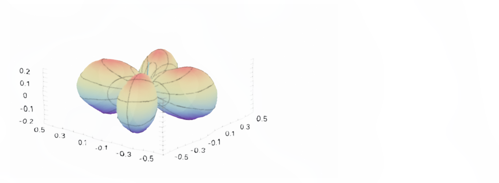

{/* add this script to the body  */}
{/* https://cdn.jsdelivr.net/gh/WLJSTeam/web-components@latest/src/common/app.js */}
<wljs-store json="./attachments/43823bdd-62fc-446f-8e5c-4a7ab981eb29.txt"></wljs-store>

The most important ingredient is a wobble: a smoothly varying distortion of the drawing. 

## Displacement map

A displacement map is an image used as a field of offsets. Instead of displaying its colors, we read its red and green channels as instructions for sampling another image (x,y) similar to normal maps. Image data is usually stored as real numbers from 0.0 to 1.0, so a channel value of `0.5` means no offset; values on either side will  move the sampling position in opposite directions.

Let's start with a smooth gradient and deliberately exaggerate the distortion so it is easy to see by eye

<WLJSWrapper><wljs-editor display="codemirror" type="Input" editable="true"  >{`img = ImageResize[ExampleData[{"TestImage", "House"}], {300, 300}];
	dMap = LinearGradientImage[
	  {RGBColor[1.0,0.5,0.5], RGBColor[0.0,0.5,0.5]}, ImageDimensions[img]
	];
	
	Row[{
	  Labeled[img, "Original"],
	  Labeled[dMap, "Map"],
	  Labeled[ImageTransformation[img,
	 # + 100. ({1, -1} (PixelValue[dMap, #][[{1, 2}]] - {0.5, 0.5})) &,
	 DataRange -> Full, Padding -> "Fixed"], "Result"]
	}] // Deploy`}</wljs-editor></WLJSWrapper>

<WLJSWrapper><wljs-editor display="codemirror" type="Output"  >{`(*GB[*){{(*GB[*){{(*BB[*)((*VB[*)(FrontEndRef["Fc108a7c8-971a-4534-ac01-fcc75c883245"])(*,*)(*"1:eJxTTMoPSmNkYGAoZgESHvk5KRCeEJBwK8rPK3HNS3GtSE0uLUlMykkNVgUJJxsaWCSaJ1voWpobJuqamBqb6CYmGxjqpiUnm5smW1gYG5mYAgCV8BWJ"*)(*]VB*))(*,*)(*"1:eJxTTMoPSmNkYGAoZgESHvk5KWnMIB4vkAjLTC13SU3OL0osyS8KBskHJOalpjHBVAeV5qQWcwIZjjmZ6Xm5qXklCDmfzOKSYjYgwxkonFpUzAFkOiUWp+ZkYpgggCQVkF+cWZKZn4eiHgAIiyhB"*)(*]BB*)(*VB[*)(**)(*,*)(*"1:eJxTTMoPSmNiYGAo5gUSYZmp5S6pyflFiSX5RcEsQBHPktRciDyIF1Sak1osAGS4pKYlluaUOCUWpwaXVOakBrMDBX0Sk1JzUlMAU+0Vnw=="*)(*]VB*)}(*||*),(*||*){"Original"(*VB[*)(**)(*,*)(*"1:eJxTTMoPSmNiYGAo5gUSYZmp5S6pyflFiSX5RcEsQBHPktRciDyIF1Sak1osAGS4pKYlluaUOCUWpwaXVOakBvMABX0Sk1JzUlPAFADFtBeE"*)(*]VB*)}}(*||*)(*1:eJxTTMoPSmNmYGAo5gUSYZmp5S6pyflFiSX5RcEsQBH3osyUNCaQPIgXVJqTWiwAFXbKr3DMyUzPy03NK0Eo8cksLkHVEMwOZDjn55Tm5hWnMaKoQ+EVs4HUAQ1LLUIzAMzILydPN9i9TonFqTmZeakB+cWZJZn5eajuzQSZBCYAfcc7lA==*)(*]GB*)(*|*),(*|*)(*GB[*){{(*BB[*)((*VB[*)(FrontEndRef["F64292bb6-8ae2-442f-bcd5-98915df99136"])(*,*)(*"1:eJxTTMoPSmNkYGAoZgESHvk5KRCeEJBwK8rPK3HNS3GtSE0uLUlMykkNVgUJm5kYWRolJZnpWiSmGumamBil6SYlp5jqWlpYGpqmpFlaGhqbAQCWgxWf"*)(*]VB*))(*,*)(*"1:eJxTTMoPSmNkYGAoZgESHvk5KWnMIB4vkAjLTC13SU3OL0osyS8KBskHJOalpjHBVAeV5qQWcwIZjjmZ6Xm5qXklCDmfzOKSYjYgwxkonFpUzAFkOiUWp+ZkYpgggCQVkF+cWZKZn4eiHgAIiyhB"*)(*]BB*)(*VB[*)(**)(*,*)(*"1:eJxTTMoPSmNiYGAo5gUSYZmp5S6pyflFiSX5RcEsQBHPktRciDyIF1Sak1osAGS4pKYlluaUOCUWpwaXVOakBrMDBX0Sk1JzUlMAU+0Vnw=="*)(*]VB*)}(*||*),(*||*){"Map"(*VB[*)(**)(*,*)(*"1:eJxTTMoPSmNiYGAo5gUSYZmp5S6pyflFiSX5RcEsQBHPktRciDyIF1Sak1osAGS4pKYlluaUOCUWpwaXVOakBvMABX0Sk1JzUlPAFADFtBeE"*)(*]VB*)}}(*||*)(*1:eJxTTMoPSmNmYGAo5gUSYZmp5S6pyflFiSX5RcEsQBH3osyUNCaQPIgXVJqTWiwAFXbKr3DMyUzPy03NK0Eo8cksLkHVEMwOZDjn55Tm5hWnMaKoQ+EVs4HUAQ1LLUIzAMzILydPN9i9TonFqTmZeakB+cWZJZn5eajuzQSZBCYAfcc7lA==*)(*]GB*)(*|*),(*|*)(*GB[*){{(*BB[*)((*VB[*)(FrontEndRef["Fdc6ab1ed-977a-4c4b-9d77-6c402ffdc530"])(*,*)(*"1:eJxTTMoPSmNkYGAoZgESHvk5KRCeEJBwK8rPK3HNS3GtSE0uLUlMykkNVgUJpySbJSYZpqboWpqbJ+qaJJsk6VqmmJvrmiWbGBilpaUkmxobAACr9hZ+"*)(*]VB*))(*,*)(*"1:eJxTTMoPSmNkYGAoZgESHvk5KWnMIB4vkAjLTC13SU3OL0osyS8KBskHJOalpjHBVAeV5qQWcwIZjjmZ6Xm5qXklCDmfzOKSYjYgwxkonFpUzAFkOiUWp+ZkYpgggCQVkF+cWZKZn4eiHgAIiyhB"*)(*]BB*)(*VB[*)(**)(*,*)(*"1:eJxTTMoPSmNiYGAo5gUSYZmp5S6pyflFiSX5RcEsQBHPktRciDyIF1Sak1osAGS4pKYlluaUOCUWpwaXVOakBrMDBX0Sk1JzUlMAU+0Vnw=="*)(*]VB*)}(*||*),(*||*){"Result"(*VB[*)(**)(*,*)(*"1:eJxTTMoPSmNiYGAo5gUSYZmp5S6pyflFiSX5RcEsQBHPktRciDyIF1Sak1osAGS4pKYlluaUOCUWpwaXVOakBvMABX0Sk1JzUlPAFADFtBeE"*)(*]VB*)}}(*||*)(*1:eJxTTMoPSmNmYGAo5gUSYZmp5S6pyflFiSX5RcEsQBH3osyUNCaQPIgXVJqTWiwAFXbKr3DMyUzPy03NK0Eo8cksLkHVEMwOZDjn55Tm5hWnMaKoQ+EVs4HUAQ1LLUIzAMzILydPN9i9TonFqTmZeakB+cWZJZn5eajuzQSZBCYAfcc7lA==*)(*]GB*)}}(*||*)(*1:eJxTTMoPSmNiYGAo5gUSYZmp5S6pyflFiSX5RcEsQBH3oswUiDyIF1Sak1rMBWQEp+akJpckJgG5rECuW2JOcSoAqAgSkw==*)(*]GB*)`}</wljs-editor></WLJSWrapper>

Here, red controls the horizontal offset and green controls the vertical offset. Blue is unused. Because green stays at `0.5`, this first map changes only the horizontal sampling position.

<Callout>
This implementation of displacement map with `ImageTransformation` is not really optimal in terms of performance. May be some Wolfram Wizards in the comments can suggest something better than this.
</Callout>

`ImageTransformation` works backwards: for each **output** pixel at `p`, it samples the **source** at `p + offset`. With `DataRange -> Full`, the offsets are in pixel coordinates. Subtracting `{0.5, 0.5}` centers the map, and the factor `100` sets the strength. The `{1, -1}` factor is only needed to flips the vertical component to match the downward-pointing convention.

A gradient gives us a simple warp. A map whose offsets vary around the center can produce a lens-like bulge effect:

<WLJSWrapper><wljs-editor display="codemirror" type="Input" editable="true"  >{`img = ImageResize[ExampleData[{"TestImage", "House"}], {300,300}];
	
	coords = Subdivide[-1., 1., 299];
	dMap = Table[With[{s = Exp[-8.0 (x^2 + y^2)]},
	  0.5 {1.0 - s x, 1.0 - s y, 1.0}
	], {y, coords}, {x, coords}];
	dMap = Image[dMap, "Real32"];
	
	Row[{
	  Labeled[dMap, "Map"],
	  Labeled[ImageTransformation[img,
	 # + 200. ({1, -1} (PixelValue[dMap, #][[{1, 2}]] - {0.5, 0.5})) &,
	 DataRange -> Full, Padding -> "Fixed"], "Result"]
	}] // Deploy`}</wljs-editor></WLJSWrapper>

<WLJSWrapper><wljs-editor display="codemirror" type="Output"  >{`(*GB[*){{(*GB[*){{(*BB[*)((*VB[*)(FrontEndRef["F2da92efb-ee06-4c5b-80ed-bf52f6461b57"])(*,*)(*"1:eJxTTMoPSmNkYGAoZgESHvk5KRCeEJBwK8rPK3HNS3GtSE0uLUlMykkNVgUJG6UkWhqlpiXppqYamOmaJJsm6VoYpKboJqWZGqWZmZgZJpmaAwCsqBZ8"*)(*]VB*))(*,*)(*"1:eJxTTMoPSmNkYGAoZgESHvk5KWnMIB4vkAjLTC13SU3OL0osyS8KBskHJOalpjHBVAeV5qQWcwIZjjmZ6Xm5qXklCDmfzOKSYjYgwxkonFpUzAFkOiUWp+ZkYpgggCQVkF+cWZKZn4eiHgAIiyhB"*)(*]BB*)(*VB[*)(**)(*,*)(*"1:eJxTTMoPSmNiYGAo5gUSYZmp5S6pyflFiSX5RcEsQBHPktRciDyIF1Sak1osAGS4pKYlluaUOCUWpwaXVOakBrMDBX0Sk1JzUlMAU+0Vnw=="*)(*]VB*)}(*||*),(*||*){"Map"(*VB[*)(**)(*,*)(*"1:eJxTTMoPSmNiYGAo5gUSYZmp5S6pyflFiSX5RcEsQBHPktRciDyIF1Sak1osAGS4pKYlluaUOCUWpwaXVOakBvMABX0Sk1JzUlPAFADFtBeE"*)(*]VB*)}}(*||*)(*1:eJxTTMoPSmNmYGAo5gUSYZmp5S6pyflFiSX5RcEsQBH3osyUNCaQPIgXVJqTWiwAFXbKr3DMyUzPy03NK0Eo8cksLkHVEMwOZDjn55Tm5hWnMaKoQ+EVs4HUAQ1LLUIzAMzILydPN9i9TonFqTmZeakB+cWZJZn5eajuzQSZBCYAfcc7lA==*)(*]GB*)(*|*),(*|*)(*GB[*){{(*BB[*)((*VB[*)(FrontEndRef["F13b7f905-04b1-404b-8635-52f57fe3d79b"])(*,*)(*"1:eJxTTMoPSmNkYGAoZgESHvk5KRCeEJBwK8rPK3HNS3GtSE0uLUlMykkNVgUJGxonmadZGpjqGpgkGeqaAEldCzNjU11TozRT87RU4xRzyyQAiwAVXw=="*)(*]VB*))(*,*)(*"1:eJxTTMoPSmNkYGAoZgESHvk5KWnMIB4vkAjLTC13SU3OL0osyS8KBskHJOalpjHBVAeV5qQWcwIZjjmZ6Xm5qXklCDmfzOKSYjYgwxkonFpUzAFkOiUWp+ZkYpgggCQVkF+cWZKZn4eiHgAIiyhB"*)(*]BB*)(*VB[*)(**)(*,*)(*"1:eJxTTMoPSmNiYGAo5gUSYZmp5S6pyflFiSX5RcEsQBHPktRciDyIF1Sak1osAGS4pKYlluaUOCUWpwaXVOakBrMDBX0Sk1JzUlMAU+0Vnw=="*)(*]VB*)}(*||*),(*||*){"Result"(*VB[*)(**)(*,*)(*"1:eJxTTMoPSmNiYGAo5gUSYZmp5S6pyflFiSX5RcEsQBHPktRciDyIF1Sak1osAGS4pKYlluaUOCUWpwaXVOakBvMABX0Sk1JzUlPAFADFtBeE"*)(*]VB*)}}(*||*)(*1:eJxTTMoPSmNmYGAo5gUSYZmp5S6pyflFiSX5RcEsQBH3osyUNCaQPIgXVJqTWiwAFXbKr3DMyUzPy03NK0Eo8cksLkHVEMwOZDjn55Tm5hWnMaKoQ+EVs4HUAQ1LLUIzAMzILydPN9i9TonFqTmZeakB+cWZJZn5eajuzQSZBCYAfcc7lA==*)(*]GB*)}}(*||*)(*1:eJxTTMoPSmNiYGAo5gUSYZmp5S6pyflFiSX5RcEsQBH3oswUiDyIF1Sak1rMBWQEp+akJpckJgG5rECuW2JOcSoAqAgSkw==*)(*]GB*)`}</wljs-editor></WLJSWrapper>

Now replace the carefully constructed map with noise. Independent red and green noise fields give us uncorellated horizontal and vertical offsets. Blurring makes neighboring pixels move together; without it, the result would look scrambled rather than hand-drawn.

We also rescale each blurred field with `ImageAdjust`, since averaging the noise otherwise leaves very little variation around `0.5`

<WLJSWrapper><wljs-editor display="codemirror" type="Input" editable="true"  >{`img = ImageResize[ExampleData[{"TestImage", "House"}], {300, 300}];
	dMap = 
	  ImageMultiply[ImageAdjust[Blur[RandomImage[{0, 1}, 300], 10]], Red] +
	  ImageMultiply[ImageAdjust[Blur[RandomImage[{0, 1}, 300], 10]], Green] +
	  0.5 ConstantImage[Blue, 300];
	
	Row[{
	  Labeled[dMap, "Smooth noise map"],
	  Labeled[ImageTransformation[img,
	    # + 12. ({1, -1} (PixelValue[dMap, #][[{1, 2}]] - {0.5, 0.5})) &,
	    DataRange -> Full, Padding -> "Fixed"], "Wobbled"]
	}] // Deploy`}</wljs-editor></WLJSWrapper>

<WLJSWrapper><wljs-editor display="codemirror" type="Output"  >{`(*GB[*){{(*GB[*){{(*BB[*)((*VB[*)(FrontEndRef["F1bd646eb-e3e2-4bb9-a430-abd4ab23b4d4"])(*,*)(*"1:eJxTTMoPSmNkYGAoZgESHvk5KRCeEJBwK8rPK3HNS3GtSE0uLUlMykkNVgUJGyalmJmYpSbpphqnGumaJCVZ6iaaGBvoJialmCQmGRknmaSYAACnOBaR"*)(*]VB*))(*,*)(*"1:eJxTTMoPSmNkYGAoZgESHvk5KWnMIB4vkAjLTC13SU3OL0osyS8KBskHJOalpjHBVAeV5qQWcwIZjjmZ6Xm5qXklCDmfzOKSYjYgwxkonFpUzAFkOiUWp+ZkYpgggCQVkF+cWZKZn4eiHgAIiyhB"*)(*]BB*)(*VB[*)(**)(*,*)(*"1:eJxTTMoPSmNiYGAo5gUSYZmp5S6pyflFiSX5RcEsQBHPktRciDyIF1Sak1osAGS4pKYlluaUOCUWpwaXVOakBrMDBX0Sk1JzUlMAU+0Vnw=="*)(*]VB*)}(*||*),(*||*){"Smooth noise map"(*VB[*)(**)(*,*)(*"1:eJxTTMoPSmNiYGAo5gUSYZmp5S6pyflFiSX5RcEsQBHPktRciDyIF1Sak1osAGS4pKYlluaUOCUWpwaXVOakBvMABX0Sk1JzUlPAFADFtBeE"*)(*]VB*)}}(*||*)(*1:eJxTTMoPSmNmYGAo5gUSYZmp5S6pyflFiSX5RcEsQBH3osyUNCaQPIgXVJqTWiwAFXbKr3DMyUzPy03NK0Eo8cksLkHVEMwOZDjn55Tm5hWnMaKoQ+EVs4HUAQ1LLUIzAMzILydPN9i9TonFqTmZeakB+cWZJZn5eajuzQSZBCYAfcc7lA==*)(*]GB*)(*|*),(*|*)(*GB[*){{(*BB[*)((*VB[*)(FrontEndRef["F2108c6a5-e7c7-496d-aba3-974ccdfa823a"])(*,*)(*"1:eJxTTMoPSmNkYGAoZgESHvk5KRCeEJBwK8rPK3HNS3GtSE0uLUlMykkNVgUJGxkaWCSbJZrqpponm+uaWJql6CYmJRrrWpqbJCenpCVaGBknAgCahxZL"*)(*]VB*))(*,*)(*"1:eJxTTMoPSmNkYGAoZgESHvk5KWnMIB4vkAjLTC13SU3OL0osyS8KBskHJOalpjHBVAeV5qQWcwIZjjmZ6Xm5qXklCDmfzOKSYjYgwxkonFpUzAFkOiUWp+ZkYpgggCQVkF+cWZKZn4eiHgAIiyhB"*)(*]BB*)(*VB[*)(**)(*,*)(*"1:eJxTTMoPSmNiYGAo5gUSYZmp5S6pyflFiSX5RcEsQBHPktRciDyIF1Sak1osAGS4pKYlluaUOCUWpwaXVOakBrMDBX0Sk1JzUlMAU+0Vnw=="*)(*]VB*)}(*||*),(*||*){"Wobbled"(*VB[*)(**)(*,*)(*"1:eJxTTMoPSmNiYGAo5gUSYZmp5S6pyflFiSX5RcEsQBHPktRciDyIF1Sak1osAGS4pKYlluaUOCUWpwaXVOakBvMABX0Sk1JzUlPAFADFtBeE"*)(*]VB*)}}(*||*)(*1:eJxTTMoPSmNmYGAo5gUSYZmp5S6pyflFiSX5RcEsQBH3osyUNCaQPIgXVJqTWiwAFXbKr3DMyUzPy03NK0Eo8cksLkHVEMwOZDjn55Tm5hWnMaKoQ+EVs4HUAQ1LLUIzAMzILydPN9i9TonFqTmZeakB+cWZJZn5eajuzQSZBCYAfcc7lA==*)(*]GB*)}}(*||*)(*1:eJxTTMoPSmNiYGAo5gUSYZmp5S6pyflFiSX5RcEsQBH3oswUiDyIF1Sak1rMBWQEp+akJpckJgG5rECuW2JOcSoAqAgSkw==*)(*]GB*)`}</wljs-editor></WLJSWrapper>

The photograph of the house makes the distortion easy to recognize, but clean lines are the real test

<WLJSWrapper><wljs-editor display="codemirror" type="Input" editable="true"  >{`plotImage = ImageResize[
	  Rasterize[Plot[{x, x x, x x x}, {x, 0, 1}, AspectRatio -> 1,
	    Background -> White, ImageSize -> {300, 300}]], {300, 300}
	];
	wobbledPlot = ImageTransformation[plotImage,
	  # + 6. ({1, -1} (PixelValue[dMap, #][[{1, 2}]] - {0.5, 0.5})) &,
	  DataRange -> Full, Padding -> "Fixed"
	];
	
	Row[{
	  Labeled[plotImage, "Original"],
	  Labeled[wobbledPlot, "Wobble only"]
	}] // Deploy`}</wljs-editor></WLJSWrapper>

<WLJSWrapper><wljs-editor display="codemirror" type="Output"  >{`(*GB[*){{(*GB[*){{(*BB[*)((*VB[*)(FrontEndRef["Fb502d808-b784-456f-b1ad-491248be3c6a"])(*,*)(*"1:eJxTTMoPSmNkYGAoZgESHvk5KRCeEJBwK8rPK3HNS3GtSE0uLUlMykkNVgUJJ5kaGKVYGFjoJplbmOiamJql6SYZJqbomlgaGplYJKUaJ5slAgCSkRW5"*)(*]VB*))(*,*)(*"1:eJxTTMoPSmNkYGAoZgESHvk5KWnMIB4vkAjLTC13SU3OL0osyS8KBskHJOalpjHBVAeV5qQWcwIZjjmZ6Xm5qXklCDmfzOKSYjYgwxkonFpUzAFkOiUWp+ZkYpgggCQVkF+cWZKZn4eiHgAIiyhB"*)(*]BB*)(*VB[*)(**)(*,*)(*"1:eJxTTMoPSmNiYGAo5gUSYZmp5S6pyflFiSX5RcEsQBHPktRciDyIF1Sak1osAGS4pKYlluaUOCUWpwaXVOakBrMDBX0Sk1JzUlMAU+0Vnw=="*)(*]VB*)}(*||*),(*||*){"Original"(*VB[*)(**)(*,*)(*"1:eJxTTMoPSmNiYGAo5gUSYZmp5S6pyflFiSX5RcEsQBHPktRciDyIF1Sak1osAGS4pKYlluaUOCUWpwaXVOakBvMABX0Sk1JzUlPAFADFtBeE"*)(*]VB*)}}(*||*)(*1:eJxTTMoPSmNmYGAo5gUSYZmp5S6pyflFiSX5RcEsQBH3osyUNCaQPIgXVJqTWiwAFXbKr3DMyUzPy03NK0Eo8cksLkHVEMwOZDjn55Tm5hWnMaKoQ+EVs4HUAQ1LLUIzAMzILydPN9i9TonFqTmZeakB+cWZJZn5eajuzQSZBCYAfcc7lA==*)(*]GB*)(*|*),(*|*)(*GB[*){{(*BB[*)((*VB[*)(FrontEndRef["F28cd2b0e-cd26-4221-b0bf-ccaedd4bc271"])(*,*)(*"1:eJxTTMoPSmNkYGAoZgESHvk5KRCeEJBwK8rPK3HNS3GtSE0uLUlMykkNVgUJG1kkpxglGaTqAikzXRMjI0PdJIOkNN3k5MTUlBSTpGQjc0MApoIWvQ=="*)(*]VB*))(*,*)(*"1:eJxTTMoPSmNkYGAoZgESHvk5KWnMIB4vkAjLTC13SU3OL0osyS8KBskHJOalpjHBVAeV5qQWcwIZjjmZ6Xm5qXklCDmfzOKSYjYgwxkonFpUzAFkOiUWp+ZkYpgggCQVkF+cWZKZn4eiHgAIiyhB"*)(*]BB*)(*VB[*)(**)(*,*)(*"1:eJxTTMoPSmNiYGAo5gUSYZmp5S6pyflFiSX5RcEsQBHPktRciDyIF1Sak1osAGS4pKYlluaUOCUWpwaXVOakBrMDBX0Sk1JzUlMAU+0Vnw=="*)(*]VB*)}(*||*),(*||*){"Wobble only"(*VB[*)(**)(*,*)(*"1:eJxTTMoPSmNiYGAo5gUSYZmp5S6pyflFiSX5RcEsQBHPktRciDyIF1Sak1osAGS4pKYlluaUOCUWpwaXVOakBvMABX0Sk1JzUlPAFADFtBeE"*)(*]VB*)}}(*||*)(*1:eJxTTMoPSmNmYGAo5gUSYZmp5S6pyflFiSX5RcEsQBH3osyUNCaQPIgXVJqTWiwAFXbKr3DMyUzPy03NK0Eo8cksLkHVEMwOZDjn55Tm5hWnMaKoQ+EVs4HUAQ1LLUIzAMzILydPN9i9TonFqTmZeakB+cWZJZn5eajuzQSZBCYAfcc7lA==*)(*]GB*)}}(*||*)(*1:eJxTTMoPSmNiYGAo5gUSYZmp5S6pyflFiSX5RcEsQBH3oswUiDyIF1Sak1rMBWQEp+akJpckJgG5rECuW2JOcSoAqAgSkw==*)(*]GB*)`}</wljs-editor></WLJSWrapper>

## Move the effect into an SVG filter

The raster experiments explain the effect, but they leave us with a fixed image. In WLJS, we can instead attach an SVG filter to the DOM element that displays an expression. The browser then filters its rendered appearance, including subsequent visual updates, without asking the Wolfram kernel to regenerate a raster image for every frame.

The filter follows a slighly extended sequence just for increase the softness of lines:

| Stage | SVG primitive |   |
| --- | --- | --- |
| Smooth noise | `feTurbulence` | Generate the displacement map |
| Wobble | `feDisplacementMap` | Distort the rendered expression |
| Ink softness | `feGaussianBlur` | Soften the displaced edges |
| Tone and opacity | `feComponentTransfer` | Adjust RGB and reshape alpha |
| Paper grain | `feTurbulence`, `feColorMatrix`, `feBlend` | Add a faint, optional texture |

The JavaScript cell below registers the decorator and keeps reusable filter definitions in its output. Evaluate it before the examples that use `XkcdFilter`:

<WLJSWrapper><wljs-editor display="codemirror" type="Input" editable="true" encoded="true" fade="true" >{`.js%0A%2F%2F%20Keep%20the%20definitions%20in%20this%20cell%27s%20output%2C%20with%20one%20filter%20per%20option%20set.%0Aconst%20ns%20%3D%20%22http%3A%2F%2Fwww.w3.org%2F2000%2Fsvg%22%3B%0Aconst%20host%20%3D%20document.createElementNS%28ns%2C%20%22svg%22%29%3B%0Ahost.setAttribute%28%22aria-hidden%22%2C%20%22true%22%29%3B%0Ahost.setAttribute%28%22width%22%2C%20%220%22%29%3B%0Ahost.setAttribute%28%22height%22%2C%20%220%22%29%3B%0Ahost.style.cssText%20%3D%20%22position%3Aabsolute%3Bpointer-events%3Anone%22%3B%0Aconst%20defs%20%3D%20document.createElementNS%28ns%2C%20%22defs%22%29%3B%0Ahost.appendChild%28defs%29%3B%0Aconst%20filters%20%3D%20new%20Map%28%29%3B%0Aconst%20prefix%20%3D%20%22xkcd-%22%20%2B%20crypto.randomUUID%28%29%3B%0A%0Aconst%20decorate%20%3D%20async%20%28args%2C%20env%29%20%3D%3E%20%7B%0A%20%20const%20options%20%3D%20await%20core._getRules%28args%2C%20env%29%3B%0A%20%20const%20element%20%3D%20options.Id%0A%20%20%20%20%3F%20document.getElementById%28options.Id%29%0A%20%20%20%20%3A%20env.element%3B%0A%20%20if%20%28%21%28element%20instanceof%20Element%29%29%20%7B%0A%20%20%20%20throw%20new%20TypeError%28%22XkcdFilterDecorator%20needs%20a%20DOM%20element.%22%29%3B%0A%20%20%7D%0A%0A%20%20const%20settings%20%3D%20%7B%0A%20%20%20%20Wobble%3A%2010.6%2C%0A%20%20%20%20Roughness%3A%200.018%2C%0A%20%20%20%20InkBleed%3A%200.35%2C%0A%20%20%20%20PaperGrain%3A%200.025%2C%0A%20%20%20%20...options%0A%20%20%7D%3B%0A%20%20const%20values%20%3D%20%5B%22Wobble%22%2C%20%22Roughness%22%2C%20%22InkBleed%22%2C%20%22PaperGrain%22%5D%0A%20%20%20%20.map%28name%20%3D%3E%20settings%5Bname%5D%29%3B%0A%20%20if%20%28values.some%28value%20%3D%3E%20%21Number.isFinite%28value%29%20%7C%7C%20value%20%3C%200%29%29%20%7B%0A%20%20%20%20throw%20new%20TypeError%28%22Filter%20settings%20must%20be%20finite%2C%20nonnegative%20numbers.%22%29%3B%0A%20%20%7D%0A%20%20if%20%28settings.PaperGrain%20%3E%201%29%20%7B%0A%20%20%20%20throw%20new%20RangeError%28%22PaperGrain%20must%20be%20between%200%20and%201.%22%29%3B%0A%20%20%7D%0A%0A%20%20const%20key%20%3D%20JSON.stringify%28values%29%3B%0A%20%20let%20id%20%3D%20filters.get%28key%29%3B%0A%20%20if%20%28%21id%29%20%7B%0A%20%20%20%20id%20%3D%20prefix%20%2B%20%22-%22%20%2B%20filters.size%3B%0A%20%20%20%20const%20filter%20%3D%20document.createElementNS%28ns%2C%20%22filter%22%29%3B%0A%20%20%20%20filter.id%20%3D%20id%3B%0A%20%20%20%20%2F%2F%20Leave%20space%20for%20displaced%20or%20blurred%20pixels%20around%20the%20content.%0A%20%20%20%20filter.setAttribute%28%22x%22%2C%20%22-20%25%22%29%3B%0A%20%20%20%20filter.setAttribute%28%22y%22%2C%20%22-20%25%22%29%3B%0A%20%20%20%20filter.setAttribute%28%22width%22%2C%20%22140%25%22%29%3B%0A%20%20%20%20filter.setAttribute%28%22height%22%2C%20%22140%25%22%29%3B%0A%20%20%20%20filter.setAttribute%28%22color-interpolation-filters%22%2C%20%22sRGB%22%29%3B%0A%0A%20%20%20%20filter.innerHTML%20%3D%20%60%0A%20%20%20%20%20%20%3CfeTurbulence%20type%3D%22fractalNoise%22%20baseFrequency%3D%22%24%7Bsettings.Roughness%7D%22%0A%20%20%20%20%20%20%20%20numOctaves%3D%222%22%20seed%3D%2217%22%20stitchTiles%3D%22stitch%22%20result%3D%22wobbleNoise%22%2F%3E%0A%20%20%20%20%20%20%3CfeDisplacementMap%20in%3D%22SourceGraphic%22%20in2%3D%22wobbleNoise%22%20scale%3D%22%24%7Bsettings.Wobble%7D%22%0A%20%20%20%20%20%20%20%20xChannelSelector%3D%22R%22%20yChannelSelector%3D%22G%22%20result%3D%22wobbled%22%2F%3E%0A%20%20%20%20%20%20%3CfeGaussianBlur%20in%3D%22wobbled%22%20stdDeviation%3D%22%24%7Bsettings.InkBleed%7D%22%20result%3D%22softInk%22%2F%3E%0A%20%20%20%20%20%20%3CfeComponentTransfer%20in%3D%22softInk%22%20result%3D%22roughInk%22%3E%0A%20%20%20%20%20%20%20%20%3CfeFuncR%20type%3D%22gamma%22%20amplitude%3D%221.08%22%20exponent%3D%220.9%22%20offset%3D%22-0.025%22%2F%3E%0A%20%20%20%20%20%20%20%20%3CfeFuncG%20type%3D%22gamma%22%20amplitude%3D%221.08%22%20exponent%3D%220.9%22%20offset%3D%22-0.025%22%2F%3E%0A%20%20%20%20%20%20%20%20%3CfeFuncB%20type%3D%22gamma%22%20amplitude%3D%221.08%22%20exponent%3D%220.9%22%20offset%3D%22-0.025%22%2F%3E%0A%20%20%20%20%20%20%20%20%3CfeFuncA%20type%3D%22table%22%20tableValues%3D%220%200.08%200.92%201%22%2F%3E%0A%20%20%20%20%20%20%3C%2FfeComponentTransfer%3E%0A%20%20%20%20%20%20%3CfeTurbulence%20type%3D%22fractalNoise%22%20baseFrequency%3D%220.7%22%20numOctaves%3D%223%22%0A%20%20%20%20%20%20%20%20seed%3D%2229%22%20stitchTiles%3D%22stitch%22%20result%3D%22paperNoise%22%2F%3E%0A%20%20%20%20%20%20%3CfeColorMatrix%20in%3D%22paperNoise%22%20type%3D%22matrix%22%20result%3D%22faintPaperNoise%22%0A%20%20%20%20%20%20%20%20values%3D%220%200%200%200%200.35%0A%20%20%20%20%20%20%20%20%20%20%20%20%20%20%20%200%200%200%200%200.35%0A%20%20%20%20%20%20%20%20%20%20%20%20%20%20%20%200%200%200%200%200.35%0A%20%20%20%20%20%20%20%20%20%20%20%20%20%20%20%200%200%200%20%24%7Bsettings.PaperGrain%7D%200%22%2F%3E%0A%20%20%20%20%20%20%3CfeBlend%20in%3D%22roughInk%22%20in2%3D%22faintPaperNoise%22%20mode%3D%22multiply%22%2F%3E%0A%20%20%20%20%60%3B%0A%0A%20%20%20%20defs.appendChild%28filter%29%3B%0A%20%20%20%20filters.set%28key%2C%20id%29%3B%0A%20%20%7D%0A%20%20element.style.filter%20%3D%20%60url%28%23%24%7Bid%7D%29%60%3B%0A%7D%3B%0A%0Acore.XkcdFilterDecorator%20%3D%20decorate%3B%0Athis.ondestroy%20%3D%20%28%29%20%3D%3E%20%7B%0A%20%20filters.clear%28%29%3B%0A%20%20host.remove%28%29%3B%0A%7D%3B%0A%0Adocument.body.appendChild%28host%29%3B%0A%0Areturn%20%27Installed%27%3B`}</wljs-editor></WLJSWrapper>

<WLJSWrapper><wljs-editor display="js" type="Output" encoded="true" class="wljs-hide-undefined" >{`%2F%2F%20Keep%20the%20definitions%20in%20this%20cell%27s%20output%2C%20with%20one%20filter%20per%20option%20set.%0Aconst%20ns%20%3D%20%22http%3A%2F%2Fwww.w3.org%2F2000%2Fsvg%22%3B%0Aconst%20host%20%3D%20document.createElementNS%28ns%2C%20%22svg%22%29%3B%0Ahost.setAttribute%28%22aria-hidden%22%2C%20%22true%22%29%3B%0Ahost.setAttribute%28%22width%22%2C%20%220%22%29%3B%0Ahost.setAttribute%28%22height%22%2C%20%220%22%29%3B%0Ahost.style.cssText%20%3D%20%22position%3Aabsolute%3Bpointer-events%3Anone%22%3B%0Aconst%20defs%20%3D%20document.createElementNS%28ns%2C%20%22defs%22%29%3B%0Ahost.appendChild%28defs%29%3B%0Aconst%20filters%20%3D%20new%20Map%28%29%3B%0Aconst%20prefix%20%3D%20%22xkcd-%22%20%2B%20crypto.randomUUID%28%29%3B%0A%0Aconst%20decorate%20%3D%20async%20%28args%2C%20env%29%20%3D%3E%20%7B%0A%20%20const%20options%20%3D%20await%20core._getRules%28args%2C%20env%29%3B%0A%20%20const%20element%20%3D%20options.Id%0A%20%20%20%20%3F%20document.getElementById%28options.Id%29%0A%20%20%20%20%3A%20env.element%3B%0A%20%20if%20%28%21%28element%20instanceof%20Element%29%29%20%7B%0A%20%20%20%20throw%20new%20TypeError%28%22XkcdFilterDecorator%20needs%20a%20DOM%20element.%22%29%3B%0A%20%20%7D%0A%0A%20%20const%20settings%20%3D%20%7B%0A%20%20%20%20Wobble%3A%2010.6%2C%0A%20%20%20%20Roughness%3A%200.018%2C%0A%20%20%20%20InkBleed%3A%200.35%2C%0A%20%20%20%20PaperGrain%3A%200.025%2C%0A%20%20%20%20...options%0A%20%20%7D%3B%0A%20%20const%20values%20%3D%20%5B%22Wobble%22%2C%20%22Roughness%22%2C%20%22InkBleed%22%2C%20%22PaperGrain%22%5D%0A%20%20%20%20.map%28name%20%3D%3E%20settings%5Bname%5D%29%3B%0A%20%20if%20%28values.some%28value%20%3D%3E%20%21Number.isFinite%28value%29%20%7C%7C%20value%20%3C%200%29%29%20%7B%0A%20%20%20%20throw%20new%20TypeError%28%22Filter%20settings%20must%20be%20finite%2C%20nonnegative%20numbers.%22%29%3B%0A%20%20%7D%0A%20%20if%20%28settings.PaperGrain%20%3E%201%29%20%7B%0A%20%20%20%20throw%20new%20RangeError%28%22PaperGrain%20must%20be%20between%200%20and%201.%22%29%3B%0A%20%20%7D%0A%0A%20%20const%20key%20%3D%20JSON.stringify%28values%29%3B%0A%20%20let%20id%20%3D%20filters.get%28key%29%3B%0A%20%20if%20%28%21id%29%20%7B%0A%20%20%20%20id%20%3D%20prefix%20%2B%20%22-%22%20%2B%20filters.size%3B%0A%20%20%20%20const%20filter%20%3D%20document.createElementNS%28ns%2C%20%22filter%22%29%3B%0A%20%20%20%20filter.id%20%3D%20id%3B%0A%20%20%20%20%2F%2F%20Leave%20space%20for%20displaced%20or%20blurred%20pixels%20around%20the%20content.%0A%20%20%20%20filter.setAttribute%28%22x%22%2C%20%22-20%25%22%29%3B%0A%20%20%20%20filter.setAttribute%28%22y%22%2C%20%22-20%25%22%29%3B%0A%20%20%20%20filter.setAttribute%28%22width%22%2C%20%22140%25%22%29%3B%0A%20%20%20%20filter.setAttribute%28%22height%22%2C%20%22140%25%22%29%3B%0A%20%20%20%20filter.setAttribute%28%22color-interpolation-filters%22%2C%20%22sRGB%22%29%3B%0A%0A%20%20%20%20filter.innerHTML%20%3D%20%60%0A%20%20%20%20%20%20%3CfeTurbulence%20type%3D%22fractalNoise%22%20baseFrequency%3D%22%24%7Bsettings.Roughness%7D%22%0A%20%20%20%20%20%20%20%20numOctaves%3D%222%22%20seed%3D%2217%22%20stitchTiles%3D%22stitch%22%20result%3D%22wobbleNoise%22%2F%3E%0A%20%20%20%20%20%20%3CfeDisplacementMap%20in%3D%22SourceGraphic%22%20in2%3D%22wobbleNoise%22%20scale%3D%22%24%7Bsettings.Wobble%7D%22%0A%20%20%20%20%20%20%20%20xChannelSelector%3D%22R%22%20yChannelSelector%3D%22G%22%20result%3D%22wobbled%22%2F%3E%0A%20%20%20%20%20%20%3CfeGaussianBlur%20in%3D%22wobbled%22%20stdDeviation%3D%22%24%7Bsettings.InkBleed%7D%22%20result%3D%22softInk%22%2F%3E%0A%20%20%20%20%20%20%3CfeComponentTransfer%20in%3D%22softInk%22%20result%3D%22roughInk%22%3E%0A%20%20%20%20%20%20%20%20%3CfeFuncR%20type%3D%22gamma%22%20amplitude%3D%221.08%22%20exponent%3D%220.9%22%20offset%3D%22-0.025%22%2F%3E%0A%20%20%20%20%20%20%20%20%3CfeFuncG%20type%3D%22gamma%22%20amplitude%3D%221.08%22%20exponent%3D%220.9%22%20offset%3D%22-0.025%22%2F%3E%0A%20%20%20%20%20%20%20%20%3CfeFuncB%20type%3D%22gamma%22%20amplitude%3D%221.08%22%20exponent%3D%220.9%22%20offset%3D%22-0.025%22%2F%3E%0A%20%20%20%20%20%20%20%20%3CfeFuncA%20type%3D%22table%22%20tableValues%3D%220%200.08%200.92%201%22%2F%3E%0A%20%20%20%20%20%20%3C%2FfeComponentTransfer%3E%0A%20%20%20%20%20%20%3CfeTurbulence%20type%3D%22fractalNoise%22%20baseFrequency%3D%220.7%22%20numOctaves%3D%223%22%0A%20%20%20%20%20%20%20%20seed%3D%2229%22%20stitchTiles%3D%22stitch%22%20result%3D%22paperNoise%22%2F%3E%0A%20%20%20%20%20%20%3CfeColorMatrix%20in%3D%22paperNoise%22%20type%3D%22matrix%22%20result%3D%22faintPaperNoise%22%0A%20%20%20%20%20%20%20%20values%3D%220%200%200%200%200.35%0A%20%20%20%20%20%20%20%20%20%20%20%20%20%20%20%200%200%200%200%200.35%0A%20%20%20%20%20%20%20%20%20%20%20%20%20%20%20%200%200%200%200%200.35%0A%20%20%20%20%20%20%20%20%20%20%20%20%20%20%20%200%200%200%20%24%7Bsettings.PaperGrain%7D%200%22%2F%3E%0A%20%20%20%20%20%20%3CfeBlend%20in%3D%22roughInk%22%20in2%3D%22faintPaperNoise%22%20mode%3D%22multiply%22%2F%3E%0A%20%20%20%20%60%3B%0A%0A%20%20%20%20defs.appendChild%28filter%29%3B%0A%20%20%20%20filters.set%28key%2C%20id%29%3B%0A%20%20%7D%0A%20%20element.style.filter%20%3D%20%60url%28%23%24%7Bid%7D%29%60%3B%0A%7D%3B%0A%0Acore.XkcdFilterDecorator%20%3D%20decorate%3B%0Athis.ondestroy%20%3D%20%28%29%20%3D%3E%20%7B%0A%20%20filters.clear%28%29%3B%0A%20%20host.remove%28%29%3B%0A%7D%3B%0A%0Adocument.body.appendChild%28host%29%3B%0A%0Areturn%20%27Installed%27%3B`}</wljs-editor></WLJSWrapper>

`XkcdFilterDecorator` is the frontend symbol/function that applies the filter. It uses `env.element` for a normal decorated expression, or looks up an explicit `"Id"` option in its arguments. Expressions with the same settings share one filter definition stored in the notebook windows.

There are four controls you can use:

| Property | Effect |
| --- | --- |
| `"Wobble"` | Displacement strength; use `0` to turn off distortion |
| `"Roughness"` | Noise frequency; larger values make the bends more closely spaced |
| `"InkBleed"` | Blur standard deviation |
| `"PaperGrain"` | Strength of the faint texture, between `0` and `1`; use `0` to remove it |

The fixed noise seeds keep the texture stable as the content updates. Now we need a Wolfram wrapper that calls this frontend function when its contents are displayed.

<WLJSWrapper><wljs-editor display="codemirror" type="Input" editable="true"  >{`XkcdFilter /: MakeBoxes[
	    XkcdFilter[expr_, opts: OptionsPattern[]], form: StandardForm] :=
	  With[{
	    boxes = MakeBoxes[expr, form]
	  },
	    BoxBox[boxes, XkcdFilterDecorator[opts]]  
	  ]
	
	Options[XkcdFilter] = {
	    "Wobble" -> 10.6,
	    "Roughness" -> 0.018,
	    "InkBleed" -> 0.35,
	    "PaperGrain" -> 0.025
	};`}</wljs-editor></WLJSWrapper>

For `StandardForm`, `MakeBoxes` formats the inner expression and `BoxBox` provides an editable container around it. The decorator applies the filter to that container, so it does not need to understand whether the contents are a number, a plot, or something else. This is just a display rule that makes `XkcdFilter[expr]` equal to `expr`. In this version we omit the `Head` option of `BoxBox`, so copying the decorated inner value back into input gives the inner expression

Let's test it on a number:

<WLJSWrapper><wljs-editor display="codemirror" type="Input" editable="true"  >{`XkcdFilter[43]`}</wljs-editor></WLJSWrapper>

<WLJSWrapper><wljs-editor display="codemirror" type="Output"  >{`(*BB[*)(43)(*,*)(*"1:eJxTTMoPSmNkYGAoZgESHvk5KWkMIJ4wkIjITk5xy8wpSS1ySU3OL0osyS8CAO4bDCk="*)(*]BB*)`}</wljs-editor></WLJSWrapper>

<WLJSWrapper><wljs-editor display="codemirror" type="Input" editable="true"  >{`(*BB[*)(43)(*,*)(*"1:eJxTTMoPSmNkYGAoZgESHvk5KWkMIJ4wkIjITk5xy8wpSS1ySU3OL0osyS8CAO4bDCk="*)(*]BB*) + 1`}</wljs-editor></WLJSWrapper>

<WLJSWrapper><wljs-editor display="codemirror" type="Output"  >{`44`}</wljs-editor></WLJSWrapper>

Now use the same wrapper on a plot. No rasterization step is needed in our Wolfram code, and the rendered content remains interactive. The filter changes its appearance only

<WLJSWrapper><wljs-editor display="codemirror" type="Input" editable="true"  >{`XkcdFilter[Plot[{x, x x, x x x, Sin[x 10]}, {x,0,1}], 
	    "Wobble" -> 8.6,
	    "Roughness" -> 0.018,
	    "InkBleed" -> 0.55,
	    "PaperGrain" -> 0.01
	]`}</wljs-editor></WLJSWrapper>

<WLJSWrapper><wljs-editor display="codemirror" type="Output"  >{`(*BB[*)((*VB[*)(FrontEndRef["F90cafcf2-27dc-4323-9c3a-d87997545139"])(*,*)(*"1:eJxTTMoPSmNkYGAoZgESHvk5KRCeEJBwK8rPK3HNS3GtSE0uLUlMykkNVgUJWxokJ6YlpxnpGpmnJOuaGBsZ61omGyfqpliYW1qam5qYGhpbAgChDBWb"*)(*]VB*))(*,*)(*"1:eJxTTMoPSmNkYGAoZgESHvk5KWkgRrEwkIjITk5xy8wpSS1ySU3OL0osyS9KY4IpDSrNSQ1mAzLC85OSclKLjMFA0QFNBSeIkV+anpGXWlxcZH3fv3d63iR7NEUcQIZnXrZTTmpqStGsmSDwEF0NF5ARkFiQWuRelJiZV1Qtss79YVWLPQDlpzP2"*)(*]BB*)`}</wljs-editor></WLJSWrapper>

Bar chart:

<WLJSWrapper><wljs-editor display="codemirror" type="Input" editable="true"  >{`XkcdFilter[BarChart[RandomReal[{0,1}, {3,2}]], 
	    "Wobble" -> 8.6,
	    "Roughness" -> 0.018,
	    "InkBleed" -> 0.55,
	    "PaperGrain" -> 0.01
	]`}</wljs-editor></WLJSWrapper>

<WLJSWrapper><wljs-editor display="codemirror" type="Output"  >{`(*BB[*)((*VB[*)(FrontEndRef["Ff6d56fac-4c9a-412b-8114-e6d250f2a8bf"])(*,*)(*"1:eJxTTMoPSmNkYGAoZgESHvk5KRCeEJBwK8rPK3HNS3GtSE0uLUlMykkNVgUJp5mlmJqlJSbrmiRbJuqaGBol6VoYGproppqlGJkapBklWiSlAQCjaRZG"*)(*]VB*))(*,*)(*"1:eJxTTMoPSmNkYGAoZgESHvk5KWkgRrEwkIjITk5xy8wpSS1ySU3OL0osyS9KY4IpDSrNSQ1mAzLC85OSclKLjMFA0QFNBSeIkV+anpGXWlxcZH3fv3d63iR7NEUcQIZnXrZTTmpqStGsmSDwEF0NF5ARkFiQWuRelJiZV1Qtss79YVWLPQDlpzP2"*)(*]BB*)`}</wljs-editor></WLJSWrapper>

The decorator also works around a 3D view. Try dragging the object to rotate it: the filter is applied to the rendered view as it changes. Toon shading makes the surface a good companion for the wobbly outlines.

<WLJSWrapper><wljs-editor display="codemirror" type="Input" editable="true"  >{`XkcdFilter[
	  SphericalPlot3D[
	    ((*FB[*)((1)(*,*)/(*,*)(4))(*]FB*)) ((*SqB[*)Sqrt[(*FB[*)((15)(*,*)/(*,*)(2 \\[Pi]))(*]FB*)](*]SqB*)) (-Im[((*SpB[*)Power[E(*|*),(*|*)-2 I p](*]SpB*)) ((*SpB[*)Power[Sin[t](*|*),(*|*)2](*]SpB*))]+Re[((*SpB[*)Power[E(*|*),(*|*)2 I p](*]SpB*)) ((*SpB[*)Power[Sin[t](*|*),(*|*)2](*]SpB*))]),
	    
	    {t,0,Pi}, {p,0,2Pi}, 
	    PlotStyle->MaterialShading[MeshToonMaterial[]], 
	    MeshStyle->Black,
	    ColorFunction->"Rainbow"
	], 
	    "Wobble" -> 9.6,
	    "Roughness" -> 0.018,
	    "InkBleed" -> 0.55,
	    "PaperGrain" -> 0.01
	]`}</wljs-editor></WLJSWrapper>

## Use the filter in Markdown and slides

Embedded expressions use `WLXForm` rather than `StandardForm`, so they need a second display rule. We'll make a small HTML wrapper and direct the same decorator to it by ID.

<WLJSWrapper><wljs-editor display="codemirror" type="Input" editable="true"  >{`.wlx
	XkcdFilter /: MakeBoxes[
	    XkcdFilter[expr_, opts: OptionsPattern[]], form: WLXForm] :=
	  With[{
	    Id = CreateUUID[]
	  }, {
	    deco = CreateFrontEndObject[XkcdFilterDecorator["Id"->Id, opts]]
	  },
	  {
	    Output = MakeBoxes[expr, WLXForm],
	    Deco = MakeBoxes[deco, WLXForm]
	  }, 
	  
	  

	    <Output/>
	    <Deco/>
	  

	]`}</wljs-editor></WLJSWrapper>

The outer `div` contains the rendered expression. `CreateFrontEndObject` runs the decorator, passing the unique ID of that wrapper. The decorator adds no visible content of its own; it only changes the wrapper's CSS filter - the way how to execute it in-place.

Now we assign the filtered plot to a capitalized symbol, so that we can embed it using a self-closing `Plt` WLX tag. The slide also shows the component syntax for plain text: an `XkcdFilter` tag with `Hello World` as its child

<WLJSWrapper><wljs-editor display="codemirror" type="Input" editable="true"  >{`Plt = XkcdFilter[Plot[{x, x x, x x x, Sin[x 10]}, {x,0,1}], 
	    "Wobble" -> 9.6,
	    "Roughness" -> 0.018,
	    "InkBleed" -> 0,
	    "PaperGrain" -> 0
	];`}</wljs-editor></WLJSWrapper>

<WLJSWrapper><wljs-editor display="codemirror" type="Input" editable="true"  >{`.slide
	
	## XKCD Presentation <!-- .element: style="font-family: 'Comic Sans MS', 'Chalkboard SE', 'Comic Neue', sans-serif" -->
	
	<Plt/>
	
	 
	
	<XkcdFilter>Hello World</XkcdFilter>`}</wljs-editor></WLJSWrapper>

<WLJSWrapper><wljs-editor display="slide" type="Output"  >{`<dummy >
	## XKCD Presentation <!-- .element: style="font-family: 'Comic Sans MS', 'Chalkboard SE', 'Comic Neue', sans-serif" -->
	
	
FrontEndExecutable[Fbe184d98-3d5a-4a25-bfef-3da9a1bd9d91]FrontEndExecutable[F6ced63b6-64fd-408c-b595-b75fb6318b77]
 
Hello WorldFrontEndExecutable[Fee685360-bb01-4241-a150-6f44f91172a8]
</dummy>`}</wljs-editor></WLJSWrapper>

The slide heading adds an informal font (Comic Sans oh God!) as a separate styling choice...

For the more details, see the [SVG filter primitives](https://www.w3.org/TR/filter-effects-1/) and WLJS's [decorating symbols guide](https://wljs.io/frontend/Advanced/Decorating-symbols).

Happy plotting!