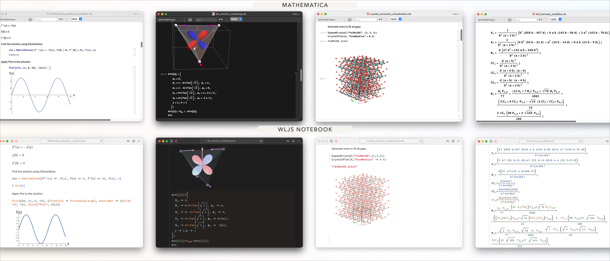
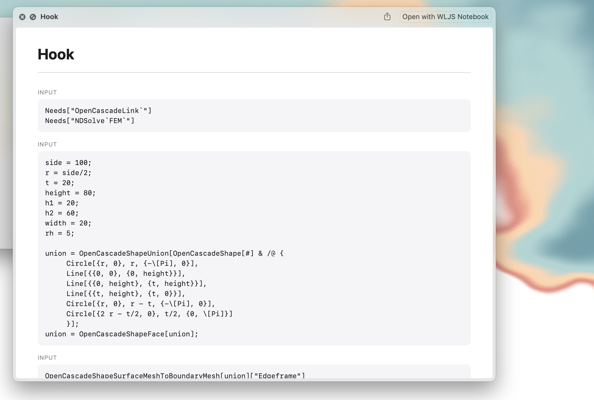

{/* add this script to the body  */}
{/* https://cdn.jsdelivr.net/gh/WLJSTeam/web-components@latest/src/common/app.js */}
<wljs-store json="./attachments/883bb16e-6d8d-40e2-9f0e-b012fcd7d745.txt"></wljs-store>

import { Tabs, Tab } from 'fumadocs-ui/components/tabs';

<Tabs items={['Windows', 'Mac','GNU/Linux', 'Docker', 'Homebrew']}>
  <Tab value="Mac">
    - [Apple Silicon](https://github.com/WLJSTeam/wljs-notebook/releases/download/v3.2.0/wljs-notebook-3.2.0-arm64-macos.dmg)
    - [Intel](https://github.com/WLJSTeam/wljs-notebook/releases/download/v3.2.0/wljs-notebook-3.2.0-x64-macos.dmg)
  </Tab>
  <Tab value="Windows">
    - [x86/64](https://github.com/WLJSTeam/wljs-notebook/releases/download/v3.2.0/wljs-notebook-3.2.0-x64-win.exe)
  </Tab>
  <Tab value="GNU/Linux">
    - [DEB x86/64](https://github.com/WLJSTeam/wljs-notebook/releases/download/v3.2.0/wljs-notebook-3.2.0-amd64-gnulinux.deb)
    - [DEB ARM64](https://github.com/WLJSTeam/wljs-notebook/releases/download/v3.2.0/wljs-notebook-3.2.0-arm64-gnulinux.deb)
    - [AppImage x86/64](https://github.com/WLJSTeam/wljs-notebook/releases/download/v3.2.0/wljs-notebook-3.2.0-x86_64-gnulinux.AppImage)
    - [AppImage ARM64](https://github.com/WLJSTeam/wljs-notebook/releases/download/v3.2.0/wljs-notebook-3.2.0-arm64-gnulinux.AppImage)
    - [RPM x86/64](https://github.com/WLJSTeam/wljs-notebook/releases/download/v3.2.0/wljs-notebook-3.2.0-x86_64-gnulinux.rpm)
  </Tab>
  <Tab value="Docker">

```bash
docker run -it \
  -v ~/wljs:"/home/wljs/WLJS Notebooks" \
  -v ~/wljs/Licensing:/home/wljs/.WolframEngine/Licensing \
  -v ~/wljs/tmp:/tmp \
  -p 8000:3000 \
  --name wljs \
  ghcr.io/wljsteam/wljs-notebook:3.2.0
```

  </Tab>
  <Tab value="Homebrew">
  
```bash  
brew install --cask wljs-notebook
```

  </Tab>
</Tabs>

## Summary
- __Zero-lag saving__
- Improved mixed-content rendering for equations and objects
- __8× faster initial kernel launch__
- __Faster exports, 2× faster 2D and 3D graphics, and faster audio streaming__
- __7400× faster JavaScript-to-WL pipeline__ (you can literally stream raw video directly from JavaScript to Wolfram)
- Improved frontend garbage collector
- Better Dialog API
- Safer `Refresh` and automatic throttling for `Animate`
- __Improved export of static and interactive notebooks to HTML__
- __Improved Mathematica notebook imports__
- Access to server logs from the app and kernel crash detection
- Caching improvements
- Fixed race-condition bugs in the MCP server
- Better internal architecture, __fully refactored in three passes__
- Improved export options
- Better React/Web Components integration
- __More integration tests (> 200)__
- Compact frontend–backend API with a binary-based protocol
- Quick Look support on macOS
- File Explorer context-menu extension on Windows
- Improved `Dataset` rendering

## Zero-lag saving
We redesigned the entire system that controls how graphs, images, sound, and dataset objects flow among the evaluation kernel, frontend, and server. You no longer need to wait for the so-called *synchronization of objects*; the data is already there!


In addition, we improved our garbage collector for plots, graphics, and other *heavy* objects. It works in several steps:
1. Silently marks anything not visible in the notebook as garbage
2. Scans through cells and finds all false positives (objects that are not visible but are still in use)
3. Scans through all hidden, encoded objects and marks other false positives
4. Nukes the rest

## Faster I/O
A multi-step refactor throughout the WLJS Notebook codebase gave us the opportunity to tighten and factor out the frontend–backend API. We no longer evaluate arbitrary expressions on the backend; instead, the backend accepts only a limited set of opcodes and non-executable payloads. The JavaScript → WL pipeline now relies on a binary protocol, an efficient WXF serializer implementation, and a zero-copy approach to typed arrays and binary payloads. Altogether:

- __2×__ <wljs-html encoded="true">{`%3Cabbr%20title%3D%22it%20was%20always%20fast%2C%20actually%22%3Efaster%3C%2Fabbr%3E`}</wljs-html> Kernel (WL) → Frontend (JavaScript)
- __7,400×__ faster Frontend (JavaScript) → Kernel (WL)

You can literally stream raw, uncompressed video to the backend in real time using something like this:

<WLJSWrapper><wljs-editor display="codemirror" type="Input" editable="true"  >{`img = ConstantArray[{255,255,255,255}, {240,320}];
	EventHandler["takeMyData", (img = #)&];
	Image[img // Offload, "Byte"]`}</wljs-editor></WLJSWrapper>

<WLJSWrapper><wljs-editor display="codemirror" type="Output"  >{`(*VB[*)(FrontEndRef["F989ee7a3-fcdc-4ced-9fbe-0af0e7c94fd7"])(*,*)(*"1:eJxTTMoPSmNkYGAoZgESHvk5KRCeEJBwK8rPK3HNS3GtSE0uLUlMykkNVgUJW1pYpqaaJxrrpiWnJOuaJKem6FqmJaXqGiSmGaSaJ1uapKWYAwC0MxdT"*)(*]VB*)`}</wljs-editor></WLJSWrapper>

On the JavaScript side, we can capture frames from a webcam, obtain them from the GPU (WebGL/WebGPU), or generate them using Canvas:

<WLJSWrapper><wljs-editor display="codemirror" type="Input" editable="true"  >{`.js
	
	function createCanvasPixels(width = 320, height = 240) {
	  const canvas = new OffscreenCanvas(width, height);
	  const context = canvas.getContext("2d");
	  // Draw something
	  context.fillStyle = "#18181b";
	  context.fillRect(0, 0, width, height);
	
	  context.fillStyle = "#38bdf8";
	  context.beginPath();
	  context.arc(width / 2, height / 2, 60, 0, Math.PI * 2);
	  context.fill();
	  const { data } = context.getImageData(0, 0, width, height);
	  return new NumericArrayObject(data, [height, width, 4]); // Uint8ClampedArray
	}
	
	const pixels = createCanvasPixels();
	server.kernel.io.fire('takeMyData', pixels);`}</wljs-editor></WLJSWrapper>

All typed arrays and `NumericArrayObject` instances (our class for structured typed arrays) become `NumericArray` objects on the Wolfram side, while everything else is translated as usual: `[1,2,3...]` becomes `{1,2,3...}`, objects become associations, and so on.

## Faster initial launch and package loading
It turned out that our autocomplete feature, built around the `$NewSymbol` expression—which is called on every symbol allocation—was causing noticeable kernel lag, as well as silent context switching (the trickiest bug we have ever faced). We no longer use it; instead, we periodically scan contexts using the safer approach, `Names[]`. __This sped up the initial launch by a factor of eight__.

## Better expression formatting
We improved our main editor so that it automatically adjusts brackets in cases like these:

<WLJSWrapper><wljs-editor display="codemirror" type="Input" editable="true"  >{`{Red, 1}`}</wljs-editor></WLJSWrapper>

<WLJSWrapper><wljs-editor display="codemirror" type="Output"  >{`{(*VB[*)(RGBColor[1, 0, 0])(*,*)(*"1:eJxTTMoPSmNiYGAo5gUSYZmp5S6pyflFiSX5RcEsQBHn4PCQNGaQPAeQCHJ3cs7PyS8qYgCDD/ZQBgMDnAEA4iUPRg=="*)(*]VB*),1}`}</wljs-editor></WLJSWrapper>

<WLJSWrapper><wljs-editor display="codemirror" type="Input" editable="true"  >{`ByteArray[{1,2,4}]`}</wljs-editor></WLJSWrapper>

<WLJSWrapper><wljs-editor display="codemirror" type="Output"  >{`ByteArray[(*VB[*) "AQIE" (*,*)(*"1:eJxdUFtPwjAUxmvUP2Dikz70HYpLmG8tMEARl50N2Z6cW1kWtnV0EC6/0x/kKWBEk+brdzk5PacPn9KZntVqteoOgcu1JVX+wZQKi0TEsMzzUG3Qnp7omnOEvsziHRnJQvzaw7Ra/FOnWt0etT20GyxEPk7FCi4xg3Qrnu73tTcI3ThdSKXjv0/u1TWC5ww7IpKxgC9UhLYIZZwTg+NNqLkzaJPQOhr0x8CkfZQjoQ3SZOJ57bqv0oZ8lPo9Jo0kAuZNjCCYlXMoCOUc3gO8JoUV+quk7T4m3fEa8sCeY0U0MRx/lpnelg28qFI2+H3J7V4bihEkZsFeZLVpmUPup5ZVhjNWNuo+JKTZ0UdPdzSR0eGHFfa/oTd3lpmAK01EGL8V2WbnumopqgskVphV4hsBZHON"*)(*]VB*)]`}</wljs-editor></WLJSWrapper>

## BarLegend accepts row layouts
We extended the options for `BarLegend` to support horizontal bar legends as well:

<WLJSWrapper><wljs-editor display="codemirror" type="Input" editable="true"  >{`BarLegend[{"Rainbow", {0,1}}, 2, LegendLayout->"Row", ImageSize -> {300,20}, LegendLabel->"Here"]`}</wljs-editor></WLJSWrapper>

<WLJSWrapper><wljs-editor display="codemirror" type="Output"  >{`(*VB[*)(FrontEndRef["F5afae585-657f-41bb-bf7e-f7e307e0dcc5"])(*,*)(*"1:eJxTTMoPSmNkYGAoZgESHvk5KRCeEJBwK8rPK3HNS3GtSE0uLUlMykkNVgUJmyamJaaaWpjqmpmap+maGCYl6SalmafqArGxgXmqQUpysikAp3YWsw=="*)(*]VB*)`}</wljs-editor></WLJSWrapper>

It also supports an absolute offset:

<WLJSWrapper><wljs-editor display="codemirror" type="Input" editable="true"  >{`BarLegend[{"Rainbow", {0,1}}, 2, LegendLayout->"Row", ImageSize -> {300,20}, LegendLabel->{"Here", {0,-35}}]`}</wljs-editor></WLJSWrapper>

<WLJSWrapper><wljs-editor display="codemirror" type="Output"  >{`(*VB[*)(FrontEndRef["Fc105fbc5-4612-4eac-8dc0-67ccfaf69b9a"])(*,*)(*"1:eJxTTMoPSmNkYGAoZgESHvk5KRCeEJBwK8rPK3HNS3GtSE0uLUlMykkNVgUJJxsamKYlJZvqmpgZGumapCYm61qkJBvompknJ6clpplZJlkmAgCiFxan"*)(*]VB*)`}</wljs-editor></WLJSWrapper>

Here it is in action:

<WLJSWrapper><wljs-editor display="codemirror" type="Input" editable="true"  >{`ContourPlot[ (*FB[*)(((*SpB[*)Power[x(*|*),(*|*)2](*]SpB*)-(*SpB[*)Power[y(*|*),(*|*)2](*]SpB*))(*,*)/(*,*)((*SpB[*)Power[((*SpB[*)Power[x(*|*),(*|*)2](*]SpB*)+(*SpB[*)Power[y(*|*),(*|*)2](*]SpB*))(*|*),(*|*)2](*]SpB*)))(*]FB*),
	 {x, -1, 1}, {y, -1, 1},
	 Contours -> 4,
	 PlotLegends -> Placed[BarLegend[Automatic, 2, LegendLayout->"Row",  ImageSize -> {230,20}, LegendLabel->{"Bar", {0,-35}}], Bottom],
	 ImageSize -> {300, 300},
	 ColorFunction -> "Rainbow",
	 ClippingStyle -> Automatic
	]`}</wljs-editor></WLJSWrapper>

<WLJSWrapper><wljs-editor display="codemirror" type="Output" encoded="true"  >{`%28%2AVB%5B%2A%29%28Legended%5BToExpression%5BFrontEndRef%5B%22F483c1046-3eef-475f-9d6d-023715ac2193%22%5D%2C%20InputForm%5D%2C%20Placed%5BBarLegend%5B%7BBlend%5B%22Rainbow%22%2C%20%231%5D%20%26%20%2C%20%7B-59%2F10%2C%2059%2F10%7D%7D%2C%202%2C%20LabelStyle%20-%3E%20%7B%7D%2C%20LegendLabel%20-%3E%20%7B%22Bar%22%2C%20%7B0%2C%20-35%7D%7D%2C%20LegendLayout%20-%3E%20%22Row%22%2C%20LegendMarkerSize%20-%3E%20300%2C%20ScalingFunctions%20-%3E%20%7BIdentity%2C%20Identity%7D%2C%20ImageSize%20-%3E%20%7B230%2C%2020%7D%2C%20Charting%60AxisLabel%20-%3E%20None%2C%20Charting%60TickSide%20-%3E%20Right%2C%20ColorFunctionScaling%20-%3E%20True%5D%2C%20Bottom%2C%20Identity%5D%5D%29%28%2A%2C%2A%29%28%2A%221%3AeJxlUslOAzEMLWXfJED8AAduVOrGUnGipUhIZdGk4kyaeIpFSKRMRrT8H5%2FBld8ocYYOzPRixfbzs5%2Fjo5GJ4uVKpZLsevOE8H4NwljujGXrPjKAMWjZzCBb3vQl%2BhwB4yWKHXhzY412fS37ExCp4yMF7JjC7YuWaNTbZ7UWQFxrn5%2FGtY48k7V6s3XeOOWi2ei04iqxrHgTpb5ugx7A5YNW0xAd2hRKGBqDgQIRWiWr1IqrBLIh17x5VFyAjLfJ3%2FSmy20m5I9pgInLFFDLm1QLh0ZneWLsKg8PK4g46pH5lUulTBmH5JXYqnO2iBMXV%2Fg5m81wK0cWcpfeCTmsFqhIYtj0gI9AMTdVEFcW%2B%2BTQ7fyXQkFxJracqS9Gkfjwyw9X4tr5xzU1aVYeee1F2F4Ou%2BP2FSzDD8CTpQUVhGPCa9Xj%2BYKT4iRhJbcStEM3LTglKvrF2zc%2BBupVUvNNag4Xl0in2Xvh1vn%2Bz1cTTMKCQv7e6NJVJfv%2F0UMUrwxldlwRjl%2FKW6d2PaOMnQv71ZnfbLjDrnHOvBV0%2FQDhqdK2%22%2A%29%28%2A%5DVB%2A%29`}</wljs-editor></WLJSWrapper>

## Improved Mathematica notebook imports
We should be honest with you here. Originally, the conversion process was hard-coded for certain cell types and expressions, which made it very fragile. The main issue is that Mathematica has many undocumented typesetting expressions mixed with textual constructs. Some are straightforward and can be mapped 1:1 to WLJS, while others require TeX forms to remain readable. At this point, we used AI assistance for the first time in this project. Through multiple iterations, the process was refined to the point where 10 random notebooks found online and in our archive could be opened and rendered correctly.

Here are some examples:




## Better Dialog API
You no longer need to provide a `Notebook` or `Window` reference to open a dialog window:

<WLJSWrapper><wljs-editor display="codemirror" type="Input" editable="true"  >{`Button["Message", MessageDialog["Hey"]]
	Button["Open multiple files", 
	  SystemDialogInputAsync["OpenList", Null]~Then~(MessageDialog@*ToString)
	]`}</wljs-editor></WLJSWrapper>

## Safer Refresh and Animate
If something refreshes too quickly, accidentally evaluating a large expression can be disastrous. To prevent this, the refresh rate is now automatically throttled to 5 FPS or lower, depending on the expression's size.

For example, `ContourPlot` generates an expression that is difficult for our built-in JIT to optimize for real-time updates, so it falls back to a full reevaluation. Even if we set `RefreshRate` to a high value, the system prevents the refresh rate from becoming unsafe:

<WLJSWrapper><wljs-editor display="codemirror" type="Input" editable="true"  >{`Animate[ContourPlot[(*FB[*)(((x - r))(*,*)/(*,*)((*SpB[*)Power[(x - r)(*|*),(*|*)2](*]SpB*) + (*SpB[*)Power[(y)(*|*),(*|*)2](*]SpB*)))(*]FB*), {x,-1,1}, {y,-1,1}], {r,-1,1,0.1}, (*BB[*)(RefreshRate->60)(*,*)(*"1:eJxTTMoPSmNkYGAoZgESHvk5KRAeB5AILqnMSXXKr0hjgskHleakFnMBGU6JydnpRfmleSlpzDDlQe5Ozvk5+UVFDGDwwR6dwcAAAAHdFiw="*)(*]BB*)]`}</wljs-editor></WLJSWrapper>

## Improved notebook-to-HTML export
We removed all the clutter and workarounds from our generated HTML notebooks.


The files are now smaller, search-engine-friendly, and based on [Web Components](https://developer.mozilla.org/en-US/docs/Web/API/Web_components). However, we retained compatibility with the older format, so your previously exported HTML notebooks can be reimported into the `wln` format. We have no plans to remove the old parser.


*A single, self-contained HTML file that works without an internet connection and can be reimported as a normal notebook*

We unified our export workflow. Whenever you export a WLJS Notebook to MDX/React, vanilla HTML/JavaScript, or a standalone HTML file:

1. All narrative cells (Markdown) are rendered as standard HTML; for MDX, they are left intact
2. The contents of all code cells are preserved as-is and wrapped in `wljs-editor` tags

The second point is very important: if a browser does not recognize this tag, the content is shown as normal, unstyled code. Once the Web Components bootstrap loads, the code is automatically highlighted and displayed as a normal-looking WLJS cell with graphics, sound, equations, and more. Here is our bootstrap package:

- [WLJSTeam/web-components](https://github.com/WLJSTeam/web-components)

You can add it to your footer as a single script. It is framework-agnostic:

<WLJSWrapper><wljs-editor display="codemirror" type="Input" editable="true"  >{`.html
	
	<script
	  type="module"
	  src="https://cdn.jsdelivr.net/gh/WLJSTeam/web-components@latest/src/common/app.js"
	></script>
	`}</wljs-editor></WLJSWrapper>


It can also be self-hosted. Navigate to <wljs-html encoded="true">{`%3Csmall%20%3EShare%3C%2Fsmall%3E`}</wljs-html>–<wljs-html encoded="true">{`%3Csmall%20%3EHTML%20Embeddable%3C%2Fsmall%3E`}</wljs-html>–<wljs-html encoded="true">{`%3Csmall%20%3EBootstrap%3C%2Fsmall%3E`}</wljs-html> to export a bootstrap package for yourself.

If you are a React/Next.js user, no problem: [here is an example blog project](https://github.com/WLJSTeam/web-components-mdx) that uses this bootstrap.

Here is what it looks like in practice when you export the notebook as <wljs-html encoded="true">{`%3Csmall%20%3EMDX%3C%2Fsmall%3E`}</wljs-html> or <wljs-html encoded="true">{`%3Csmall%20%3EHTML%20Embeddable%3C%2Fsmall%3E`}</wljs-html>:

<WLJSWrapper><wljs-editor display="codemirror" type="Input" editable="true"  >{`.html
	<h2>Contour Plot</h2>
	<p>Generates a contour plot of f as a function of {x,y}</p>
	
	
	<wljs-editor display="codemirror" type="Input">
	  <xmp>ContourPlot[
	  Cos[x] + Cos[y], {x, 0, 4 Pi}, {y, 0, 4 Pi}
	]</xmp>
	</wljs-editor>
	
	<wljs-editor display="codemirror" type="Output">
	  <xmp>(*VB[*)(FrontEndRef["..."])(*,*)(*"1:..."*)(*]VB*)</xmp>
	</wljs-editor>`}</wljs-editor></WLJSWrapper>

These `wljs-editor` tags are unstyled by default, but they still show meaningful content before the bootstrap has loaded. Even if JavaScript is disabled, the source code remains visible to users and search engines.

<Callout>
All visible objects, including `Manipulate` expressions, can be exported while preserving their interactivity.
</Callout>

## Crash reports and server logs
If the master kernel crashes for any reason, logs will be generated. You can always access them from <wljs-html encoded="true">{`%3Csmall%20%3EMisc%3C%2Fsmall%3E`}</wljs-html>–<wljs-html encoded="true">{`%3Csmall%20%3EShow%20Logs%3C%2Fsmall%3E`}</wljs-html> in the top menu of the WLJS desktop application.


## Fixed race conditions in the MCP server
If you have ever used WLJS with coding agents, you might have noticed that they sometimes had to redo cell edits because of apparent typos. In fact, they were not typos! They were caused by lag in cell-state synchronization, which is no longer an issue in 3.2.0.

## Fixed race conditions for inset expressions and labels
Duplicated labels or expressions inside `Inset` could cause race conditions and result in one or more missing visual elements. We eliminated this problem by aggregating all requests into a single task for each expression.

## Batch cell operations in the command palette
We added a small snippet that lets you delete or add cells, starting from the focused cell.


## JavaScript API changes
The old, unsafe methods __were completely removed__:
- `server.kernel.ask`
- `server.kernel.send`
- `server.kernel.emitt`
- `server.kernel._emitt`

They were replaced by the new `ServerIO` class, introduced in 2025:

- `server.kernel.io.fire(eventId, data)` – fires an event with data as its payload
- `server.kernel.io.fire(eventId, data, pattern)` – fires an event that matches the pattern (a string)
- `server.kernel.io.poke(eventId)` – fires an event with no payload (the fastest route)
- `server.kernel.io.fetch(symbolName, args)` – evaluates `Apply[symbol, args]` and returns the result (which may also be a Promise)
- `server.kernel.io.fetch(symbolName)` – evaluates a symbol and returns the result (which may also be a Promise)
- `server.kernel.io.request(eventId, data)` – works like the `fire` method but returns the result generated by the event (which may also be a Promise)
- `server.kernel.io.request(eventId, data, pattern)` – works like `fire` with a pattern provided

## NetGraph shows the preview of nets
Finally the output form of `NetGraph` can show something meaningful! 

<WLJSWrapper><wljs-editor display="codemirror" type="Input" editable="true"  >{`net = NetGraph[{LinearLayer[2], ElementwiseLayer[Ramp], 
	   ThreadingLayer[Plus]}, {1 -> 2, {NetPort["Input"], 2} -> 3}]`}</wljs-editor></WLJSWrapper>

<WLJSWrapper><wljs-editor display="codemirror" type="Output" encoded="true"  >{`NetGraph%5B%28%2AVB%5B%2A%29%20%3C%7C%22Type%22%20-%3E%20%22Graph%22%2C%20%22Inputs%22%20-%3E%20%3C%7C%22Input%22%20-%3E%20NeuralNetworks%60TensorT%5B%7B2%7D%2C%20NeuralNetworks%60AtomT%5D%7C%3E%2C%20%22Outputs%22%20-%3E%20%3C%7C%22Output%22%20-%3E%20NeuralNetworks%60TensorT%5B%7B2%7D%2C%20NeuralNetworks%60AtomT%5D%7C%3E%2C%20%22Nodes%22%20-%3E%20%3C%7C%221%22%20-%3E%20%3C%7C%22Type%22%20-%3E%20%22Linear%22%2C%20%22Arrays%22%20-%3E%20%3C%7C%22Weights%22%20-%3E%20NeuralNetworks%60TensorT%5B%7B2%2C%202%7D%2C%20NeuralNetworks%60RealT%5D%2C%20%22Biases%22%20-%3E%20NeuralNetworks%60Nullable%5BNeuralNetworks%60TensorT%5B%7B2%7D%2C%20NeuralNetworks%60RealT%5D%5D%7C%3E%2C%20%22Parameters%22%20-%3E%20%3C%7C%22OutputDimensions%22%20-%3E%20%7B2%7D%2C%20%22%24OutputSize%22%20-%3E%202%2C%20%22%24InputSize%22%20-%3E%202%2C%20%22%24InputDimensions%22%20-%3E%20%7B2%7D%7C%3E%2C%20%22Inputs%22%20-%3E%20%3C%7C%22Input%22%20-%3E%20NeuralNetworks%60TensorT%5B%7B2%7D%2C%20NeuralNetworks%60AtomT%5D%7C%3E%2C%20%22Outputs%22%20-%3E%20%3C%7C%22Output%22%20-%3E%20NeuralNetworks%60TensorT%5B%7B2%7D%2C%20NeuralNetworks%60RealT%5D%7C%3E%7C%3E%2C%20%222%22%20-%3E%20%3C%7C%22Type%22%20-%3E%20%22Elementwise%22%2C%20%22Arrays%22%20-%3E%20%3C%7C%7C%3E%2C%20%22Parameters%22%20-%3E%20%3C%7C%22Function%22%20-%3E%20NeuralNetworks%60ValidatedParameter%5BRamp%5D%2C%20%22%24Dimensions%22%20-%3E%20%7B2%7D%7C%3E%2C%20%22Inputs%22%20-%3E%20%3C%7C%22Input%22%20-%3E%20NeuralNetworks%60TensorT%5B%7B2%7D%2C%20NeuralNetworks%60RealT%5D%7C%3E%2C%20%22Outputs%22%20-%3E%20%3C%7C%22Output%22%20-%3E%20NeuralNetworks%60TensorT%5B%7B2%7D%2C%20NeuralNetworks%60RealT%5D%7C%3E%7C%3E%2C%20%223%22%20-%3E%20%3C%7C%22Type%22%20-%3E%20%22Threading%22%2C%20%22Arrays%22%20-%3E%20%3C%7C%7C%3E%2C%20%22Parameters%22%20-%3E%20%3C%7C%22Function%22%20-%3E%20NeuralNetworks%60ValidatedParameter%5BPlus%5D%2C%20%22Broadcasting%22%20-%3E%20NeuralNetworks%60ValidatedParameter%5BAutomatic%5D%7C%3E%2C%20%22Inputs%22%20-%3E%20%3C%7C%22Input1%22%20-%3E%20NeuralNetworks%60TensorT%5B%7B2%7D%2C%20NeuralNetworks%60AtomT%5D%2C%20%22Input2%22%20-%3E%20NeuralNetworks%60TensorT%5B%7B2%7D%2C%20NeuralNetworks%60RealT%5D%7C%3E%2C%20%22Outputs%22%20-%3E%20%3C%7C%22Output%22%20-%3E%20NeuralNetworks%60TensorT%5B%7B2%7D%2C%20NeuralNetworks%60AtomT%5D%7C%3E%7C%3E%7C%3E%2C%20%22Edges%22%20-%3E%20%7BNeuralNetworks%60NetPath%5B%22Nodes%22%2C%20%223%22%2C%20%22Inputs%22%2C%20%22Input1%22%5D%20-%3E%20NeuralNetworks%60NetPath%5B%22Inputs%22%2C%20%22Input%22%5D%2C%20NeuralNetworks%60NetPath%5B%22Nodes%22%2C%20%221%22%2C%20%22Inputs%22%2C%20%22Input%22%5D%20-%3E%20NeuralNetworks%60NetPath%5B%22Inputs%22%2C%20%22Input%22%5D%2C%20NeuralNetworks%60NetPath%5B%22Nodes%22%2C%20%222%22%2C%20%22Inputs%22%2C%20%22Input%22%5D%20-%3E%20NeuralNetworks%60NetPath%5B%22Nodes%22%2C%20%221%22%2C%20%22Outputs%22%2C%20%22Output%22%5D%2C%20NeuralNetworks%60NetPath%5B%22Nodes%22%2C%20%223%22%2C%20%22Inputs%22%2C%20%22Input2%22%5D%20-%3E%20NeuralNetworks%60NetPath%5B%22Nodes%22%2C%20%222%22%2C%20%22Outputs%22%2C%20%22Output%22%5D%2C%20NeuralNetworks%60NetPath%5B%22Outputs%22%2C%20%22Output%22%5D%20-%3E%20NeuralNetworks%60NetPath%5B%22Nodes%22%2C%20%223%22%2C%20%22Outputs%22%2C%20%22Output%22%5D%7D%7C%3E%2C%20%3C%7C%22Version%22%20-%3E%20%2215.0.2%22%2C%20%22Unstable%22%20-%3E%20False%7C%3E%20%28%2A%2C%2A%29%28%2A%221%3AeJxTTMoPSmNmYGAolgISTvkVbvlFuQmORUWJeempKcGlubmJRZVA4TRGkBohIOFWlJ9X4pqX4lqRmlxakpiUkxqsChJOMjI3NzRPMtVNNTIw0DUxNjLSTbIwNtQ1Nk00NUq2TDW0TDNLYwCZwgIkfDKLS4pZQfoSc4pTAbJZIuc%3D%22%2A%29%28%2A%5DVB%2A%29%5D`}</wljs-editor></WLJSWrapper>

## More integration tests
We took testing even more seriously and added additional integration tests (over __200__). Each test uses a fully functional notebook environment running in a headless Chromium browser. Our tests cover:

- The full cell-evaluation cycle
- UI interactions
- Notebook imports
- Simple and complex 2D and 3D graphics, as well as sound
- `Dataset` and `Tabular` data structures with mixed row types
- Solving equations and rendering visual output
- All GUI building blocks, from `InputRange` to `Manipulate`
- Expression styling
- WLX, HTML, and JavaScript cells
- Neural networks

## Native Windows and macOS extensions
We added automatic File Explorer context-menu integration with a `New WLJS Notebook` entry. In addition, Quick Look is now available on macOS: press <wljs-html encoded="true">{`%3Ckbd%20%3ESpace%3C%2Fkbd%3E`}</wljs-html> while a notebook file is selected.




## Thank you for your support
This time, we have two new monthly supporters on [OpenCollective](https://opencollective.com/wljs-notebook) ❤️

- Silvas
- Anonymous Guest