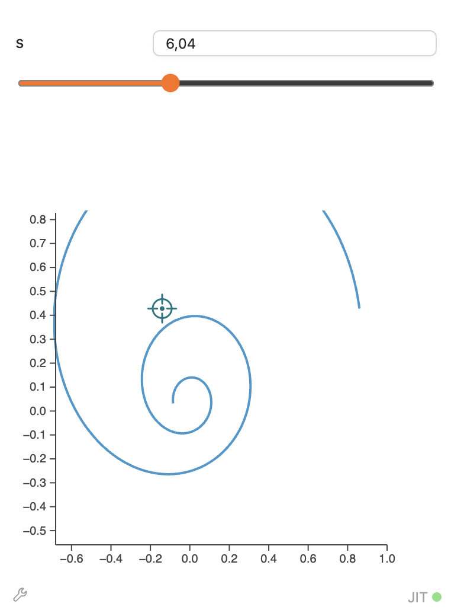
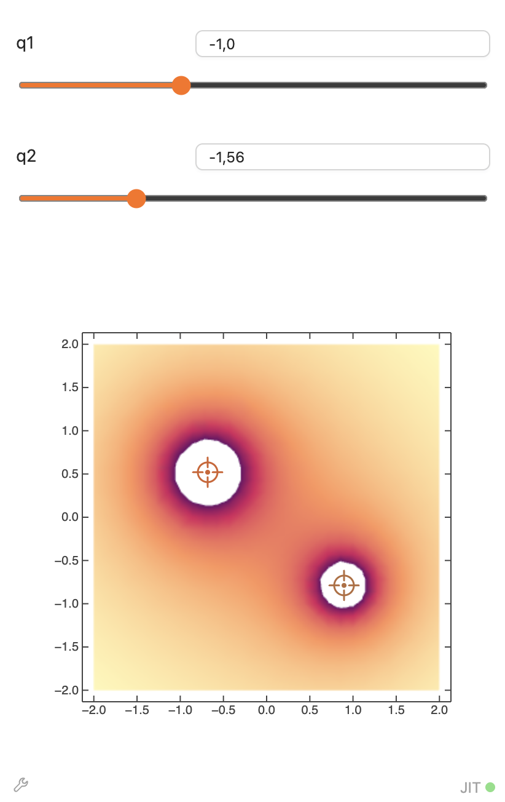
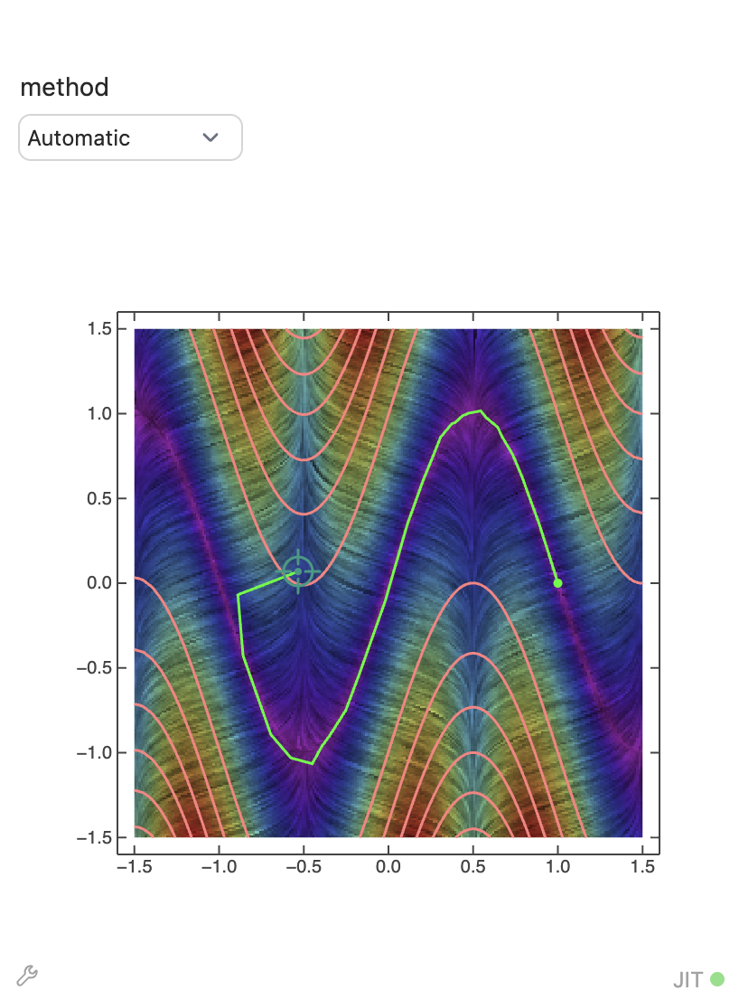

{/* add this script to the body  */}
{/* https://cdn.jsdelivr.net/gh/WLJSTeam/web-components@latest/src/common/app.js */}
<wljs-store kernel="./attachments/kernel-5905639153906636136.txt" json="./attachments/eefd6d5c-3bcb-4fc6-9587-ff584fa95843.txt"></wljs-store>

import { Tabs, Tab } from 'fumadocs-ui/components/tabs';

<Tabs items={['Windows', 'Mac','GNU/Linux', 'Docker', 'Homebrew']}>
  <Tab value="Mac">
    - [Apple Silicon](https://github.com/WLJSTeam/wljs-notebook/releases/download/v3.2.1/wljs-notebook-3.2.1-arm64-macos.dmg)
    - [Intel](https://github.com/WLJSTeam/wljs-notebook/releases/download/v3.2.1/wljs-notebook-3.2.1-x64-macos.dmg)
  </Tab>
  <Tab value="Windows">
    - [x86/64](https://github.com/WLJSTeam/wljs-notebook/releases/download/v3.2.1/wljs-notebook-3.2.1-x64-win.exe)
  </Tab>
  <Tab value="GNU/Linux">
    - [DEB x86/64](https://github.com/WLJSTeam/wljs-notebook/releases/download/v3.2.1/wljs-notebook-3.2.1-amd64-gnulinux.deb)
    - [DEB ARM64](https://github.com/WLJSTeam/wljs-notebook/releases/download/v3.2.1/wljs-notebook-3.2.1-arm64-gnulinux.deb)
    - [AppImage x86/64](https://github.com/WLJSTeam/wljs-notebook/releases/download/v3.2.1/wljs-notebook-3.2.1-x86_64-gnulinux.AppImage)
    - [AppImage ARM64](https://github.com/WLJSTeam/wljs-notebook/releases/download/v3.2.1/wljs-notebook-3.2.1-arm64-gnulinux.AppImage)
    - [RPM x86/64](https://github.com/WLJSTeam/wljs-notebook/releases/download/v3.2.1/wljs-notebook-3.2.1-x86_64-gnulinux.rpm)
  </Tab>
  <Tab value="Docker">

```bash
docker run -it \
  -v ~/wljs:"/home/wljs/WLJS Notebooks" \
  -v ~/wljs/Licensing:/home/wljs/.WolframEngine/Licensing \
  -v ~/wljs/tmp:/tmp \
  -p 8000:3000 \
  --name wljs \
  ghcr.io/wljsteam/wljs-notebook:3.2.1
```

  </Tab>
  <Tab value="Homebrew">
  
```bash  
brew install --cask wljs-notebook
```

  </Tab>
</Tabs>

## Critical patch
We fixed caching error related to the stored frontend objects when saving. At certain conditions when the kernel link suddenly goes down an attempt to save notebook could corrupt graphs, images and other frontend objects.

However, we could just ship this path alone, so here are some extras for the desert 

## Improved Rasterize
We implemented the missing features of `Rasterize` expression such as `"Graphics"`, `RasterSize` options. 2nd argument specifies in which form the output should be returned. By the default

<WLJSWrapper><wljs-editor display="codemirror" type="Input" editable="true"  >{`Rasterize[60]
	Rasterize[60, "Image"]`}</wljs-editor></WLJSWrapper>

are the same, now can also pack raster data into `Graphics`, which is used internally by some `Plot*` functions

<WLJSWrapper><wljs-editor display="codemirror" type="Input" editable="true"  >{`Rasterize[60, "Graphics", RasterSize->20]
	% // Head `}</wljs-editor></WLJSWrapper>

<WLJSWrapper><wljs-editor display="codemirror" type="Output"  >{`(*VB[*)(FrontEndRef["F47b0f25c-02d8-4418-92b0-b5604cac0eac"])(*,*)(*"1:eJxTTMoPSmNkYGAoZgESHvk5KRCeEJBwK8rPK3HNS3GtSE0uLUlMykkNVgUJm5gnGaQZmSbrGhilWOiamBha6FoaJRnoJpmaGZgkJyYbpCYmAwCQ1hXU"*)(*]VB*)`}</wljs-editor></WLJSWrapper>

<WLJSWrapper><wljs-editor display="codemirror" type="Output"  >{`Graphics`}</wljs-editor></WLJSWrapper>

Providing a list will also work:

<WLJSWrapper><wljs-editor display="codemirror" type="Input" editable="true"  >{`Rasterize[60, {"Image", "Graphics"}, RasterSize->20];
	Head /@ %`}</wljs-editor></WLJSWrapper>

<WLJSWrapper><wljs-editor display="codemirror" type="Output"  >{`{Image,Graphics}`}</wljs-editor></WLJSWrapper>

This allows `LineIntegralConvolutionPlot` and others to accept images for stream convolution plots

<WLJSWrapper><wljs-editor display="codemirror" type="Input" editable="true"  >{`house = ExampleData[{"TestImage", "House"}];
	
	LineIntegralConvolutionPlot[
	    {{-1 - (*SpB[*)Power[x(*|*),(*|*)2](*]SpB*) + y, 1 + x - (*SpB[*)Power[y(*|*),(*|*)2](*]SpB*)}, house}
	    ,
	    {x, -3, 3}
	    ,
	    {y, -3, 3}
	    ,
	    VectorPoints -> 10
	    ,
	    VectorColorFunction -> None
	    ,
	    VectorStyle -> White
	]`}</wljs-editor></WLJSWrapper>

<WLJSWrapper><wljs-editor display="codemirror" type="Output"  >{`(*VB[*)(FrontEndRef["Fdf17ab9d-509f-4563-830f-6fbb4bfe1f42"])(*,*)(*"1:eJxTTMoPSmNkYGAoZgESHvk5KRCeEJBwK8rPK3HNS3GtSE0uLUlMykkNVgUJp6QZmicmWabomhpYpumamJoZ61oYG6TpmqUlJZkkpaUappkYAQCh3hZR"*)(*]VB*)`}</wljs-editor></WLJSWrapper>

## Locator support in `Manipulate`
We improved `Manipulate` compatibility with Mathematica. Use `Locator` control option for manipulated expression to add interactive positioning element aka "crosshair"

<Callout type="note">
Locators in the context of `Manipulate` can only work if the output expression is `Graphics`
</Callout>

<WLJSWrapper><wljs-editor display="codemirror" type="Input" editable="true"  >{`Manipulate[
	  ParametricPlot[Exp[-x/s]({Cos[x], Sin[x]} + loc), {x,0,5Pi}], 
	  {s, 1.0, 15.0}, {{loc, {0.,0.}}, Locator}, ContinuousAction->True]`}</wljs-editor></WLJSWrapper>

<div style={{ maxWidth: '350px' }}>



</div>

<Callout type="warning">
If JIT optimization fails (it may happen especially on `ContourPlot`s), `Locator` may not be as useful as a 1-2 basic sliders.

Prefer `DensityPlot` over `ContourPlot` in the case of locators
</Callout>

Draw the potential of two charges:

<WLJSWrapper><wljs-editor display="codemirror" type="Input" editable="true"  >{`Manipulate[
	 DensityPlot[
	  q1/Norm[{x, y} - p[[1]]] + q2/Norm[{x, y} - p[[2]]], {x, -2, 
	   2}, {y, -2, 2}], {{q1, -1}, -3, 3}, {{q2, 1}, -3, 
	  3}, {{p, {{-1, 0}, {1, 0}}}, Locator}]`}</wljs-editor></WLJSWrapper>

<div style={{ maxWidth: '350px' }}>



</div>

Here is more complicated example, where raster graphics is combined with vector

> Show the local direction of the gradient of a function along with its level curves investigating different unconstrained optimization methods

<WLJSWrapper><wljs-editor display="codemirror" type="Input" editable="true" encoded="true"  >{`Module%5B%7Bf%2C%20L%2C%20fplot%7D%2C%0A%20f%5Bx_%2C%20y_%5D%20%3A%3D%20%28%2ASpB%5B%2A%29Power%5B%281-x%29%28%2A%7C%2A%29%2C%28%2A%7C%2A%292%5D%28%2A%5DSpB%2A%29%20%2B%20100%20%28%28%2ASpB%5B%2A%29Power%5B%28y-Sin%5B%5C%5BPi%5D%20x%5D%29%28%2A%7C%2A%29%2C%28%2A%7C%2A%292%5D%28%2A%5DSpB%2A%29%29%3B%0A%20L%20%3D%201.5%60%3B%0A%0A%20fplot%20%3D%20Show%5B%0A%20%20%20%20LineIntegralConvolutionPlot%5BEvaluate%5BD%5Bf%5Bx%2C%20y%5D%2C%20%7B%7Bx%2C%20y%7D%7D%5D%5D%2C%20%7Bx%2C%20-L%2C%20L%7D%2C%20%7By%2C%20-L%2C%20L%7D%2C%20ColorFunction-%3E%22Rainbow%22%5D%2C%0A%20%20%20%20ContourPlot%5Bf%5Bx%2C%20y%5D%2C%20%7Bx%2C%20-L%2C%20L%7D%2C%20%7By%2C%20-L%2C%20L%7D%2C%20ContourShading%20-%3E%20None%2C%20ContourStyle%20-%3E%20Pink%5D%0A%20%5D%3B%0A%0A%20Manipulate%5B%0A%20%20Module%5B%7Bsteps%7D%2C%0A%20%20%20%20%20%20%20%20steps%20%3D%20Reap%5BQuiet%5BFindMinimum%5Bf%5Bx%2C%20y%5D%2C%20Evaluate%5B%28%2ABB%5B%2A%29%28Transpose%5B%7B%7Bx%2Cy%7D%2Cp0%7D%5D%29%28%2A%2C%2A%29%28%2A%221%3AeJxTTMoPSmNmYGAo5gcSAUX5ZZkpqSn%2BBSWZ%2BXnFaYwgCRYg4ZGfk5LGBOLxAomwzNRyl9Tk%2FKLEkvyiYE6gSEhRYl5xQX5xajBISwhEKUhjUGlOajDYhNTEFFSlaIpYgQzXstS8ErCQX2lODgB64iTl%22%2A%29%28%2A%5DBB%2A%29%5D%2C%20Method%20-%3E%20method%2C%20StepMonitor%20%3A%3E%20Sow%5B%7Bx%2C%20y%7D%5D%5D%5D%5D%5B%5B2%2C%201%5D%5D%3B%20%0A%20%20%20%20%20%20%20%20steps%20%3D%20Prepend%5Bsteps%2C%20p0%5D%3B%20%0A%20%20%20%20%20%20%20%20Show%5Bfplot%2C%20Graphics%5B%7BGreen%2C%20Line%5Bsteps%5D%2C%20%7BPointSize%5B0.025%60%5D%2C%20Point%5BLast%5Bsteps%5D%5D%7D%7D%5D%2C%20PlotRange%20-%3E%20%7B%7B-L%2C%20L%7D%2C%20%7B-L%2C%20L%7D%7D%5D%0A%20%20%5D%2C%20%0A%20%20%20%20%7B%7Bp0%2C%20%7B-1%2C%20-1%7D%7D%2C%20Locator%7D%2C%0A%20%20%20%20%7Bmethod%2C%20%7BAutomatic%2C%20%22Newton%22%2C%20%22GaussNewton%22%2C%20%22QuasiNewton%22%2C%20%22PrincipalAxis%22%7D%7D%0A%20%5D%0A%5D`}</wljs-editor></WLJSWrapper>

<div style={{ maxWidth: '350px' }}>



</div>

## New event listeners for `Graphics`
We added new events to track:
- `"metaclick"` - fired when you click with <wljs-html encoded="true">{`%3Ckbd%20%3ECtrl%2FCmd%3C%2Fkbd%3E`}</wljs-html> pressed
- `"shiftclick"` - fired when you click with <wljs-html encoded="true">{`%3Ckbd%20%3EShift%3C%2Fkbd%3E`}</wljs-html> pressed
- `"capturekeyevents"` - fires for both: pressed and released keys

<WLJSWrapper><wljs-editor display="codemirror" type="Input" editable="true" encoded="true"  >{`EventHandler%5BPlot%5Bx%2C%20%7Bx%2C0%2C1%7D%5D%2C%20%7B%0A%20%20%22metaclick%22%20-%3E%20%28Print%5BStringTemplate%5B%22Meta%20as%20%60%60%22%5D%5B%23%5D%5D%26%29%2C%0A%20%20%22shiftclick%22%20-%3E%20%28Print%5BStringTemplate%5B%22Shift%20as%20%60%60%22%5D%5B%23%5D%5D%26%29%0A%7D%5D`}</wljs-editor></WLJSWrapper>

and here is an example for key capture

<WLJSWrapper><wljs-editor display="codemirror" type="Input" editable="true" encoded="true"  >{`EventHandler%5BGraphics%5B%7B%0A%20%20Disk%5B%5D%2C%20StandardRed%2C%20Text%5B%22Focus%20on%20me%22%2C%20%7B0%2C0%7D%2C%20%7B0%2C0%7D%5D%0A%7D%2C%20ImageSize-%3E200%5D%2C%20%7B%0A%20%20%22capturekeyevents%22%20-%3E%20%28Print%5BStringTemplate%5B%22%60%60%22%5D%5B%23%5D%5D%26%29%0A%7D%5D`}</wljs-editor></WLJSWrapper>

## New event lsiteners for `Graphics3D`
We added missing `click` event and `mousemove` for 3D. This was rather tricky, since one needs to cast rays in 3D space and check for intersection. Here is a good example for that:

<WLJSWrapper><wljs-editor display="codemirror" type="Input" editable="true"  >{`Module[{pos = {0,0,0}},
	 EventHandler[Plot3D[x y, {x,-1,1}, {y,-1,1}, 
	  BoxRatios->{1,1,1}, Epilog->{
	  Red, Sphere[pos//Offload, 0.1]
	 }], {"click" -> ((pos = #) &)}]
	]`}</wljs-editor></WLJSWrapper>

*try to click on the plotted surface*

## Dynamic color and opacity for 3D
We had this feature for ages in `Graphics`. `RGBColor`, `Hue` and `Opacity` now can be dynamic too in `Graphics3D` context.

<WLJSWrapper><wljs-editor display="codemirror" type="Input" editable="true"  >{`color = List @@ Pink;
	Graphics3D[{RGBColor[color//Offload], Cuboid[]}]`}</wljs-editor></WLJSWrapper>

<WLJSWrapper><wljs-editor display="codemirror" type="Output"  >{`(*VB[*)(Graphics3D[{RGBColor[Offload[color]], Cuboid[{0, 0, 0}]}])(*,*)(*"1:eJxTTMoPSmNkYGAoZgESHvk5KRAeF5BwL0osyMhMLjZ2SWOCqfDJLC6BqOAAEkHuTs75OflFEBF2IOGflpaTn5hSrAlkO+enpaWm+mQWlqaWFiW4VpSk5hVn5ucVJyAMTkhGaGcDaSlNys9MSWNGti4TSDMgCAB5bSnY"*)(*]VB*)`}</wljs-editor></WLJSWrapper>

<WLJSWrapper><wljs-editor display="codemirror" type="Input" editable="true"  >{`color = List@@RGBColor@RandomColor[];`}</wljs-editor></WLJSWrapper>

Or use a picker

<WLJSWrapper><wljs-editor display="codemirror" type="Input" editable="true"  >{`EventHandler[InputColor[color], (color=#)&]`}</wljs-editor></WLJSWrapper>

<WLJSWrapper><wljs-editor display="codemirror" type="Output"  >{`(*VB[*)(EventObject[<|"Id" -> "3092d982-5108-4841-9e03-569e17bfc529", "Initial" -> {1, 0.5, 0.5}, "View" -> "F3cd52012-73aa-40ee-9949-440597e6e2eb"|>])(*,*)(*"1:eJxTTMoPSmNkYGAoZgESHvk5KRCeEJBwK8rPK3HNS3GtSE0uLUlMykkNVgUJGyenmBoZGBrpmhsnJuqaGKSm6lpamljqmpgYmFqap5qlGqUmAQCQuhWN"*)(*]VB*)`}</wljs-editor></WLJSWrapper>

## Improved `NumberForm` support on the frontend
Sometimes you need trailing zeros for numbers. On Wolfram Kernel this is easy:

<WLJSWrapper><wljs-editor display="codemirror" type="Input" editable="true"  >{`NumberForm[2, {2,0}, NumberPadding->"0"]
	NumberForm[2, {2,0}, NumberPadding->"0"] // ToString`}</wljs-editor></WLJSWrapper>

<WLJSWrapper><wljs-editor display="codemirror" type="Output"  >{`(*VB[*)(2)(*,*)(*"1:eJxdT81Kw0AYDP6A+Bb2lGw9VDEeBA+7oStU0sr+xSge0u1XWbLpJk1jUp/Ax3bj0cswMwzMzNXase1pEATtpYf5xhzcXhno+Y+XISLkHUXhbHYbhejaMzS5eYDFIETqXni1LPMn7OLPlPc8U6ui7Bq9i1le2qlUtUjIQA1matGIzPSJrBP2OsRa1vzNTu91qYys6JFnlulv3Eg9/0qf5R3FOK+oco+Tse+DEBRtT8aBZx5YZ4FfjASKzWpnj3+u2HfwLzO+4WBBH4q1hfbcS1rYFn4BxP5CVA=="*)(*]VB*)`}</wljs-editor></WLJSWrapper>

<WLJSWrapper><wljs-editor display="codemirror" type="Output"  >{`"002"`}</wljs-editor></WLJSWrapper>

Now this is also supported on the frontend (if expression is executed inside `Offload`)

<WLJSWrapper><wljs-editor display="codemirror" type="Input" editable="true"  >{`val = 2;
	TextView[NumberForm[val, {3, 0}, NumberPadding->"0"]//ToString//Offload]`}</wljs-editor></WLJSWrapper>

<WLJSWrapper><wljs-editor display="codemirror" type="Output"  >{`(*VB[*)(FrontEndRef["Ff84631b4-ad4b-4ccd-8165-c6135fd47d43"])(*,*)(*"1:eJxTTMoPSmNkYGAoZgESHvk5KRCeEJBwK8rPK3HNS3GtSE0uLUlMykkNVgUJp1mYmBkbJpnoJqaYJOmaJCen6FoYmpnqJpsZGpumpZiYp5gYAwCdCRXr"*)(*]VB*)`}</wljs-editor></WLJSWrapper>
