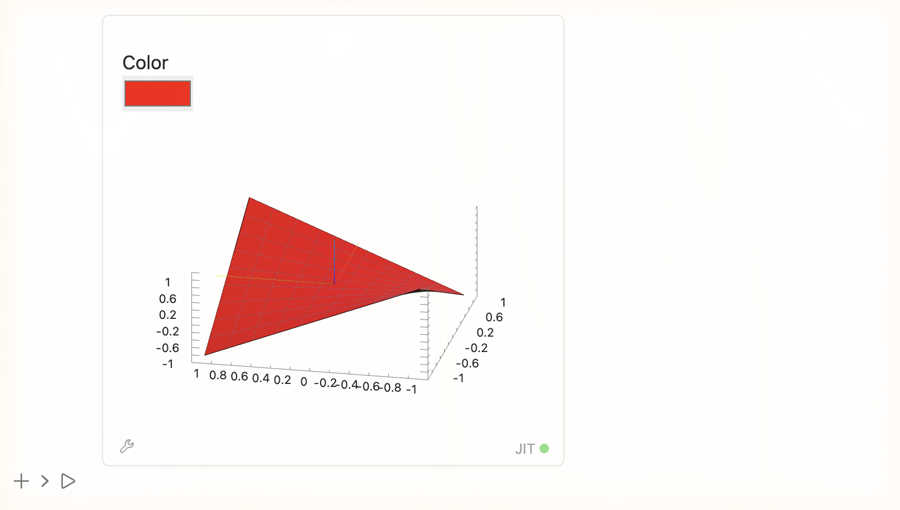
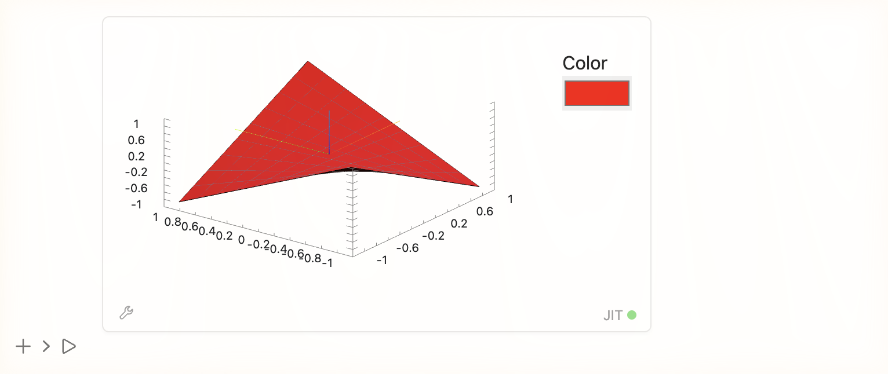

{/* add this script to the body  */}
{/* https://cdn.jsdelivr.net/gh/WLJSTeam/web-components@latest/src/common/app.js */}
<wljs-store json="./attachments/2600d2a8-8419-4fe3-8232-d8c0f7830bb7.txt"></wljs-store>

import { Tabs, Tab } from 'fumadocs-ui/components/tabs';

<Tabs items={['Windows', 'Mac','GNU/Linux', 'Docker', 'Homebrew']}>
  <Tab value="Mac">
    - [Apple Silicon](https://github.com/WLJSTeam/wljs-notebook/releases/download/v3.2.2/wljs-notebook-3.2.2-arm64-macos.dmg)
    - [Intel](https://github.com/WLJSTeam/wljs-notebook/releases/download/v3.2.2/wljs-notebook-3.2.2-x64-macos.dmg)
  </Tab>
  <Tab value="Windows">
    - [x86/64](https://github.com/WLJSTeam/wljs-notebook/releases/download/v3.2.2/wljs-notebook-3.2.2-x64-win.exe)
  </Tab>
  <Tab value="GNU/Linux">
    - [DEB x86/64](https://github.com/WLJSTeam/wljs-notebook/releases/download/v3.2.2/wljs-notebook-3.2.2-amd64-gnulinux.deb)
    - [DEB ARM64](https://github.com/WLJSTeam/wljs-notebook/releases/download/v3.2.2/wljs-notebook-3.2.2-arm64-gnulinux.deb)
    - [AppImage x86/64](https://github.com/WLJSTeam/wljs-notebook/releases/download/v3.2.2/wljs-notebook-3.2.2-x86_64-gnulinux.AppImage)
    - [AppImage ARM64](https://github.com/WLJSTeam/wljs-notebook/releases/download/v3.2.2/wljs-notebook-3.2.2-arm64-gnulinux.AppImage)
    - [RPM x86/64](https://github.com/WLJSTeam/wljs-notebook/releases/download/v3.2.2/wljs-notebook-3.2.2-x86_64-gnulinux.rpm)
  </Tab>
  <Tab value="Docker">

```bash
docker run -it \
  -v ~/wljs:"/home/wljs/WLJS Notebooks" \
  -v ~/wljs/Licensing:/home/wljs/.WolframEngine/Licensing \
  -v ~/wljs/tmp:/tmp \
  -p 8000:3000 \
  --name wljs \
  ghcr.io/wljsteam/wljs-notebook:3.2.2
```

  </Tab>
  <Tab value="Homebrew">
  
```bash  
brew install --cask wljs-notebook
```

  </Tab>
</Tabs>

## MaterialShading for 3D Graphics
We added support for a collection of physical and parameterized surface materials for use in `Graphics3D` and other 3D plots. For a long time, we relied on our own custom options in `Directive[]`, such as `"Metalness"`, `"Emissive"`, and others. We are not dropping support for them; instead, we are extending it to include WL's native `MaterialShading` expression. Here are a few examples:

<WLJSWrapper><wljs-editor display="codemirror" type="Input" editable="true"  >{`bronze = MaterialShading["Bronze"]
	velvet = MaterialShading["Velvet"]
	metal = MaterialShading[<|"MetallicCoefficient"->1.0, "RoughnessCoefficient"->0.5|>]`}</wljs-editor></WLJSWrapper>

<WLJSWrapper><wljs-editor display="codemirror" type="Output"  >{`MaterialShading[(*VB[*) "Bronze" (*,*)(*"1:eJxdT8FqwkAQTbWKlp68CJ7ag8ccNs2ieFOMWAgWkrbnzmYnEshmYbPB6Nc7a4SWXh7z3sy8mfcqdJL3Pc+rZwQb3e60UT9rY6A6okwbpcCcSc4f3MyEYGd0ZaNKRi1mjQVRYjp3MoMQgjdgPuOS+eEi5D5AJnyeZ0vOpMgXgncujwRxUdt/rOfY9M8X9+vvFtV3gad0SL0DKFy9dLNPBJEsrDau/eu216Xs2JjgK4m3mGmJ6TOxeRBsKMAFqehc3EbSUIqRKxDkR1Web+qnabAeuGxQ1ngFItFKHQ=="*)(*]VB*)]`}</wljs-editor></WLJSWrapper>

<WLJSWrapper><wljs-editor display="codemirror" type="Output"  >{`MaterialShading[(*VB[*) "Velvet" (*,*)(*"1:eJxdj81rwkAQxWP9QMVTL4InPXjMoVGJ01ulEQWxkLSe3WQmEtjNwmbT6n/vbFNo6eXHvDezb3ZmqY7ztud51YSx0detNur8YowoL4RJrZQwN7bzlpt5ZGyNLm1UYnSlrLYilZTMnR3iahHCCnzIIfWXAIG/xkXqZ08AOYoAsjBsUjqMQ1HZf+rBqfGfX/xs31tSp4K+kh73jkLR87SZHTIiLKw2rv2bttMSGzVgfMSHV8o0UjJiNQ+CE8lPslw0Ke5FXPMVfVeQwLdS3r7dd1NT1XW3CVnRHcSjSao="*)(*]VB*)]`}</wljs-editor></WLJSWrapper>

<WLJSWrapper><wljs-editor display="codemirror" type="Output"  >{`MaterialShading[(*VB[*) <|"MetallicCoefficient" -> 1., "RoughnessCoefficient" -> 0.5|> (*,*)(*"1:eJytT01Lw0AQjZ+oR0EFT3roMSVFE6w3rQkKFSFRz24zb+vCZhf2A9t/724j1qOCl8e8NzNv3pzPdM23kiSxpwFu9aLSpnu7MYapOajxXcfMMsh8I84cBqiMVq5UVC7QesdmEs0gysiBEQpKacyv0kuwPB1znqcAK+iCMoAzvhldtgNMhXW95zdb9U5+pPi6/uDQvQp8NEeh9wjHpBTtRINz0Qood33Wrx4EKEk4beL02vxeS+rZfoCXenqHVhOancBGw0GRrVPVPnyzFwswelJyuVKfjcdfsx5HE+3n7wrW/kPY3cCyYf7LtDb+VjFp8QlhCXlH"*)(*]VB*)]`}</wljs-editor></WLJSWrapper>

Then you can easily apply them to given graphics primitives:

<WLJSWrapper><wljs-editor display="codemirror" type="Input" editable="true"  >{`Plot3D[x y, {x,-1,1}, {y,-1,1}, PlotStyle->metal]`}</wljs-editor></WLJSWrapper>

<WLJSWrapper><wljs-editor display="codemirror" type="Output"  >{`(*VB[*)(FrontEndRef["F69006763-b197-478c-bfa3-8ebff626b96c"])(*,*)(*"1:eJxTTMoPSmNkYGAoZgESHvk5KRCeEJBwK8rPK3HNS3GtSE0uLUlMykkNVgUJm1kaGJiZmxnrJhlamuuamFsk6yalJRrrWqQmpaWZGZklWZolAwCM+BXR"*)(*]VB*)`}</wljs-editor></WLJSWrapper>

Here is a great example that uses the `Glazed` preset with a red base color:

<WLJSWrapper><wljs-editor display="codemirror" type="Input" editable="true" encoded="true"  >{`With%5B%7Bc%20%3D%200.8%60%7D%2C%20%0A%20ContourPlot3D%5B%0A%20%28%28%2ASpB%5B%2A%29Power%5B%28%28%2ASpB%5B%2A%29Power%5Bx%28%2A%7C%2A%29%2C%28%2A%7C%2A%292%5D%28%2A%5DSpB%2A%29%2B%28%2ASpB%5B%2A%29Power%5By%28%2A%7C%2A%29%2C%28%2A%7C%2A%292%5D%28%2A%5DSpB%2A%29-%28%2ASpB%5B%2A%29Power%5Bc%28%2A%7C%2A%29%2C%28%2A%7C%2A%292%5D%28%2A%5DSpB%2A%29%29%28%2A%7C%2A%29%2C%28%2A%7C%2A%292%5D%28%2A%5DSpB%2A%29%20%2B%20%28%2ASpB%5B%2A%29Power%5B%28%28%2ASpB%5B%2A%29Power%5Bz%28%2A%7C%2A%29%2C%28%2A%7C%2A%292%5D%28%2A%5DSpB%2A%29-1%29%28%2A%7C%2A%29%2C%28%2A%7C%2A%292%5D%28%2A%5DSpB%2A%29%29%0A%20%28%28%2ASpB%5B%2A%29Power%5B%28%28%2ASpB%5B%2A%29Power%5By%28%2A%7C%2A%29%2C%28%2A%7C%2A%292%5D%28%2A%5DSpB%2A%29%2B%28%2ASpB%5B%2A%29Power%5Bz%28%2A%7C%2A%29%2C%28%2A%7C%2A%292%5D%28%2A%5DSpB%2A%29-%28%2ASpB%5B%2A%29Power%5Bc%28%2A%7C%2A%29%2C%28%2A%7C%2A%292%5D%28%2A%5DSpB%2A%29%29%28%2A%7C%2A%29%2C%28%2A%7C%2A%292%5D%28%2A%5DSpB%2A%29%20%2B%20%28%2ASpB%5B%2A%29Power%5B%28%28%2ASpB%5B%2A%29Power%5Bx%28%2A%7C%2A%29%2C%28%2A%7C%2A%292%5D%28%2A%5DSpB%2A%29-1%29%28%2A%7C%2A%29%2C%28%2A%7C%2A%292%5D%28%2A%5DSpB%2A%29%29%0A%20%28%28%2ASpB%5B%2A%29Power%5B%28%28%2ASpB%5B%2A%29Power%5Bz%28%2A%7C%2A%29%2C%28%2A%7C%2A%292%5D%28%2A%5DSpB%2A%29%2B%28%2ASpB%5B%2A%29Power%5Bx%28%2A%7C%2A%29%2C%28%2A%7C%2A%292%5D%28%2A%5DSpB%2A%29-%28%2ASpB%5B%2A%29Power%5Bc%28%2A%7C%2A%29%2C%28%2A%7C%2A%292%5D%28%2A%5DSpB%2A%29%29%28%2A%7C%2A%29%2C%28%2A%7C%2A%292%5D%28%2A%5DSpB%2A%29%20%2B%20%28%2ASpB%5B%2A%29Power%5B%28%28%2ASpB%5B%2A%29Power%5By%28%2A%7C%2A%29%2C%28%2A%7C%2A%292%5D%28%2A%5DSpB%2A%29-1%29%28%2A%7C%2A%29%2C%28%2A%7C%2A%292%5D%28%2A%5DSpB%2A%29%29%2C%20%0A%20%7Bx%2C%20-1.5%60%2C%201.5%60%7D%2C%20%7By%2C%20-1.5%60%2C%201.5%60%7D%2C%20%7Bz%2C%20-1.5%60%2C%201.5%60%7D%2C%20%0A%20%20Contours%20-%3E%20%7B0.1%7D%2C%20ContourStyle%20-%3E%20%7BMaterialShading%5B%7B%22Glazed%22%2C%20Red%7D%5D%7D%2C%0A%20%20Axes%20-%3E%20False%2C%20Background%20-%3E%20GrayLevel%5B.1%5D%2C%20%0A%20%20Lighting%20-%3E%20%22ThreePoint%22%2C%20Mesh%20-%3E%20False%2C%20ViewAngle%20-%3E%20Pi%2F10%2C%20%0A%20%20ViewVertical%20-%3E%20%7B0%2C%201%2C%200%7D%2C%20PlotPoints%20-%3E%2050%5D%5D`}</wljs-editor></WLJSWrapper>

<WLJSWrapper><wljs-editor display="codemirror" type="Output"  >{`(*VB[*)(FrontEndRef["Fad0b0ec6-aeee-4d7d-ad81-ba681f64f722"])(*,*)(*"1:eJxTTMoPSmNkYGAoZgESHvk5KRCeEJBwK8rPK3HNS3GtSE0uLUlMykkNVgUJJ6YYJBmkJpvpJqampuqapJin6CamWBjqJiWaWRimmZmkmRsZAQC2iBbT"*)(*]VB*)`}</wljs-editor></WLJSWrapper>

Custom or built-in mesh materials can also be provided:

<WLJSWrapper><wljs-editor display="codemirror" type="Input" editable="true"  >{`Graphics3D[{
	  MaterialShading[MeshToonMaterial[]],
	  Sphere[],
	  PointLight[Red, 5{-1,1,1}],
	  PointLight[Green, 7{-1,-1,1}]
	}, Lighting->None]`}</wljs-editor></WLJSWrapper>

<WLJSWrapper><wljs-editor display="codemirror" type="Output"  >{`(*VB[*)(Graphics3D[{MaterialShading[MeshToonMaterial[]], Sphere[{0, 0, 0}], PointLight[RGBColor[1, 0, 0], {-5, 5, 5}], PointLight[RGBColor[0, 1, 0], {-7, -7, 7}]}, Lighting -> None])(*,*)(*"1:eJyNkE0OgjAQRkFBjRvP4Bn0BP5EF2AMeABQpnYS0tG2JF7duMC2BJGFiZuXzHwzb5rOz5Qw3/M8FRjsqSzYwFZTg53MbxwvarFhQTsRodLN/MwgzjVIzMuU5wWKK/NssDRYE2MAEd4rqGS2fWgQCkmorHNmMSh+IhKtpNGODNIbBwls+H0UrbtD98ojodARXrluFiYGyW61ppIk+v2lvvFV1zWGNgz/NzqZ/8P4tEaH8cdow6QqwWmc1fyU6x5IwBvAeF1s"*)(*]VB*)`}</wljs-editor></WLJSWrapper>

Here is an example of a custom material written in JavaScript and passed as a frontend symbol to `MaterialShading`:

<WLJSWrapper><wljs-editor display="codemirror" type="Input" editable="true" encoded="true" fade="true" >{`.js%0Alet%20THREE%3B%0Acore.WaterMaterial%20%3D%20async%20%28args%2C%20env%29%20%3D%3E%20%7B%0A%20%20if%20%28%21THREE%29%20%7B%0A%20%20%20%20await%20interpretate.shared.THREE.load%28%29%0A%20%20%20%20THREE%20%3D%20interpretate.shared.THREE.THREE%3B%0A%20%20%7D%0A%0A%20%20return%20function%28%29%20%7B%0A%20%20%20%20const%20material%20%3D%20new%20THREE.ShaderMaterial%28%7B%0A%20%20%20%20%20%20name%3A%20%27WaterMaterial%27%2C%0A%20%20%20%20%20%20uniforms%3A%20%7B%0A%20%20%20%20%20%20%20%20uTime%3A%20%20%20%20%20%20%20%20%20%20%7B%20value%3A%200.0%20%7D%2C%0A%20%20%20%20%20%20%20%20uAmplitude%3A%20%20%20%20%20%7B%20value%3A%200.25%20%7D%2C%20%20%20%0A%20%20%20%20%20%20%20%20uFrequency%3A%20%20%20%20%20%7B%20value%3A%204.0%20%7D%2C%20%20%20%0A%20%20%20%20%20%20%20%20uSpeed%3A%20%20%20%20%20%20%20%20%20%7B%20value%3A%201.0%20%7D%2C%0A%20%20%20%20%20%20%20%20uDeepColor%3A%20%20%20%20%20%7B%20value%3A%20new%20THREE.Color%280x0a3d6b%29%20%7D%2C%0A%20%20%20%20%20%20%20%20uShallowColor%3A%20%20%7B%20value%3A%20new%20THREE.Color%280x2fa4d9%29%20%7D%2C%0A%20%20%20%20%20%20%20%20uFoamColor%3A%20%20%20%20%20%7B%20value%3A%20new%20THREE.Color%280xffffff%29%20%7D%2C%0A%20%20%20%20%20%20%20%20uFoamThreshold%3A%20%7B%20value%3A%200.55%20%7D%2C%20%20%20%0A%20%20%20%20%20%20%20%20uOpacity%3A%20%20%20%20%20%20%20%7B%20value%3A%200.92%20%7D%0A%20%20%20%20%20%20%7D%2C%0A%20%20%20%20%20%20vertexShader%3A%20%60%0A%20%20%20%20%20%20%20%20uniform%20float%20uTime%2C%20uAmplitude%2C%20uFrequency%2C%20uSpeed%3B%0A%20%20%20%20%20%20%20%20varying%20vec3%20vNormalV%3B%0A%20%20%20%20%20%20%20%20varying%20vec3%20vViewPos%3B%0A%20%20%20%20%20%20%20%20varying%20vec3%20vObjPos%3B%0A%20%20%20%20%20%20%20%20varying%20float%20vHeight%3B%20%20%20%2F%2F%20normalized%20wave%20height%2C%20about%20-1..1%0A%20%20%20%20%20%20%20%20varying%20float%20vSlope%3B%0A%0A%20%20%20%20%20%20%20%20%2F%2F%20Sum%20of%20directional%20waves%20defined%20in%203D%20%28object%20space%29%2C%0A%20%20%20%20%20%20%20%20%2F%2F%20so%20it%20works%20on%20any%20mesh%2C%20flat%20or%20not.%0A%20%20%20%20%20%20%20%20float%20waves%28vec3%20p%29%20%7B%0A%20%20%20%20%20%20%20%20%20%20float%20t%20%3D%20uTime%20%2A%20uSpeed%3B%0A%20%20%20%20%20%20%20%20%20%20float%20h%20%3D%200.0%3B%0A%20%20%20%20%20%20%20%20%20%20h%20%2B%3D%200.50%20%2A%20sin%28dot%28p%2C%20normalize%28vec3%28%201.0%2C%200.3%2C%200.6%29%29%29%20%2A%20uFrequency%20%20%20%20%20%20%20%20%2B%20t%20%2A%201.1%29%3B%0A%20%20%20%20%20%20%20%20%20%20h%20%2B%3D%200.30%20%2A%20sin%28dot%28p%2C%20normalize%28vec3%28-0.7%2C%200.8%2C%200.2%29%29%29%20%2A%20uFrequency%20%2A%201.7%20%20%2B%20t%20%2A%201.7%29%3B%0A%20%20%20%20%20%20%20%20%20%20h%20%2B%3D%200.15%20%2A%20sin%28dot%28p%2C%20normalize%28vec3%28%200.2%2C-0.5%2C%201.0%29%29%29%20%2A%20uFrequency%20%2A%202.9%20%20%2B%20t%20%2A%202.3%29%3B%0A%20%20%20%20%20%20%20%20%20%20h%20%2B%3D%200.08%20%2A%20sin%28dot%28p%2C%20normalize%28vec3%28%200.9%2C%200.9%2C-0.4%29%29%29%20%2A%20uFrequency%20%2A%204.7%20%20%2B%20t%20%2A%203.1%29%3B%0A%20%20%20%20%20%20%20%20%20%20return%20h%3B%20%2F%2F%20max%20amplitude%20sum%20%3D%201.03%0A%20%20%20%20%20%20%20%20%7D%0A%0A%20%20%20%20%20%20%20%20void%20main%28%29%20%7B%0A%20%20%20%20%20%20%20%20%20%20vec3%20n%20%3D%20normalize%28normal%29%3B%0A%20%20%20%20%20%20%20%20%20%20float%20h%20%3D%20waves%28position%29%3B%0A%0A%20%20%20%20%20%20%20%20%20%20%2F%2F%20finite-difference%20gradient%20of%20the%20wave%20field%0A%20%20%20%20%20%20%20%20%20%20float%20e%20%3D%200.01%20%2F%20uFrequency%3B%0A%20%20%20%20%20%20%20%20%20%20vec3%20g%20%3D%20vec3%28%0A%20%20%20%20%20%20%20%20%20%20%20%20waves%28position%20%2B%20vec3%28e%2C%200.0%2C%200.0%29%29%20-%20h%2C%0A%20%20%20%20%20%20%20%20%20%20%20%20waves%28position%20%2B%20vec3%280.0%2C%20e%2C%200.0%29%29%20-%20h%2C%0A%20%20%20%20%20%20%20%20%20%20%20%20waves%28position%20%2B%20vec3%280.0%2C%200.0%2C%20e%29%29%20-%20h%0A%20%20%20%20%20%20%20%20%20%20%29%20%2F%20e%20%2A%20uAmplitude%3B%0A%0A%20%20%20%20%20%20%20%20%20%20%2F%2F%20keep%20only%20the%20part%20of%20the%20gradient%20tangent%20to%20the%20surface%0A%20%20%20%20%20%20%20%20%20%20vec3%20tang%20%3D%20g%20-%20n%20%2A%20dot%28g%2C%20n%29%3B%0A%20%20%20%20%20%20%20%20%20%20vec3%20nWave%20%3D%20normalize%28n%20-%20tang%29%3B%0A%0A%20%20%20%20%20%20%20%20%20%20%2F%2F%20displace%20along%20the%20surface%20normal%0A%20%20%20%20%20%20%20%20%20%20vec3%20displaced%20%3D%20position%20%2B%20n%20%2A%20h%20%2A%20uAmplitude%3B%0A%0A%20%20%20%20%20%20%20%20%20%20vec4%20mv%20%3D%20modelViewMatrix%20%2A%20vec4%28displaced%2C%201.0%29%3B%0A%20%20%20%20%20%20%20%20%20%20vViewPos%20%3D%20mv.xyz%3B%0A%20%20%20%20%20%20%20%20%20%20vNormalV%20%3D%20normalize%28normalMatrix%20%2A%20nWave%29%3B%0A%20%20%20%20%20%20%20%20%20%20vObjPos%20%3D%20position%3B%0A%20%20%20%20%20%20%20%20%20%20vHeight%20%3D%20h%20%2F%201.03%3B%0A%20%20%20%20%20%20%20%20%20%20vSlope%20%3D%20length%28tang%29%3B%0A%0A%20%20%20%20%20%20%20%20%20%20gl_Position%20%3D%20projectionMatrix%20%2A%20mv%3B%0A%20%20%20%20%20%20%20%20%7D%0A%20%20%20%20%20%20%60%2C%0A%20%20%20%20%20%20fragmentShader%3A%20%60%0A%20%20%20%20%20%20%20%20uniform%20float%20uTime%2C%20uFoamThreshold%2C%20uOpacity%3B%0A%20%20%20%20%20%20%20%20uniform%20vec3%20uDeepColor%2C%20uShallowColor%2C%20uFoamColor%3B%0A%20%20%20%20%20%20%20%20varying%20vec3%20vNormalV%3B%0A%20%20%20%20%20%20%20%20varying%20vec3%20vViewPos%3B%0A%20%20%20%20%20%20%20%20varying%20vec3%20vObjPos%3B%0A%20%20%20%20%20%20%20%20varying%20float%20vHeight%3B%0A%20%20%20%20%20%20%20%20varying%20float%20vSlope%3B%0A%0A%20%20%20%20%20%20%20%20float%20hash%28vec3%20p%29%20%7B%0A%20%20%20%20%20%20%20%20%20%20p%20%3D%20fract%28p%20%2A%200.3183099%20%2B%200.1%29%3B%0A%20%20%20%20%20%20%20%20%20%20p%20%2A%3D%2017.0%3B%0A%20%20%20%20%20%20%20%20%20%20return%20fract%28p.x%20%2A%20p.y%20%2A%20p.z%20%2A%20%28p.x%20%2B%20p.y%20%2B%20p.z%29%29%3B%0A%20%20%20%20%20%20%20%20%7D%0A%20%20%20%20%20%20%20%20float%20noise%28vec3%20x%29%20%7B%0A%20%20%20%20%20%20%20%20%20%20vec3%20i%20%3D%20floor%28x%29%2C%20f%20%3D%20fract%28x%29%3B%0A%20%20%20%20%20%20%20%20%20%20f%20%3D%20f%20%2A%20f%20%2A%20%283.0%20-%202.0%20%2A%20f%29%3B%0A%20%20%20%20%20%20%20%20%20%20return%20mix%28%0A%20%20%20%20%20%20%20%20%20%20%20%20mix%28mix%28hash%28i%29%2C%20hash%28i%20%2B%20vec3%281%2C0%2C0%29%29%2C%20f.x%29%2C%0A%20%20%20%20%20%20%20%20%20%20%20%20%20%20%20%20mix%28hash%28i%20%2B%20vec3%280%2C1%2C0%29%29%2C%20hash%28i%20%2B%20vec3%281%2C1%2C0%29%29%2C%20f.x%29%2C%20f.y%29%2C%0A%20%20%20%20%20%20%20%20%20%20%20%20mix%28mix%28hash%28i%20%2B%20vec3%280%2C0%2C1%29%29%2C%20hash%28i%20%2B%20vec3%281%2C0%2C1%29%29%2C%20f.x%29%2C%0A%20%20%20%20%20%20%20%20%20%20%20%20%20%20%20%20mix%28hash%28i%20%2B%20vec3%280%2C1%2C1%29%29%2C%20hash%28i%20%2B%20vec3%281%2C1%2C1%29%29%2C%20f.x%29%2C%20f.y%29%2C%0A%20%20%20%20%20%20%20%20%20%20%20%20f.z%29%3B%0A%20%20%20%20%20%20%20%20%7D%0A%0A%20%20%20%20%20%20%20%20void%20main%28%29%20%7B%0A%20%20%20%20%20%20%20%20%20%20vec3%20n%20%3D%20normalize%28vNormalV%29%3B%0A%20%20%20%20%20%20%20%20%20%20if%20%28%21gl_FrontFacing%29%20n%20%3D%20-n%3B%0A%20%20%20%20%20%20%20%20%20%20vec3%20v%20%3D%20normalize%28-vViewPos%29%3B%0A%20%20%20%20%20%20%20%20%20%20vec3%20l%20%3D%20normalize%28vec3%281.0%29%29%3B%0A%0A%20%20%20%20%20%20%20%20%20%20%2F%2F%20base%20water%20color%3A%20deeper%20in%20troughs%2C%20lighter%20on%20crests%0A%20%20%20%20%20%20%20%20%20%20float%20depthMix%20%3D%20smoothstep%28-1.0%2C%201.0%2C%20vHeight%29%3B%0A%20%20%20%20%20%20%20%20%20%20vec3%20col%20%3D%20mix%28uDeepColor%2C%20uShallowColor%2C%20depthMix%29%3B%0A%0A%20%20%20%20%20%20%20%20%20%20%2F%2F%20lighting%20-%20just%20plain%20one%0A%20%20%20%20%20%20%20%20%20%20float%20diff%20%3D%20clamp%28dot%28n%2C%20l%29%2C%200.0%2C%201.0%29%20%2A%200.6%20%2B%200.4%3B%0A%20%20%20%20%20%20%20%20%20%20float%20spec%20%3D%20pow%28max%28dot%28n%2C%20normalize%28l%20%2B%20v%29%29%2C%200.0%29%2C%2090.0%29%3B%0A%20%20%20%20%20%20%20%20%20%20float%20fres%20%3D%20pow%281.0%20-%20max%28dot%28n%2C%20v%29%2C%200.0%29%2C%203.0%29%3B%0A%20%20%20%20%20%20%20%20%20%20col%20%3D%20col%20%2A%20diff%20%2B%20uShallowColor%20%2A%20fres%20%2A%200.5%20%2B%20vec3%28spec%29%20%2A%201.2%3B%0A%0A%20%20%20%20%20%20%20%20%20%20%2F%2F%20foam%3A%20on%20crests%0A%20%20%20%20%20%20%20%20%20%20%0A%20%20%20%20%20%20%20%20%20%20float%20crest%20%3D%20smoothstep%28uFoamThreshold%2C%201.0%2C%20vHeight%20%2B%20vSlope%20%2A%200.6%29%3B%0A%20%20%20%20%20%20%20%20%20%20float%20nz%20%3D%20noise%28vObjPos%20%2A%2025.0%20%2B%20vec3%280.0%2C%20uTime%20%2A%200.6%2C%20uTime%20%2A%200.3%29%29%20%2A%200.65%0A%20%20%20%20%20%20%20%20%20%20%20%20%20%20%20%20%20%20%20%2B%20noise%28vObjPos%20%2A%2060.0%20-%20vec3%28uTime%20%2A%200.4%29%29%20%2A%200.35%3B%0A%20%20%20%20%20%20%20%20%20%20float%20foam%20%3D%20smoothstep%280.35%2C%200.75%2C%20nz%20%2A%20crest%20%2A%201.6%20%2B%20crest%20%2A%200.25%29%3B%0A%20%20%20%20%20%20%20%20%20%20col%20%3D%20mix%28col%2C%20uFoamColor%2C%20clamp%28foam%2C%200.0%2C%201.0%29%29%3B%0A%0A%20%20%20%20%20%20%20%20%20%20gl_FragColor%20%3D%20vec4%28col%2C%20uOpacity%29%3B%0A%20%20%20%20%20%20%20%20%7D%0A%20%20%20%20%20%20%60%2C%0A%20%20%20%20%20%20lights%3A%20false%2C%0A%20%20%20%20%20%20toneMapped%3A%20false%2C%0A%20%20%20%20%20%20transparent%3A%20true%2C%0A%20%20%20%20%20%20side%3A%20THREE.DoubleSide%0A%20%20%20%20%7D%29%3B%0A%0A%20%20%20%20const%20start%20%3D%20performance.now%28%29%3B%0A%20%20%20%20material.onBeforeRender%20%3D%20%28%29%20%3D%3E%20%7B%0A%20%20%20%20%20%20material.uniforms.uTime.value%20%3D%20%28performance.now%28%29%20-%20start%29%20%2F%201000%3B%0A%20%20%20%20%7D%3B%0A%0A%20%20%20%20return%20material%3B%0A%20%20%7D%0A%7D`}</wljs-editor></WLJSWrapper>

<WLJSWrapper><wljs-editor display="js" type="Output" encoded="true" class="wljs-hide-undefined" >{`let%20THREE%3B%0Acore.WaterMaterial%20%3D%20async%20%28args%2C%20env%29%20%3D%3E%20%7B%0A%20%20if%20%28%21THREE%29%20%7B%0A%20%20%20%20await%20interpretate.shared.THREE.load%28%29%0A%20%20%20%20THREE%20%3D%20interpretate.shared.THREE.THREE%3B%0A%20%20%7D%0A%0A%20%20return%20function%28%29%20%7B%0A%20%20%20%20const%20material%20%3D%20new%20THREE.ShaderMaterial%28%7B%0A%20%20%20%20%20%20name%3A%20%27WaterMaterial%27%2C%0A%20%20%20%20%20%20uniforms%3A%20%7B%0A%20%20%20%20%20%20%20%20uTime%3A%20%20%20%20%20%20%20%20%20%20%7B%20value%3A%200.0%20%7D%2C%0A%20%20%20%20%20%20%20%20uAmplitude%3A%20%20%20%20%20%7B%20value%3A%200.25%20%7D%2C%20%20%20%0A%20%20%20%20%20%20%20%20uFrequency%3A%20%20%20%20%20%7B%20value%3A%204.0%20%7D%2C%20%20%20%0A%20%20%20%20%20%20%20%20uSpeed%3A%20%20%20%20%20%20%20%20%20%7B%20value%3A%201.0%20%7D%2C%0A%20%20%20%20%20%20%20%20uDeepColor%3A%20%20%20%20%20%7B%20value%3A%20new%20THREE.Color%280x0a3d6b%29%20%7D%2C%0A%20%20%20%20%20%20%20%20uShallowColor%3A%20%20%7B%20value%3A%20new%20THREE.Color%280x2fa4d9%29%20%7D%2C%0A%20%20%20%20%20%20%20%20uFoamColor%3A%20%20%20%20%20%7B%20value%3A%20new%20THREE.Color%280xffffff%29%20%7D%2C%0A%20%20%20%20%20%20%20%20uFoamThreshold%3A%20%7B%20value%3A%200.55%20%7D%2C%20%20%20%0A%20%20%20%20%20%20%20%20uOpacity%3A%20%20%20%20%20%20%20%7B%20value%3A%200.92%20%7D%0A%20%20%20%20%20%20%7D%2C%0A%20%20%20%20%20%20vertexShader%3A%20%60%0A%20%20%20%20%20%20%20%20uniform%20float%20uTime%2C%20uAmplitude%2C%20uFrequency%2C%20uSpeed%3B%0A%20%20%20%20%20%20%20%20varying%20vec3%20vNormalV%3B%0A%20%20%20%20%20%20%20%20varying%20vec3%20vViewPos%3B%0A%20%20%20%20%20%20%20%20varying%20vec3%20vObjPos%3B%0A%20%20%20%20%20%20%20%20varying%20float%20vHeight%3B%20%20%20%2F%2F%20normalized%20wave%20height%2C%20about%20-1..1%0A%20%20%20%20%20%20%20%20varying%20float%20vSlope%3B%0A%0A%20%20%20%20%20%20%20%20%2F%2F%20Sum%20of%20directional%20waves%20defined%20in%203D%20%28object%20space%29%2C%0A%20%20%20%20%20%20%20%20%2F%2F%20so%20it%20works%20on%20any%20mesh%2C%20flat%20or%20not.%0A%20%20%20%20%20%20%20%20float%20waves%28vec3%20p%29%20%7B%0A%20%20%20%20%20%20%20%20%20%20float%20t%20%3D%20uTime%20%2A%20uSpeed%3B%0A%20%20%20%20%20%20%20%20%20%20float%20h%20%3D%200.0%3B%0A%20%20%20%20%20%20%20%20%20%20h%20%2B%3D%200.50%20%2A%20sin%28dot%28p%2C%20normalize%28vec3%28%201.0%2C%200.3%2C%200.6%29%29%29%20%2A%20uFrequency%20%20%20%20%20%20%20%20%2B%20t%20%2A%201.1%29%3B%0A%20%20%20%20%20%20%20%20%20%20h%20%2B%3D%200.30%20%2A%20sin%28dot%28p%2C%20normalize%28vec3%28-0.7%2C%200.8%2C%200.2%29%29%29%20%2A%20uFrequency%20%2A%201.7%20%20%2B%20t%20%2A%201.7%29%3B%0A%20%20%20%20%20%20%20%20%20%20h%20%2B%3D%200.15%20%2A%20sin%28dot%28p%2C%20normalize%28vec3%28%200.2%2C-0.5%2C%201.0%29%29%29%20%2A%20uFrequency%20%2A%202.9%20%20%2B%20t%20%2A%202.3%29%3B%0A%20%20%20%20%20%20%20%20%20%20h%20%2B%3D%200.08%20%2A%20sin%28dot%28p%2C%20normalize%28vec3%28%200.9%2C%200.9%2C-0.4%29%29%29%20%2A%20uFrequency%20%2A%204.7%20%20%2B%20t%20%2A%203.1%29%3B%0A%20%20%20%20%20%20%20%20%20%20return%20h%3B%20%2F%2F%20max%20amplitude%20sum%20%3D%201.03%0A%20%20%20%20%20%20%20%20%7D%0A%0A%20%20%20%20%20%20%20%20void%20main%28%29%20%7B%0A%20%20%20%20%20%20%20%20%20%20vec3%20n%20%3D%20normalize%28normal%29%3B%0A%20%20%20%20%20%20%20%20%20%20float%20h%20%3D%20waves%28position%29%3B%0A%0A%20%20%20%20%20%20%20%20%20%20%2F%2F%20finite-difference%20gradient%20of%20the%20wave%20field%0A%20%20%20%20%20%20%20%20%20%20float%20e%20%3D%200.01%20%2F%20uFrequency%3B%0A%20%20%20%20%20%20%20%20%20%20vec3%20g%20%3D%20vec3%28%0A%20%20%20%20%20%20%20%20%20%20%20%20waves%28position%20%2B%20vec3%28e%2C%200.0%2C%200.0%29%29%20-%20h%2C%0A%20%20%20%20%20%20%20%20%20%20%20%20waves%28position%20%2B%20vec3%280.0%2C%20e%2C%200.0%29%29%20-%20h%2C%0A%20%20%20%20%20%20%20%20%20%20%20%20waves%28position%20%2B%20vec3%280.0%2C%200.0%2C%20e%29%29%20-%20h%0A%20%20%20%20%20%20%20%20%20%20%29%20%2F%20e%20%2A%20uAmplitude%3B%0A%0A%20%20%20%20%20%20%20%20%20%20%2F%2F%20keep%20only%20the%20part%20of%20the%20gradient%20tangent%20to%20the%20surface%0A%20%20%20%20%20%20%20%20%20%20vec3%20tang%20%3D%20g%20-%20n%20%2A%20dot%28g%2C%20n%29%3B%0A%20%20%20%20%20%20%20%20%20%20vec3%20nWave%20%3D%20normalize%28n%20-%20tang%29%3B%0A%0A%20%20%20%20%20%20%20%20%20%20%2F%2F%20displace%20along%20the%20surface%20normal%0A%20%20%20%20%20%20%20%20%20%20vec3%20displaced%20%3D%20position%20%2B%20n%20%2A%20h%20%2A%20uAmplitude%3B%0A%0A%20%20%20%20%20%20%20%20%20%20vec4%20mv%20%3D%20modelViewMatrix%20%2A%20vec4%28displaced%2C%201.0%29%3B%0A%20%20%20%20%20%20%20%20%20%20vViewPos%20%3D%20mv.xyz%3B%0A%20%20%20%20%20%20%20%20%20%20vNormalV%20%3D%20normalize%28normalMatrix%20%2A%20nWave%29%3B%0A%20%20%20%20%20%20%20%20%20%20vObjPos%20%3D%20position%3B%0A%20%20%20%20%20%20%20%20%20%20vHeight%20%3D%20h%20%2F%201.03%3B%0A%20%20%20%20%20%20%20%20%20%20vSlope%20%3D%20length%28tang%29%3B%0A%0A%20%20%20%20%20%20%20%20%20%20gl_Position%20%3D%20projectionMatrix%20%2A%20mv%3B%0A%20%20%20%20%20%20%20%20%7D%0A%20%20%20%20%20%20%60%2C%0A%20%20%20%20%20%20fragmentShader%3A%20%60%0A%20%20%20%20%20%20%20%20uniform%20float%20uTime%2C%20uFoamThreshold%2C%20uOpacity%3B%0A%20%20%20%20%20%20%20%20uniform%20vec3%20uDeepColor%2C%20uShallowColor%2C%20uFoamColor%3B%0A%20%20%20%20%20%20%20%20varying%20vec3%20vNormalV%3B%0A%20%20%20%20%20%20%20%20varying%20vec3%20vViewPos%3B%0A%20%20%20%20%20%20%20%20varying%20vec3%20vObjPos%3B%0A%20%20%20%20%20%20%20%20varying%20float%20vHeight%3B%0A%20%20%20%20%20%20%20%20varying%20float%20vSlope%3B%0A%0A%20%20%20%20%20%20%20%20float%20hash%28vec3%20p%29%20%7B%0A%20%20%20%20%20%20%20%20%20%20p%20%3D%20fract%28p%20%2A%200.3183099%20%2B%200.1%29%3B%0A%20%20%20%20%20%20%20%20%20%20p%20%2A%3D%2017.0%3B%0A%20%20%20%20%20%20%20%20%20%20return%20fract%28p.x%20%2A%20p.y%20%2A%20p.z%20%2A%20%28p.x%20%2B%20p.y%20%2B%20p.z%29%29%3B%0A%20%20%20%20%20%20%20%20%7D%0A%20%20%20%20%20%20%20%20float%20noise%28vec3%20x%29%20%7B%0A%20%20%20%20%20%20%20%20%20%20vec3%20i%20%3D%20floor%28x%29%2C%20f%20%3D%20fract%28x%29%3B%0A%20%20%20%20%20%20%20%20%20%20f%20%3D%20f%20%2A%20f%20%2A%20%283.0%20-%202.0%20%2A%20f%29%3B%0A%20%20%20%20%20%20%20%20%20%20return%20mix%28%0A%20%20%20%20%20%20%20%20%20%20%20%20mix%28mix%28hash%28i%29%2C%20hash%28i%20%2B%20vec3%281%2C0%2C0%29%29%2C%20f.x%29%2C%0A%20%20%20%20%20%20%20%20%20%20%20%20%20%20%20%20mix%28hash%28i%20%2B%20vec3%280%2C1%2C0%29%29%2C%20hash%28i%20%2B%20vec3%281%2C1%2C0%29%29%2C%20f.x%29%2C%20f.y%29%2C%0A%20%20%20%20%20%20%20%20%20%20%20%20mix%28mix%28hash%28i%20%2B%20vec3%280%2C0%2C1%29%29%2C%20hash%28i%20%2B%20vec3%281%2C0%2C1%29%29%2C%20f.x%29%2C%0A%20%20%20%20%20%20%20%20%20%20%20%20%20%20%20%20mix%28hash%28i%20%2B%20vec3%280%2C1%2C1%29%29%2C%20hash%28i%20%2B%20vec3%281%2C1%2C1%29%29%2C%20f.x%29%2C%20f.y%29%2C%0A%20%20%20%20%20%20%20%20%20%20%20%20f.z%29%3B%0A%20%20%20%20%20%20%20%20%7D%0A%0A%20%20%20%20%20%20%20%20void%20main%28%29%20%7B%0A%20%20%20%20%20%20%20%20%20%20vec3%20n%20%3D%20normalize%28vNormalV%29%3B%0A%20%20%20%20%20%20%20%20%20%20if%20%28%21gl_FrontFacing%29%20n%20%3D%20-n%3B%0A%20%20%20%20%20%20%20%20%20%20vec3%20v%20%3D%20normalize%28-vViewPos%29%3B%0A%20%20%20%20%20%20%20%20%20%20vec3%20l%20%3D%20normalize%28vec3%281.0%29%29%3B%0A%0A%20%20%20%20%20%20%20%20%20%20%2F%2F%20base%20water%20color%3A%20deeper%20in%20troughs%2C%20lighter%20on%20crests%0A%20%20%20%20%20%20%20%20%20%20float%20depthMix%20%3D%20smoothstep%28-1.0%2C%201.0%2C%20vHeight%29%3B%0A%20%20%20%20%20%20%20%20%20%20vec3%20col%20%3D%20mix%28uDeepColor%2C%20uShallowColor%2C%20depthMix%29%3B%0A%0A%20%20%20%20%20%20%20%20%20%20%2F%2F%20lighting%20-%20just%20plain%20one%0A%20%20%20%20%20%20%20%20%20%20float%20diff%20%3D%20clamp%28dot%28n%2C%20l%29%2C%200.0%2C%201.0%29%20%2A%200.6%20%2B%200.4%3B%0A%20%20%20%20%20%20%20%20%20%20float%20spec%20%3D%20pow%28max%28dot%28n%2C%20normalize%28l%20%2B%20v%29%29%2C%200.0%29%2C%2090.0%29%3B%0A%20%20%20%20%20%20%20%20%20%20float%20fres%20%3D%20pow%281.0%20-%20max%28dot%28n%2C%20v%29%2C%200.0%29%2C%203.0%29%3B%0A%20%20%20%20%20%20%20%20%20%20col%20%3D%20col%20%2A%20diff%20%2B%20uShallowColor%20%2A%20fres%20%2A%200.5%20%2B%20vec3%28spec%29%20%2A%201.2%3B%0A%0A%20%20%20%20%20%20%20%20%20%20%2F%2F%20foam%3A%20on%20crests%0A%20%20%20%20%20%20%20%20%20%20%0A%20%20%20%20%20%20%20%20%20%20float%20crest%20%3D%20smoothstep%28uFoamThreshold%2C%201.0%2C%20vHeight%20%2B%20vSlope%20%2A%200.6%29%3B%0A%20%20%20%20%20%20%20%20%20%20float%20nz%20%3D%20noise%28vObjPos%20%2A%2025.0%20%2B%20vec3%280.0%2C%20uTime%20%2A%200.6%2C%20uTime%20%2A%200.3%29%29%20%2A%200.65%0A%20%20%20%20%20%20%20%20%20%20%20%20%20%20%20%20%20%20%20%2B%20noise%28vObjPos%20%2A%2060.0%20-%20vec3%28uTime%20%2A%200.4%29%29%20%2A%200.35%3B%0A%20%20%20%20%20%20%20%20%20%20float%20foam%20%3D%20smoothstep%280.35%2C%200.75%2C%20nz%20%2A%20crest%20%2A%201.6%20%2B%20crest%20%2A%200.25%29%3B%0A%20%20%20%20%20%20%20%20%20%20col%20%3D%20mix%28col%2C%20uFoamColor%2C%20clamp%28foam%2C%200.0%2C%201.0%29%29%3B%0A%0A%20%20%20%20%20%20%20%20%20%20gl_FragColor%20%3D%20vec4%28col%2C%20uOpacity%29%3B%0A%20%20%20%20%20%20%20%20%7D%0A%20%20%20%20%20%20%60%2C%0A%20%20%20%20%20%20lights%3A%20false%2C%0A%20%20%20%20%20%20toneMapped%3A%20false%2C%0A%20%20%20%20%20%20transparent%3A%20true%2C%0A%20%20%20%20%20%20side%3A%20THREE.DoubleSide%0A%20%20%20%20%7D%29%3B%0A%0A%20%20%20%20const%20start%20%3D%20performance.now%28%29%3B%0A%20%20%20%20material.onBeforeRender%20%3D%20%28%29%20%3D%3E%20%7B%0A%20%20%20%20%20%20material.uniforms.uTime.value%20%3D%20%28performance.now%28%29%20-%20start%29%20%2F%201000%3B%0A%20%20%20%20%7D%3B%0A%0A%20%20%20%20return%20material%3B%0A%20%20%7D%0A%7D`}</wljs-editor></WLJSWrapper>

<WLJSWrapper><wljs-editor display="codemirror" type="Input" editable="true"  >{`Plot3D[x y, {x,-1,1}, {y,-1,1}, PlotStyle->MaterialShading[WaterMaterial[]]] `}</wljs-editor></WLJSWrapper>

<WLJSWrapper><wljs-editor display="codemirror" type="Output"  >{`(*VB[*)(FrontEndRef["Fdd3662b8-ad02-49e1-a364-21b40f1bf085"])(*,*)(*"1:eJxTTMoPSmNkYGAoZgESHvk5KRCeEJBwK8rPK3HNS3GtSE0uLUlMykkNVgUJp6QYm5kZJVnoJqYYGOmaWKYa6iYam5noGhkmmRikGSalGViYAgCZkBWq"*)(*]VB*)`}</wljs-editor></WLJSWrapper>

Now you have an OCEAN in your plot! Could you dream of anything else?

### SpinShow: Automatically Animated 3D Plots
It may come in handy to automatically animate any 3D plot with a defined speed and rotation angle for presentation purposes.

> The old Graphics`Animation` package had the SpinShow[] function... –
> J. M.'s missing motivation
> / Commented Sep 28, 2012 at 11:57

Wish granted.

<WLJSWrapper><wljs-editor display="codemirror" type="Input" editable="true"  >{`AnimatedKnot = Graphics3D[{MaterialShading["Bronze"], 
	  KnotData["SolomonSeal", "ImageData"]}, "SpinShow"->True]`}</wljs-editor></WLJSWrapper>

<WLJSWrapper><wljs-editor display="codemirror" type="Output"  >{`(*VB[*)(FrontEndRef["Fae25c1a9-8814-4e41-9724-81d9f7e24225"])(*,*)(*"1:eJxTTMoPSmNkYGAoZgESHvk5KRCeEJBwK8rPK3HNS3GtSE0uLUlMykkNVgUJJ6YamSYbJlrqWlgYmuiapJoY6lqaG5noWhimWKaZpxqZGBmZAgCTkBU1"*)(*]VB*)`}</wljs-editor></WLJSWrapper>

Or, if you want it to move like a boomerang, use `"SpinShow" -> angle`. The speed is controlled by the second argument in the list `"SpinShow" -> {angle, speed}`.

<Callout type="idea">
The animation stops when the 3D plot is no longer visible.
</Callout>

You can put it on one of your slides if you wish:

<WLJSWrapper><wljs-editor display="codemirror" type="Input" editable="true"  >{`.slide
	
	## First
	
	---
	
	## Second
	
	<AnimatedKnot/>`}</wljs-editor></WLJSWrapper>

## Improvements in Excalidraw
We fixed some minor UI issues with the drawing-board widget. In addition, you can now use subscripts and superscripts in plain-text labels. *This is a new feature that the official library does not have.*

<Callout>
Just in case: type `!

Our PR to the official repository will probably not be accepted, but just in case, here is the link:

- https://github.com/excalidraw/excalidraw/pull/12639

## Chemical / Molecular Framework
We improved support for many functions in WL's `Molecule*` and `ChemicalReaction` frameworks. Here are a few examples of creating molecules.

Construct a water molecule using bonds:


<WLJSWrapper><wljs-editor display="codemirror" type="Input" editable="true"  >{`m = Molecule[
	  {"O", "H", "H"},
	  {
	    Bond[{1, 2}, "Single"],
	    Bond[{1, 3}, "Single"]
	  }
	]
	
	MoleculeValue[m, "MolecularMass"]`}</wljs-editor></WLJSWrapper>

<WLJSWrapper><wljs-editor display="codemirror" type="Output"  >{`Molecule[(*VB[*) {"O", "H", "H"}, {Bond[{1, 2}, "Single"], Bond[{1, 3}, "Single"]}, {} (*,*)(*"1:eJylUk1Pg0AQrV/x4+DBi4mnetgjiV0EijcotLWpVtlirCcXdjFEYBs+0vbfuwukaC8STZZZ5s2bty+ZufaYExx0Op3sigeTrYcsjd+NNMXJByWoiGOcbjgc7AnOBQ/DlCW5nRB7Tf0ix15EERCwiqmP5cCXVJ1g6dbTVAkrGpVwcAMx1iGUe/1gX6gc8jANs7zS3GZl7fKbi/r1+5zGLyFdoVPxDC8UEb7rVvQzHmwS5iwVjEZwzCJSZaLJdaYW9Rmh6JxjAPYBNEYmUEx+A6gDzRSnhJHX4KjwMj8Nl3mJwDH/KhLQBnUnHOwgEChWDSmWEKt5v7Rx6ZmQ1yxxtrWmLJAekA06Wc/nD+wJxY+fi5HBlA8XLd7ipYLU5SaIhiF6VRzfzp7NscyylWtM+vrA9YFs/XCiWKPaWjMSp+CjPBE/FJNZEm1KdJ4WdGdQZSZ2xmGranfaz/CY14ycxdlfJygguY1pJDjdbjtLJkvIvyzBNpayI7HBOMroF4GJ0U0="*)(*]VB*)]`}</wljs-editor></WLJSWrapper>

<WLJSWrapper><wljs-editor display="codemirror" type="Output" encoded="true"  >{`%28%2AVB%5B%2A%29%28Quantity%5B18.015%604.6974178551775845%2C%20%22AtomicMassUnit%22%5D%29%28%2A%2C%2A%29%28%2A%221%3AeJxTTMoPSmNkYGAoZgESHvk5KWnMIB4vkAjLTC13SU3OL0osyS8K5gCKBJYm5pVkllQGSQI5hhZ6BoamCSZ6ZpbmJobmFqamhubmphYmpsF8QFnHkvzczGTfxOLi0LzMEgDEZxkw%22%2A%29%28%2A%5DVB%2A%29`}</wljs-editor></WLJSWrapper>

Create a molecule from a SMILES string:

<WLJSWrapper><wljs-editor display="codemirror" type="Input" editable="true"  >{`m = Molecule["NC(=O)C[C@H](C(=O)O)N"]
	MoleculePlot[m, ImageSize->400]`}</wljs-editor></WLJSWrapper>

<WLJSWrapper><wljs-editor display="codemirror" type="Output"  >{`Molecule[(*VB[*) {"N", "C", "O", "C", Atom["C", "HydrogenCount" -> 1], "C", "O", "O", "N"}, {Bond[{1, 2}, "Single"], Bond[{2, 3}, "Double"], Bond[{2, 4}, "Single"], Bond[{4, 5}, "Single"], Bond[{5, 6}, "Single"], Bond[{6, 7}, "Double"], Bond[{6, 8}, "Single"], Bond[{5, 9}, "Single"]}, {StereochemistryElements -> {<|"StereoType" -> "Tetrahedral", "ChiralCenter" -> 5, "Direction" -> "Counterclockwise"|>}} (*,*)(*"1:eJzFVFtvmzAYzW7a5XEvk/bUPfAYiUuc0L2ZW5KGJA2GrK00aQQbmgJxhEmB/On9heEka5qqUrNp1ST4wMfn+w728ceXGXXCV41Gg32ug0ZLi2bpD5hl/iIiGK3S1M+qGg5fcM7HOlgZXeTmApslCVa5P0sIEjisyLglYVlpEuCTZksBYXMmd6QmwDOpTU5x0MYgfMmrvK6DPWf5tubdaDP36d5X7NT7OUmnc1Kg91ymnlgl/teTLf1DHUw8z2nGGfuCPZrg7YgneY5tkIBigr7XWYKsCjLsagLQ6qcgnwodjV8bGM32OFrNWJDNl/kGkfX63pKEjr7L5OAB0hKAsYOAwYvteE+kPSneO0ZcfSbx0THi8jOJj48RVx4X7xj8uqMeakqCAslZ6bpDeo7SUXzZhRREHrq8SpcAtZdVmFhzdAGcwGQTradQVnjwTD3VvUBQjIPlAaO7k9yfcGdVd8Y7/kJ8PF4k1QZ1sxV5cO43I96CDi22rXh8S7yt52BOU/a3DfGz8bshtHsNIatSZ786+WDbajse27mryES92xgMviXDvta6jeGN7eqSgjxlbIuUVUgdXEVkcD12FwA4sRVDUYf9s6UgW8Ugr2M1VyCi1108YPpyIuliWbmFJAZRhXBQlO71SKpcp7QKRcQunI5CJDJbL9hELYO1KUYR7OE+SQtuDvdHfmCR9gcWIc45OTnOAI0u8L83oP2/DRiK0TpYw/Uwih0c6ucjK5DUCbM95aLPYuq64XRtuI44upnYhreUJhCa0xZpR//CAPaG/+z9hJFfgw2jjA=="*)(*]VB*)]`}</wljs-editor></WLJSWrapper>

<WLJSWrapper><wljs-editor display="codemirror" type="Output"  >{`(*VB[*)(FrontEndRef["F0b2dc7b2-5193-4852-972f-8a94f34559b4"])(*,*)(*"1:eJxTTMoPSmNkYGAoZgESHvk5KRCeEJBwK8rPK3HNS3GtSE0uLUlMykkNVgUJGyQZpSSbJxnpmhpaGuuaWJga6VqaG6XpWiRamqQZm5iaWiaZAACQtBU5"*)(*]VB*)`}</wljs-editor></WLJSWrapper>

*Try hovering your mouse over the vertices.*

Now let's get its chemical formula object:

<WLJSWrapper><wljs-editor display="codemirror" type="Input" editable="true"  >{`formula = ChemicalFormula[m]`}</wljs-editor></WLJSWrapper>

<WLJSWrapper><wljs-editor display="codemirror" type="Output"  >{`(*VB[*)(ChemicalFormula[{"C" -> 4, "H" -> 8, "N" -> 2, "O" -> 3}, <||>])(*,*)(*"1:eJyNVFmPo0YQtnJIUf5F9mnWrOTGgAdHmgdOQzeHAWMbVvNgY+7msAFj2Ox/jz0PyWRXkfalvjq+r6TqLtUfx8qOfp5MJs3vdyOd0ra6bNOwd+xfJpOnKc9/nn58+h5XD/zy5WnqHB+e0x2b4JLW7WfhafrX9OOnN0u/Pk1f74S74t/k9xLlXZX9MYnxrjr/MYn5rkr9I/n69Z5445N/hvC22ejV2imM3FtxFRO7jucXNeMs6iHCcursGTuQGotXqKrpXQ6yS8ENXh7q19W92R0/PYIPb73ajJRQn3F6UnWVOKhEaMlrHXO+yNnJ2pX3Lu6q0Y0HX4tIsFt7YiH1o7SmiWhdCiMm59qZdKtq3e1yXyVHXk0wH5yvKZ5Lz7bJn+TMLc4BGG+yfE1p9iSkzHDrtYEwoKBuQEfVwo1rHBZZ3GYV0e2OOy9LjhRFrgAiYOisBYKwKGqq3a4jVMl+xi5zUaFIZBP5ugzl4WCYUf/y4W1A/tsBh627JVEPOGtfzs7KAGleIoa5aqN+C1XbYNFhhBAXzHwghg4k4bVqI6sgYiNCedj7wLC9m8wqjedfnplyLJ6NbUGOt3SEQMmP5zxOAhQH3OFyDCEVsykbJ6m1Oiy1c9jq2IBH00pcjahoJOiu5vYSibXjcRbi1lyU0C1g1URXSV8S8sjqw6Vw2h3Dm8/N/iJYFYAzcBBJkULRQe1O9UUGlJa49EgQGN2qCs3rXByyq1fHnm+L0T7V6WvWb6isNFXssxZjJsj0SJDPF7DcqCeEZUR3nYF2+pllIAY569UZvUvjtbkDo356FpbComERW9/faqdANhRsNtgFVjlbmGa9j06GofFJPcNit03PzWlBb4GucBiHtMJ4CuU58jxJhuWMhfv6fz7lvxvsx5KjXHMG7bCu8vQ15zJtI5CU41KmBqpmuC+HH4coMTclw9i5nHNA4FRYz3rUzoaU4pwqWZ1QI9QWKQAGOnuDMrLAEiOjb22JHDYGlPZ70IqumwW3WyC6quFWKACAtHtO0UEEuZd3GxT99Dg199MysTscOr89nPBwMks8vGU3ly78hvO4S06Iw6A9HHHY/HoP5QNuwr8BihJsJg=="*)(*]VB*)`}</wljs-editor></WLJSWrapper>

Extract its properties:

<WLJSWrapper><wljs-editor display="codemirror" type="Input" editable="true"  >{`formula["MolecularMass"]`}</wljs-editor></WLJSWrapper>

<WLJSWrapper><wljs-editor display="codemirror" type="Output" encoded="true"  >{`%28%2AVB%5B%2A%29%28Quantity%5B132.119%604.8098580434249145%2C%20%22AtomicMassUnit%22%5D%29%28%2A%2C%2A%29%28%2A%221%3AeJxTTMoPSmNkYGAoZgESHvk5KWnMIB4vkAjLTC13SU3OL0osyS8K5gCKBJYm5pVkllQGSQE5hsZGeoaGlgkmehYGlhamFgYmxiZGJpaGJqbBfEBpx5L83Mxk38Ti4tC8zBIA2ccZVA%3D%3D%22%2A%29%28%2A%5DVB%2A%29`}</wljs-editor></WLJSWrapper>

Create a 3D plot of the molecule:

<WLJSWrapper><wljs-editor display="codemirror" type="Input" editable="true"  >{`MoleculePlot3D[m]`}</wljs-editor></WLJSWrapper>

<WLJSWrapper><wljs-editor display="codemirror" type="Output"  >{`(*VB[*)(FrontEndRef["F04b6bf52-9ced-4388-8be6-685d38ab87af"])(*,*)(*"1:eJxTTMoPSmNkYGAoZgESHvk5KRCeEJBwK8rPK3HNS3GtSE0uLUlMykkNVgUJG5gkmSWlmRrpWianpuiaGFtY6FokpZrpmlmYphhbJCZZmCemAQCdKRYx"*)(*]VB*)`}</wljs-editor></WLJSWrapper>

### Reactions
Define a chemical reaction and then balance it:

<WLJSWrapper><wljs-editor display="codemirror" type="Input" editable="true"  >{`reaction = ChemicalReaction["Bi(NO3)3 + NaOH -> Bi(OH)3 + NaNO3"]
	reaction // ReactionBalance`}</wljs-editor></WLJSWrapper>

<WLJSWrapper><wljs-editor display="codemirror" type="Output"  >{`ChemicalReaction[(*VB[*) <|ChemicalFormula[{"Bi" -> 1, {"N" -> 1, "O" -> 3} -> 3}] -> 1, ChemicalFormula[{"Na" -> 1, "O" -> 1, "H" -> 1}] -> 1|> -> <|ChemicalFormula[{"Bi" -> 1, {"O" -> 1, "H" -> 1} -> 3}] -> 1, ChemicalFormula[{"Na" -> 1, "N" -> 1, "O" -> 3}] -> 1|> (*,*)(*"1:eJxdUU2TmkAQNdmkKrt/IFW55cBdBl30yKfKlwkIyJ6CzADKwLgDCPjrM+hWkk1V15v3Xvd0V3V/PxA3fZhMJvU3BjLpdULLXxKlcZUh6LVlGdOB2emHseYTgzXB8EYcUqG/tnWsm//Ux1F9/aftW7tNg8rgiDqPpSb3qicGGjw2hI6J98Pu6pGB71oqSghEHmEeBxYckAKZm8vs5cCSGU6L8Z3dLOVP4kYAzwkSMoam0KZWVkg/8wwozys4BavLZlnqcLpQVBNmawGyonMU5vyLngrPJzcL9DOQ5wAhOQ3TqHN1dbrT7A0H5MZrzaOHSeQ7GZFnNj5IUbjF2N/GXtRfYyOg5sLAr4XjlXtXvkSiEu5FWiSuYmpdmu948xDn84VkaHz+YzisjMrfBjZo+8Luh5XBRixPOkPL6AIt79enZPZavax7u1MzWIviVeWA7qBZkqQnbzmUTGmlEu3PYXK5GhH7yffUOtt7lmiYioUq5UfCYuaLiNl8F2WcoI4BwLudzdXgbbv3Q41HcVuMvC8jQTHcVni4uTvaovozI3qMa/QbueijdA=="*)(*]VB*)]`}</wljs-editor></WLJSWrapper>

<WLJSWrapper><wljs-editor display="codemirror" type="Output"  >{`ChemicalReaction[(*VB[*) <|ChemicalFormula[{"Bi" -> 1, {"N" -> 1, "O" -> 3} -> 3}] -> 1, ChemicalFormula[{"Na" -> 1, "O" -> 1, "H" -> 1}] -> 3|> -> <|ChemicalFormula[{"Bi" -> 1, {"O" -> 1, "H" -> 1} -> 3}] -> 1, ChemicalFormula[{"Na" -> 1, "N" -> 1, "O" -> 3}] -> 3|> (*,*)(*"1:eJxdUctym0AQVBKnKskPuMq3HLhbq2Ch4/KUMALxBp2yhsWSlmUtBDLw9VkkVxL70tPTPY+qmZ9PzCu+TCaT0x0HmXU6q+lvWNeoesa531KK6p7Lxaex5obDkpX5hdiswv9ka39qPmSfx+z2v7Fv41YNptEev/rcmlyrfnDQ8n3D6tF4v+yafecQepaKM5ZjH3FNAJIAYCQLosyjABZcsNuyvLKLpPw1LgRMhRnEZj8lmmQ9E+h2LlAeDPseGGctLg+JbSqv8qZRm7mfNSjRWZ64B94uM5JiEs+htDjjFAcdzdc6XMBB7TeMWMfjLxYY5iFcQbyxut1j5kQgdJCfdkNm2i+O1OlHYvs02S2JuFTCeLB7tdtFMD2njmGuCpjxJcrjGg+xaBnbKnS2a9CK5brrDZNbs6FO+03rBlU4M/TeLYgAdO2Fr7s3m7goBhqn86fMI3kBfCDmW/0YUwMhs8oksqstp9Z6xFuMJKh4eLCbKfUKKM28lJ/l3ZVENXq75/U14xu8tsT+t5FglDtV2V/UoG7x6SsnOipP+A8ygKIm"*)(*]VB*)]`}</wljs-editor></WLJSWrapper>

Create a reaction explicitly from molecules using SMILES notation (crazy people—water is just `O`...):

<WLJSWrapper><wljs-editor display="codemirror" type="Input" editable="true"  >{`methane = Molecule["C"];
	oxygen = Molecule["O=O"];
	carbonDioxide = Molecule["O=C=O"];
	water = Molecule["O"];
	
	combustion = ChemicalReaction[
	  <|methane -> 1, oxygen -> 2|> ->
	  <|carbonDioxide -> 1, water -> 2|>
	]`}</wljs-editor></WLJSWrapper>

<WLJSWrapper><wljs-editor display="codemirror" type="Output"  >{`ChemicalReaction[(*VB[*) <|Molecule[{"C"}, {}, {}] -> 1, Molecule[{"O", "O"}, {Bond[{1, 2}, "Double"]}, {}] -> 2|> -> <|Molecule[{"O", "C", "O"}, {Bond[{1, 2}, "Double"], Bond[{2, 3}, "Double"]}, {}] -> 1, Molecule[{"O"}, {}, {}] -> 2|> (*,*)(*"1:eJxdUctum0AUdZtWavsDlbrrgj3GQYblDMbmHTMDBHtVYgZCeEwD4/D4+g52lDaVRueee87VvdKZnw8UZTeLxaL7wQHSYUvb+hdo26TJSYrPdZ20I5ezD/PMJw4GrdIL8WhD/spO0bH/uo9z9/2fta/rTEbqqCA95tbiOvWNg54WjLaz8f7YtfvKIUTOhpxoSrDPNUFSBAlEUJAhr4KkcsE7V9WVXSTtzbgQaSmsALGGIHDpHtdeedgBesx1bLyUso00YvyG/VSqDhZXyxH3XYBFhhuN2Xrj2cranUZ2p+hiN5Zry1HUKehWlh3emvggmqPYs0dBgo9PcHB4Te5LmZdD5edTAdGu8J9E9nxqZDt5AbGpC9I2WjplyRJLX6aTdZ/GJ3gyJrB3igBBJcKuj9TQLMAAHjTX1WM3Nns/azslO5q3CGl5sx/5BdXeuCod8fCsFXypYU8esDI1NMRQ4jZ/8JivzRjAvN1KOx7Du1TkTfSa3/Ur5tjRuSL4y0xIkt411XhRg/ZMus+cbJOqI38AFRWZ3Q=="*)(*]VB*)]`}</wljs-editor></WLJSWrapper>

Read some of its properties:

<WLJSWrapper><wljs-editor display="codemirror" type="Input" editable="true"  >{`combustion["EquationString"]
	combustion["ReverseReaction"]`}</wljs-editor></WLJSWrapper>

<WLJSWrapper><wljs-editor display="codemirror" type="Output"  >{`"CH4 + 2O2 --> CO2 + 2H2O"`}</wljs-editor></WLJSWrapper>

<WLJSWrapper><wljs-editor display="codemirror" type="Output"  >{`ChemicalReaction[(*VB[*) <|Molecule[{"O", "C", "O"}, {Bond[{1, 2}, "Double"], Bond[{2, 3}, "Double"]}, {}] -> 1, Molecule[{"O"}, {}, {}] -> 2|> -> <|Molecule[{"C"}, {}, {}] -> 1, Molecule[{"O", "O"}, {Bond[{1, 2}, "Double"]}, {}] -> 2|> (*,*)(*"1:eJxdUU1zmzAUdJN2Js0fyExvPXDHuMT4iGxhPoQTI0xCTiUgYyyBWpCD4ddH2Jm0yYxm3+6+N0+j1c9nHmwvR6NR80MC4EeL1+Vvs66TKicZPpRlUnfS3n4ZZr5KsDnLTmTFK/LPRkUjPqmLQd38t/ZtnSNIGRWkxbI1Ok9dS4BZIXg9ND5edlbfJWwCtCApzwjeSE/RDEUzI6DoQFZFm0ljdWDszE7W/L1xItpYmZjEPYahz+9xuaLx0uRPOcT2C9W9YE7sP6Dt6QxhdTLucNuEWBW4mgsPVivPmPp9J+4MqDYdnbrImPVhM3G9zS8Hx6rTqa3YKRrY7cERyZo8UF2WmK3zvgDBsljvVfE3rXQveTEfHahoVjRGlIrEheOsdx+yxxSkdi8fY6FiHwAjwn7owG00d3J/vWz3C2D1VudD+3Z6bxpqShFdg7DSCWFWSeiTGzMr2FYshr6fIrp8drirJ7dyITC5Wagg2+XKZDEcTfuQjL6I3jI8f8cQfXBgBF8NhCTZXcW6kxvWB9J8k8RKWENeAdaQm7w="*)(*]VB*)]`}</wljs-editor></WLJSWrapper>

## Dedicated `Paclets` folder

A WLJS Notebook installation usually creates the following directory in your default documents folder:

```text
WLJS Notebooks/
|-- Demos/            # Example notebooks and demonstrations.
|-- Extensions/       # WLJS-specific extensions for the frontend and kernel.
|-- User palette/     # User-defined command palette items.
|-- User templates/   # Templates for creating notebooks.
`-- Paclets/          # Local Wolfram paclets discovered when WLJS starts.
```

The `Paclets` directory is new. During startup, WLJS checks each of its direct subdirectories for a `PacletInfo.m` or `PacletInfo.wl` file. For every paclet it finds, WLJS calls `PacletDirectoryLoad` on the containing directory, making the Wolfram kernel aware of the package and its location.

## Improved titles of input elements
Similar to Excalidraw you now can use TeX-style subscripts and superscripts in almost every input element (or view)

<WLJSWrapper><wljs-editor display="codemirror" type="Input" editable="true"  >{`InputRange[0,1, "Label"->"x_{1}"]
	Button["A^{a}", Beep[]]
	TextView["Hey", "Label"->"Boo^{2}"]`}</wljs-editor></WLJSWrapper>

<WLJSWrapper><wljs-editor display="codemirror" type="Output"  >{`(*VB[*)(EventObject[<|"Id" -> "842f301d-877b-46ba-96da-cca935e2ba0d", "Initial" -> 0, "View" -> "F4d1be182-ef07-44ff-9c47-fc5f6853051b"|>])(*,*)(*"1:eJxTTMoPSmNkYGAoZgESHvk5KRCeEJBwK8rPK3HNS3GtSE0uLUlMykkNVgUJm6QYJqUaWhjppqYZmOuamKSl6Vomm5jrpiWbpplZmBobmBomAQCffBX0"*)(*]VB*)`}</wljs-editor></WLJSWrapper>

<WLJSWrapper><wljs-editor display="codemirror" type="Output"  >{`(*VB[*)(EventObject[<|"Id" -> "f03190ec-c846-47e1-92d4-9ccc0ca5d456", "Initial" -> False, "View" -> "F09ebe8b6-e48f-4c33-9f1f-07ecbae4b1d8"|>])(*,*)(*"1:eJxTTMoPSmNkYGAoZgESHvk5KRCeEJBwK8rPK3HNS3GtSE0uLUlMykkNVgUJG1imJqVaJJnppppYpOmaJBsb61qmGabpGpinJiclppokGaZYAACm6Baz"*)(*]VB*)`}</wljs-editor></WLJSWrapper>

<WLJSWrapper><wljs-editor display="codemirror" type="Output"  >{`(*VB[*)(FrontEndRef["F2ab513aa-82e3-47d5-9eac-9b7f3d0bd853"])(*,*)(*"1:eJxTTMoPSmNkYGAoZgESHvk5KRCeEJBwK8rPK3HNS3GtSE0uLUlMykkNVgUJGyUmmRoaJybqWhilGuuamKeY6lqmJibrWiaZpxmnGCSlWJgaAwCgTBZH"*)(*]VB*)`}</wljs-editor></WLJSWrapper>

`Manipulate` expression also inherits this property for its inputs descriptions

<WLJSWrapper><wljs-editor display="codemirror" type="Input" editable="true"  >{`Manipulate[(*SqB[*)Sqrt[x](*]SqB*), {{x,1, "x^{2}"}, 0, 2, 0.1}]`}</wljs-editor></WLJSWrapper>

## `Manipulate` improvements

### Color-picker controls

`Manipulate` now creates a color picker when a control starts with a color
value:

```wolfram
Manipulate[
  Plot3D[x y, {x, -1, 1}, {y, -1, 1}, PlotStyle -> color],
  {color, Red, "Color"}
]
```



### `ControlPlacement`

Use `ControlPlacement` to put the controls above, below, to the left, or to the
right of the manipulated expression. The supported settings are `Top`,
`Bottom`, `Left`, and `Right`.

```wolfram
Manipulate[
  Plot3D[x y, {x, -1, 1}, {y, -1, 1}, PlotStyle -> color],
  {color, Red, "Color"},
  ControlPlacement -> Right
]
```



See the [`Manipulate`](../frontend/GUI/Manipulate#color-controls) reference for
the supported color forms and option details.

## All kinds of Gauges
We added support for many indicators, angular, linear and etc

```wolfram
{
  AngularGauge[20, {0,2}],
  BulletGauge[0.2, 0.3, {0,1}, GaugeStyle->Green],
  ClockGauge[Now],
  HorizontalGauge[0.6],
  ThermometerGauge[100],
  VerticalGauge[0.2]
};
Partition[%, 3]//Grid 
```

<WLJSWrapper><wljs-editor display="codemirror" type="Output"  >{`(*GB[*){{(*VB[*)(AngularGauge[20, {0, 2}])(*,*)(*"1:eJxTTMoPSmNkYGAoZgESHvk5KWlMIB4PkHDMSy/NSSxyTyxNT80UAQpApEAKfTKLSzKBNEMmSAgA6Y4NEA=="*)(*]VB*)(*|*),(*|*)(*VB[*)(BulletGauge[0.2, 0.3, {0, 1}, GaugeStyle -> RGBColor[0, 1, 0]])(*,*)(*"1:eJxTTMoPSmNkYGAoZgESHvk5KWkgRjE3kHAqzclJLXFPLE1PLZo1EwRO2hcZg8Fl+zQmmCafzOKSTCDNkAkyByEeVJqTWswFZIBNCC6pzElNYwZJcoAk3Z2c83PyixAawSwAsVYf4A=="*)(*]VB*)(*|*),(*|*)(*VB[*)(ClockGauge[4.004002356473822])(*,*)(*"1:eJxTTMoPSmNkYGAoZgESHvk5KRAeF5BwzslPznZPLE1PDVIHck30DAxMDAyMjE3NTMyNLYyMEgzN9IxNTQ3MLI0NjM1NjI1NjbXiLAG0FxD9"*)(*]VB*)}(*||*),(*||*){(*VB[*)(HorizontalGauge[0.6])(*,*)(*"1:eJxTTMoPSmNkYGAoZgESHvk5KRAeP5hXlFmVn1eSmOOeWJqeWmQMBo/tAS8TDWw="*)(*]VB*)(*|*),(*|*)(*VB[*)(ThermometerGauge[100])(*,*)(*"1:eJxTTMoPSmNkYGAoZgESHvk5KRCeAJAIyUgtys3PTS1JLXJPLE1PzUwBCgIACDoL1g=="*)(*]VB*)(*|*),(*|*)(*VB[*)(VerticalGauge[0.2])(*,*)(*"1:eJxTTMoPSmNkYGAoZgESHvk5KRAeL5AISy0qyUxOzHFPLE1PLZo1EwRO2gMAHYIOxQ=="*)(*]VB*)}}(*||*)(*1:eJxTTMoPSmNkYGAo5gUSYZmp5S6pyflFiSX5RcEsQBH3oswUAJ89CUc=*)(*]GB*)`}</wljs-editor></WLJSWrapper>

Try the dynamic version too

```wolfram
level = 0.2;
EventHandler[InputRange[0,1,0.01], (level=#)&]

{
  AngularGauge[level//Offload, {0,2}],
  BulletGauge[level//Offload, 0.3, {0,1}, GaugeStyle->Green],
  ClockGauge[{12 level//Offload,12,0}],
  HorizontalGauge[level//Offload],
  ThermometerGauge[100 level//Offload, {0,100}],
  VerticalGauge[level//Offload]
};
Partition[%, 3]//Grid 
```

By the way, they are all supported by `Manipulate`, `Animate` and `Refresh` JIT (Just in Time Transpiler)

```wolfram
Refresh[ClockGauge[Now], 0.1]
```

## HapticFeedback improvements (MacOS)
We extended `HapticFeedback` expression, and also added haptic (brrr) on the UI elements such as cell groups. Try to hover over them. `InputRange` now has slightly lighter haptic texture on the trackpad

```wolfram
Print["Generic"];
Do[Pause[0.1]; HapticFeedback["Generic"], {15}];
Print["Alignment"];
Do[Pause[0.1]; HapticFeedback["Alignment"], {15}];
Print["LevelChange"];
Do[Pause[0.1]; HapticFeedback["LevelChange"], {15}];
```

## Refresh got new usage patterns
Did you know you can manually trigger `Refresh`? Now it got even more options to control the evaluation and display:

```wolfram
ev = EventObject[];
Refresh[ListPlot[RandomReal[{-1,1}, {2,100}]], ev]
```

To update it normally with JIT enabled

```wolfram
EventFire[ev, True]
```

Or

```wolfram
EventFire[ev, "Refresh", True]
EventFire[ev, "I love cucumbers", True]
```

To bypass JIT and make a hard refresh (clear and rebuild)

```wolfram
EventFire[ev, "FullRefresh", True]
```

This might come handy if you need to update the plot ranges, since these are usually ignored by diff-engine and JIT.

## Pointer events (Mouse / Digitizer / Stylus)
We added new general input event listeners, which can be used for `Graphics`-like  and `Image` expressions

- `"pointerup"`
- `"pointerdown"`
- `"pointermove"`

send position, tilt angle, pressure level and buttons state of an input device. Unlike `"click"` or `"mousemove"` these events are not throttled, but may come with 15-30 ms latency.

- `"pointerrawupdate"`

is emitted for any property changes in position, pressure, tilt, geometry, or chorded-button changes as soon as they happen (very high frequency, less than 10 ms). For reliable drawing lifecycle using some Wacom pen, you can listen to:

```
pointerdown      - begin stroke
pointerrawupdate - append samples
pointerup        - finish stroke
```


## Inset improvements
We added `ContentSize` option to `Inset`, so you predefine the size for the container. It helps in the case if the inset expression relies on the size of its parent (which is undefined in this case).

No predefined size:

```wolfram
Graphics[{
  Circle[{0,0}, 0.8],
  Inset[Manipulate[x, {x,0,1}], {0,0}, Center]
}, PlotRange->1, ImageSize->200]
```


Fixed container size:

```wolfram
Graphics[{
  Circle[{0,0}, 0.8],
  Inset[Manipulate[x, {x,0,1}], {0,0}, Center, ContentSize->{100, 100}]
}, PlotRange->1, ImageSize->200]
```

Then you can take advantage of auto-scaling if you provide the target size of the inset as __3rd argument__ in the relative units of `PlotRange`. Then we also increase the content size to avoid clipping:

```wolfram
Graphics[{
  Circle[{0,0}, 0.8],
  Inset[Manipulate[x, {x,0,1}], {0,0}, Center, 1., ContentSize->{500, 200}]
}, PlotRange->1, ImageSize->200]
```


If the inset expression already knows its size, you don't need any extra options, just like in Mathematica:

```wolfram
Graphics[{
  Circle[{0,0}, 0.8],
  Inset[Plot[x, {x,0,1}, ImageSize->200, Background->Yellow], {0,0}, Center, 1.]
}, PlotRange->1, ImageSize->200]
```